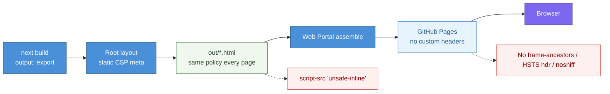
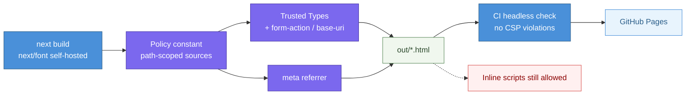
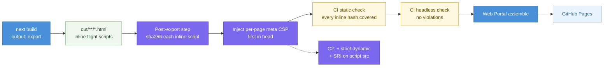
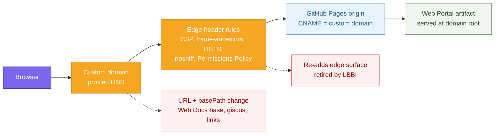

# DESIGN-20261121-UU4L: Security Header Delivery — Research

_Produced by the 🔍 Research phase. Owned by `@architect`. Do not edit after Evaluate phase begins._

## Context

This research covers Decision 2 from `00 Frame.md`: how CSP and the other header protections reach the browser when GitHub Pages cannot set response headers. It covers EC3 and part of EC9.

### Verified vs from knowledge

Facts below are split by source. **Verified** facts were checked in the repo or on the live site on 2026-11-21. **From knowledge** facts come from the architect's own knowledge (Next.js 15.x to early 16.x, CSP Level 3) and are not verified.

### Facts that bound every option

**Verified (repo or live site, 2026-11-21):**

- **Live headers.** `curl -I https://dataart.github.io/artisyn-implementation-harness/` returns `access-control-allow-origin: *` and `cache-control: max-age=600`. It returns no `Strict-Transport-Security`, `X-Frame-Options`, `X-Content-Type-Options`, `Referrer-Policy`, `Permissions-Policy` or COOP/CORP. `/docs/` returns the same set. Plain `http://` gets a 301 to `https://`.
- **Shared origin.** `https://dataart.github.io/` returns 404: there is no org user site and no inherited custom domain. Every DataArt project site shares the origin `dataart.github.io`. So a bare `'self'` in `script-src` trusts scripts from any DataArt Pages repo. A path-scoped source (`https://dataart.github.io/artisyn-implementation-harness/`) narrows this. Per the CSP spec, path matching is relaxed after a redirect.
- **Web Docs runs a weaker policy on the same origin.** Its policy is `script-src 'self' 'unsafe-inline' 'wasm-unsafe-eval' https://giscus.app` (`apps/web-docs/.vitepress/config.ts:26`). An XSS in Web Docs runs on the same origin and can reach Web Explorer's storage and pages. This caps how much a strict Web Explorer CSP adds on its own.
- **NFRs.** NFR-10 is about the giscus token. Its verification already accepts a meta CSP "minus `frame-ancestors`". No NFR covers Web Explorer's CSP yet.
- **Prior decision.** DESIGN-20261103-LBBI moved the site from CloudFront + S3 + Lambda@Edge (basic auth, CDK) to GitHub Pages. It did so to drop the AWS billing and ops surface, and because the site became public. Its Research OQ-2 explicitly accepted a meta CSP without `frame-ancestors` or reporting. NFR-1, -2, -4, -8 and -9 were retired with no replacement.
- **Dead code.** `scripts/ci/lambda-edge-deploy.sh` is not called by any project.json, workflow or script. It still holds an AWS SSM/Lambda deploy flow for the deleted `lambda-auth` app.
- **No test tooling.** The repo has no HTML-parsing or browser-test tooling (no Playwright, Puppeteer, cheerio, parse5, jsdom). `next` is not installed yet.
- **Web Explorer source.** It has no `<form>` and no frame-busting code. Its only third-party origins today are Google Fonts (`index.html:23-26`).

**From knowledge (not verified):**

- **Inline scripts per router.** App Router static export inlines a bootstrap plus several `self.__next_f.push([...])` RSC flight scripts per page. Pages with Suspense fallbacks may add `$RC`-style inline scripts. Pages Router inlines `__NEXT_DATA__` as `type="application/json"` (a data block CSP does not block) plus small bootstrap scripts. Content and hashes change every build and differ per page.
- **No nonces without a server.** The Next.js CSP guide says a static policy must use `'unsafe-inline'` or hashes. `experimental.sri` (webpack, App Router) adds `integrity` to `<script src>`. Turbopack (the Next 16 default) support is unknown.
- **Meta CSP limits.** In a `<meta>` CSP, `frame-ancestors`, `report-uri`/`report-to` and `sandbox` do nothing, and Report-Only cannot be sent. HSTS, `X-Frame-Options`, `X-Content-Type-Options`, `Permissions-Policy`, COOP, COEP and CORP are header-only. A meta policy governs only content parsed after it, so it must come before the first `<script>`.
- **What a meta can carry.** `<meta name="referrer">` (browsers default to `strict-origin-when-cross-origin` anyway), `require-trusted-types-for`/`trusted-types`, `upgrade-insecure-requests`, `form-action`, `base-uri`.
- **HSTS preload.** `github.io` is believed to be on the HSTS preload list with subdomains, so HTTPS holds in major browsers without the header.
- **JSON-LD.** `<script type="application/ld+json">` is not executed, so `script-src` does not block it. This is relevant to Decision 1 and NFR-7.

### Cross-cutting items (every option)

- **Google Fonts.** Keep them: `style-src`/`font-src` stay open to two Google hosts, and every visitor calls them. Or self-host with `next/font/google`: fonts are fetched at build time (CI needs network then) and served from `/_next/static/media`. The Google hosts leave the policy, and font preloading helps LCP/CLS.
- **Inline styles.** React `style={{}}` needs `style-src 'unsafe-inline'` or `'unsafe-hashes'`. Today's policy already allows `'unsafe-inline'` styles. Strict styles are a separate lever.
- **No CSP in local dev.** A meta injected after export never runs on `next dev`, which also needs eval. The CSP is exercised only on the exported build.
- **Clickjacking.** Only a header can stop it. A public read-only promo site with no auth, forms or state-changing actions has mainly UI-redress and brand-misuse exposure. A JS frame-buster (external file, CSP-safe) is a weak fallback.
- **CI checks for EC9.** Neither tool exists today.
  - (a) Static: parse each exported `.html`. Assert exactly one CSP meta before any `<script>`. Hash every inline executable script and assert each is in the page's policy.
  - (b) Browser: serve `out/` under the base path, load every route headless, and fail on any `securitypolicyviolation`.

## Options

### Option A — Minimal: keep today's meta policy, add `'unsafe-inline'` to scripts

**Description:** Keep today's directive set and change only what breaks: `script-src 'self' 'unsafe-inline'`, matching the Web Docs precedent. One constant policy string goes in every page's head, from the root layout or a small post-export step. Fonts, `connect-src` and the other directives stay unchanged. CI asserts every exported page carries the meta before its first script.

**Industry precedent:** Next.js CSP docs ("without nonces" / static rendering); Web Docs `config.ts`; DESIGN-20261103-LBBI Research OQ-2.

**Diagram:**

**Pros:**

- Smallest change, with precedent on the same origin (Web Docs, NFR-10 verification).
- Robust across Next versions and router choice. A page change never invalidates the policy.
- No post-processing coupled to build output. Nx caching is unaffected.

**Cons:**

- Script XSS protection is much weaker than today's `script-src 'self'`. An injected inline script runs.
- `'self'` still trusts every DataArt project site.
- No `frame-ancestors`, reporting, HSTS header, nosniff or `Permissions-Policy`.
- EC9's "covers every inline script" check becomes trivially true.

**Unknowns / risks:**

- Whether a meta written in the App Router root layout (React 19 head hoisting) always renders before Next's `<script>` tags. If not, post-export injection is needed.
- Whether this meets EC3's "defined and enforced", or needs an NFR that accepts the weaker policy.

---

### Option B — Relaxed scripts, plus every protection a meta tag can carry

**Description:** Scripts stay `'unsafe-inline'` as in A. Everything a meta can carry is tightened:

- Path-scoped `https://dataart.github.io/artisyn-implementation-harness/` instead of `'self'` for `script-src`, `connect-src` and `img-src`.
- `object-src 'none'`, `base-uri 'none'`, `form-action 'none'`, `upgrade-insecure-requests`.
- `require-trusted-types-for 'script'` and `trusted-types`.
- `<meta name="referrer" content="strict-origin-when-cross-origin">`.
- Fonts self-hosted through `next/font`.
- An external JS frame-buster.

CI runs check (b).

**Industry precedent:** OWASP Secure Headers Project and CSP Cheat Sheet; MDN `<meta name="referrer">`; W3C Trusted Types and web.dev "Prevent DOM-based XSS with Trusted Types"; Next.js `next/font` docs.

**Diagram:**

**Pros:**

- Closes the shared-origin gap in `'self'`.
- Trusted Types blocks DOM-XSS sinks even with inline scripts allowed.
- The policy is independent of build output.
- Removes the third-party font dependency and its privacy exposure.

**Cons:**

- Inline script injection is still allowed. This is weaker than any hash policy.
- Trusted Types may break React/Next internals or libraries, and browsers enforce it unevenly.
- Same header-only gaps as A.
- The frame-buster can be bypassed (for example with a sandboxed iframe).

**Unknowns / risks:**

- Whether the Next runtime, React 19 and the 7 browser-API files pass Trusted Types. Needs a spike.
- Trusted Types support beyond Chromium (check MDN).
- How path-scoped sources behave with `_next/` URLs and redirects.

---

### Option C — Per-page meta CSP with build-time SHA-256 hashes

**Description:** A step after `next build` (an Nx target, or inside `web-explorer-build.sh`) parses every exported HTML file. It hashes each inline executable script, skipping data blocks such as `application/json` and `ld+json`. It injects a per-page CSP meta as the first child of `<head>`. CI runs check (a) as the EC9 gate and (b) as backup. B's meta hardening can be layered on.

Two variants:

- **C1 — hashes plus a path-scoped host source:** `script-src 'sha256-…' … https://dataart.github.io/artisyn-implementation-harness/_next/`. External chunks load through the path source. Inline scripts need a hash.
- **C2 — hashes plus `'strict-dynamic'`:** scripts loaded by trusted scripts are allowed, and host and `'self'` sources are ignored. So the HTML's own `<script src>` tags must also be trusted: a hash plus `integrity` through `experimental.sri`, or a single hashed inline loader.

**Industry precedent:** web.dev "Mitigate XSS with a strict CSP" (hash-based, static sites); W3C CSP Level 3 (hash-source, `strict-dynamic`, meta limits); GoogleChromeLabs `strict-csp` / `strict-csp-html-webpack-plugin`; Astro 5.9 `experimental.csp`; Next.js CSP docs on `experimental.sri`. `next-safe` targets headers, so it does not fit.

**Diagram:**

**Pros:**

- The strongest script policy a static host allows. Injected inline scripts are blocked.
- Matches web.dev strict-CSP guidance and EC9's wording.
- No hosting change.
- Hashes are computed from the actual output, so they cannot drift if the step always runs after build.

**Cons:**

- A new build step coupled to Next's output format. A Next upgrade can change the shape or count of inline scripts.
- The policy differs per page and per build.
- The meta grows with flight chunks (a few KB per page).
- C2 depends on `experimental.sri` (webpack-only as far as known) and on uneven browser support for hash-matching external scripts with `integrity`.
- Same header-only gaps as A.
- Web Docs on the same origin keeps `'unsafe-inline'`, which limits the real gain.

**Unknowns / risks:**

- How many inline scripts each page has for the chosen router, and whether client navigation adds any at runtime. App Router soft navigation fetches `.txt` RSC payloads through `connect-src` and is believed to add none.
- Next 16/Turbopack support for `experimental.sri` (C2).
- Whether post-processing affects Nx caching or the Web Portal copy.
- A new HTML parser dependency is needed.

---

### Option D — Edge layer in front of GitHub Pages that adds real headers

**Description:** A header-capable proxy sits in front of Pages, and Pages stays the origin. The script policy itself still needs A, B or C. Static header rules are configuration. A Worker or Lambda@Edge that rewrites HTML for per-request nonces would be request-time compute, which the Frame puts out of scope.

Two variants:

- **D1 — Cloudflare proxy on a custom domain:** DNS on Cloudflare, proxied, plus a Pages custom domain (`CNAME`). Response Header Transform Rules add CSP, `frame-ancestors`, HSTS, `X-Content-Type-Options: nosniff`, `Permissions-Policy`, COOP/CORP and `report-to`.
- **D2 — re-create CloudFront with a ResponseHeadersPolicy:** the retired stack.

**Industry precedent:** GitHub Docs "Managing a custom domain for your GitHub Pages site"; Cloudflare Docs "Response Header Transform Rules"; OWASP Secure Headers Project; this repo's retired CloudFront ResponseHeadersPolicy (LBBI).

**Diagram:**

**Pros:**

- The only option that delivers `frame-ancestors`, HSTS, nosniff, `Permissions-Policy`, COOP/CORP and violation reporting.
- A Report-Only rollout is possible.
- Applies to Web Docs too.

**Cons:**

- Changes the public URL. Cloudflare cannot proxy `*.github.io`, and a custom domain on a project site serves from the domain root. So the Next `basePath`, the Web Docs base, canonical URLs (Decision 1), giscus path mapping and existing shared links all change. Web Docs changes are out of scope.
- Re-adds a third-party account, DNS ownership and configuration outside the repo. This reverses LBBI's retirement of the edge and infra surface, and conflicts in spirit with the developer's request to keep hosting on GitHub Pages.
- D2 brings back AWS billing, CDK and OIDC.
- GitHub's certificate issuance behind a proxied record needs care.

**Unknowns / risks:**

- Whether a custom domain is available and wanted. LBBI OQ-1 never resolved in its favour.
- Who owns the Cloudflare account, and whether the header configuration lives in the repo as code.
- GitHub redirecting the `github.io` URL to the custom domain is believed to close the unprotected bypass. Not verified.

---

## Protection coverage by option

Only Option D delivers header-only protections. Only Option C blocks injected inline scripts.

| Protection                                                | A                                              | B                    | C        | D                               |
| --------------------------------------------------------- | ---------------------------------------------- | -------------------- | -------- | ------------------------------- |
| Strict inline-script blocking                             | no                                             | no                   | yes      | depends on A/B/C                |
| Trusted Types                                             | optional                                       | yes                  | optional | optional                        |
| `frame-ancestors` / `X-Frame-Options`                     | no                                             | JS frame-buster only | no       | yes                             |
| HSTS header                                               | no (relies on `github.io` preload, unverified) | same                 | same     | yes                             |
| `X-Content-Type-Options`, `Permissions-Policy`, COOP/CORP | no                                             | no                   | no       | yes                             |
| Violation reporting / Report-Only                         | no                                             | no                   | no       | yes                             |
| Referrer-Policy                                           | meta or browser default                        | meta                 | meta     | header                          |
| Hosting/URL change                                        | none                                           | none                 | none     | custom domain, base path change |

## Open Questions

_V/E tiers are proposed at Research and confirmed at the Research sign-off._

| #    | Question                                                                                                                                                                                                                                | V/E | Why this tier                                                                                   | Owner                          |
| ---- | --------------------------------------------------------------------------------------------------------------------------------------------------------------------------------------------------------------------------------------- | --- | ----------------------------------------------------------------------------------------------- | ------------------------------ |
| OQ-1 | Is a custom domain available and wanted? Without it D is not feasible, and D also changes Web Docs (out of scope).                                                                                                                      | (V) | The answer removes or keeps Option D.                                                           | Developer / DataArt org        |
| OQ-2 | Policy floor for EC3: must script protection be strictly stronger than Web Docs' `'unsafe-inline'`, or is same-origin parity acceptable given Web Docs already caps origin-wide protection? Should a new NFR record the accepted level? | (V) | A stronger floor removes Options A and B.                                                       | Developer                      |
| OQ-3 | Is clickjacking an accepted risk for a read-only public promo site (as LBBI accepted for docs), or a requirement?                                                                                                                       | (V) | A hard requirement leaves only Option D.                                                        | Developer                      |
| OQ-4 | Which inline scripts does the Decision 1 router emit, how many per page, and are they stable across builds? Needs a spike build.                                                                                                        | (E) | Sizes Option C's build step; does not remove any option.                                        | `@architect`, after Decision 1 |
| OQ-5 | Are Trusted Types compatible with Next.js, React 19 and the app's browser-API code? Needs a spike.                                                                                                                                      | (E) | Decides whether B or C adds the Trusted Types layer; the core of each option stands either way. | Implementation spike           |
| OQ-6 | Is build-time network access to Google Fonts acceptable in `deploy-web.yml` for `next/font`, or must font files be vendored?                                                                                                            | (E) | Affects font delivery detail, not which option is viable.                                       | Developer                      |
| OQ-7 | Is a headless browser (Playwright) acceptable in CI for EC9's browser check, plus an HTML parser dependency for the static check?                                                                                                       | (E) | Affects CI cost and tooling; every option can use the static check alone.                       | Developer                      |
| OQ-8 | Remove dead `scripts/ci/lambda-edge-deploy.sh` in this change, or track it separately?                                                                                                                                                  | (E) | Housekeeping; dead whichever option wins.                                                       | Developer                      |
