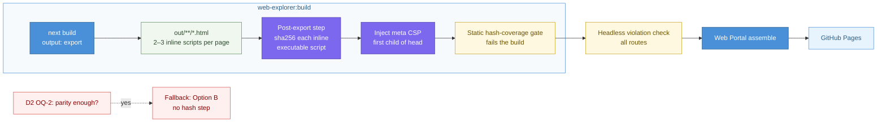

# DESIGN-20261121-UU4L: Security Header Delivery — Evaluate

**Viability status (2026-11-22):**

| Item                   | Status                                                                                                                   |
| ---------------------- | ------------------------------------------------------------------------------------------------------------------------ |
| Option D               | **Not viable.** No custom domain is available (D2 OQ-1, developer, 2026-11-22). It stays in the matrix for completeness. |
| Clickjacking           | Accepted risk (D2 OQ-3).                                                                                                 |
| Policy floor (D2 OQ-2) | Not yet answered. Options A and B are **conditional** on it.                                                             |

_Produced by the 🏗 Evaluate phase. This is the judgment artifact for Decision 2. Options come from `01 Research - Security Header Delivery.md`; criteria come from `00 Frame.md`. The sibling decision is `02 Evaluate - Rendering, Routing and Page Metadata.md`, whose Option B sets the inline-script input. The WAF assessment is repeated in `design/Report.md`._

## Requirements × Options Matrix

Only Option C keeps today's script-injection protection on a static host.

Rows = evaluation criteria from `design/00 Frame.md`. Columns = options from `design/01 Research - Security Header Delivery.md`.
✅ satisfies · ⚠️ partially (see note) · ❌ does not satisfy

| Requirement                                                                                      | A Minimal, `'unsafe-inline'` (conditional: D2 OQ-2) | B Relaxed scripts + meta hardening (conditional: D2 OQ-2) | C Per-page meta CSP with build-time hashes                             | D Edge layer (not viable: D2 OQ-1) |
| ------------------------------------------------------------------------------------------------ | --------------------------------------------------- | --------------------------------------------------------- | ---------------------------------------------------------------------- | ---------------------------------- |
| R1 EC3 policy defined and enforced on every page                                                 | ⚠️ defined, but weaker than today                   | ⚠️ defined; scripts weaker than today                     | ✅                                                                     | ❌ not viable                      |
| R2 Script-injection protection vs today's `script-src 'self'`                                    | ❌ regresses to `'unsafe-inline'`                   | ⚠️ regresses; Trusted Types only covers DOM sinks         | ✅ parity: injected inline scripts blocked                             | — depends on A/B/C                 |
| R3 Shared-origin gap (`'self'` = all DataArt Pages sites)                                        | ❌                                                  | ✅ path-scoped sources                                    | ✅ path-scoped host source (C1)                                        | —                                  |
| R4 Header-only protections (frame-ancestors, HSTS, nosniff, Permissions-Policy, reporting)       | ❌                                                  | ❌ JS frame-buster only                                   | ❌                                                                     | ✅ but not viable                  |
| R5 EC9 meaningful CI check                                                                       | ⚠️ trivially true                                   | ✅ headless violation check                               | ✅ static hash-coverage gate + headless backup                         | ✅                                 |
| R6 Fit with Decision 1 Option B (2–3 inline scripts per page, hashes change per build, verified) | ✅                                                  | ✅                                                        | ✅ deterministic per build, 2–3 hashes per page                        | ✅                                 |
| R7 EC11 GitHub Pages limits / no custom headers                                                  | ✅                                                  | ✅                                                        | ✅                                                                     | ❌ needs custom domain             |
| R8 Build coupling                                                                                | ✅ none                                             | ✅ none                                                   | ⚠️ post-export step tied to Next's HTML output; guarded by the CI gate | ⚠️ external config                 |
| R9 EC10 revertable                                                                               | ✅                                                  | ✅                                                        | ✅                                                                     | ✅                                 |

## Tradeoffs

WAF pillars plus Integration Complexity and Vendor Lock-in.

| Dimension              | A Minimal                | B Relaxed scripts + meta hardening                        | C Per-page meta CSP with hashes                           | D Edge layer                                |
| ---------------------- | ------------------------ | --------------------------------------------------------- | --------------------------------------------------------- | ------------------------------------------- |
| Operational Excellence | ✅ trivial               | ✅ policy constant                                        | ⚠️ one post-export step to maintain                       | ❌ external account and DNS                 |
| Security               | ❌ script XSS regression | ⚠️ regression mitigated by Trusted Types and path scoping | ✅ strongest policy a static host allows                  | ✅ full header set                          |
| Reliability            | ✅ nothing to break      | ⚠️ Trusted Types may break React/Next internals (D2 OQ-5) | ⚠️ a missed hash breaks interactivity → CI gate mandatory | ⚠️ extra hop                                |
| Performance Efficiency | ✅                       | ✅ self-hosted fonts help LCP                             | ✅ adds ~0.5 KB of meta per page                          | ✅                                          |
| Cost Optimization      | ✅                       | ✅                                                        | ✅                                                        | ⚠️ third-party plan                         |
| Sustainability         | ✅                       | ✅                                                        | ✅                                                        | ✅                                          |
| Integration Complexity | ✅                       | ⚠️ Trusted Types spike needed                             | ⚠️ HTML parser dependency                                 | ❌ URL and base-path change across the site |
| Vendor Lock-in         | ✅                       | ✅                                                        | ✅ standard CSP3                                          | ❌ edge vendor                              |

## Recommendation

**Recommended option: Option C1 — per-page `<meta>` CSP with build-time SHA-256 hashes plus a path-scoped host source, layered with Option B's meta-deliverable hardening except Trusted Types.**

After `next build`, a post-export step hashes every inline executable script in each `out/**/*.html`. It skips `application/json` and `ld+json` data blocks. It injects one `<meta http-equiv="Content-Security-Policy">` as the first child of `<head>`.

**Policy delivered in every exported page:**

| Directive / tag                           | Value                                                                                        |
| ----------------------------------------- | -------------------------------------------------------------------------------------------- |
| `script-src`                              | `'sha256-…'` per inline script + `https://dataart.github.io/artisyn-implementation-harness/` |
| `connect-src`, `img-src`                  | Path-scoped the same way                                                                     |
| `style-src`                               | `'self' 'unsafe-inline'` (React inline styles; unchanged from today)                         |
| `font-src`                                | `'self'` only; fonts self-hosted via `next/font`                                             |
| `object-src` / `base-uri` / `form-action` | `'none'` / `'none'` / `'none'`                                                               |
| `upgrade-insecure-requests`               | Set                                                                                          |
| `<meta name="referrer">`                  | `strict-origin-when-cross-origin`                                                            |
| `'strict-dynamic'` (C2)                   | Not used: it depends on `experimental.sri`, which is webpack-only and uncertain              |
| Trusted Types                             | Deferred to a later spike (D2 OQ-5)                                                          |

**Why:** it is the only viable option that keeps today's script-injection protection. The spike shows the cost is small and deterministic: 2–3 hashes per page, recomputed every build. It closes the shared-origin gap. It needs no hosting change, so it respects EC11.

**Accepted trade-offs and risks:**

| #   | Trade-off or risk                                                                  | Basis                                                        |
| --- | ---------------------------------------------------------------------------------- | ------------------------------------------------------------ |
| 1   | No `frame-ancestors`, HSTS header, nosniff, Permissions-Policy or reporting        | Header-only on GitHub Pages; clickjacking accepted (D2 OQ-3) |
| 2   | Web Docs shares the origin with `'unsafe-inline'`, which caps the origin-wide gain | Web Docs is out of scope                                     |
| 3   | A post-export step coupled to Next's output format                                 | Guarded by the CI hash-coverage gate                         |

**Why not the others:**

- **A:** regresses script protection to `'unsafe-inline'` and keeps the shared-origin gap.
- **B:** also regresses scripts. Its useful parts are folded into the recommendation.
- **D:** not viable without a custom domain.

**Conditional:** if the developer decides parity with Web Docs is enough (D2 OQ-2), fall back to Option B without the hash step. The rest of the hardening stays.

**Falsifiable assumption:** Next's static export keeps its executable inline scripts in the HTML. Client navigation adds none at runtime; it fetches `.txt` RSC payloads via `connect-src`. If the headless CI check finds runtime violations, revisit.

**Open questions to resolve before implementation:**

| #       | Question                                                                             | Owner       | Impact if unresolved                                       |
| ------- | ------------------------------------------------------------------------------------ | ----------- | ---------------------------------------------------------- |
| D2 OQ-2 | Policy floor: strict, or parity with Web Docs?                                       | Developer   | Selects C1 vs the B fallback; confirm at Evaluate sign-off |
| D2 OQ-6 | Build-time network access to Google Fonts for `next/font`, or vendor the font files? | Developer   | Font delivery; CSP `font-src`                              |
| D2 OQ-7 | Playwright in CI for the headless check, plus an HTML parser dependency              | Developer   | EC9 depth                                                  |
| D2 OQ-5 | Trusted Types compatibility                                                          | Later spike | Not in this scope                                          |
| D2 OQ-8 | Remove dead `scripts/ci/lambda-edge-deploy.sh`                                       | Developer   | Housekeeping                                               |

## WAF Assessment (recommended option)

Closing assessment of Option C1 plus meta-deliverable hardening.

| Pillar                 | Rating | Strengths                                                                                          | Gaps                                                                   | Recommendations                                                                                                                                                             |
| ---------------------- | ------ | -------------------------------------------------------------------------------------------------- | ---------------------------------------------------------------------- | --------------------------------------------------------------------------------------------------------------------------------------------------------------------------- |
| Operational Excellence | 🟡     | Policy generated from real output, never hand-edited                                               | A post-export step to maintain across Next upgrades                    | P2: pin the Next minor version and re-run the CI gate on every upgrade                                                                                                      |
| Security               | 🟡     | Strongest script policy possible on a static host; path-scoped sources close the shared-origin gap | No header-only protections; Web Docs' weaker policy on the same origin | P1: the CI hash-coverage gate must fail the build; P2: record the accepted level and accepted risks in a new CSP NFR; P3: harden Web Docs' policy separately (out of scope) |
| Reliability            | 🟡     | Hashes recomputed every build, cannot drift                                                        | A missed or stale hash silently disables interactivity on that page    | P1: static coverage gate in `web-explorer:build`; P2: headless violation check across all routes                                                                            |
| Performance Efficiency | 🟢     | ~0.5 KB of meta per page; self-hosted fonts improve LCP/CLS                                        | None                                                                   | —                                                                                                                                                                           |
| Cost Optimization      | 🟢     | No new services                                                                                    | One dev dependency (HTML parser)                                       | —                                                                                                                                                                           |
| Sustainability         | 🟢     | No extra runtime work                                                                              | None                                                                   | —                                                                                                                                                                           |

**P1 items (resolve before implementation):**

1. CI hash-coverage gate fails the build on any uncovered inline script.
2. Policy floor (D2 OQ-2) confirmed by the developer.
