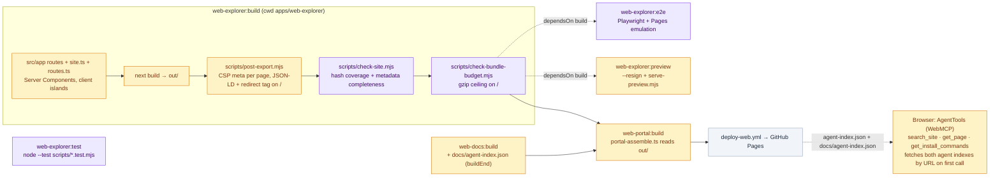

# DESIGN-20261121-UU4L: Web Explorer Next.js Static Export — Plan

| Field   | Value                                                         |
| ------- | ------------------------------------------------------------- |
| Ticket  | DESIGN-20261121-UU4L                                          |
| Intent  | [0-intent.md](0-intent.md)                                    |
| Branch  | `docs/design-20261121-uu4l-web-explorer-nextjs-static-export` |
| Created | 2026-11-22                                                    |

## Solution

Build the approved design exactly as written. The spec is [Architecture](../solution/Architecture.md) (decisions D1–D23), the two Design files, [Stack](../solution/Stack.md) and [Efforts](../solution/Efforts.md).

- **What changes:** `apps/web-explorer` becomes a Next.js 16.4.x App Router app with `output: 'export'`. Server Components are the default; client islands are used only where the design's boundary table lists them. A post-export step signs every page with its own hashed CSP. Three gates run inside `web-explorer:build`. A Playwright `e2e` target emulates GitHub Pages.
- **Containers touched:**
  - Web Explorer: the main change.
  - Web Portal: its input path and assertions.
  - Web Docs: only a generated `docs/agent-index.json` from its existing `buildEnd` hook, for the WebMCP search (developer, 2026-11-22). Its pages and CSP are unchanged.
  - `ci-web.yml` and `deploy-web.yml` change only as the design lists, plus the two env lines.
  - Discuss is untouched.
- **Reused:** the existing content components in `src/components`, `src/charts` and `src/pages/*`; Tailwind 4; the Nx project and target names; Web Portal's composition role; `deploy-web.yml`'s upload path.

Planning decisions:

- **Branch:** all work lands on the design branch. D18 and Efforts name `feat/web-explorer-nextjs`; the developer chose this branch at Context sign-off. It still merges to `main` once.
- **Unit 8 joins this branch** (developer, Context sign-off). It is the last step.
- **Tests first:** the Playwright specs (Efforts unit 7's content) and `node:test` cases for the build scripts are written in Step 1. The CI wiring stays late, in Step 25.
- **New `test` target:** a `web-explorer:test` target (`node --test scripts/*.test.mjs src/agent/*.test.mjs`, `cwd` `apps/web-explorer`) is added so that ci-web's existing "Test (affected)" step runs the script tests. The design names no `test` target; this adds one and changes no decision. `/dev document` adds it to the HLD target list, the LLD and the README.
- **Script cases start as `todo`:** ci-web's "Test (affected)" step runs before "Build (affected)", and the draft PR opens at Step 6. So a Step 1 case for a script that does not exist yet is marked `{ todo: 'Step N' }`. It runs and reports, but it does not fail the run. The step that writes the script removes the `todo` flag (RF-002).
- **Lint and typecheck scope widen to the new files:** `tsconfig.json` `include` adds `e2e` and `playwright.config.ts`, and `lint` becomes `eslint src scripts e2e playwright.config.ts`. Otherwise the new test and build-script files would never be linted or type-checked (RF-013).
- **Agent readiness and SEO (developer request at the plan sign-off, 2026-11-22):** the developer asked to include Lighthouse's Agentic Browsing category ([scoring](https://developer.chrome.com/docs/lighthouse/agentic-browsing/scoring)) together with the per-page SEO tags. Read from the Lighthouse source (`core/config/default-config.js`, `core/audits/agentic/*`, `core/audits/webmcp-*`; category `agentic-browsing`, in the default config since 13.3.0, fraction score, each audit weight 1), this adds three things:
  - `out/llms.txt` with a build gate (Step 13)
  - accessibility-tree fixes, an e2e axe check on Lighthouse's exact 33 agent rules, and Lighthouse `seo` + `agentic-browsing` runs on all 16 pages (Step 24)
  - the same categories in the before and after Lighthouse runs (Steps 2 and 26)
- **What is not adopted, and why:**
  - **Root `llms.txt`, `/.well-known/ard.json`, `robots.txt` `Agentmap`:** Lighthouse's `llms-txt` and `ard-schema` audits request `new URL('/llms.txt', page)` and `new URL('/.well-known/ard.json', page)`, which is the origin root `https://dataart.github.io/`. This repo cannot publish there, the same limit as `robots.txt` in D3. A 4xx there is "not applicable", not a fail. Our `llms.txt` lives under the base path, where the llmstxt.org proposal allows it, for agents that look there.
  - **An Agentic Resource Discovery manifest advertised with `<link rel="ard">`:** not adopted. Such a manifest lists agent resources (`urn:air:` identifiers, media types), and this site publishes none. An advertised but thin manifest would score 0 or 0.9 instead of not applicable.
  - **The `@webmcp/next` SDK (web-mcp.net):** not adopted. It is a third-party wrapper over the native WebMCP API (it names `navigator.modelContext`; Chrome's docs name `document.modelContext`, and the in-repo wrapper supports both), by its own description. Its version, maintainer and source could not be read (npm page 403, GitHub 404). Its provider has an optional analytics `siteId` with an unstated transport. Its tool examples call server API routes and Server Actions, which do not exist under `output: 'export'`. A small in-repo wrapper (Step 21) gives the same `registerTool` behaviour with no supply-chain or CSP unknowns.
- **WebMCP tools (developer request, 2026-11-22, "content exposure or search articles tool"; Web Docs search and the install tool confirmed by the developer the same day):** three read-only tools, `search_site`, `get_page` and `get_install_commands`, registered site-wide by a client component in the root layout (Steps 21–22).
  - They answer from the static indexes and `commands.ts`, so nothing runs on a server.
  - The index is fetched from `<site>/` only when a tool is first called, so the CSP is unchanged and no page pays for it on load.
  - WebMCP is experimental. Chrome exposes it behind a flag or a WebMCP origin-trial token, which the post-export step injects as a meta tag when `WEBMCP_ORIGIN_TRIAL_TOKEN` is set. Where it is not supported, the tools are simply not registered.
  - **Search covers Web Explorer pages and Web Docs articles without coupling the builds.** Each container publishes its own index with the same shape: `agent-index.json` (Step 18) and `docs/agent-index.json` (Step 19). The tools fetch both at runtime by public URL, as the Docs link already works, so neither build reads the other's output. Web Portal asserts both when it assembles the site (Step 20).
  - `get_install_commands` reuses the `/get-started` matrix in `commands.ts`, so the page and the tool cannot drift.
- **Lighthouse baseline first:** the "before" measurement (D13, unit 7 evidence) runs on the Vite build in Step 2, because Step 3 replaces the build.
- **Order follows Efforts:**
  - unit 1 is Steps 3–6
  - unit 2 is Step 7
  - unit 3 is Steps 8–9
  - unit 4 is Step 10
  - unit 5 is Steps 11–14, with Step 13 (`llms.txt`) added
  - unit 6 is Steps 15–17, followed by the added Steps 18–22 (agent indexes, Web Portal index check, WebMCP tools)
  - unit 7 is Steps 23–26, with Step 24 (agent readiness) added
  - unit 8 is Step 27
- **Scripts read the TypeScript sources:** `post-export.mjs` and `check-site.mjs` import `src/site.ts`, `src/routes.ts` and `src/env.ts` directly (and `src/agent/tools.test.mjs` imports `src/agent/tools.ts` and `pages/get-started/commands.ts`), using Node 24's built-in type stripping. Those modules use only erasable TypeScript syntax, have no path aliases, and import each other with `.ts` extensions (`allowImportingTsExtensions` is already on). So the base path, origin, registry and repository URL default each have one source, with no JSON copy (RF-007).
- **Open design questions D1 OQ-7 and OQ-8** (exact `next` patch, Tailwind PostCSS setup, `basePath` on icons and ``) are settled in Steps 3–4 and recorded in Implementation Notes.

## Acceptance Criteria

- [ ] `AC-1` — `yarn nx run web-explorer:build` passes. `out/` holds one `index.html` per route-registry entry (16 routes: `/`, the hub, 10 `inside-the-loop/<slug>/`, `get-started/`, `docs-flow/`, `dogfood/`, `comic/`), plus `404.html`, `sitemap.xml`, `llms.txt`, `.nojekyll` and `_next/`.
- [ ] `AC-2` — The metadata-completeness gate in `check-site.mjs` passes on every registry page (full set) and on `404.html` (title, description, referrer, `noindex`). A spot check of `out/get-started/index.html` shows:
  - title `Get started — Artisyn`
  - its own description
  - canonical `https://dataart.github.io/artisyn-implementation-harness/get-started/`
  - `og:title`, `og:description`, `og:url`, and an absolute `og:image` whose file exists in `out/`
  - `twitter:card` `summary_large_image`
  - `meta name="referrer"` `strict-origin-when-cross-origin`, which the gate checks on every page
- [ ] `AC-3` — `out/comic/index.html` has `<meta name="robots" content="noindex">`. `out/sitemap.xml` lists exactly the 15 indexable routes as absolute trailing-slash URLs, without `/comic/`. No `robots.txt` is emitted.
- [ ] `AC-4` — Every `out/**/*.html` has exactly one CSP meta tag, placed right after `<meta charset>` and before any `<script>`, with the D11 directive list. The hash-coverage gate passes, and `out/` references no external script, style, font or image URL.
- [ ] `AC-5` — `out/index.html` carries a JSON-LD block that parses as JSON (`WebSite` + `SoftwareSourceCode`); `check-site.mjs` asserts the parse in every build. It also carries a `<script src=".../legacy-hash-redirect.js">` tag. No other page carries either.
- [ ] `AC-6` — In `web-explorer:e2e`, old `#/get-started?channel=…&provider=…` and `#/inside-the-loop/<slug>` links land on the path URLs with the query kept, and `#how-it-works` stays a same-page anchor.
- [ ] `AC-7` — In `web-explorer:e2e`, a configured `/get-started/?channel=…&provider=…` link shows its selection. The pre-rendered `out/get-started/index.html` contains the default selection's full commands.
- [ ] `AC-8` — In `web-explorer:e2e`:
  - a header `next/link` click fetches the route's RSC `.txt` payload with status 200 and does not reload the document
  - header anchor links scroll to their section on `/` and from one other page
- [ ] `AC-9` — In `web-explorer:e2e`:
  - every registry route and the 404 page load with zero `securitypolicyviolation` events, no "Refused to" console message, no console error and no hydration error
  - `/no-such-page/` and a `/docs/` miss get the root `404.html` with status 404, with a Home link and a Docs link
- [ ] `AC-10` — `check-bundle-budget.mjs` sums the gzip size of the JS and CSS that `out/index.html` references, and fails the build above its ceiling (≤ 300 KB, confirmed or tightened from the first measurement). The measured value and the final ceiling are recorded in Implementation Notes.
- [ ] `AC-11` — Lighthouse (mobile, simulated throttling) LCP, CLS and TBT are recorded before (Vite) and after (Next) on `/`, `/get-started/` and `/inside-the-loop/context/` in Implementation Notes. Any metric that got worse is listed with a decision.
- [ ] `AC-12` — `yarn nx run web-portal:build` passes and `apps/web-portal/dist/` holds `index.html`, `404.html`, `.nojekyll` and `docs/index.html`. `portal-assemble.ts` also asserts both agent indexes (Step 20), and fails when `out/docs` exists before the copy (checked with a temporary directory) and fails above its size limit (checked with `PORTAL_MAX_BYTES=1`). The published size is recorded.
- [ ] `AC-13` — `web-explorer:preview` serves `http://localhost:4173/artisyn-implementation-harness/` with a re-signed policy that has no `upgrade-insecure-requests`. `/` loads with no CSP violation. A missing path returns the root `404.html` with status 404. `out/` is unchanged by the preview (checksums before and after).
- [ ] `AC-14` — `yarn nx run web-explorer:dev` serves `/` and `/get-started/` locally.
- [ ] `AC-15` — The Nx targets `build`, `typecheck`, `lint`, `serve`, `dev` and `preview` keep their names, and `e2e` and `test` are added. `web-explorer:typecheck`, `web-explorer:lint` and `web-explorer:test` pass. `git status` is clean after `build` and `typecheck`.
- [ ] `AC-16` — NFR-7: `git grep -nE "dangerouslySetInnerHTML|<script" apps/web-explorer/src` returns nothing.
- [ ] `AC-17` — Removed: `git grep -nE "react-router-dom|from 'vite'|@vitejs|@tailwindcss/vite|web-explorer-build.sh|lambda-edge-deploy" -- apps scripts .github` returns nothing, and `scripts/ci/lambda-edge-deploy.sh`, `scripts/ci/check-bundle-budget.mjs`, `src/main.tsx`, `index.html` and `vite.config.ts` are gone.
- [ ] `AC-18` — No Google font hosts: `grep -r "fonts.googleapis\|fonts.gstatic" apps/web-explorer/out apps/web-explorer/src` returns nothing. Inter and DM Sans `woff2` files and their SIL OFL licence files are committed under `src/fonts/`.
- [ ] `AC-19` — Search Console verification:
  - With `NEXT_PUBLIC_GOOGLE_SITE_VERIFICATION=test-token`, every page carries `<meta name="google-site-verification" content="test-token">`. With the variable unset, no page carries it.
  - `deploy-web.yml` and `ci-web.yml` pass the variable to their build step.
  - `web-explorer:build` lists it as an env input.
- [ ] `AC-20` — `ci-web.yml` has an "E2E (affected)" step after "Build (affected)". It installs Chromium only when `web-explorer` is affected, and caches browsers keyed on the Playwright version. The ci-web run on the branch's PR is green.
- [ ] `AC-22` — Agent accessibility: in `web-explorer:e2e`, the axe check limited to the 33 rules of Lighthouse's `agent-accessibility-tree` audit finds no violation on any registry route or the 404 page. Lighthouse's `agent-accessibility-tree` audit passes on all 16 routes.
- [ ] `AC-23` — Lighthouse 13.4.1 (Chrome 150+) on all 16 routes, through preview:
  - every `seo` audit passes or is not applicable, except `is-crawlable` on `/comic/` (intentional `noindex`)
  - in `agentic-browsing`, `agent-accessibility-tree` and `cumulative-layout-shift` pass, and no audit fails
  - with WebMCP enabled in that Chrome, `webmcp-registered-tools` lists `search_site`, `get_page` and `get_install_commands`, and `webmcp-schema-validity` passes
  - `llms-txt`, `ard-schema` and `webmcp-form-coverage` are not applicable, with the reasons recorded in Implementation Notes
  - the before (Vite) and after results are recorded per page
- [ ] `AC-24` — `out/llms.txt` exists and the build gate checks it:
  - an H1, a summary, an absolute link with a description for each of the 15 indexable routes, links to Docs and the repository, and no `/comic/`
  - it satisfies Lighthouse's `llms-txt` rules: H1, at least one Markdown link, at least 50 characters
  - it is served at `https://dataart.github.io/artisyn-implementation-harness/llms.txt`
- [ ] `AC-25` — Agent indexes, both checked by gates:
  - `out/agent-index.json` is valid JSON with one entry per indexable route (15, without `/comic/`), each with non-empty `title` and `text`, and it is at most 1 MB
  - Web Docs' `docs/agent-index.json` has one entry per built page except `404.html`, follows the same contract, and is at most 5 MB
  - Web Portal fails without either index
- [ ] `AC-26` — WebMCP tools:
  - in `web-explorer:e2e`, with a stub on `document.modelContext` and, in a second run, on `navigator.modelContext`, every registry route registers `search_site`, `get_page` and `get_install_commands` exactly once, all `readOnlyHint: true`
  - `search_site({ query: 'context' })` returns `/inside-the-loop/context/`
  - `search_site` with `source: 'docs'` returns the docs fixture entry
  - `get_page({ path: '/get-started/' })` returns its title and text
  - `get_install_commands({ channel: 'zip', provider: 'claude' })` returns the same blocks as `commands.ts`
  - the unit cases reject invalid input, and search falls back to site-only results (`docsAvailable: false`) when the docs index cannot load
  - there is no CSP violation, and no index request before a tool is called
  - one live check in a flag-enabled Chrome 150+ lists the three tools and runs `search_site`
- [ ] `AC-27` — `WEBMCP_ORIGIN_TRIAL_TOKEN`:
  - set: every page carries `<meta http-equiv="origin-trial">` right after the CSP meta; unset: no page does
  - it is a `web-explorer:build` env input, and both workflows pass it to their build step
- [ ] `AC-21` — Out of scope stays untouched:
  - `git diff main --stat -- apps/web-docs` shows only `.vitepress/config.ts`, `.vitepress/utils/agent-index.ts` and `package.json`
  - apart from its two env lines (`NEXT_PUBLIC_GOOGLE_SITE_VERIFICATION`, `WEBMCP_ORIGIN_TRIAL_TOKEN`), `deploy-web.yml` is unchanged (`git diff main -- .github/workflows/deploy-web.yml`)

## Dependencies

- The developer runs `git push` and opens the draft PR from this branch to `main` after Step 6 (guarded command). Step 25 needs that PR's ci-web run.
- Network access for `yarn install` (new packages), the Playwright Chromium download, the `woff2` font files and `yarn dlx lighthouse@13.4.1`.
- Chrome 150 or later on the developer machine, for the `agentic-browsing` category (Steps 2, 24 and 26), with WebMCP enabled by flag for Step 24's WebMCP audits.
- Not a blocker: the repo owner registers `https://dataart.github.io` for Chrome's WebMCP origin trial and sets `WEBMCP_ORIGIN_TRIAL_TOKEN` in the `web` environment, after merge. Without it, the tools register only in browsers with WebMCP enabled by flag.

## Steps

All commands run from the repo root with `export PATH=/Users/anton/.nvm/versions/node/v24.19.0/bin:$PATH` first.

### Step 1 — Tests: browser checks and build-script cases (red)

**Changes:**

- `apps/web-explorer/package.json` — dev dependencies `@playwright/test`, `@axe-core/playwright` and `parse5`; Playwright's Chromium is installed locally.
- `apps/web-explorer/playwright.config.ts` — Chromium only; `baseURL` `https://dataart.github.io/artisyn-implementation-harness/`.
- `apps/web-explorer/e2e/pages-emulation.ts` — a `page.route` fixture that serves `out/` with the GitHub Pages rules:
  - `dir/` serves `dir/index.html`
  - `/dir` without a slash answers 301 to `/dir/`
  - unknown paths, including `/docs/*`, get the root `404.html` with status 404
  - content types as in the design
  - the `securitypolicyviolation` listener goes in through `page.addInitScript`, and "Refused to" and error console messages are collected
- `apps/web-explorer/e2e/*.spec.ts` — browser cases:
  - AC-9: every registry route plus 404, no violations or console or hydration errors, `/no-such-page/` and a `/docs/` miss
  - AC-6: legacy hash links
  - AC-7: configured `/get-started/` link
  - AC-8: `next/link` RSC payload fetch, header anchors
  - AC-26: WebMCP through a stub on `document.modelContext` and, in a second run, on `navigator.modelContext`, installed with `page.addInitScript`. The Pages emulation serves a fixture `docs/agent-index.json`. On every registry route, the three tools are registered exactly once with valid schemas, and calling them returns the expected pages and blocks.
  - AC-22: agent accessibility on every registry route and the 404 page, through `@axe-core/playwright` limited to the 33 axe rule IDs of Lighthouse's `agent-accessibility-tree` audit (listed in a constant, with the Lighthouse source file and version it came from)
- `apps/web-explorer/scripts/post-export.test.mjs`, `check-site.test.mjs` and `check-bundle-budget.test.mjs` — `node:test` cases on small HTML fixtures:
  - post-export: one CSP meta right after charset; inline executable scripts hashed, JSON data blocks not hashed; JSON-LD and redirect tag on root `index.html` only, with every `<` in the JSON-LD written as the escape `<`; failure on an existing CSP meta and on a missing `head` or charset; `--resign` removes the earlier injections and omits `upgrade-insecure-requests` for an `http:` origin
  - check-site, metadata: per page, failure on any of the following (RF-003, RF-012):
    - a missing title or description
    - a canonical that is not absolute, not trailing-slash or not under `siteUrl`
    - a missing `og:title`, `og:description` or `og:url`
    - an `og:image` that is not absolute or whose file is missing
    - `twitter:card` other than `summary_large_image`
    - a missing referrer meta
    - a sitemap that does not list exactly the pages without `noindex`
    - `/comic/` without `noindex`
  - check-site, security: failure on an uncovered hash, a second CSP meta, a misplaced CSP meta, an external URL, and a root JSON-LD block that does not parse
  - check-site, `llms.txt`: failure on a missing file, no H1, no Markdown link, under 50 characters, an indexable route missing, or `/comic/` present
  - check-bundle-budget: sums gzip sizes of the referenced `_next/static` files and fails above the ceiling
  - post-export and check-site, agent index: `out/agent-index.json` lists exactly the indexable routes with title, description, headings and text, and leaves out `/comic/`; the origin-trial meta is present on every page with `WEBMCP_ORIGIN_TRIAL_TOKEN` set and absent without it
- `apps/web-explorer/src/agent/tools.test.mjs` — `node:test` cases on fixture site and docs indexes:
  - `search_site`: ranking order, snippets, `limit` and `source` bounds, results from both indexes, `docsAvailable: false` when the docs fetch fails, a 201-character query rejected, `/comic/` never returned
  - `get_page`: an unknown `path` rejected
  - `get_install_commands`: every channel × provider pair matches `commands.ts`; an unknown channel or provider rejected
  - Each case is marked `{ todo: 'Step N' }` with the step that writes its script or check: budget Step 5, metadata Step 12, `llms.txt` Step 13, post-export Step 15, security Step 16, agent index Step 18, content tools and origin-trial meta Step 21, install tool Step 22.
  - Each case loads its script with `await import('./<script>.mjs')` inside the test body. No test file imports the script under test at the top level, so a missing script fails only the `todo` case, not the file load (RF-014). Fixtures and `node:*` imports stay at the top level.
- `apps/web-explorer/project.json`:
  - new `test` target (`node --test scripts/*.test.mjs src/agent/*.test.mjs`, `cwd` `apps/web-explorer`)
  - new `e2e` target (`playwright test`, `dependsOn: ["build"]`)
  - `lint` becomes `eslint src scripts e2e playwright.config.ts`
- `apps/web-explorer/tsconfig.json` — `include` adds `e2e` and `playwright.config.ts`.
- `.gitignore` — `apps/web-explorer/test-results/`, `apps/web-explorer/playwright-report/`.

**Verification:**

> Run: `yarn nx run web-explorer:test`
> Expected: the run exits 0; every case is reported as `todo` and fails inside with a module-not-found error for its script (red for the expected reason, without failing CI).
>
> Run: `yarn workspace @artisyn-harness/web-explorer playwright test`
> Expected: the suite runs; every case fails because `apps/web-explorer/out/index.html` does not exist.
>
> Run: `yarn nx run web-explorer:lint` and `yarn nx run web-explorer:typecheck`
> Expected: both pass, and both now cover `scripts/`, `e2e/` and `playwright.config.ts`.

### Step 2 — Measurement: Lighthouse baseline on the Vite build

**Changes:**

- None to source. The current Vite build (`yarn nx run web-explorer:build`, then `vite preview`) is measured on `/`, `/#/get-started` and `/#/inside-the-loop/context`:
  - `yarn dlx lighthouse@13.4.1`, mobile, simulated throttling
  - the `performance`, `seo` and `agentic-browsing` categories
  - a Chrome of version 150 or later as `CHROME_PATH`; Playwright's Chromium if it is new enough, otherwise the installed Google Chrome; the version is recorded
- `impl/2-report.md` — Implementation Notes record LCP, CLS and TBT per page, the SEO score and agentic-browsing results per page, and the current landing raw and gzip JS+CSS sizes. They also record whether `vite preview` gzips responses (`curl -sI -H 'Accept-Encoding: gzip'`), so the "after" run can be compared like for like (RF-010).

**Verification:**

> Run: the three Lighthouse runs; JSON reports go to the scratchpad.
> Expected: each report has numeric `largest-contentful-paint`, `cumulative-layout-shift` and `total-blocking-time` values, an SEO score and an `agentic-browsing` category result. They are copied into the report (AC-11 and AC-23, the "before" half).

### Step 3 — Web Explorer: Next.js scaffold and build wiring

Depends on Step 2.

**Changes:**

- `apps/web-explorer/package.json`:
  - add `next@~16.4.6`, `@tailwindcss/postcss` and `postcss`
  - scripts become `next dev`, `next build` and `next typegen && tsc --noEmit`
  - Vite stays installed until Step 10
- `next.config.ts` and `postcss.config.mjs` — as in [Stack](../solution/Stack.md).
- `src/site.ts` — `basePath`, `siteOrigin`, `siteUrl`, `asset()`.
- `src/routes.ts` — the `RouteEntry` type and a registry skeleton with all 16 paths; final copy comes in Step 11.
- `src/app/layout.tsx` — `html lang`, Inter, `metadataBase`, title template, referrer, theme colour, icons and `Header`.
- A placeholder `src/app/page.tsx`.
- `src/fonts/` — Inter and DM Sans `woff2` files with their `OFL.txt` licence files.
- `public/.nojekyll`.
- `src/env.ts` — `NEXT_PUBLIC_REPO_URL` and `NEXT_PUBLIC_DOCS_URL`, same defaults.
- `globals.d.ts` and `commands.ts` — read `process.env.HARNESS_VERSION`.
- `src/components/Header.tsx` — `asset()` and `next/link`.
- `tsconfig.json` — the Next settings committed: `next` plugin, `.next/types`, `next-env.d.ts`. `vite/client` stays in `types` until Step 10, because six `import.meta.env.BASE_URL` uses remain until Steps 7 and 9 (RF-001).
- `project.json`:
  - `build` runs `NEXT_TELEMETRY_DISABLED=1 next build` (gates are added in later steps), with `outputs: ["{projectRoot}/out"]` and `cwd` `apps/web-explorer`
  - `build` inputs keep `default`, `^default` and `{workspaceRoot}/skills/implementation-harness/package.json`, and add the env inputs `NEXT_PUBLIC_REPO_URL` and `NEXT_PUBLIC_DOCS_URL` (RF-008)
  - `typecheck` runs `next typegen && tsc --noEmit`
  - `dev` and `serve` run `next dev --hostname 0.0.0.0`
- `.gitignore` — `apps/web-explorer/out/`, `.next/`, `.preview/`, `next-env.d.ts`.
- `eslint.config.js` — ignores `**/.next/**`, `**/out/**`, `**/.preview/**` and `**/next-env.d.ts`.

**Verification:**

> Run: `yarn install`
> Expected: `next` resolves to 16.4.x with React 19 and TypeScript 5.
>
> Run: `yarn nx run web-explorer:build`
> Expected: `apps/web-explorer/out/index.html` and `out/.nojekyll` exist, `_next/static/` exists, and the page's `<title>` is set.
>
> Run: `yarn nx run web-explorer:typecheck`, then `git status --short`
> Expected: typecheck passes, and `tsconfig.json` is not rewritten.
>
> Run: `node -e "import('./src/routes.ts').then(m => console.log(m.routes.length))"` from `apps/web-explorer`
> Expected: prints 16, so plain Node loads the registry through type stripping.

### Step 4 — Web Explorer: landing page as Server Components with client islands

Depends on Step 3.

**Changes:**

- `src/hooks/usePrefersReducedMotion.ts` — a `useSyncExternalStore` hook over `matchMedia`, with server snapshot `false`.
- `src/components/primitives.tsx` — split into a server module and a client module. Every importer is updated in this same step, including pages not yet ported, so typecheck stays green.
- `'use client'` added to `HeroPreview`, `TerminalScenarios`, `ContextFolders`, `EngineeringLoop`, `Modal` and `charts/BaDesktopFlow`, `HarnessExplorer`, `XrayAnatomy`, as the landing needs them.
- `pages/landing/Landing.tsx` — split: static sections stay server-rendered; the `motion` hero blocks and the copy-command button become small client components; the router-state scroll effect is removed.
- `Header` is no longer rendered by the page (the layout renders it); `Footer` stays.
- `src/app/page.tsx` — renders the landing.

**Verification:**

> Run: `yarn nx run web-explorer:build`
> Expected: `out/index.html` holds the landing's text in the HTML (for example the hero heading), not an empty root.
>
> Run: `yarn nx run web-explorer:dev`, then open `http://localhost:3000/artisyn-implementation-harness/`
> Expected: the landing renders with animations, the copy button works, and the browser console shows no hydration warning.
>
> Run: `yarn nx run web-explorer:typecheck` and `web-explorer:lint`
> Expected: both pass.

### Step 5 — Web Explorer: gzip bundle budget

Depends on Step 4.

**Changes:**

- `apps/web-explorer/scripts/check-bundle-budget.mjs` — moved from `scripts/ci/` and rewritten. It reads the `_next/static/` JS and CSS that `out/index.html` references and sums their gzip sizes (`node:zlib`) against the ceiling.
- `scripts/ci/check-bundle-budget.mjs` is deleted.
- `project.json` — `build` appends `&& node scripts/check-bundle-budget.mjs`.
- `check-bundle-budget.test.mjs` — the `todo` flags are removed.

**Verification:**

> Run: `yarn nx run web-explorer:test`
> Expected: the `check-bundle-budget` cases pass, no longer as `todo`.
>
> Run: `yarn nx run web-explorer:build`
> Expected: the budget line prints the gzip total for `/`. The value is recorded and the ceiling is confirmed or tightened (AC-10).
>
> Run: the budget script with a temporary ceiling below the measured value
> Expected: it exits non-zero (fails closed).

### Step 6 — Web Portal: read `out/` and new assertions

Depends on Step 3.

**Changes:**

- `scripts/ci/portal-assemble.ts`:
  - copies `apps/web-explorer/out/` to the artifact root
  - fails if `out/docs` exists before the copy
  - asserts `index.html`, `404.html`, `docs/index.html` and `.nojekyll`
  - fails above 900 MB published size; the limit can be lowered with `PORTAL_MAX_BYTES` so the gate can be tested (RF-006)
- `apps/web-portal/project.json` — `build.inputs` are `["default", "^default", "{workspaceRoot}/scripts/ci/portal-assemble.ts"]`.

**Verification:**

> Run: `yarn nx run web-portal:build`
> Expected: it passes, and `apps/web-portal/dist/` holds `index.html`, `404.html` (Next's default 404 until Step 9), `.nojekyll` and `docs/index.html`. The published size is recorded.
>
> Run: `mkdir apps/web-explorer/out/docs && yarn tsx scripts/ci/portal-assemble.ts`, then remove the directory. The script runs directly, so `next build` does not clear `out/` first (RF-005).
> Expected: it fails with the `out/docs` message.
>
> Run: `PORTAL_MAX_BYTES=1 yarn tsx scripts/ci/portal-assemble.ts`
> Expected: it fails with the size message, so the 900 MB gate fails closed.
>
> Developer: push the branch and open the draft PR to `main` (guarded). Confirm the ci-web run starts.

### Step 7 — Web Explorer: `/inside-the-loop` hub and 10 detail pages

Depends on Step 4.

**Changes:**

- `src/app/inside-the-loop/layout.tsx` — imports `inside-the-loop.css` and wraps children in the client `InsideTheLoopNavProvider`.
- `page.tsx` — the hub.
- `[slug]/page.tsx` — `generateStaticParams` returns the 10 slugs and sets `dynamicParams = false`.
- `InsideTheLoopNav` — client; uses `useRouter().push`; records visited state from `usePathname`.
- `InsideTheLoopHub`, `InsideTheLoopDetailPage` and `01-requirements` — `'use client'`.
- `charts/InsideLoopMap` — loaded through `next/dynamic` with `ssr: false` and a placeholder at its final size.
- `asset()` replaces `import.meta.env.BASE_URL` in `01-requirements`, `03-harness` and `InsideTheLoopHub`.
- `InsideTheLoopRoutes.tsx` and `InsideTheLoopLayout.tsx` are deleted. The `<main>` landmark that `InsideTheLoopLayout.tsx` rendered moves into the server `app/inside-the-loop/layout.tsx` (RF-018).

**Verification:**

> Run: `yarn nx run web-explorer:build`, then `ls apps/web-explorer/out/inside-the-loop/*/index.html | wc -l`
> Expected: the build passes, the command prints 10, and `out/inside-the-loop/index.html` exists.
>
> Run: `web-explorer:dev` and open the hub
> Expected: the map renders, visiting a page marks it visited in the nav, and the console shows no hydration warning.

### Step 8 — Web Explorer: `/get-started`

Depends on Step 4.

**Changes:**

- `src/app/get-started/page.tsx` — imports `getStarted.css` and renders `GetStarted` inside `<Suspense>`. The fallback is the configurator with the default selection.
- `GetStarted`:
  - `'use client'`
  - `useSearchParams` from `next/navigation`
  - `router.replace` for toggles and Share
  - the Share URL is `siteUrl + /get-started/?…`
  - fixed panel heights
  - unknown values fall back to the defaults

**Verification:**

> Run: `yarn nx run web-explorer:build`, then `grep -c "<command text of the default channel>" apps/web-explorer/out/get-started/index.html`
> Expected: the default commands are in the HTML.
>
> Run: `web-explorer:dev` and open `/get-started/?channel=zip&provider=claude`
> Expected: the zip + claude selection shows, toggles update the URL without a new history entry, and the version chip shows the harness version.

### Step 9 — Web Explorer: `/docs-flow`, `/dogfood`, `/comic` and the 404 page

Depends on Step 4.

**Changes:**

- `src/app/docs-flow/page.tsx`:
  - a Server Component that renders `<main>` and the page's static intro text; only the flow canvas loads client-side (RF-018)
  - DM Sans through `next/font/local`
  - the Google Fonts `@import` is removed from `docsFlow.css`
  - `DocsFlow` and `ArtifactNode` become `'use client'`, and `DocsFlow` loads through `next/dynamic` with `ssr: false`
- `src/app/dogfood/page.tsx` — `GraphExplorer` becomes `'use client'`.
- `src/app/comic/page.tsx` — `Comic` becomes `'use client'`, with image paths through `asset()`.
- `src/app/not-found.tsx` — Header, a short message, a `next/link` to Home and a plain `<a href>` to `/artisyn-implementation-harness/docs/`. Its metadata is a title, a description and `robots: noindex`. It has no canonical and no social tags, because it is not a route and has no URL of its own (RF-015).

**Verification:**

> Run: `yarn nx run web-explorer:build`
> Expected: `out/docs-flow/index.html`, `out/dogfood/index.html`, `out/comic/index.html` and `out/404.html` exist, and `out/404.html` contains both links.
>
> Run: `web-explorer:dev` and open each page
> Expected: the flow diagram, graph explorer and comic work, DM Sans loads from `_next/static/media`, and the console shows no hydration warning.

### Step 10 — Web Explorer: routing clean-up and removal of Vite and React Router

Depends on Steps 5, 7, 8 and 9.

**Changes:**

- `public/legacy-hash-redirect.js` — the algorithm from the Rendering Design.
- Header "How it works" and "Capabilities" become plain `<a href>` links to `/artisyn-implementation-harness/#…`; the landing body anchors become `#…`.
- `components/SectionLink.tsx` is deleted.
- Deleted: `src/main.tsx`, `index.html`, `vite.config.ts` and `scripts/ci/web-explorer-build.sh`.
- Removed from `package.json`: `react-router-dom`, `vite`, `@vitejs/plugin-react` and `@tailwindcss/vite`.
- `tsconfig.json` — `vite/client` is removed from `types`.
- `eslint.config.js` — browser globals for `apps/web-explorer/public/*.js`.

**Verification:**

> Run: `git grep -nE "react-router-dom|from 'vite'|@vitejs|@tailwindcss/vite|web-explorer-build.sh" -- apps scripts .github`
> Expected: nothing.
>
> Run: `yarn install`, then `web-explorer:typecheck`, `lint` and `build`
> Expected: all pass.
>
> Run: `web-explorer:dev`, click a header anchor on `/get-started/`
> Expected: it loads `/` and scrolls to the section.

### Step 11 — Web Explorer: route registry copy and per-page metadata

Depends on Step 10.

**Changes:**

- `src/routes.ts`:
  - the final title and description for all 16 entries; the landing keeps today's description
  - `image` defaults to `/social-preview.png`
  - `/comic/` has `index: false`
  - a `toMetadata(entry)` helper builds the canonical, Open Graph, Twitter and robots metadata
- Each `page.tsx` exports `metadata`; `[slug]/page.tsx` uses `generateMetadata`.
- The hub and nav lists read the registry.
- `src/app/sitemap.ts` — `dynamic = 'force-static'`; lists the indexable entries.

**Verification:**

> Run: `yarn nx run web-explorer:build`, then inspect `out/get-started/index.html` and `out/sitemap.xml`
> Expected: the AC-2 spot-check values are present, `/comic/` has `noindex`, and the sitemap has 15 URLs without `/comic/`.

### Step 12 — Web Explorer: metadata-completeness gate

Depends on Step 11.

**Changes:**

- `apps/web-explorer/scripts/check-site.mjs` — the metadata-completeness part. It imports `src/routes.ts` directly.
  - Registry pages get the full list from Step 1: NFR-18 plus the per-page referrer meta.
  - `404.html` gets title, description, referrer and `noindex` only. It is not in the registry and has no URL of its own, so canonical and social tags do not apply (RF-015).
  - Step 1 adds a `404.html` fixture case for this subset.
- `project.json` — `build` runs `check-site.mjs` before the budget check.
- `check-site.test.mjs` — the metadata cases lose their `todo` flags.

**Verification:**

> Run: `yarn nx run web-explorer:test`
> Expected: the metadata cases pass, no longer as `todo`.
>
> Run: `yarn nx run web-explorer:build`
> Expected: the gate passes.
>
> Temporarily blank one page's description, build, then restore it
> Expected: the gate fails, naming the file.

### Step 13 — Web Explorer: `llms.txt` for AI agents

Depends on Step 12.

**Changes:**

- `src/app/llms.txt/route.ts` — a `GET` route handler with `dynamic = 'force-static'`, exported as `out/llms.txt` (`text/plain`). It is built from the route registry, following the llmstxt.org format:
  - an H1 `# Artisyn — Implementation Harness`
  - a `>` summary line taken from the landing description
  - `## Pages`: one `- [title](absolute URL): description` line per indexable route, in registry order; `/comic/` is left out
  - `## Docs`: a link to the docs URL and one to the repository URL (from `src/env.ts`)
- If `next build` with `output: 'export'` does not emit a `force-static` route handler, the file is written by `post-export.mjs` instead, once that script exists in Step 15; until then the gate's `llms.txt` cases stay `todo` (RF-020). The fallback is recorded in Implementation Notes.
- `check-site.mjs` — an `llms.txt` check that fails on:
  - a missing file
  - no H1 line (`/^\s*#\s+.+/m`), no Markdown link, or under 50 characters (Lighthouse `llms-txt` rules)
  - an indexable route missing from the file, or `/comic/` present
- `check-site.test.mjs` — the `llms.txt` cases written in Step 1 lose their `todo` flags.

**Verification:**

> Run: `yarn nx run web-explorer:test`
> Expected: the `llms.txt` cases pass.
>
> Run: `yarn nx run web-explorer:build`, then `head -20 apps/web-explorer/out/llms.txt`
> Expected: the gate passes; the file starts with the H1, the summary and the 15 page links.
>
> Temporarily remove one registry entry's line from the generator, build, then restore it
> Expected: the gate fails, naming the missing route.

### Step 14 — CI and Web Explorer: Search Console verification variable

Depends on Step 11.

**Changes:**

- `src/app/layout.tsx` — `verification.google` from `NEXT_PUBLIC_GOOGLE_SITE_VERIFICATION`, omitted when unset.
- `project.json` — the `build` env input `NEXT_PUBLIC_GOOGLE_SITE_VERIFICATION`.
- `.github/workflows/deploy-web.yml` and `ci-web.yml` — the build step env gains `NEXT_PUBLIC_GOOGLE_SITE_VERIFICATION: ${{ vars.NEXT_PUBLIC_GOOGLE_SITE_VERIFICATION }}`.

**Verification:**

> Run: `NEXT_PUBLIC_GOOGLE_SITE_VERIFICATION=test-token yarn nx run web-explorer:build`, then `grep -L 'google-site-verification' $(find apps/web-explorer/out -name '*.html')`
> Expected: no file is listed.
>
> Run: the build without the variable, then `grep -rl 'google-site-verification' apps/web-explorer/out`
> Expected: nothing. Nx re-ran the build because the input changed.
>
> Run: `yarn dlx js-yaml` on both workflow files
> Expected: both parse.

### Step 15 — Web Explorer: post-export step

Depends on Step 10, and on Step 11 for the JSON-LD text.

**Changes:**

- `apps/web-explorer/scripts/post-export.mjs` — parse5 parse and serialise, run on every `out/**/*.html`:
  - the CSP meta right after charset, with the D11 policy
  - inline executable scripts hashed
  - JSON-LD and the redirect `<script src>` on the root `index.html` only
  - the origin and base path are imported from `src/site.ts`, the landing description from `src/routes.ts`, and the repository URL default from `src/env.ts`
  - `--origin`, `--resign` and the positional root-directory argument
- `project.json` — `build` runs `post-export.mjs` right after `next build`.
- `post-export.test.mjs` — the `todo` flags are removed.

**Verification:**

> Run: `yarn nx run web-explorer:test`
> Expected: the post-export cases pass, no longer as `todo`.
>
> Run: `yarn nx run web-explorer:build`, then `grep -c 'http-equiv="Content-Security-Policy"' $(find apps/web-explorer/out -name '*.html') | grep -v ':1$'`
> Expected: nothing; every page has exactly one.
>
> Run: `node apps/web-explorer/scripts/post-export.mjs apps/web-explorer/out`
> Expected: a second run fails on the existing CSP meta.

### Step 16 — Web Explorer: hash-coverage gate

Depends on Step 15.

**Changes:**

- `apps/web-explorer/scripts/check-site.mjs` — adds the CSP count, position, hash-coverage and external-URL checks, and the check that the root JSON-LD block parses as JSON (D10, AC-5), to the same script.
- `check-site.test.mjs` — the security cases lose their `todo` flags.

**Verification:**

> Run: `yarn nx run web-explorer:test`
> Expected: all script cases pass, and none is reported as `todo`.
>
> Run: `yarn nx run web-explorer:build`
> Expected: the gate passes on every page.
>
> Run: edit one inline script's text in a copy of `out/` and run `check-site.mjs` on that copy
> Expected: it fails with the file path and the first 80 characters.

### Step 17 — Web Explorer: preview re-signing and `serve-preview.mjs`

Depends on Step 16.

**Changes:**

- `apps/web-explorer/scripts/serve-preview.mjs` — a zero-dependency `node:http` server on port 4173 with the Pages emulation rules.
- `project.json` — the `preview` command as in [Stack](../solution/Stack.md).

**Verification:**

> Run: `yarn nx run web-explorer:preview` in the background, then `curl -sI http://localhost:4173/artisyn-implementation-harness/` and `curl -s -o /dev/null -w '%{http_code}' http://localhost:4173/artisyn-implementation-harness/no-such-page/`
> Expected: 200, then 404. The served policy has `http://localhost:4173/artisyn-implementation-harness/` and no `upgrade-insecure-requests`.
>
> Open `/` in the browser
> Expected: the console shows no CSP violation.
>
> Run: `shasum` of `out/` before and after
> Expected: identical.

### Step 18 — Web Explorer: agent content index

Depends on Step 17.

**Changes:**

- `apps/web-explorer/scripts/post-export.mjs` — after signing, writes `out/agent-index.json`. It is a JSON data file served from `<site>/`, so `connect-src <site>/` already covers it.
  - Shape (the agent-index contract that Web Docs follows in Step 19): `{ "source": "site", "entries": [ … ] }`
  - Each entry holds:
    - `path` (relative to the site root, for example `/get-started/`), absolute `url`, `title` and `description` from the route registry
    - `headings`: the `h1`–`h3` text of the exported page
    - `text`: the page's visible text from `<main>`, without `header`, `footer`, `nav`, `script`, `style` and `svg`, whitespace collapsed
  - It has one entry per indexable registry route; `/comic/` and `404.html` are left out.
  - `--resign` leaves the file as it is.
- `check-site.mjs` — an index check that fails when the file is missing or not valid JSON, an indexable route is missing, `/comic/` is present, an entry has empty `title` or `text`, or the file is larger than 1 MB.
- Server-rendered `<main>` for every indexable page (RF-018):
  - Step 7's `app/inside-the-loop/layout.tsx` keeps the `<main>` landmark that the deleted `InsideTheLoopLayout.tsx` rendered.
  - Step 9's server `docs-flow/page.tsx` renders `<main>` and the page's static intro text, and only the flow canvas loads with `ssr: false`.
  - This step verifies both.
- `post-export.test.mjs` and `check-site.test.mjs` — the index cases from Step 1 lose their `todo` flags.

**Verification:**

> Run: `yarn nx run web-explorer:test`
> Expected: the index cases pass.
>
> Run: `yarn nx run web-explorer:build`, then `node -e "const i=require('./apps/web-explorer/out/agent-index.json'); console.log(i.entries.length, i.entries.map(e=>e.path+':'+e.text.length).join(' '))"`
> Expected: the gate passes. It prints 15 entries, none of them `/comic/`, and every `text` length is above 0, including `/docs-flow/` and the inside-the-loop pages. The file size is recorded in Implementation Notes.

### Step 19 — Web Docs: agent content index

No dependency on Web Explorer steps. It follows the Step 18 contract.

**Changes:**

- `apps/web-docs/.vitepress/utils/agent-index.ts` — reads each built page in `outDir` with `parse5` (added as a `web-docs` dev dependency) and builds the same contract with `source: "docs"`:
  - `path` under `/docs/`, absolute `url` (`https://dataart.github.io/artisyn-implementation-harness/docs/…`), `title`, and `description` from the page frontmatter or its meta description
  - `headings`: `h1`–`h3`
  - `text` from `.vp-doc`, whitespace collapsed
  - `404.html` is left out, and so are pages VitePress already excludes (`Stories/**`)
- `apps/web-docs/.vitepress/config.ts` — `buildEnd` also writes `outDir/agent-index.json`, next to the existing operational-graph copy, and fails the build when the index has no entries or is larger than 5 MB. If the full text goes over 5 MB, each entry's `text` is capped at a fixed length, and the cap is recorded.
- Web Docs keeps its own CSP and pages. Only one generated JSON file is added to its output.

**Verification:**

> Run: `yarn nx run web-docs:build`, then `node -e "const i=require('./apps/web-docs/.vitepress/dist/agent-index.json'); console.log(i.source, i.entries.length, JSON.stringify(i).length)"`
> Expected: prints `docs`, an entry count equal to the number of built pages minus `404.html`, and a size under 5 MB. The count and size are recorded.
>
> Run: `yarn nx run web-docs:lint` and `web-docs:typecheck`
> Expected: both pass.
>
> Run: `git diff main --stat -- apps/web-docs`
> Expected: only `.vitepress/config.ts`, `.vitepress/utils/agent-index.ts` and `package.json` change.

### Step 20 — Web Portal: assert both agent indexes

Depends on Steps 6, 18 and 19.

**Changes:**

- `scripts/ci/portal-assemble.ts` — also asserts that `agent-index.json` and `docs/agent-index.json` exist and parse as JSON with a non-empty `entries` array.

**Verification:**

> Run: `yarn nx run web-portal:build`
> Expected: it passes, and both files are in `apps/web-portal/dist/`.
>
> Run: remove `apps/web-docs/.vitepress/dist/agent-index.json`, run `yarn tsx scripts/ci/portal-assemble.ts`, then rebuild Web Docs
> Expected: it fails with the missing-index message.

### Step 21 — Web Explorer: WebMCP content tools

Depends on Steps 18 and 19.

**Changes:**

- `src/agent/webmcp.ts` — a small in-repo wrapper over the native WebMCP API.
  - It uses `document.modelContext`, the object Chrome's WebMCP docs name, and falls back to `navigator.modelContext`. Lighthouse's detection checks both, and so does the e2e stub. When neither exists, it does nothing.
  - Before writing it, check the exact `registerTool` signature and how a tool is unregistered against Chrome's WebMCP docs ([imperative API](https://developer.chrome.com/docs/ai/webmcp/imperative-api)). Input arguments are objects; JSON-string input is deprecated from Chrome 155.
  - No third-party SDK: `@webmcp/next` was considered and not adopted (see Planning decisions).
- `src/agent/tools.ts` — pure functions, unit-tested with `node:test` through type stripping (erasable syntax only, no aliases, `.ts` import extensions, as in RF-007).
  - Data:
    - both indexes are fetched lazily on the first call and cached: `asset('/agent-index.json')` (site) and `asset('/docs/agent-index.json')` (docs)
    - both are same-origin under `<site>/`, so `connect-src` already covers them
    - when the docs index cannot be loaded (local `dev` or `preview`, where Web Docs is not served), search runs on the site index alone and the result says `docsAvailable: false`
  - `search_site({ query, limit?, source? })`:
    - `query` is a string of 1–200 characters; `limit` is an integer from 1 to 10, default 5; `source` is one of `site`, `docs` or `all`, default `all`
    - matching is case-insensitive on tokens; a title match weighs 5, a heading 3, the description 2, the text 1
    - each result has `source`, `title`, `url`, `description` and a snippet of about 200 characters around the first match
  - `get_page({ path })`:
    - `path` is a string of 1–300 characters starting with `/`, for example `/get-started/` or `/docs/Harness/…`
    - it must match an entry in the site or docs index; anything else is rejected
    - returns `source`, `title`, `url`, `description`, `headings` and `text`
  - Both tools are annotated `readOnlyHint: true`, and both return `{ content: [{ type: 'text', text: JSON.stringify(result) }] }`.
- `src/agent/AgentTools.tsx` — a `'use client'` component rendered once in `app/layout.tsx`. It registers the tools in an effect, renders nothing, and stays mounted across client navigation, so the tools are registered once per document.
  - It loads `tools.ts` with a dynamic `import()` on the first tool call, so `/` carries only the small registration shim (RF-023).
- `post-export.mjs` and the origin-trial token:
  - when `WEBMCP_ORIGIN_TRIAL_TOKEN` is set, `post-export.mjs` injects `<meta http-equiv="origin-trial" content="…">` right after the CSP meta on every page; the tag is omitted when the variable is unset
  - `check-site.mjs` asserts the tag on every page when the variable is set, and its absence when not
- `project.json` — `WEBMCP_ORIGIN_TRIAL_TOKEN` becomes a `build` env input.
- `deploy-web.yml` and `ci-web.yml` — the build step env gains `WEBMCP_ORIGIN_TRIAL_TOKEN: ${{ vars.WEBMCP_ORIGIN_TRIAL_TOKEN }}`. The token is public by design, not a secret (NFR-11 holds).
- Operational step for the repo owner, like Search Console:
  - register `https://dataart.github.io` for Chrome's WebMCP origin trial
  - set the variable in the `web` environment
- `src/agent/tools.test.mjs` — the content-tool cases written in Step 1 lose their `todo` flags.

**Verification:**

> Run: `yarn nx run web-explorer:test`
> Expected: the content-tool cases pass:
>
> - ranking order
> - snippets
> - `limit` and `source` bounds
> - results from both fixture indexes
> - `docsAvailable: false` when the docs index fetch fails
> - a 201-character query rejected
> - an unknown `path` rejected
> - `/comic/` never returned
>
> Run: `yarn nx run web-explorer:e2e`
> Expected: the WebMCP cases pass. They install a stub on `document.modelContext`, and in a second run on `navigator.modelContext`, with `page.addInitScript`. The stub records `registerTool` calls. The Pages emulation serves a fixture `docs/agent-index.json`. On every registry route:
>
> - the tools are registered exactly once, with valid JSON Schemas
> - `search_site({ query: 'context' })` returns `/inside-the-loop/context/`
> - `search_site({ query: '<a term from the docs fixture>', source: 'docs' })` returns the docs entry
> - `get_page({ path: '/get-started/' })` returns its title and text
> - there is no CSP violation, and no index request before the first tool call
>
> Run: `WEBMCP_ORIGIN_TRIAL_TOKEN=test-token yarn nx run web-explorer:build`, then the same build without it
> Expected: the meta tag is on every page with the variable set, and on none without it.
>
> Run: `yarn nx run web-explorer:build`, then read the budget line
> Expected: the landing page is still within its gzip ceiling. The added bytes are recorded.
>
> Required live check (RF-019): open preview in Chrome 150+ with WebMCP enabled by flag (the origin-trial token is bound to `https://dataart.github.io` and does not work on `localhost`), then call `document.modelContext.getTools()` (or `navigator.modelContext.getTools()`) in DevTools
> Expected: it lists the registered tools, and calling `search_site` from DevTools returns results. If no local Chrome can enable WebMCP, the step stops and asks the developer; it is not recorded as passed.

### Step 22 — Web Explorer: install-commands WebMCP tool

Depends on Steps 8 and 21.

**Changes:**

- `src/agent/tools.ts` — `get_install_commands({ channel, provider })`:
  - `channel` is an `enum` of the channel IDs in `pages/get-started/commands.ts` (`skills-sh`, `marketplace`, `gh-skill`, `npmjs`, `gh-packages`, `zip`)
  - `provider` is an `enum` of `claude`, `codex` and `copilot`
  - returns the harness version, the channel and provider labels, the channel's `soon` flag, and the `installBlocks`, `launchBlocks` and `updateBlocks` from `commands.ts`, plus the `/get-started/?channel=…&provider=…` URL of that configuration
  - annotated `readOnlyHint: true`
  - It reuses `commands.ts` as is, with no second copy of the matrix. `commands.ts` is made erasable-only for type stripping, and reads the version from `process.env.HARNESS_VERSION` (Step 3).
- `src/agent/AgentTools.tsx` — registers the third tool on the same lazy path.
- `src/agent/tools.test.mjs` — the install-tool cases from Step 1 lose their `todo` flags.

**Verification:**

> Run: `HARNESS_VERSION=9.9.9 yarn nx run web-explorer:test`
> Expected: the install-tool cases pass:
>
> - every channel × provider pair returns blocks equal to `commands.ts` for that pair
> - the version is included
> - an unknown channel or provider is rejected
> - the URL matches the `/get-started` share format
>
> Run: `yarn nx run web-explorer:e2e`
> Expected: the stub records three tools on every route, and `get_install_commands({ channel: 'zip', provider: 'claude' })` returns the ZIP blocks.
>
> Live check in the flag-enabled Chrome from Step 21
> Expected: `get_install_commands` is listed and returns the blocks.

### Step 23 — Web Explorer: e2e suite green locally

Depends on Steps 12, 13, 14, 16, 17, 18, 20, 21 and 22.

**Changes:**

- Fix whatever the Step 1 browser cases expose in the app or the emulation. Fixes stay inside the design. Anything outside it is escalated.

**Verification:**

> Run: `yarn nx run web-explorer:e2e`
> Expected: all cases pass (AC-6 to AC-9 and AC-26), except the agent-accessibility cases, which Step 24 turns green.

### Step 24 — Web Explorer: agent readiness and Lighthouse SEO on every page

Depends on Step 23.

**Changes:**

- Lighthouse (pinned `lighthouse@13.4.1` through `yarn dlx`, Chrome 150 or later) runs with `--only-categories=seo,agentic-browsing` on all 16 registry routes through `web-explorer:preview`. Each finding is fixed in the component that causes it, for example:
  - a missing accessible name on a button, link or input
  - an invalid ARIA role, attribute or parent-child relation
  - `aria-hidden` on focusable content
  - generic link text such as "Learn more"
  - an image without `alt`
  - a non-crawlable anchor
- Fixes stay within the existing content and visuals. A fix that needs new copy beyond an accessible label, or a visual change, is escalated.
- The `e2e` agent-accessibility cases from Step 1 run `@axe-core/playwright` with exactly the 33 axe rule IDs that Lighthouse's `agent-accessibility-tree` audit uses, on every registry route and the 404 page. CI then keeps these checks green after this step.
- `impl/2-report.md` — Implementation Notes record, per page, the agentic-browsing pass ratio and every audit's result. The expected not-applicable results are named with the reason:
  - `llms-txt` and `ard-schema`: Lighthouse probes only the origin root, which this project site does not own
  - `webmcp-form-coverage`: the site has no forms
- Lighthouse runs in Chrome 150+ with WebMCP enabled by flag; the origin-trial token does not apply on `localhost`. So `webmcp-registered-tools` lists the three tools, and `webmcp-schema-validity` validates their schemas. This is required; if no local Chrome can enable WebMCP, the step stops and asks the developer (RF-019).
- The notes also record each page's SEO score, with any failing audit and its decision.

**Verification:**

> Run: `yarn nx run web-explorer:e2e`
> Expected: all cases pass, including the agent-accessibility cases on every route.
>
> Run: the Lighthouse runs on all 16 routes; JSON reports go to the scratchpad.
> Expected:
>
> - `agent-accessibility-tree` and `cumulative-layout-shift` pass on every page
> - every SEO audit passes or is not applicable, except `is-crawlable` on `/comic/` (intentional `noindex`)
> - `webmcp-registered-tools` lists the three tools, and `webmcp-schema-validity` passes
> - `llms-txt`, `ard-schema` and `webmcp-form-coverage` report pass or not applicable, never fail

### Step 25 — CI: ci-web "E2E (affected)" step

Depends on Step 24.

**Changes:**

- `.github/workflows/ci-web.yml` — after "Build (affected)", a step that:
  - checks `yarn nx show projects --affected --base=origin/${{ github.base_ref }} --head=HEAD` for `web-explorer`
  - restores `actions/cache` for `~/.cache/ms-playwright`, keyed on the Playwright version
  - runs `yarn workspace @artisyn-harness/web-explorer playwright install --with-deps chromium`
  - runs `yarn nx affected --target=e2e --configuration=ci --base=… --head=HEAD` with the same `env` block as "Build (affected)", including `NEXT_PUBLIC_GOOGLE_SITE_VERIFICATION` and `WEBMCP_ORIGIN_TRIAL_TOKEN` (RF-026). The `build` that `e2e` depends on then hits the Nx cache, and e2e tests the artifact CI built, not a rebuild (RF-004).

**Verification:**

> Run: `yarn dlx js-yaml .github/workflows/ci-web.yml`
> Expected: it parses.
>
> Developer: push; the PR's ci-web run shows "E2E (affected)" green, with Chromium installed (AC-20)
> Live CI evidence; the developer pastes the run link.

### Step 26 — Measurement: Lighthouse after the migration

Depends on Step 24, the last step that can change the app (RF-009).

**Changes:**

- None to source. Lighthouse runs on the same three pages through `web-explorer:preview`, with the performance, SEO and agentic-browsing categories, the same as Step 2. The notes record whether `serve-preview.mjs` gzips responses, next to the Step 2 answer for `vite preview`. If the two differ, the comparison says so (RF-010).
- `impl/2-report.md` — Implementation Notes record the "after" values beside the "before" values, with a decision for any regression.

**Verification:**

> Run: the three Lighthouse runs
> Expected: numeric LCP, CLS and TBT for each page, recorded (AC-11).

### Step 27 — CI: remove `lambda-edge-deploy.sh`

No dependencies.

**Changes:**

- `scripts/ci/lambda-edge-deploy.sh` is deleted.

**Verification:**

> Run: `git grep -n lambda-edge-deploy -- ':!docs/Stories'`
> Expected: nothing.
>
> Run: `yarn nx run-many --target=build --projects=web-explorer,web-portal`
> Expected: passes.

Run required verification before dependent steps; request human verification only when needed.
