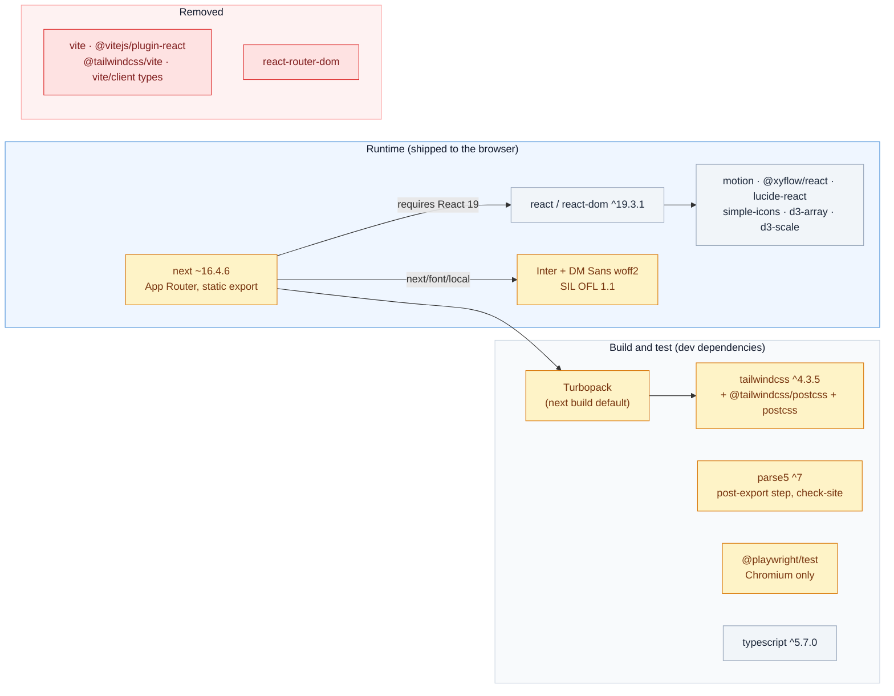

# DESIGN-20261121-UU4L: Web Explorer Next.js Static Export — Stack

Next.js 16.4.x replaces Vite and React Router as Web Explorer's framework and builder; everything else in the runtime stack stays as it is.

The decision context is in [Architecture](Architecture.md). How each technology is used is in [Design - Rendering, Routing and Page Metadata](Design%20-%20Rendering,%20Routing%20and%20Page%20Metadata.md) and [Design - Security Header Delivery](Design%20-%20Security%20Header%20Delivery.md). Ordering is in [Efforts](Efforts.md).

## Dependency view



Legend: amber = added; grey = unchanged; red = removed.

## Added

| Technology             | Responsibility                                                                                                            | Version                                                         | Where used                                                                                                                                                                                                                                                                                                                       |
| ---------------------- | ------------------------------------------------------------------------------------------------------------------------- | --------------------------------------------------------------- | -------------------------------------------------------------------------------------------------------------------------------------------------------------------------------------------------------------------------------------------------------------------------------------------------------------------------------- |
| `next`                 | App Router, Server Components, static export, metadata, `next/font/local`, `next/link`, `next/navigation`, `next/dynamic` | `~16.4.6` (minor pinned; 16.4.6 verified in the Evaluate spike) | `apps/web-explorer` dependency                                                                                                                                                                                                                                                                                                   |
| Turbopack              | Bundler for `next build`                                                                                                  | Bundled with `next` (Next 16 default)                           | `web-explorer:build`, `dev`                                                                                                                                                                                                                                                                                                      |
| `@tailwindcss/postcss` | Tailwind 4 as a PostCSS plugin                                                                                            | Same version as `tailwindcss` (`^4.3.5`)                        | `postcss.config.mjs`, dev dependency                                                                                                                                                                                                                                                                                             |
| `postcss`              | CSS pipeline Next runs                                                                                                    | `^8`                                                            | Dev dependency                                                                                                                                                                                                                                                                                                                   |
| `parse5`               | HTML parse and serialise                                                                                                  | `^7`                                                            | `scripts/post-export.mjs`, `scripts/check-site.mjs`; dev dependency                                                                                                                                                                                                                                                              |
| `@playwright/test`     | Browser checks with Pages emulation                                                                                       | `1.x`; Chromium only                                            | `web-explorer:e2e`; dev dependency. Config `apps/web-explorer/playwright.config.ts`, specs `apps/web-explorer/e2e/`. CI installs the browser with `yarn workspace @artisyn-harness/web-explorer playwright install --with-deps chromium`, only when `yarn nx show projects --affected --base=… --head=HEAD` lists `web-explorer` |
| Inter `woff2`          | Site-wide typeface                                                                                                        | Weights 400–800, as served today                                | `src/fonts/` with its SIL OFL 1.1 licence file; `next/font/local` in `app/layout.tsx`                                                                                                                                                                                                                                            |
| DM Sans `woff2`        | `/docs-flow` typeface                                                                                                     | Weights 400–800, as served today                                | `src/fonts/` with its SIL OFL 1.1 licence file; `next/font/local` in the docs-flow route                                                                                                                                                                                                                                         |

## Removed

| Technology                                                              | Replaced by                                                     |
| ----------------------------------------------------------------------- | --------------------------------------------------------------- |
| `vite`                                                                  | `next build` / `next dev`                                       |
| `@vitejs/plugin-react`                                                  | Next's built-in React support                                   |
| `@tailwindcss/vite`                                                     | `@tailwindcss/postcss`                                          |
| `react-router-dom`                                                      | App Router file routes, `next/link`, `next/navigation`          |
| `vite/client` types in `tsconfig.json`                                  | Next types from `next typegen` (`next-env.d.ts`, `.next/types`) |
| Google Fonts requests (`index.html` `<link>`, `docsFlow.css` `@import`) | Vendored `woff2` files                                          |
| `scripts/ci/web-explorer-build.sh`                                      | The Nx `build` command below                                    |

## Compatibility

| Constraint                                        | Detail                                                                                                                    |
| ------------------------------------------------- | ------------------------------------------------------------------------------------------------------------------------- |
| React                                             | Next 16 requires React 19; `react` and `react-dom` stay at `^19.3.1`                                                      |
| TypeScript                                        | Stays at `^5.7.0`. TypeScript 7 does not install under Yarn's built-in TypeScript patch (verified in the spike)           |
| Node                                              | 24 (root `engines: >=24`)                                                                                                 |
| Package manager                                   | Yarn 4.9.2 workspace; `yarn` only, never `npm` or `npx`                                                                   |
| `motion`, `@xyflow/react`, `d3-array`, `d3-scale` | Unchanged versions; imported only from client components where they drive interaction                                     |
| `lucide-react`, `simple-icons`                    | Unchanged; usable from Server Components                                                                                  |
| Telemetry                                         | `NEXT_TELEMETRY_DISABLED=1` on every `next build`                                                                         |
| Generated files                                   | `.gitignore` adds `apps/web-explorer/out/`, `.next/`, `.preview/`, `next-env.d.ts`, `test-results/`, `playwright-report/` |

## `next.config.ts`

```ts
import { readFileSync } from 'node:fs';
import { resolve } from 'node:path';
import type { NextConfig } from 'next';
import { basePath } from './src/site';

// Nx runs next with cwd apps/web-explorer.
const harnessVersion: string = JSON.parse(
  readFileSync(resolve(process.cwd(), '../../skills/implementation-harness/package.json'), 'utf8')
).version;

const nextConfig: NextConfig = {
  output: 'export',
  basePath, // '/artisyn-implementation-harness'
  trailingSlash: true,
  images: { unoptimized: true },
  env: { HARNESS_VERSION: harnessVersion },
};

export default nextConfig;
```

`postcss.config.mjs` registers `@tailwindcss/postcss` as its only plugin.

## Nx targets (`apps/web-explorer/project.json`)

The project name and the target names `build`, `typecheck`, `lint`, `serve`, `dev` and `preview` stay; `e2e` is new.

```json
{
  "build": {
    "executor": "nx:run-commands",
    "cache": true,
    "inputs": [
      "default",
      "^default",
      "{workspaceRoot}/skills/implementation-harness/package.json",
      { "env": "NEXT_PUBLIC_REPO_URL" },
      { "env": "NEXT_PUBLIC_DOCS_URL" },
      { "env": "NEXT_PUBLIC_GOOGLE_SITE_VERIFICATION" }
    ],
    "outputs": ["{projectRoot}/out"],
    "options": {
      "command": "NEXT_TELEMETRY_DISABLED=1 next build && node scripts/post-export.mjs && node scripts/check-site.mjs && node scripts/check-bundle-budget.mjs",
      "cwd": "apps/web-explorer"
    }
  },
  "typecheck": {
    "executor": "nx:run-commands",
    "options": { "command": "next typegen && tsc --noEmit", "cwd": "apps/web-explorer" }
  },
  "lint": {
    "executor": "nx:run-commands",
    "options": { "command": "eslint src", "cwd": "apps/web-explorer" }
  },
  "dev": {
    "executor": "nx:run-commands",
    "options": { "command": "next dev --hostname 0.0.0.0", "cwd": "apps/web-explorer" }
  },
  "serve": {
    "executor": "nx:run-commands",
    "options": { "command": "next dev --hostname 0.0.0.0", "cwd": "apps/web-explorer" }
  },
  "preview": {
    "executor": "nx:run-commands",
    "dependsOn": ["build"],
    "options": {
      "command": "rm -rf .preview && mkdir -p .preview && cp -R out .preview/artisyn-implementation-harness && node scripts/post-export.mjs --resign --origin http://localhost:4173 .preview/artisyn-implementation-harness && node scripts/serve-preview.mjs",
      "cwd": "apps/web-explorer"
    }
  },
  "e2e": {
    "executor": "nx:run-commands",
    "dependsOn": ["build"],
    "options": { "command": "playwright test", "cwd": "apps/web-explorer" }
  }
}
```

`preview` copies `out/` to `.preview/artisyn-implementation-harness/`, re-signs it for `http://localhost:4173`, and serves `.preview/` with `scripts/serve-preview.mjs`, a zero-dependency `node:http` server with the GitHub Pages emulation rules. The site is at `http://localhost:4173/artisyn-implementation-harness/`. Details are in [Design - Security Header Delivery](Design%20-%20Security%20Header%20Delivery.md#preview).

Web Portal: `web-portal:build` gains explicit inputs and keeps its dependencies.

```json
{
  "build": {
    "executor": "nx:run-commands",
    "cache": true,
    "dependsOn": ["web-explorer:build", "web-docs:build"],
    "inputs": ["default", "^default", "{workspaceRoot}/scripts/ci/portal-assemble.ts"],
    "outputs": ["{projectRoot}/dist"],
    "options": { "command": "tsx scripts/ci/portal-assemble.ts" }
  }
}
```

## Verification

| Check                      | Evidence                                                                                                                                             |
| -------------------------- | ---------------------------------------------------------------------------------------------------------------------------------------------------- |
| Install                    | `yarn install` resolves `next` 16.4.x with React 19 and TypeScript 5                                                                                 |
| Build                      | `yarn nx run web-explorer:build` emits `out/` with one `index.html` per route, `404.html`, `sitemap.xml` and `.nojekyll`, and passes all three gates |
| Types                      | `yarn nx run web-explorer:typecheck` passes                                                                                                          |
| Browser                    | `yarn nx run web-explorer:e2e` passes in Chromium                                                                                                    |
| No removed packages remain | `apps/web-explorer/package.json` lists no `vite`, `@vitejs/plugin-react`, `@tailwindcss/vite` or `react-router-dom`                                  |
