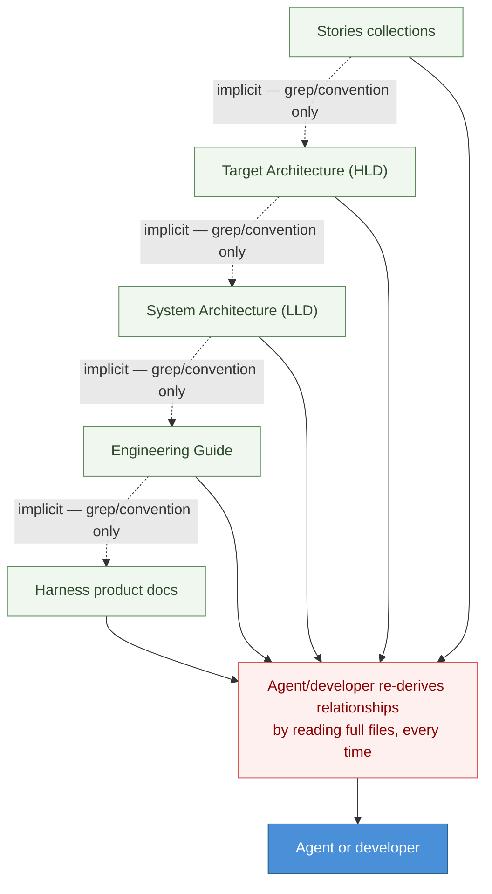

# DESIGN-20261102-Q5MU — Deterministic Docs Knowledge Graph

## Problem

The harness's canonical knowledge — HLD, LLD, Engineering Guide, and Stories collections, plus the cross-project Harness product docs — exists only as prose documents linked by convention and file-path reference, not by a deterministic, queryable structure. Relationships between docs (which HLD container an LLD section implements, which Story produced which doc, which Engineering Guide procedure a Lifecycle doc references) are implicit: an agent or developer reconstructs them by grep/glob and re-reading whole documents, every time, rather than looking them up. As the Product doc tree (`docs/Harness/`) and Project doc tree (`docs/Target Architecture (HLD)/`) grow, and as the harness bootstraps into more projects, there is no deterministic index of these relationships and no visualization surfacing them to a developer, an IDE, or a reader of the published VitePress site.

**Current state:**

## Success

### Known ECs

- EC1: Each doc page carries a unique ID in its frontmatter.
- EC2: A deterministic relation table is built between docs from those IDs (not an LLM-inferred or fuzzy/semantic graph).
- EC3: The graph has a representation inside the IDE (for an agent or developer working in an editor).
- EC4: The graph has a representation on the published VitePress site (for a reader of the docs site).
- EC5: Interaction with the graph is embedded into existing harness lifecycle stages: bootstrap (indexing), context gathering, and documentation/publishing.

### Proposed ECs

- [proposed] EC: The graph build/storage must add minimal or no new operational infrastructure — no new always-on service to operate, consistent with the harness's existing footprint (static VitePress site + CI).
- [proposed] EC: Doc IDs must be stable identity, not derived from file path — they must survive doc moves, renames, and folder restructuring (e.g. an HLD version bump) without breaking relations.
- [proposed] EC: The graph must be deterministically regenerable from doc frontmatter alone (no hidden manual state), so bootstrap/CI can rebuild it from scratch at any time.
- [proposed] EC: Coverage must degrade gracefully — docs without a frontmatter ID yet (the common case on day one, and for any project newly bootstrapped) must not break the graph build; they're simply unindexed until adopted.

## Decisions

| #   | Decision                                                                                                                                                                         | Why it's independent                                                                                                                                              |
| --- | -------------------------------------------------------------------------------------------------------------------------------------------------------------------------------- | ----------------------------------------------------------------------------------------------------------------------------------------------------------------- |
| 1   | Graph storage format (e.g. SQLite vs. a flat deterministic file such as JSON/YAML vs. other)                                                                                     | A pure data-format/storage tradeoff — can be decided and changed without touching what the graph models or how it's visualized.                                   |
| 2   | Graph structure and topology (doc-level vs. section-level nodes; typed edges such as "implements", "informed-by", "supersedes" vs. untyped links)                                | A modeling decision about what the graph represents, prior to and independent of how it's stored or rendered.                                                     |
| 3   | Representation / infra footprint (how the graph is produced and kept fresh — a build-time script vs. a running service), bounded by the "minimal or no infra impact" requirement | A build/operations tradeoff, distinct from storage format or topology.                                                                                            |
| 4   | Visualization surface (IDE-side representation vs. VitePress site representation vs. both)                                                                                       | A presentation-layer decision — the same underlying graph can be surfaced differently in each place, and the choice can differ independently of storage/topology. |
| 5   | Harness lifecycle impact (how `/dev`, `/design`, `/evolve` phases read and write graph edges during context gathering, documentation, and publishing)                            | A behavioral/process-integration decision, separate from how the graph is stored, modeled, or displayed.                                                          |
| 6   | Harness bootstrap impact (how indexing is seeded/initialized when the harness bootstraps into a new project)                                                                     | A one-time initialization concern, distinct from the ongoing lifecycle integration in decision 5.                                                                 |

## Boundaries

**In scope:** a frontmatter ID scheme; a deterministic relation table/index built from those IDs; the build/indexing mechanism that produces it; an IDE-side and/or web (VitePress) visualization of the graph; the touchpoints where harness lifecycle stages (bootstrap, context gathering, documentation, publishing) read or write graph data — for the doc collections already in place (HLD, LLD, Engineering Guide, Stories, and the cross-project Harness product docs).

**Out of scope:** any new always-on runtime service beyond the existing static-site + CI footprint (the infra-impact decision above governs whether any infra is added at all — this excludes assuming new infra by default); a fuzzy or embeddings/vector-search-based semantic graph (this design is for a deterministic relation graph, built from explicit frontmatter links, not an LLM-inferred one); changes to doc authoring conventions themselves (DRY, the certainty principle) beyond adding a frontmatter ID field.

## Constraints

- `docs/Harness/06 Roadmap/01 Harness Roadmap.md` §5.9 explicitly cautions against building indexing speculatively: "Improve links, discovery instructions or indexing only where measured misses justify it; a separate memory service is not a prerequisite." This design must point to the measured gap (implicit relationships requiring full re-reads) rather than assume indexing is self-justifying.
- `docs/Harness/index.md` states `docs/Harness/package/` is the self-contained bootstrap package, but it does not exist in this repo checkout today — the bootstrap-impact decision (Decision 6) must account for there being no package folder to hook an indexer into yet, in this repo.
- None of the existing docs (HLD, LLD, Engineering Guide, Stories, Harness product docs) currently carry a frontmatter ID — adoption must be incremental, not a one-time mass-migration requirement.
- Region must never be hardcoded in source or documentation (project-wide convention, `CLAUDE.md`) — applies to any implementation output from this design.
- Package manager is `yarn`, never `npm`/`npx` (project-wide convention) — applies to any implementation output from this design.

## Links

- Ticket: DESIGN-20261102-Q5MU (local design ID — no tracker ticket)
- Related tickets: none
- Reference docs: `docs/Harness/03 Lifecycles/05 Documents Flow.md`, `docs/Harness/06 Roadmap/01 Harness Roadmap.md`, `docs/Harness/03 Lifecycles/00 Overview.md`, `docs/Harness/index.md`
