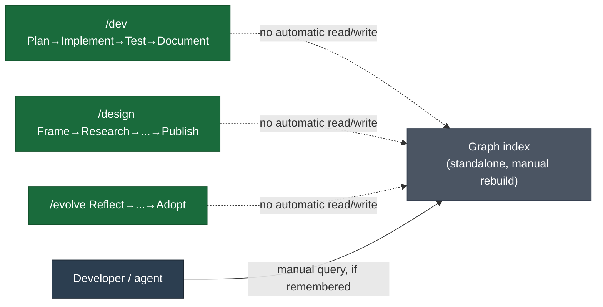
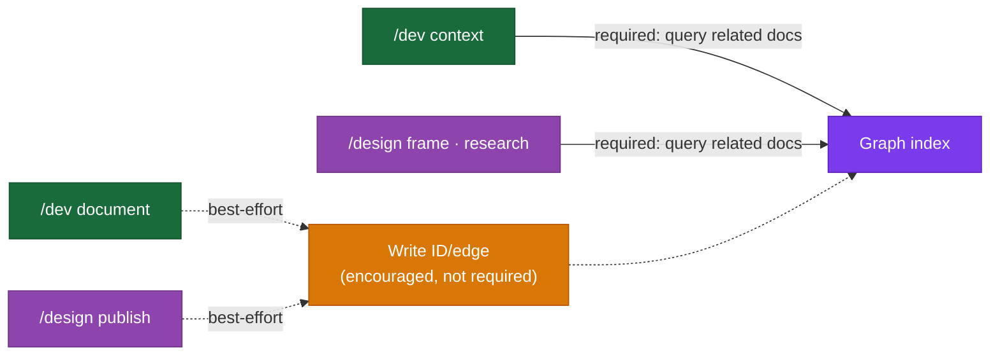
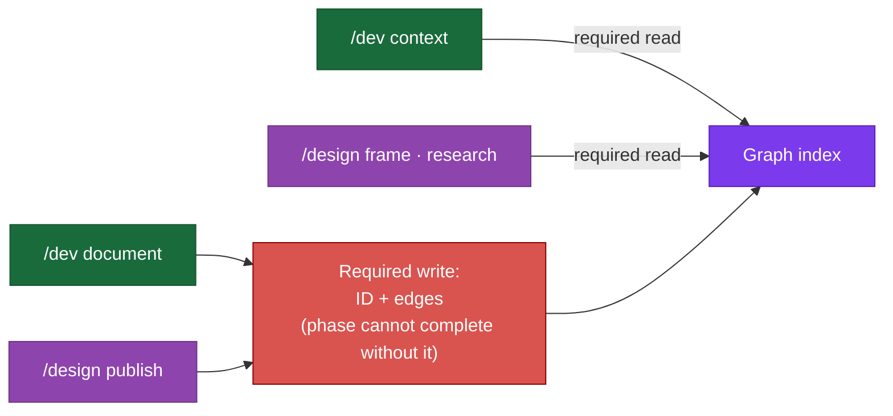
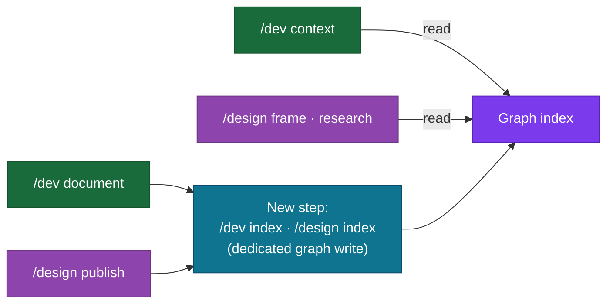
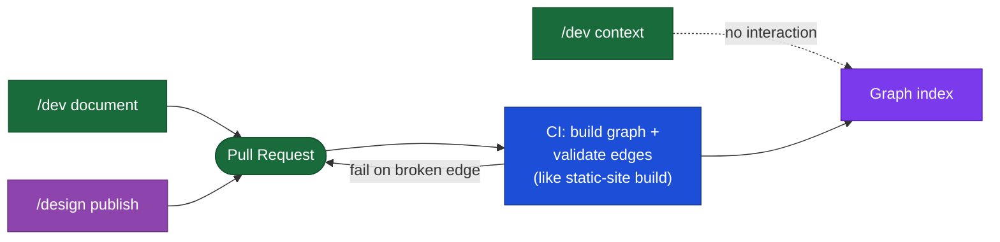

# DESIGN-20261102-Q5MU: Deterministic Docs Knowledge Graph — Research: Harness lifecycle impact

_Produced by the 🔍 Research phase. Owned by `@product-architect`. Do not edit after Evaluate phase begins._

## Context

This decision covers only how `/dev`, `/design`, and `/evolve` phases read and write graph edges during context gathering, documentation, and publishing — not storage format, topology, infra footprint, visualization, or bootstrap seeding, which are separate decisions. `docs/Harness/03 Lifecycles/00 Overview.md` defines the four lifecycles and their phases: Dev runs Plan → Implement → Test → Document; Design runs Frame → Research → Evaluate → Solution → Review Gate → Address Feedback → Publish; Evolve runs Reflect → Triage → Draft → Validate → Adopt. `docs/Harness/03 Lifecycles/05 Documents Flow.md` establishes the existing doc pipeline and states that documentation is mandatory — tickets are not complete until `/dev document` has run. Frame's constraint quotes Roadmap §5.9's caution against speculative indexing.

## Options

### Option A — Out-of-band, read-only graph; lifecycle phases never interact with it automatically (minimal change)

**Description:** The graph is built by a standalone indexing command. No phase of `/dev`, `/design`, or `/evolve` queries or writes it. Agents/developers may consult the graph manually, same as they currently use grep/glob.

**Industry precedent:** Many doc-as-code setups start here — a docs-linter or sitemap generator run ad hoc, with no CI/workflow enforcement; a common anti-pattern cited in docs-as-code postmortems.

**Diagram:**

**Pros:**

- Zero risk of breaking existing lifecycle contracts.
- Fully respects Roadmap §5.9's caution.
- Trivially reversible; no phase prompts need rewriting.

**Cons:**

- Doesn't fulfill Frame's EC5 ("interaction with the graph is embedded into existing harness lifecycle stages") — fails that acceptance criterion.
- The graph risks going stale immediately since nothing in the lifecycle ever updates it, undermining EC2/EC3's determinism promise over time.

**Unknowns / risks:**

- A graph nobody is obligated to query or maintain tends to rot — without lifecycle pressure, adoption of frontmatter IDs may never reach critical mass.

---

### Option B — Read-only query folded into existing Context/Research steps; writes remain optional best-effort at Document/Publish

**Description:** `/dev context` and `/design research`/`frame` query the graph to surface related docs by edge instead of relying purely on manual glob/grep — additive to the existing context-resolution pattern. Writing new IDs/edges when a doc graduates (`/dev document`, `/design publish`) is encouraged but not required.

**Industry precedent:** Backstage's software catalog is queried by scaffolding/create-component workflows, but catalog-info.yaml authorship is not a required CI gate for most adopters — an "encouraged, not enforced" pattern.

**Diagram:**

**Pros:**

- Directly fulfills EC5's "context gathering" touchpoint.
- Respects the graceful/incremental-coverage EC — nothing blocks on 100% graph coverage.
- Low risk to existing phase contracts since writes are optional, so no new hard-stop gate is introduced.

**Cons:**

- Optional writes mean graph completeness still depends on reviewer/agent diligence — doesn't guarantee EC2's deterministic coverage grows over time.
- "Encouraged but not required" can quietly become "never happens" without some forcing function.

**Unknowns / risks:**

- Query integration requires Context/Research steps to have a reliable fallback when the graph is empty/stale — must degrade to the current grep/glob behavior.

---

### Option C — Full required read+write integration across all three touchpoints

**Description:** Context Gathering is required to query the graph before manual globbing. `/dev document` and `/design publish` are required to write/update the doc's frontmatter ID and any new edges as part of completing the phase.

**Industry precedent:** Docs-as-code CI gates (markdown-link-check, Docusaurus's `onBrokenLinks`) enforce link integrity as a merge-blocking check, but typically on link validity, not on authoring a new relation/ID for every touched doc — this option goes further than most industry precedent.

**Diagram:**

**Pros:**

- Strongest fulfillment of EC5 and guarantees EC2's determinism actually grows — every doc touched by the lifecycle gets indexed.

**Cons:**

- Directly risks the Roadmap §5.9 caution — turns indexing into a blanket mandatory lifecycle gate rather than something applied only where measured misses justify it.
- Adds a new hard-stop to Dev's "continues routine authorized work" posture.
- Risks blocking ticket completion on tooling that Frame's own ECs say must degrade gracefully — contradicts "must be incremental."

**Unknowns / risks:**

- What happens when the graph tool itself is broken/unavailable — does `/dev document` hard-fail? No documented fallback.
- Resolved (V-tier): mandatory writes conflict with Roadmap §5.9 and the graceful-degradation EC — this option is disqualified.

---

### Option D — New dedicated lifecycle step owns graph writes; existing phases only read

**Description:** A new discrete step is added to each lifecycle specifically for graph maintenance (e.g. a `/dev index` or `/design index` sub-step), analogous to how `/harness-bootstrap patch harvest`/`patch prepare`/`patch apply` are separate named steps rather than folded into existing commands. Existing phases (Context, Research) gain read-only queries (as in Option B), but write responsibility is isolated into its own named step.

**Industry precedent:** Static-site generators with separate "build graph" steps distinct from "build content" — e.g. Obsidian's graph view/Foam's backlink index is a separate indexing pass triggered on save, decoupled from the authoring action itself.

**Diagram:**

**Pros:**

- Keeps existing phase contracts (Document, Publish) unchanged in their core responsibility.
- A dedicated step is easier to make optional-but-visible (e.g. shown in `/where-we-are` gap reports) without entangling it in Document/Publish's existing logic.
- Consistent with how the harness already separates concerns via named sub-steps elsewhere.

**Cons:**

- Adds a new named step to three lifecycles' command surfaces — more surface area to teach/document.
- Risk of the new step being skipped entirely in practice if not wired to a hard dependency (same optionality risk as Option B, just relocated).

**Unknowns / risks:**

- Where exactly this step sits relative to Document/Publish needs a concrete ordering decision at Evaluate; unclear whether Evolve's Reflect/Triage/Adopt would need their own version.

---

### Option E — CI/publish-time enforcement only; lifecycle phases don't read or write, validation happens at merge

**Description:** No `/dev`, `/design`, or `/evolve` phase interacts with the graph directly. Graph build + validation is a CI check that runs on PR/merge, analogous to a docs-as-code link checker. If a doc declares an edge to an ID that doesn't resolve, CI fails the build.

**Industry precedent:** Dominant docs-as-code pattern — Docusaurus's `onBrokenLinks: 'throw'`, markdown-link-check GitHub Actions, Backstage's catalog-info.yaml schema validation in CI — all validate-at-merge, not validate-at-authoring-time.

**Diagram:**

**Pros:**

- Lowest lifecycle-prompt rewrite burden of any enforced option — no phase command needs to change, only CI config.
- Cleanly separates authoring from validation, a well-trodden docs-as-code pattern.
- Naturally satisfies Roadmap §5.9's bar since enforcement is cheap and only triggers on actual broken edges.

**Cons:**

- Doesn't give agents/developers the discovery benefit Frame's problem statement is chasing — CI-only validation catches broken links after the fact but doesn't help Context Gathering find related docs faster during authoring, partially missing EC5's "context gathering" touchpoint.
- Feedback loop is slower (PR time, not authoring time).

**Unknowns / risks:**

- Needs clarity on whether a failing CI check blocks merge or just warns, and how that interacts with Document already being mandatory.
- Unclear how this interacts with the existing VitePress build pipeline — would need a new CI job, governed by the infra-footprint decision.

---

## Open Questions

| #    | Question                                                                                                                                                                         | Owner               | Resolution / status                                                                                                                                              |
| ---- | -------------------------------------------------------------------------------------------------------------------------------------------------------------------------------- | ------------------- | ---------------------------------------------------------------------------------------------------------------------------------------------------------------- |
| OQ-1 | (V) Does EC5 require mandatory writes, or is read-only querying plus optional/best-effort writes sufficient?                                                                     | Research (resolved) | Resolved: optional/best-effort writes suffice — mandatory writes (Option C) conflict with Roadmap §5.9 and the graceful-degradation EC; Option C is disqualified |
| OQ-2 | (E) What is the required fallback behavior for Context Gathering/Research steps when the graph is empty, stale, or the indexing tool is unavailable?                             | Evaluate            | Deferred to Evaluate Step 3                                                                                                                                      |
| OQ-3 | (E) Does Evolve's lifecycle need its own graph touchpoint, given its docs also graduate into permanent homes?                                                                    | Evaluate            | Deferred to Evaluate Step 3                                                                                                                                      |
| OQ-4 | (V) If writes were required or isolated into a new step, would that conflict with Roadmap §5.9's caution, and how would measured misses be evidenced before making it mandatory? | Research (resolved) | Resolved: yes it would conflict — reinforces disqualifying Option C's mandatory-write approach                                                                   |
| OQ-5 | (E) Where would a new dedicated step (Option D) or CI gate (Option E) sit relative to existing invariants like "documentation is mandatory"?                                     | Evaluate            | Deferred to Evaluate Step 3                                                                                                                                      |
| OQ-6 | (E) Is graph interaction expected to differ between the Product track (`docs/Harness/`) and Project track (`Target Architecture (HLD)/`)?                                        | Evaluate            | Deferred to Evaluate Step 3                                                                                                                                      |
