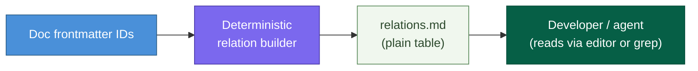
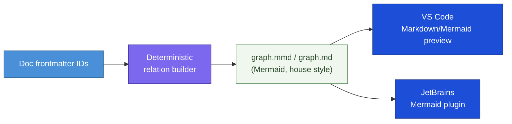
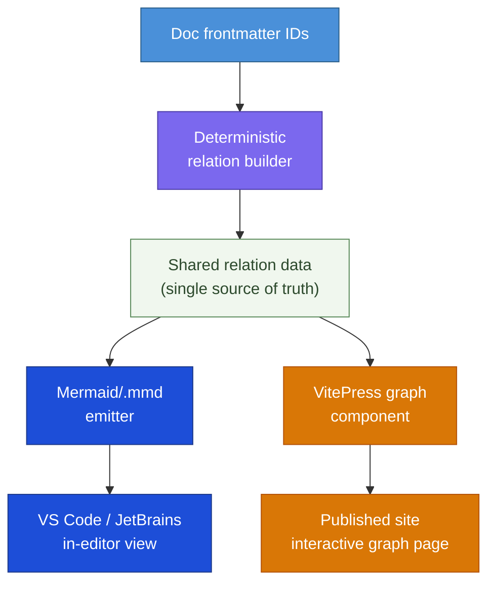

# DESIGN-20261102-Q5MU: Deterministic Docs Knowledge Graph — Research: Visualization surface

_Produced by the 🔍 Research phase. Owned by `@product-architect`. Do not edit after Evaluate phase begins._

## Context

This decision covers only where and how the deterministic docs graph is surfaced to a human — IDE, the published VitePress site, or both. It does not cover graph storage format, graph topology, infrastructure footprint, or lifecycle/bootstrap wiring; those are separate decisions in this same multi-decision design. This repo's docs site runs on VitePress 1.x/Vite (`apps/docs-web/`); the primary editing surface is Claude Code/an IDE (VS Code, JetBrains).

## Options

### Option A — Minimal change: plain Markdown relation table, no rendered graph

**Description:** The deterministic relation table is surfaced only as a plain Markdown table or list (e.g. a generated `docs/Harness/.graph/relations.md`), readable by a human or agent, with no diagram rendering anywhere, IDE or site.

**Industry precedent:** Many static-site generators and monorepo tools (e.g. plain CODEOWNERS/OWNERS index files, early Diátaxis-style doc sets) ship relation/ownership data as plain text with no visualization, relying on grep/search as the query interface.

**Diagram:**

**Pros:**

- Zero new rendering dependency, zero new build step beyond what the storage/topology/infra decisions already require.
- Fully consistent with "minimal or no new operational infrastructure" and the Roadmap §5.9 caution.
- Trivially diffable in git; agents can grep/read it directly during context gathering without parsing a non-text format.

**Cons:**

- Does not satisfy EC3 (IDE representation) or EC4 (VitePress representation) as stated in Frame — under-delivers against Known ECs.
- No visual/topological intuition for a human reader — a large relation table is hard to scan for clusters, orphans, or cycles.
- Site readers get no graph experience at all.

**Unknowns / risks:**

- Whether Frame's EC3/EC4 are strict requirements or whether a textual-only interpretation would satisfy them loosely — later resolved (V-tier): both are hard, separate, literal requirements, disqualifying this option.

---

### Option B — IDE-only: generated graph artifact opened in the editor

**Description:** The build step emits a generated graph artifact alongside the relation table — e.g. a Mermaid file, or a DOT/Graphviz file — intended to be opened directly in the editor (VS Code and JetBrains both render Mermaid/Markdown preview natively or via common extensions). No VitePress-side rendering.

**Industry precedent:** Foam (VS Code extension for a Zettelkasten-style graph over Markdown notes) renders a local graph view inside the editor only, with no separate publishing surface.

**Diagram:**

**Pros:**

- Satisfies EC3 directly.
- Reuses the same house style already established for diagrams in this repo (Mermaid with explicit classDef), so no new diagramming convention is introduced.
- Still fits the "no new infra" constraint — editor rendering is a local capability, not a service the harness operates.

**Cons:**

- Does not satisfy EC4 — a published-site reader gets nothing.
- Mermaid graphs become unwieldy past tens of nodes (no pan/zoom/search in most static renderers).
- Editor-rendering fidelity varies across VS Code and JetBrains without specifying a plugin/convention.

**Unknowns / risks:**

- Whether a committed generated artifact (vs. regenerate-on-demand) conflicts with "deterministically regenerable, no hidden manual state."
- Node-count/scale threshold at which Mermaid becomes unreadable is unverified for this doc tree's actual size.

---

### Option C — VitePress-site-only: generated interactive graph page

**Description:** The relation data is rendered as a dedicated page on the published VitePress site using a JS graph-rendering library (a VitePress custom component wrapping a force-directed graph lib) at build time from the same relation data. No IDE-side artifact beyond the plain data file.

**Industry precedent:** Backstage TechDocs' entity-relationship graph renders ownership/dependency relationships as an interactive graph on the published developer portal, generated at build/catalog-sync time — the published-site-only counterpart to Foam's IDE-only approach.

**Diagram:**

**Pros:**

- Satisfies EC4 directly; gives readers of the published site an interactive, pannable/zoomable/searchable graph — scales better visually than static Mermaid for a large doc tree.
- Fits naturally into this repo's existing stack (VitePress/Vite) — a custom Vue component is a native extension point, no new container/service.
- Build-time generation keeps it within the existing static-site + CI footprint.

**Cons:**

- Does not satisfy EC3 — a developer/agent working in the editor (the harness's primary operating surface) gets no in-IDE representation.
- Introduces a new frontend dependency (a JS graph-rendering library) into `apps/docs-web/`.
- Interactive graph UX (layout algorithm, library choice, styling) is itself a non-trivial design surface.

**Unknowns / risks:**

- Which graph-rendering library is acceptable without adding significant bundle weight is unverified.
- How this page is kept in nav overlaps with the lifecycle/bootstrap decisions, flagged as a boundary question.

---

### Option D — Both surfaces, one shared data source

**Description:** A single deterministic relation-data artifact feeds two independent renderers: a Mermaid/IDE artifact (Option B's output) for the editor, and a VitePress interactive graph page (Option C's output) for the published site. Both are generated, never hand-maintained, from the same source of truth.

**Industry precedent:** Obsidian's model is the closest single-tool precedent: one underlying vault is rendered as an in-app interactive graph view and separately exportable/publishable via Obsidian Publish as a web graph — both views read the same link data, neither is authoritative over the other.

**Diagram:**

**Pros:**

- Directly satisfies both EC3 and EC4 as literally stated in Frame's Known ECs — this is the only option that fully covers both without reinterpreting scope.
- "One underlying data source, two renderers" keeps deterministic-regeneration intact.
- Matches the house pattern already visible in this repo: Mermaid diagrams for in-repo/IDE consumption alongside the VitePress-published site as the reader-facing surface.

**Cons:**

- Two render paths to build and keep in sync — the largest footprint of the four options.
- Carries both Option B's node-count/Mermaid-scaling risk and Option C's new-frontend-dependency risk, simultaneously.
- Highest surface area to get wrong relative to "minimal or no new operational infrastructure" — needs explicit scoping in Evaluate.

**Unknowns / risks:**

- Whether "one shared data source, two renderers" is interpreted as one feature or two separately gated efforts for sizing purposes — overlaps with the infra-footprint decision.
- Visual-language parity between the Mermaid diagram and the site's interactive graph is unspecified.

---

## Open Questions

| #    | Question                                                                                                                                                                                                      | Owner               | Resolution / status                                                                                                             |
| ---- | ------------------------------------------------------------------------------------------------------------------------------------------------------------------------------------------------------------- | ------------------- | ------------------------------------------------------------------------------------------------------------------------------- |
| OQ-1 | (V) Are EC3 ("representation inside the IDE") and EC4 ("representation on the published VitePress site") both hard requirements, or could one be satisfied loosely by a shared textual artifact?              | Research (resolved) | Resolved: yes, both are hard, literal, separate requirements — Option A is disqualified; Evaluate compares Options B, C, D only |
| OQ-2 | (E) What is the actual/projected size (node/edge count) of the combined doc tree once IDs are adopted — does this determine whether Mermaid rendering stays legible or needs the interactive-graph treatment? | Evaluate            | Deferred to Evaluate Step 3                                                                                                     |
| OQ-3 | (E) Does adding a JS graph-rendering library to `apps/docs-web/` need its own lightweight evaluation (bundle size, maintenance, license) before Evaluate can compare it fairly?                               | Evaluate            | Deferred to Evaluate Step 3                                                                                                     |
| OQ-4 | (E) Where would a VitePress graph page live in the site's navigation/IDE structure — does answering that depend on the lifecycle/bootstrap decisions being settled first?                                     | Evaluate            | Deferred to Evaluate Step 3                                                                                                     |
| OQ-5 | (E) For Option D, should the IDE-side artifact be a generated-and-committed file or generated-on-demand-only?                                                                                                 | Evaluate            | Deferred to Evaluate Step 3                                                                                                     |
