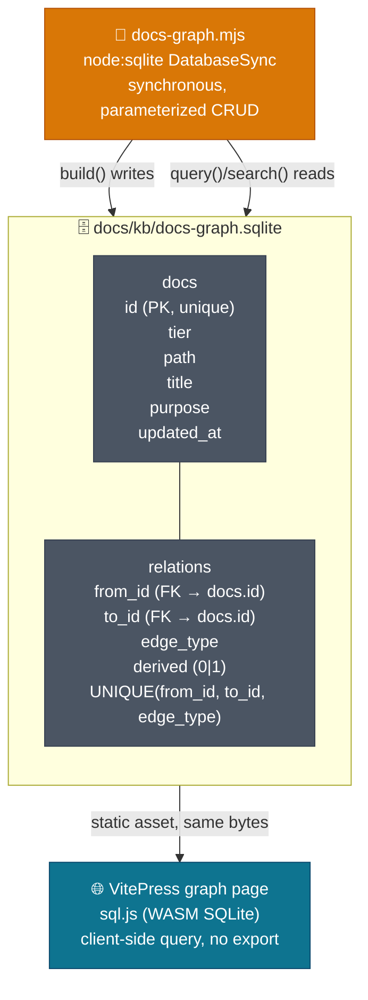
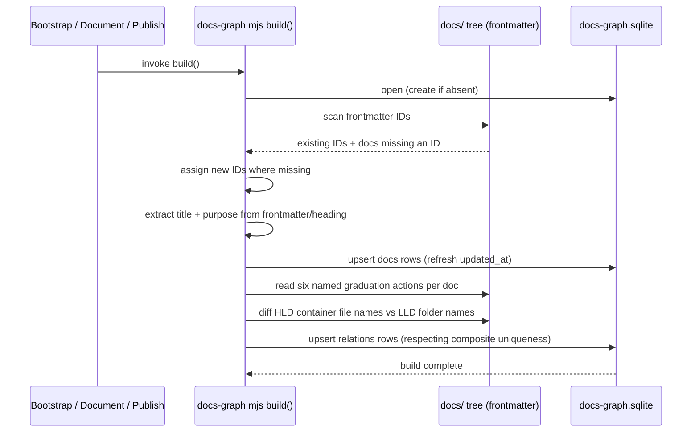

# DESIGN-20261102-Q5MU: Deterministic Docs Knowledge Graph — Design: Graph storage format

Two tables — `docs` and `relations` — persisted in one file, `docs/kb/docs-graph.sqlite`,
written by `docs-graph.mjs` through `node:sqlite` and read by both Node and the
browser against the same bytes, no export step between them.

## Schema and dual-runtime access



`docs`: `id` (TEXT, primary key, unique), `tier` (TEXT, one of
`HLD`/`LLD`/`EngineeringGuide`/`Story`/`Product`/`AppReadme`), `path` (TEXT,
relative repo path), `title` (TEXT, the doc's human-readable title — frontmatter
`title:` if present, else the doc's first `# ` heading), `purpose` (TEXT,
nullable — frontmatter `description:`/`summary:` if present, else null; this is
the one field allowed to be absent, consistent with graceful degradation for
docs that don't carry a description yet), `updated_at` (TEXT, ISO timestamp of
the last index run that touched the row).

`relations`: `from_id` and `to_id` (TEXT, foreign keys into `docs.id`),
`edge_type` (TEXT, one of the seven types in `solution/Architecture.md`'s node and
edge model), `derived` (INTEGER, `0` for the six authored graduation edges, `1`
for the computed `mirrors-consistent`/`mirrors-gap` edge). `derived` lets a
consumer tell an edge someone wrote from an edge the build computed.

Composite uniqueness on `(from_id, to_id, edge_type)` — the same edge between the
same two docs is never recorded twice; a second write to an existing edge is an
upsert, not an insert.

## Access pattern

Node-side callers (`docs-graph.mjs` itself, lifecycle-skill invocations, CI) use
`node:sqlite`'s `DatabaseSync`: synchronous, parameterized queries only, even
though every input originates from trusted frontmatter.

Browser-side, the VitePress graph page loads `docs-graph.sqlite` as a static
asset and queries it with `sql.js` (the WASM SQLite build) entirely client-side —
no server round-trip, no separate JSON export. The rendering layer that consumes
these client-side query results is specified in
`solution/Design - Visualization surface.md`.

## ID generation

Doc IDs are frontmatter-stored strings, assigned once — at bootstrap for
pre-existing docs, or at Document/Publish time for newly graduating docs — and
never reassigned afterward. The exact deterministic, collision-safe generation
algorithm is an implementation obligation tracked as a spike in
`solution/Efforts.md`; this design fixes only the shape (a stable, immutable,
frontmatter-resident string), not the generation scheme.

## Frontmatter format

Every indexed doc carries this frontmatter block (YAML, at the top of the file):

```yaml
---
id: <unique-string>
title: <string>
description: <string>
---
```

- `id` — required once a doc is indexed (absent before that — see Research's graceful-degradation proposed EC). Assigned once, by `docs-graph.mjs`, never hand-authored and never reassigned. Maps directly to the `docs.id` column.
- `title` — optional. If present, maps directly to `docs.title`. If absent, `docs-graph.mjs` derives it from the doc's first `# ` heading at index time; the derived value is stored in `docs.title`, not written back into the doc's frontmatter.
- `description` — optional. If present, maps directly to `docs.purpose`. If absent, `docs.purpose` is left `NULL` — no fallback derivation, since a doc's purpose can't be reliably inferred the way a title can from its first heading.

No other frontmatter key is read or written by this design. Existing frontmatter keys a doc already carries (for any other purpose) are left untouched — `docs-graph.mjs` only ever adds `id` (if missing) and reads `title`/`description` if present; it never removes or rewrites an existing key.

## Build flow



1. `build()` opens, or creates if absent, `docs/kb/docs-graph.sqlite` via
   `node:sqlite`.
2. Scans the doc tree for existing frontmatter IDs and assigns new ones where
   missing, per the bootstrap and graduation triggers in
   `solution/Architecture.md`.
3. Upserts `docs` rows by `id` — extracting `title` (frontmatter `title:`,
   falling back to the doc's first `# ` heading) and `purpose` (frontmatter
   `description:`, left null if absent) during the same scan —
   refreshing `updated_at`.
4. Computes the seven edge types: six from the named graduation actions already
   recorded against each doc, one (`mirrors-consistent`/`mirrors-gap`) from
   comparing HLD container file names against LLD folder names.
5. Upserts `relations` rows, respecting the composite-uniqueness constraint —
   never a duplicate insert.

## Failure / recovery

A uniqueness-constraint violation — for example a duplicate `id` from a bad
manual frontmatter edit — fails only that row's write. The build does not abort:
it continues upserting every cleanly-resolvable doc and reports the conflicting
doc(s) for manual resolution, matching `solution/Architecture.md`'s
graceful-degradation posture. The exact error-reporting format is a migration/
rollout obligation defined in the implementation, not fixed here.

## Compatibility rule

The schema is additive-only going forward: future revisions may add nullable
columns with defaults. `id` and the `(from_id, to_id, edge_type)` composite
uniqueness constraint are stable contracts — any consumer, Node or browser, can
rely on both indefinitely.

## Verification

A CI smoke test exercises `CREATE TABLE`, insert, and uniqueness-violation
rejection against the live `node:sqlite` API, so an upstream API regression is
caught immediately. A second fixture test opens and queries, with `sql.js`, the
same file `node:sqlite` produced, confirming no conversion step is needed between
the two runtimes. A third fixture test confirms `title` extraction falls back
correctly to a doc's first heading when no frontmatter `title:` field is
present, and that `purpose` is left null (not an empty string) when no
description exists.
