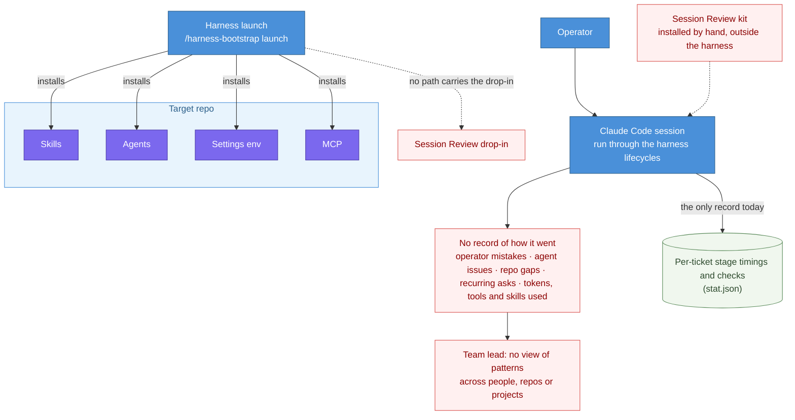

# DESIGN-20261112-T5YB — Session Review Capture Add-on

## Problem

A team that works through the harness has no record of how its sessions actually go. The harness records stage timings and check results per ticket, but nothing about the session itself: where the operator's prompts or missing context slowed the work, where the agent went wrong, what the repo or its tooling lacked, what people ask for again and again, or what a session used in tokens, tools, skills and subagents. A lead therefore cannot see patterns across people, repos or projects, and coaching, new skills and repo rules rest on anecdote.

The Session Review kit already produces that record: one anonymous, structured review per Claude Code session, committed to the repo and pooled in a dashboard for the lead. Today a team installs it separately by hand, and the harness package cannot carry it. The planner installs skill bundles (`TEMPLATE.md` + `INTENT.md`), agents, settings env and MCP. The drop-in needs scripts directly in `.claude/`, two hooks, an env block, and `.gitattributes` and `.gitignore` lines, all copied unmodified. The harness's own improvement loop would gain from the same record, since `/evolve reflect` captures friction only when someone remembers to run it; connecting the two is a follow-up design.

**Current state:**

## Success

### Known ECs

- EC1: Launch installs the Session Review drop-in into the target repo when Claude is among the selected providers and the user answers yes.
- EC2: On the Claude route the install question is always asked and needs an explicit answer. The suggested answer is yes, and the review model defaults to `opus`.
- EC3: An existing install is never overwritten silently:
  - Same version — no change, checks only.
  - Newer version — left alone and reported.
  - Present without a version file — treated as existing and left alone.
  - Older version — reported, upgrade offered, applied only on an explicit yes.
- EC4: An upgrade replaces the drop-in as a set, and keeps the team's `env` values and the `session-reviews/` history.
- EC5: The drop-in is installed byte-identical to the kit release, with no INTENT adaptation and no token substitution.
- EC6: The drop-in is vendored in the harness package and ships in the release ZIP under the harness licence. The kit stays the source; the harness copy is refreshed from a kit release and never edited in the harness.
- EC7: The dashboard stays outside the harness. The harness documents how a lead sets it up and installs nothing dashboard-related into the target repo.
- EC8: Nothing changes for Codex-only or Copilot-only launches, or when the answer is no.

### Proposed ECs

All five were proposed during framing and accepted by the developer on 2026-11-12.

- [proposed — accepted] EC9: Post-install verification is deterministic and reuses the kit's own checks: both hooks registered, `timeout: 15` on SessionEnd, version file present, review logs not git-ignored.
- [proposed — accepted] EC10: Launch detects formatters and pre-commit hooks in the target that would rewrite `session-reviews/**` or `.claude/session-review*.js`, and adds ignores or reports them.
- [proposed — accepted] EC11: Files the harness did not install get no baseline, so `patch apply` never touches them. Files it did install are copy-only and excluded from `patch harvest`.
- [proposed — accepted] EC12: The harness's live agent e2e runs never dispatch reviews, and the deterministic suite covers all five detection cases.
- [proposed — accepted] EC13: A partial install (files without hooks, or the reverse) is reported and not repaired silently.

## Decisions

| #   | Decision                                                                                                                                                                                                             | Why it's independent                                                                   |
| --- | -------------------------------------------------------------------------------------------------------------------------------------------------------------------------------------------------------------------- | -------------------------------------------------------------------------------------- |
| 1   | Packaging and sync: where the vendored drop-in lives, how the manifest and planner represent copy-only content with destinations outside the skills root, and how the copy is refreshed from a kit release.          | A package-format choice; it can change without touching what launch asks or does.      |
| 2   | Launch flow: question keys, the detection cases, the settings merge (including subfolders with their own `.claude/settings.json`), the `.gitattributes` and `.gitignore` edits, verification.                        | Behaviour at install time, independent of how the files are packaged.                  |
| 3   | Ownership after launch: baseline rules, the upgrade offer, and the relation to the kit's own `deploy` command.                                                                                                       | Concerns later `patch` operations, not the first install.                              |

## Boundaries

**In scope:** the canonical package (manifest, planner and materializer, launch references and questions), the vendored drop-in and its refresh script, patch-state rules, an Engineering Guide page, e2e coverage, and the changelog and release.

**Out of scope:** changes to the kit itself; any dashboard code or instance inside the harness; capture for Codex or Copilot; `/evolve triage` reading reviews (a follow-up design); installing Session Review into this repo.

## Constraints

- The drop-in works with Claude Code only. It needs Git Bash on Windows and a recent CLI (the kit was tested on 2.1.303).
- Its paths are fixed: scripts in `.claude/`, the skill at `.claude/skills/session-review/`.
- The review vocabulary is closed and the dashboard depends on it.
- Launch question keys are stable, so new keys are added, not renumbered. Existing settings files are reconciled, preserving hooks, permissions and unrelated keys.
- `.prettierignore` already records that reformatting deployed files causes phantom drift in `patch apply`.
- This repo is public and runs its own harness, so its own answer is no.
- The kit's deterministic secret scrub is still open, and reviews are committed.
- The pinned kit release is 2.2.5 (tag `v2.2.5`, `session-review-drop-in-2.2.5.zip`).
- A kit release can raise the drop-in's version without changing its code: 2.2.5 did, and its changelog says a repo keeps working on the copy it has. Comparing version numbers alone would therefore offer upgrades that change only the version file (bears on EC3 and Decisions 2 and 3).
- The bootstrap package is scanned per version by the DataArt InfoSec skill/plugin scanner (`docs/Harness/08 Security Scan/`); vendored hook scripts and a headless `claude -p` dispatch enter that scan's scope.
- `docs/Harness/02 Quick Start/index.md` says launch asks "only what it can't determine from context", and `docs/Harness/04 Adoption/00 Adoption Path.md` names "Q1–Q11"; the always-asked question (EC2) and a new question key change both at Publish.
- Guarded commands (`git push`, the agent e2e run) are never run by an agent, and the package manager is `yarn` only.
- Region must never be hardcoded in source or documentation (project-wide convention).

## Links

- Ticket: DESIGN-20261112-T5YB (local design ID — no tracker ticket)
- Related tickets: none
- Reference docs: `docs/Harness/03 Lifecycles/03 Evolve Lifecycle.md`, `docs/Harness/06 Roadmap/01 Harness Roadmap.md`, `docs/Harness/02 Quick Start/index.md`, `docs/Harness/04 Adoption/00 Adoption Path.md`, `docs/Harness/08 Security Scan/index.md`, `.canonical-implementation-harness/references/launch/02-launch-questions.md`, `.canonical-implementation-harness/references/launch/08-provider-launch.md`, `.canonical-implementation-harness/references/patch/06-patch-state.md`, the Session Review kit's `claude-drop-in/INSTALL.md` and `docs/ONBOARDING.md` (kit 2.2.5)
