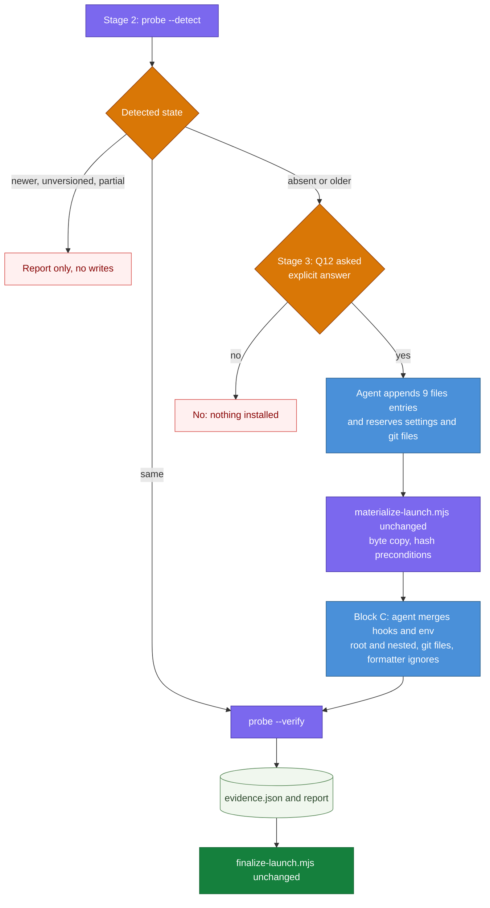
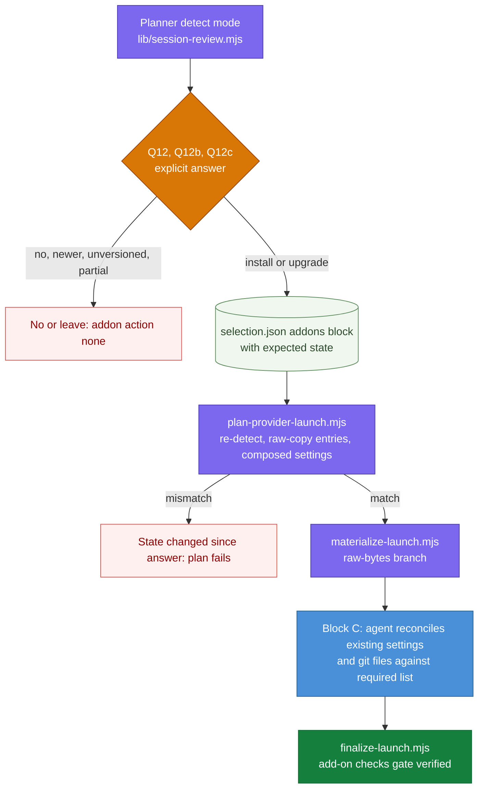
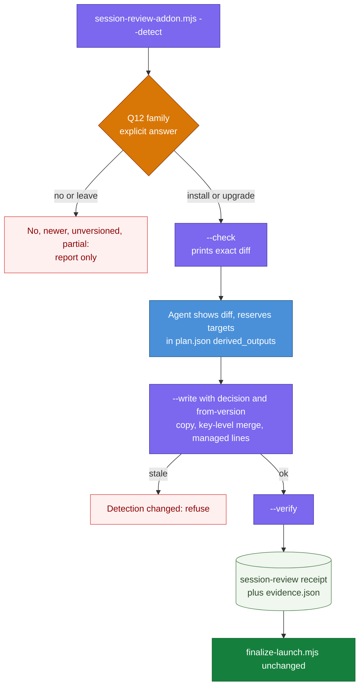
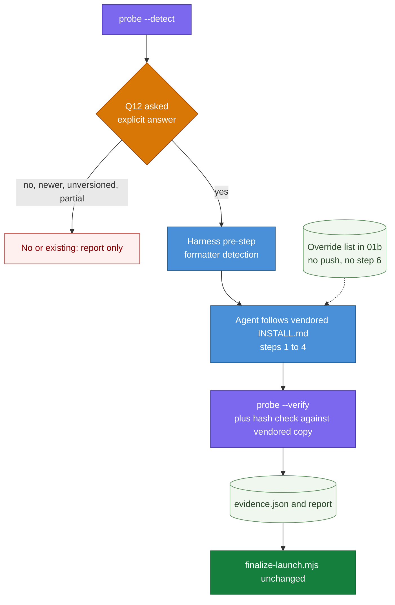

# DESIGN-20261112-T5YB: Session Review Capture Add-on — Research: Launch Flow

_Produced by the 🔍 Research phase. Owned by `@product-architect`. Do not edit after Evaluate phase begins._

## Context

Decision 2 covers what happens at `/harness-bootstrap launch` time: the question key(s), the detection cases, the settings merge (including subfolders with their own `.claude/settings.json`), the `.gitattributes` and `.gitignore` edits, and verification. The drop-in files are assumed to be available inside the package as an unmodified copy; how they are packaged is Decision 1.

### Facts that bound every option

**Stage placement**

- Detection fits stage 2 (Context), which already inventories "existing skills/agents/settings" (`01a-launch-plan.md` §1). The question fits stage 3, the settings work fits Block C (row 6), and the re-check fits Final audit (row 14).
- The launch table has 15 rows and e2e grades exactly that: `LAUNCH_STAGE_COUNT = 15` in `apps/harness-bootstrap-e2e/src/utils/constants.ts`, used by `agent-behavior.grader.ts` and `launch-report.ts`. A new row changes a graded contract, so every option below stays inside the existing rows.
- Existing inconsistency the implementer will meet: `01a-launch-plan.md` line 31 and `01-launch.md` line 98 still say "14" rows.

**What the current scripts already do**

- `materialize-launch.mjs` can already copy a file byte-for-byte with no code change, if three conditions hold: the source sits under `canonical/` (source-root check in `prepareFileEntry`); the file is valid UTF-8; it contains no `{{TOKEN}}`-shaped text. The kit 2.2.5 drop-in holds no token-shaped text.
- The materializer never deletes and never writes `derived_outputs`.
- `plan-provider-launch.mjs` turns `.claude/settings.json` into a `files` entry only when it is absent or identical. Otherwise it becomes a reserved derivation that the orchestrator reconciles (`01b` Block C). BOOT-005 asserts that materialize leaves an existing settings file untouched.
- `canonical/settings.json` has no hooks today.
- `provider-adapter.mjs` declares its path and export surface frozen. Both the planner and the materializer keep a hash list of adapter sources.
- `SKILL.md` declares the package's capabilities as "spawns one pinned local subprocess" (`check-mermaid.mjs`, no shell). A script that spawns `git` changes that line and the per-version security scan surface.

**Answers and the "always asked" rule**

- `answers.json` statuses are `verified | confirmed | proposed | unresolved | historical`. Only `verified` and `confirmed` can become plan knowns, and `historical` must be revalidated.
- So "always asked" can be expressed without a new status: evidence yields at most `proposed` (suggested yes), and the plan needs `confirmed`.
- The existing rule "Reuse verified/confirmed values" would, however, reuse a `confirmed` answer on a later run. Whether that satisfies EC2 is an open question (OQ2-1).
- Upgrade consent cannot be a reusable answer. A stored "yes, upgrade" would apply a later upgrade without a fresh yes, which EC3 forbids. It has to be scoped to the run and to the detected from→to pair.
- Existing keys are Q1–Q11 plus Q10b and Q10c, so `Q12`, `Q12b`, `Q12c` follow the precedent.

**E2E facts (EC12)**

- `run-claude-skill.ts` spawns `claude -p …` with `--permission-mode bypassPermissions`, the parent's environment and the fixture as cwd.
- Live workspaces are retained under `apps/harness-bootstrap-e2e/runs/<ts>-<case>/fixture/`, which is gitignored and inside this repo. The bootstrap scenario does not `git init`; only the patch scenario does.
- Consequence: in a live fixture, `git rev-parse --show-toplevel` and `git check-ignore` resolve against the harness repo. The kit's "logs not ignored" check would report ignored there, and the hook commands would point at this repo's `.claude/`.
- `launch-prompt.ts` pre-answers Q1–Q11 and says "do not ask me anything further". Every option therefore needs an explicit `Q12` line in that prompt, or a headless run either blocks or treats the suggested yes as an answer.
- `runStubbedLaunch` selects every directory under `canonical/skills`. If Decision 1 puts the drop-in there, the planner throws "Incomplete skill".
- Unit and integration tests use an OS temp dir that is not a git repo. Tests of git-based checks must `git init`, as `patch-prepare-apply.ts` does.

**Kit precedent (`tools/deploy-kit.js`, kit 2.2.5)**

- Dry run by default, `--apply` to write, backups first.
- "Already current" is decided by comparing content with line endings normalised, not by version. CRLF copies are accepted.
- Settings are "merged by hand per repo, so this is verified rather than written".
- Its verifier accepts `timeout >= 15`, checks `git check-attr eol`, and walks every nested `.claude/settings.json`.

### Detection states all options must classify

| State       | Signal                                                         | Required behaviour                  |
| ----------- | -------------------------------------------------------------- | ----------------------------------- |
| Absent      | no `.claude/session-review.js`, no hook naming the scripts     | ask Q12                             |
| Same        | files, both hooks, version equals vendored                     | no change, checks only              |
| Newer       | version above vendored                                         | leave, report                       |
| Unversioned | files and hooks, no version file                               | treat as existing, leave            |
| Older       | version below vendored                                         | report, offer, apply on explicit yes |
| Partial A   | files without hooks                                            | report, no silent repair            |
| Partial B   | hooks without files                                            | report, no silent repair            |

Sub-states the ECs do not name, found during research:

- older by version but the files are identical apart from the version file;
- same version but file content differs (local edit or CRLF);
- root complete but a nested settings file lacks the hooks;
- SessionEnd hook present without `timeout`;
- the older `$CLAUDE_PROJECT_DIR` command form (mentioned in `settings.hooks.json` `_comment`).

### Notes that apply to every option

- **EC12 has two available mechanisms.** One is `Q12: no` in `launch-prompt.ts`, which exercises only the EC8 path live. The other is `CLAUDE_SESSION_REVIEW=1` in the `run-claude-skill.ts` spawn environment, which allows a live yes-path case. Both are compatible with every option. Only Option C (3) gives the merge steps deterministic cover without the second.
- **`docs/Harness/` precedent.** Quick Start's "asks only what it can't determine from context" is strained by EC2 in every option; the Frame already records this for Publish. The Principles page's Repeatability ("quality doesn't depend on remembering the right prompts") is the governance text that bears on how much of the flow is agent-performed (Options A and D) versus scripted (Options B and C). No option requires a downstream project to violate a `docs/Harness/` contract.
- **Altitude.** Script names, key names and plan fields belong in the package and its references, not in `docs/Harness/`.

## Options

### Option A (1) — Agent recipe plus a read-only probe (minimal change)

**Description:** The orchestrating agent performs the install by following a new reference section; one new read-only script supplies the deterministic parts.

- **Question:** one key `Q12` with a compound value (yes/no; if yes, model defaulting to `opus`, and session-start subfolders). `02-launch-questions.md` gains a sentence that Q12 is never resolved from evidence. Upgrade consent goes to the report's decisions and the operation record, not `answers.json`.
- **Detection:** new `scripts/session-review-probe.mjs --detect` run in stage 2. It prints JSON with the state, the nested settings files found, and installed-versus-vendored hashes.
- **File copy:** the agent appends nine untagged `files` entries to `plan.json` before the freeze. The unchanged materializer copies them, and `expected_target_sha256` is the overwrite guard.
- **Settings:** the agent merges hooks and env in Block C exactly as it reconciles settings today. Each nested `.claude/settings.json` is reserved as a `derived_outputs` entry.
- **`.gitattributes` / `.gitignore`:** reserved derivations, edited by the agent.
- **Formatters (EC10):** the agent reads the stage 2 evidence against a signal table in the reference, then adds ignore lines or reports.
- **Verification:** `probe --verify` at the Block C boundary and in Final audit, recorded as a `checks` entry in `evidence.json`.
- **E2E:** unit spec for the probe over all states, one integration case for the nine-file copy, `Q12: no` in `launch-prompt.ts`, and an `absent` filesystem grader for `session-reviews/`.
- **Files changed:** `02-launch-questions.md`, `01a-launch-plan.md`, `01b-launch-install.md` (or a new `09-session-review.md`), `01d-launch-graph-verify.md`, the new probe, and e2e. The planner, materializer, finalizer, manifest and canonical settings are untouched.

**Industry precedent:** read-only diagnostics kept separate from mutation, as in `brew doctor` and `flutter doctor`; and the kit's own deploy verifier.

**Diagram:**

**Pros:**

- Smallest change to the frozen adapter surface. BOOT-005 and the Block C wording stay true.
- Matches the kit's own stance that settings are verified, not written.
- EC3 is backed by the materializer's hash precondition. EC5 is backed by its write-verification.
- EC9 and the detection half of EC12 are met by code.

**Cons:**

- The settings, `.gitattributes` and `.gitignore` merges are agent-performed. No deterministic layer exercises them, and live runs answer no.
- Launch materialization depends on drop-in content staying UTF-8 and token-free. A kit release that breaks this fails loudly.
- The agent hand-writes nine plan entries with hashes. `--check` validates them but does not generate them.
- A compound Q12 value is harder to consume mechanically.

**Unknowns / risks:**

- Requires the vendored copy under `canonical/` (Decision 1; OQ2-12).
- An upgrade "as a set" (EC4) that removes a file has no deleting actor.

---

### Option B (2) — Plan-native add-on (extend planner, materializer, finalizer)

**Description:** The add-on becomes a first-class part of the existing Q&A → JSON → script → verify pipeline.

- **Question:** `Q12` (install), `Q12b` (model), `Q12c` (session-start folders), mirroring Q10/Q10b/Q10c. They feed a new `addons` block in `selection.json`, including the state the developer answered against.
- **Detection:** a shared `scripts/lib/session-review.mjs`. The planner exposes it as a detect mode before Q&A, and re-detects at plan time. It fails if the state no longer matches, the same idea as `expected_target_sha256`.
- **File copy:** the planner emits file entries flagged as raw copy. The materializer gains a raw-bytes branch that skips decoding, token scanning and provider rendering.
- **Settings:** for a new settings file, the config renderer composes canonical Claude settings with the drop-in's hooks and env in one deterministic write. An existing non-identical file stays a reserved derivation, now with a machine-readable list of what must be present. Nested targets follow the same split.
- **`.gitattributes` / `.gitignore`:** reserved derivations with required lines.
- **Formatters:** an agent derive action recorded in the plan.
- **Verification:** `finalize-launch.mjs` gains add-on checks, so a launch cannot reach `verified` while they fail.
- **E2E:** unit specs on the planner (each state to a plan shape), materializer (raw copy) and finalizer (each failing check). `fullSelection` is unchanged, so stubbed launches stay add-on-free unless a test opts in. `Q12: no` in the launch prompt.
- **Files changed:** the three scripts, `lib/mcp-config.mjs`, the adapter-source hash lists, `canonical/manifest.json`, `08-provider-launch.md`, `01a`, `01b`, `02`.

**Industry precedent:** Terraform plan/apply, where a saved plan is rejected if state moved; and Angular schematics and Nx generators, which stage every change in one tree before committing.

**Diagram:**

**Pros:**

- One plan, one receipt, one `verification.json`.
- Byte identity holds by construction, whatever the file content (EC5).
- Detection, copy, new-file settings and verification are all code (EC9, EC12).
- Answers are machine-readable.

**Cons:**

- Largest blast radius: it touches the frozen adapter surface and all three core scripts.
- The planner gains project-inspection duties it does not have today.
- The finalizer's stated role ("checks integrity … not the truth of natural-language claims") widens to content checks.
- Merging into an existing settings file is still agent work.
- A Claude-only concern enters provider-neutral tooling, so EC8 needs regression cover on Codex-only and Copilot-only plans.

**Unknowns / risks:**

- Whether plan `schema_version` can stay 1.
- Detect, ask, then plan is a two-pass ordering.
- How `patch apply` treats raw-copy entries (Decision 3).

---

### Option C (3) — Standalone idempotent installer script (detect, check, write, verify)

**Description:** One new script owns the whole add-on; the agent only asks and invokes.

- **Question:** `Q12`, `Q12b`, `Q12c` as in Option B. Consent is enforced at the script boundary: writing requires an explicit decision argument, and an upgrade requires the detected "from" version. The script refuses if detection has changed.
- **Detection:** `scripts/session-review-addon.mjs --detect`.
- **Check:** `--check` prints the exact diff before any write: files to copy, keys to add per settings file, lines to add.
- **Write:** `--write` copies raw bytes; merges settings by key (adds a hook group only if no command already names the script, adds env keys only if absent, preserves everything else); creates nested settings files for the listed folders; ensures the `.gitattributes` lines; appends the `.gitignore` block at end of file; writes its own receipt with before and after hashes, marking each file as harness-installed or pre-existing.
- **Plan link:** the main plan reserves the add-on's targets as `derived_outputs` whose rule names the script, so the finalizer's evidence still covers them.
- **Formatters:** the script lists formatter and hook config files found and whether ignore files cover the paths. The agent decides and edits or reports.
- **Verification:** `--verify` runs the EC9 checks.
- **E2E:** unit specs for every state, merge shape and idempotent re-run; an integration case in a `git init` temp workspace; `Q12: no` in the prompt. A live yes-path case becomes possible if the runner sets `CLAUDE_SESSION_REVIEW=1`.
- **Files changed:** the new script and lib, `SKILL.md` capabilities, `02`, `01a`, `01b`, `01d`, and e2e. The three core scripts are unchanged.

**Industry precedent:** Ansible `lineinfile` and `blockinfile` with `--check --diff`; `git lfs install` and `git lfs update`, which upgrade known hook contents silently and refuse unknown ones without `--force`; dpkg conffile prompts on upgrade.

**Diagram:**

**Pros:**

- The whole flow, merges included, is deterministic and testable (EC9, EC12, EC13).
- Idempotent and re-runnable outside launch, which Decision 3's upgrade offer could reuse.
- Independent of the execution host, for example a Codex host installing for a Claude target.
- Same shape as the kit's own deploy tool.
- The adapter surface is untouched.

**Cons:**

- A package script writes into an existing `.claude/settings.json`. Block C and BOOT-005 today say existing config is reconciled by the orchestrator and not overwritten by tooling. That rule would need restating as a scoped key-level merge.
- A second receipt and write path sits beside plan → materialize → finalize.
- Rewriting JSON risks formatting and key-order churn, and it must refuse settings it cannot parse.
- It is the most new code in a package that is security-scanned per version, and that code registers hooks.
- It restates the kit's install knowledge in harness code, which can drift from `INSTALL.md`.

**Unknowns / risks:**

- Fallback when a settings file is unparseable.
- Whether to take backups.
- Deleting files a newer kit dropped.

---

### Option D (4) — Kit-owned recipe, harness-owned gates

**Description:** The vendored `INSTALL.md` is the install recipe; the harness adds a gate before and after it.

- **Question:** `Q12` only (yes/no). The model stays at the template's `opus` with no separate key. Subfolders are asked by the recipe's own step 2 and recorded in the report.
- **Detection:** the same probe as Option A.
- **File copy, settings, `.gitattributes`, `.gitignore`:** the agent follows `INSTALL.md` steps 1–4 against the vendored folder.
- **Overrides the harness reference must state:** step 5 (commit and push) is replaced by launch's close, which suggests a commit and never pushes; step 6 is replaced by `probe --verify`, plus a note that a real session is needed to see a review; a formatter pre-step is added, because `INSTALL.md` has none.
- **Verification:** the probe checks hooks, timeout, version, ignore state, and file hashes against the vendored copy for EC5.
- **E2E:** as Option A, plus a unit spec pinning the vendored `INSTALL.md` hash to the kit release.
- **Files changed:** `02-launch-questions.md`, a short `01b` section pointing at the vendored recipe with the override list, the probe, and e2e.

**Industry precedent:** package managers that delegate to the component's own install procedure, such as Debian maintainer scripts and npm lifecycle scripts; and the kit's documented "Install with Claude Code" path.

**Diagram:**

**Pros:**

- The kit stays the single source for install steps (EC6). A kit release that changes steps, files or env needs no harness recipe edit.
- Least harness text.
- The result matches a hand install and the kit's later `deploy` channel.

**Cons:**

- Launch behaviour changes whenever the vendored copy is refreshed.
- `INSTALL.md` conflicts with harness rules in three places: push is guarded, it asks questions mid-install rather than before writes, and it presumes a Claude host. The override list is a coupling that must be maintained.
- Files copied outside the plan are absent from the materialization receipt. Finalizer and baseline coverage (input to EC11) must be added by hand.
- Shell copy by an agent varies by platform, and `INSTALL.md` itself warns that `cp *` skips the dot-file.
- EC3 rests on agent discipline, not a hash precondition.
- `INSTALL.md` says nothing about detection states or upgrade, so EC3, EC4 and EC13 are harness-authored anyway.
- The package would instruct the agent to follow a vendored third-party document, which is a security-scan consideration.

**Unknowns / risks:**

- Whether `INSTALL.md` is in the vendored set (Decision 1).
- Whether the kit owner treats it as a stable contract.

---

## Not verified

- Claude Code behaviour is taken from the kit's docs, not tested: hooks loading only at session start, hook processes inheriting the session's environment, nested settings scope, and whether settings files may contain comments.
- Whether every drop-in file is valid UTF-8 without a BOM was not checked by this research (the Decision 1 research file records the orchestrator's check that the 2.2.5 zip holds no token text and only LF line endings).
- How Prettier, ESLint and lint-staged treat an explicitly passed ignored file.
- Whether launch itself ever runs `git init`.
- Not read: `01c-launch-docs.md`, the patch harvest/apply/prepare references, `host-capabilities.md`, the dated security scan reports, and the kit's `ONBOARDING.md`, `CHANGELOG.md` and script bodies beyond the `CLAUDE_SESSION_REVIEW` guard lines.
- Industry references are from general knowledge and were not re-checked.
- No Mermaid diagram was rendered.

## Open Questions

Classification proposed by the orchestrator at OQ triage (2026-11-12); the developer confirms or corrects it at the Research sign-off. (V) = the answer would disqualify one or more options; (E) = evaluation input only.

Updated 2026-11-12 with the developer's answers given at the Research sign-off.

| #      | Question | V/E (proposed) | Owner | Proposed answer / status |
| ------ | -------- | -------------- | ----- | ------------------------ |
| OQ2-1  | Does "always asked" (EC2) mean every launch run, or once per repo with the `confirmed` answer reused from `answers.json` on resume and later runs? | (E) — every option can express either | Harness author | Accepted as proposed (no objection at the Research sign-off, 2026-11-12): asked in every new launch run; a resumed run reuses the answer already confirmed in that run. |
| OQ2-2  | In a headless launch with no Q12 answer, does task 3 block, or is the add-on skipped as unanswered? | (E) | Harness author | Accepted as proposed (2026-11-12): it blocks, because EC2 requires an explicit answer; e2e supplies one in the prompt. |
| OQ2-3  | Is a repo "older" when only the version file differs? Is sameness judged by bytes or with line endings normalised, as the kit's deploy does? | (E) — same question as OQ3-5 and OQ3-7 in the Decision 3 research | Kit owner, with harness author | Partly resolved 2026-11-12 (developer, kit owner): sameness is judged on the unmodified kit content with line endings normalised. Whether a repo is 'older' when only the version file differs stays open — carried to Evaluate with OQ3-5. |
| OQ2-4  | May a package script write a key-level merge into an existing `.claude/settings.json`, or must existing settings stay an orchestrator-reconciled derivation as Block C and BOOT-005 say? | (V) — decides whether Option C is admissible | Harness author | Resolved 2026-11-12 (developer): yes. A harness script adds the hook and env keys to an existing `.claude/settings.json`; the developer's words: 'harness scripts adding hooks and env keys was the way I expected it to get installed/upgraded', then 'go with the script'. Option C (3) stays admissible. Consequence for the others: the settings merge is to be performed by a script, which Options A (1) and D (4) as described do not do, and Option B (2) does only for a new settings file. The Block C / BOOT-005 rule must be restated as a scoped key-level merge — to be confirmed by the harness author at the Review Gate. |
| OQ2-5  | May package scripts spawn `git` (`check-ignore`, `check-attr`, `ls-files`), given the single-subprocess capability declared in `SKILL.md` and the per-version scan? If not, the git checks are agent-run in every option. | (E) — changes who runs the checks, not which options survive | Harness author | Open — carried to Evaluate |
| OQ2-6  | Since the nearest settings file wins, does a nested settings file the harness creates carry only the session-review block, or the harness's canonical `env` as well? Are such files harness-installed outputs? | (E) | Harness author; kit owner to confirm the scope behaviour | Open — carried to Evaluate |
| OQ2-7  | For an existing `SessionStart`, is the sweep added as a new group or inside an existing group's `hooks` array? Is an existing registration recognised by script filename, including the older `$CLAUDE_PROJECT_DIR` form? Does an upgrade rewrite an old command or add a missing `timeout`? | (E) | Kit owner | Open — carried to Evaluate |
| OQ2-8  | After reporting a partial install, may launch offer a repair on an explicit yes in the same run, or is it strictly report-only? How are the unnamed sub-states classified? | (E) | Harness author | Open — EC13 forbids a silent repair; whether an offered repair is allowed is not settled |
| OQ2-9  | For an upgrade "as a set" (EC4), who deletes files a newer kit removed, and are backups taken? The materializer never deletes. | (E) — overlaps OQ3-9 | Kit owner and harness author | Open — carried to Evaluate |
| OQ2-10 | Is the timeout check `=== 15` (EC9 wording) or `>= 15` (kit verifier)? Is `eol=lf` part of EC9? Does a failed or unrunnable check block `verified`, or is it recorded as pending? | (E) | Kit owner and harness author | Accepted as proposed (2026-11-12): `>= 15`, as the kit's own verifier does. Whether `eol=lf` is part of EC9 and whether a failed check blocks `verified` stay open — carried to Evaluate. |
| OQ2-11 | Does "all five detection cases" in EC12 include the two partial states? Is the runner env guard wanted alongside the prompt answer? Must live fixtures be their own git repo? | (E) | Implementer, with harness author | Accepted as proposed (2026-11-12): the five cases are absent, same, newer, unversioned and older; the two partial states (EC13) are covered as well, seven in total. The runner env guard and whether live fixtures must be their own git repo stay open — carried to Evaluate. |
| OQ2-12 | Will the vendored copy sit under `canonical/` (needed by Option A's unchanged materializer) and outside `canonical/skills` (which `fullSelection` enumerates)? | (V) — resolved by Decision 1, not by an answer here | Harness author (Decision 1) | Narrowed 2026-11-12: Decision 1's OQ1-4 was resolved in favour of content that can travel in a patch bundle, which keeps the vendored copy under `canonical/` (Decision 1 Options A–C). Option A here remains conditional on Decision 1 choosing a location outside `canonical/skills`. |
| OQ2-13 | For EC10, which formatter and hook tools are in the signal list, and may launch edit ignore files without confirmation? | (E) | Implementer | Open — carried to Evaluate |
