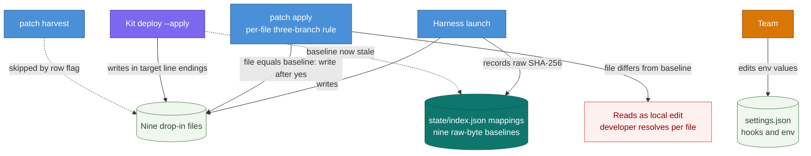
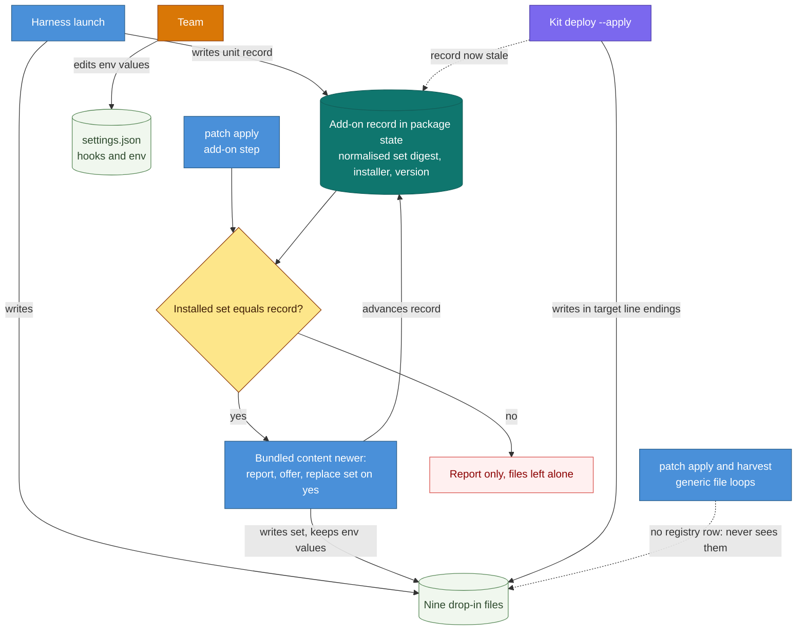
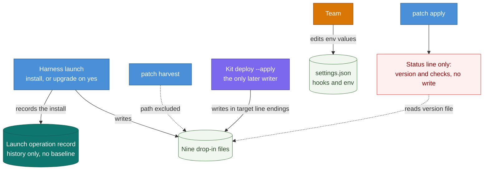
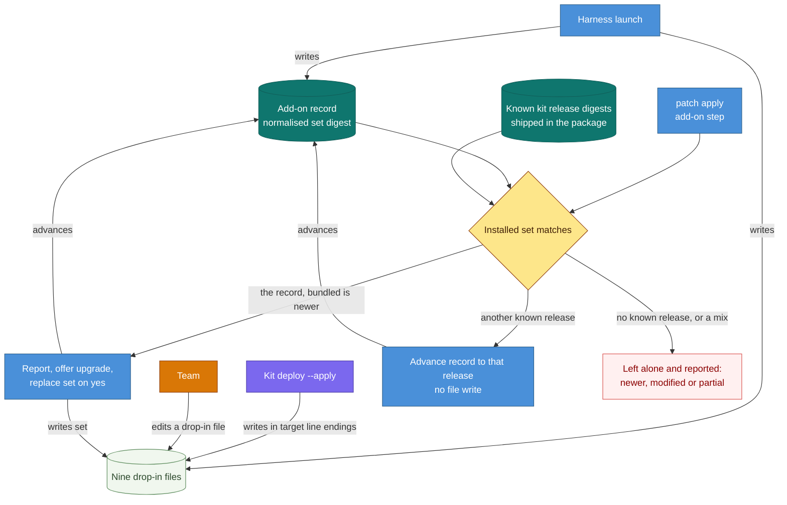
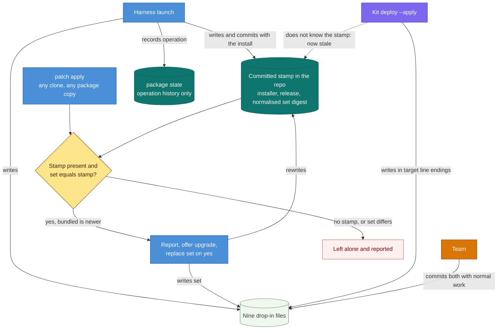
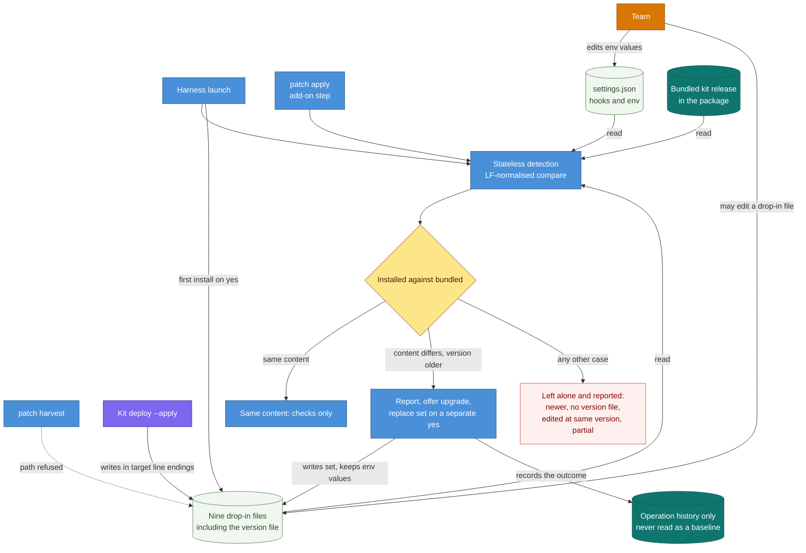

# DESIGN-20261112-T5YB: Session Review Capture Add-on — Research: Ownership After Launch

_Produced by the 🔍 Research phase. Owned by `@product-architect`. Do not edit after Evaluate phase begins._

## Context

Decision 3 covers what happens to the drop-in files in a bootstrapped repo after the first install: baseline rules, the upgrade offer, and the relation to the kit's own `deploy` command. Packaging (Decision 1) and the first install (Decision 2) are researched separately. Every option is checked against EC3, EC4, EC5, EC11 and EC13 from `00 Frame.md`.

The options refer to the numbered facts below as "fact N".

### Verified in the package

1. **`patch apply` is a prose recipe, not a script.** `scripts/` holds only launch tooling (`plan-provider-launch.mjs`, `materialize-launch.mjs`, `finalize-launch.mjs`, `provider-adapter.mjs`). Any after-launch classification of the drop-in is run by an agent unless a script is added.
2. **Baselines are raw-byte hashes.** `06-patch-state.md` defines `state/objects/<sha256>` as "exact local baseline bytes", and `state/index.json` `mappings` entries carry `canonical_sha256`, `deployed_sha256`, `rendered_base` and `provider`. Nothing normalises line endings.
3. **Baselines are local and disposable in a consumer repo.** `references/launch/01a-launch-plan.md` §1 adds the package path to `.gitignore`. `references/launch/08-provider-launch.md` says the package "can be ignored or removed entirely" after a verified launch. A baseline in `package:state/` therefore exists only on the machine that ran launch, and only while the package is kept.
4. **The existing no-baseline rule conflicts with EC11.** `06-patch-state.md` "First launch and existing projects" says: "For exact matches, initialize verified baselines." A hand-installed drop-in that matches the bundled copy would receive a baseline; EC11 says it must not.
5. **`patch apply` deploys without a per-component yes.** `05-patch-apply.md` §2: "Unchanged permanent file: deploy the new rendered output." It shows diffs before writing but asks nothing per component. EC3 requires an explicit yes for an upgrade.
6. **`patch apply` is per file; `partial` is a normal outcome.** There is no "replace as a set" concept (EC4).
7. **Explicit deletes exist in the contract.** `06-patch-state.md` has a `delete` operation; `05-patch-apply.md` says "Confirm unrequested deletions". Removal is therefore reachable by default once the files are mapped.
8. **`registry.md` is the allowlist for apply and harvest.** A file with no row and no mapping is outside both loops.
9. **What is graded deterministically today.** `patch.grader.ts` checks manifest schema, payload hashes, diff reconstruction and provider scope (a mapped result must name its provider). `state.grader.ts` checks launch receipts and that every recorded output's raw hash still matches disk. Nothing grades `state/index.json` mappings or the apply three-way decision.
10. **`.prettierignore` does not cover the five scripts.** It covers `.claude/agents/`, `.claude/skills/`, `.claude/harness-runtime/` and `.agents/`, so the three skill files are covered and `.claude/session-review*.js` are not (EC10 territory).

### Verified in the kit (2.2.5)

Sources: `tools/deploy-kit.js`, `CHANGELOG.md`, `claude-drop-in/INSTALL.md` and `settings.hooks.json`.

11. **`deploy` compares LF-normalised content and has no version-direction check.** It copies whenever normalised content differs and writes in the target's existing line-ending convention. A dashboard instance on an older kit would downgrade a repo that holds a newer drop-in.
12. **`deploy` never writes `settings.json`, `.gitattributes` or `.gitignore`.** It only verifies them: `timeout >= 15` on SessionEnd, `eol=lf` pins on the five `.js`, and review logs not ignored.
13. **`deploy` verification fails a repo whose version file differs from the kit's `VERSION`** (compared trimmed).
14. **Only the five `.js` files are pinned to LF.** The three skill files and `.session-review.version` follow the repo default, so with `core.autocrlf=true` they become CRLF in a Windows working tree. A raw-byte baseline of those four files reads as drift after a re-checkout.
15. **The file set is not fixed across releases.** A comment in `deploy-kit.js` records that `session-review-run.js` was added later, and the script flags `.claude/session-review-pricing.json` as a stale file to delete.
16. **Teams do edit drop-in files.** `deploy --skip=<repo>` exists "while a team's own committed change to a kit file is waiting to be upstreamed (a plain deploy would overwrite it)".
17. **The version-only release is confirmed.** The 2.2.5 changelog says: "the drop-in's code is unchanged. Its version file reads 2.2.5, and a repo keeps working on the copy it has." 2.2.4 was the same apart from one comment.

### Harness docs that bear on the decision

- `docs/Harness/06 Roadmap/01 Harness Roadmap.md` §5.15: "Consider fleet orchestration only after this workflow is reliable and demand exists" and "instead of introducing a parallel update mechanism".
- `docs/Harness/02 Quick Start/index.md`: launch installs "a baseline manifest for future patch operations".
- `docs/Harness/08 Security Scan/`: an open LOW finding that `state/objects/` baseline bytes have no retention policy.
- `docs/Harness/05 Principles/index.md`: Repeatability.

### How the options differ

| Axis                        | 1 Existing baseline                                | 2 Separate unit record                            | 3 Install-once hand-off      | 4 Release recognition                              | 5 Committed stamp                         |
| --------------------------- | -------------------------------------------------- | ------------------------------------------------- | ---------------------------- | -------------------------------------------------- | ----------------------------------------- |
| Where ownership is recorded | `state/index.json` `mappings` + `registry.md` rows | New record under `package:state/`                 | Launch operation record only | Unit record + shipped table of kit release digests | Committed file in the target repo         |
| `patch apply` comparison    | Raw per-file hash, three-way                       | Normalised set digest, plus version for direction | Version string, report only  | Normalised digest matched against known releases   | Normalised set digest read from the stamp |
| Upgrade offered from        | `patch apply`                                      | `patch apply`                                     | Launch only                  | `patch apply`                                      | `patch apply`, from any clone             |
| Line endings                | Need a new rule                                    | Normalised by design                              | Not applicable               | Normalised by design                               | Normalised by design                      |
| After kit `deploy`          | Reads as local edit                                | Reported; record goes stale                       | No conflict                  | Recognised and adopted                             | Reported; stamp goes stale                |
| Harness removes files       | Reachable through `delete` unless ruled out        | Never                                             | Never                        | Never                                              | Never                                     |

Options 4 and 5 can be layered on Option 2 (recognition logic; record location). They are presented as full models so each axis can be evaluated on its own.

Option F (6) was added on 2026-11-12, after the developer resolved the viability questions; it is described in full below and compared with Options A–E in "Effect of the resolutions".

The option headings below carry both the template letter and the comparison-table number: Option A (1) through Option E (5).

## Options

### Option A (1) — Per-file entries in the existing patch baseline (minimal change)

**Description:** Launch records the nine files as nine `mappings` entries in `state/index.json` (`provider: "claude"`, `canonical_sha256` equal to the rendered base because nothing is rendered) and as rows in `state/registry.md` with a new Type or Compare value marking them copy-only. `patch apply` treats them with the existing three-branch rule in `05-patch-apply.md` §2. `patch harvest` skips them through a per-row flag honoured in `04-patch-harvest.md` §1. No new record type. Four override rules have to be added to the existing contract for these rows: no rendering and no three-way merge; an explicit yes before writing; all-or-nothing across the nine files; no baseline initialisation on exact match.

**Industry precedent:** dpkg conffile handling (three hashes — previously shipped, newly shipped, on disk; replace silently when the admin did not change the file, prompt when both sides changed); RPM `%config(noreplace)`.

**Diagram:**

**Pros:**

- Smallest change to `06-patch-state.md`; reuses `mappings`, `state/objects/`, operation records and the launch manifest.
- Matches `docs/Harness/02 Quick Start/index.md` ("a baseline manifest for future patch operations") with no new concept.
- Per-file content hashing makes a version-only release a one-file change (`.session-review.version`), not a phantom nine-file upgrade.
- `patch.grader.ts` provider-scope grading already fits (`provider: "claude"`, `deployment: "mapped"`).

**Cons:**

- EC3: the existing "unchanged permanent file: deploy" branch writes without an explicit yes, so it needs an exception for these rows.
- EC4: apply is per file and `partial` is a normal outcome. A half-applied set mixes releases; `deploy-kit.js` verification shows the scripts depend on each other's exports.
- EC11: the "exact match: initialize verified baselines" migration rule must be switched off for these paths, or hand-installed files gain a baseline.
- Line endings: the four unpinned files flip to CRLF on a Windows re-checkout, and kit `deploy` writes in the target's convention. Both read as local edits under raw-byte hashing. Avoiding this needs either normalised hashing for these rows (departing from "exact local baseline bytes") or extra `.gitattributes` pins beyond `INSTALL.md`.
- After kit `deploy`, every changed file lands in the "Local edits" branch. Its remedies (harvest, retained customization, three-way merge) are all wrong for copy-only content.
- The `delete` operation becomes reachable. If a later package drops the vendored drop-in, apply would propose deleting the nine files, and the kit's uninstall also covers the two hook entries, which a per-file delete does not.

**Unknowns / risks:**

- Baseline bytes of hook scripts would be stored in `state/objects/`, which enlarges the surface of the open LOW retention finding in `docs/Harness/08 Security Scan/`.
- The baseline exists only on the launching machine (fact 3). Elsewhere the files look "present without baseline" and are never offered an upgrade.
- Not verified: how a consumer's `.claude/settings.json` is baselined. This repo's `state/index.json` has no mapping entry for it, only `canonical/settings.json` under `canonical`.

---

### Option B (2) — Separate add-on record with a set-level lock (lockfile pattern)

**Description:** The drop-in is recorded as one unit outside `mappings` and `registry.md`. A new record under `package:state/` (for example `state/addons/session-review.json`, or an `addons` key in `state/index.json` with a schema bump) holds: who installed it, the kit release and version, and the launch operation UUID; an LF-normalised SHA-256 per file and one set digest; the settings entries and the `.gitattributes` / `.gitignore` lines the harness added. Because the files have no registry row, the generic apply and harvest loops never see them. `patch apply` gains one discrete add-on step in `05-patch-apply.md`: compare the installed set (normalised) with the record and with the bundled release, classify, report, and on an explicit yes replace the whole set. The content digest decides whether there is anything to offer; the version number decides direction and wording.

**Industry precedent:** Python `.dist-info` `RECORD` + `INSTALLER` (PEP 376 / PEP 627): per-file hashes plus the name of the installer; a tool only uninstalls or upgrades what its own record lists. Lockfiles with integrity hashes: `package-lock.json` `integrity`, `yarn.lock` checksums, `.terraform.lock.hcl`, `go.sum` with `vendor/modules.txt`.

**Diagram:**

**Pros:**

- EC11 holds by construction: no record means no touch, and harvest exclusion needs no flag.
- EC4: the unit is the set, with one decision and one outcome.
- EC3: the offer is a dedicated step, so the explicit yes is not an exception inside the generic rule.
- Line endings are handled the way the kit handles them (`norm()` in `deploy-kit.js`), so CRLF copies do not read as edits. Writes still use the shipped bytes (EC5).
- A version-only release is detectable (set digest equal apart from the version file) and can be given its own policy.
- EC13: recording which hook and ignore entries were added makes "files without hooks, or the reverse" checkable.
- No `delete` path reaches the files; no baseline bytes go into `state/objects/`.

**Cons:**

- A second bookkeeping shape beside `mappings`. `06-patch-state.md`, `05-patch-apply.md`, the README's "Harvest, apply, and traceability" section and the graders all grow.
- After kit `deploy` the record is stale. The harness reports ("newer: left alone", or "modified since install") and steps back, with no route to resume ownership unless a re-stamp rule is added.
- The reverse case is not preventable from the harness: an older kit's `deploy` downgrades a harness-upgraded repo (fact 11).
- The record is local (fact 3). Another clone, or a repo whose package was removed, has no record and gets no offer.

**Unknowns / risks:**

- The file set can change between releases (fact 15). "The set" must be defined by the bundled release's file list, and files dropped by a release need a rule.
- Whether an apply operation's add-on result is recorded as `deployment: "mapped"` or a new kind. `gradePatchProviderScope` fails any non-canonical-only result without a provider, so it must carry `provider: "claude"` either way.
- The classification is agent-run unless a script is added (fact 1).

---

### Option C (3) — Install-once hand-off: the kit owns updates (externally managed pattern)

**Description:** The harness installs at launch and then stops being a writer. It keeps no baseline for the drop-in, only the launch operation record as history. `06-patch-state.md` gains a fixed exclusion of the drop-in paths from apply and harvest, alongside the existing "Exclude `patch/**`, `state/**`" rule. `patch apply` prints at most a read-only status line: installed version against bundled, and the EC9 checks. The upgrade offer of EC3 and the set replacement of EC4 exist only inside launch's add-on step when launch is run against a repo that already has an older install. All later updates go through the kit's `deploy` or a manual reinstall.

**Industry precedent:** PEP 668 `EXTERNALLY-MANAGED` (a marker telling one installer that another tool owns the environment); one-shot scaffolders (cookiecutter without cruft, `npm init` templates); Helm `helm.sh/resource-policy: keep`; Terraform `lifecycle { ignore_changes }`.

**Diagram:**

**Pros:**

- One update channel, so the dual-writer cases disappear, including the downgrade case.
- Consistent with `08-provider-launch.md` and the README: the package may be removed after a verified launch, so an upgrade channel that needs the package is not guaranteed anyway.
- Consistent with Roadmap §5.15 ("instead of introducing a parallel update mechanism"; fleet orchestration deferred).
- Smallest patch-contract change of all five: one exclusion rule and one status line.
- Line endings and version-only releases need no rule. The repo "keeps working on the copy it has", as the kit changelog says.
- EC11 holds trivially.

**Cons:**

- The Frame names "the upgrade offer" under Decision 3. Here it shrinks to launch, and EC3's fourth case and EC4 are met only if re-entering launch on an already launched repo is a supported route.
- Kit `deploy` needs a dashboard instance with a configured root. A team without a lead running one has no update route except a manual reinstall.
- A refreshed vendored copy (EC6) reaches only new launches.
- Kit `deploy` does not write `settings.json` (fact 12), so a kit release that changes hooks or `env` keys has no automated path in either tool.

**Unknowns / risks:**

- Not verified: whether launch can be re-run on a launched repo just for the add-on step. Launch resumes incomplete runs (`01a-launch-plan.md`); re-entering completed ones was not confirmed.
- EC13 partial-install reporting after launch would rest on the status line only.

---

### Option D (4) — Shared ownership with release recognition (three-hash / field-manager pattern)

**Description:** Both channels stay legitimate writers and the harness reconciles after the fact. It keeps a unit record as in Option B, and the package also ships a table of LF-normalised digests for every kit release the vendored copy has been refreshed from, each flagged where its code equals the previous release. `patch apply` classifies the installed set against the record, the bundled release and the table:

- **Equals the record:** clean; an upgrade is offered when bundled content is newer.
- **Equals another known release:** "updated by another channel". The record advances to that release with no file write, then the EC3 cases apply by version.
- **Equals no known release, version higher:** newer; left alone and reported.
- **Equals no known release otherwise:** locally modified; left alone and reported.
- **Files from different releases:** partial; reported (EC13).

**Industry precedent:** Kubernetes server-side apply `managedFields` (several managers, with ownership transferred or flagged as conflict per field); dpkg conffile handling (recognise an on-disk file as "the previous default" by hash before deciding to replace); Renovate and Dependabot pinning by digest.

**Diagram:**

**Pros:**

- The only option where a kit `deploy` does not permanently end harness ownership or read as a local edit.
- Version-only releases are first-class: a code-equivalent release is known from the table, so no phantom upgrade is offered.
- Separates "the kit updated it" from "the team edited it" (fact 16), which no other option does.
- Normalised digests make line endings a non-issue.
- EC3, EC4, EC11 and EC13 each map to a named classification.

**Cons:**

- The most machinery: a new shipped artifact that grows with every refresh and couples to the refresh script (Decision 1).
- More classification cases than the five in EC12, so more e2e work.
- An agent-run recipe is a weak fit for a multi-way digest comparison (fact 1); in practice this implies a new script.
- Advancing the record without a prompt is a state write the developer did not ask for. Whether that counts as "silent" needs a ruling.
- Still local state (fact 3), and the downgrade by an older kit's `deploy` is recognised and reported, not prevented.

**Unknowns / risks:**

- A kit release newer than the package's table is indistinguishable from a local edit except by the version file, which anyone can edit.
- Whether the kit owner will publish per-release drop-in digests or the harness must compute them at refresh.

---

### Option E (5) — Committed in-repo ownership stamp (managed-by marker)

**Description:** The ownership record travels with the repo. Launch writes one small committed file beside the drop-in (for example `.claude/.session-review.harness.json`; the name is illustrative) holding the installer, harness package version, kit release, LF-normalised set digest and the settings and ignore entries the harness added. `package:state/` keeps only operation history. Any later `patch apply`, on any clone and with any fresh copy of the package, reads the stamp, compares the installed set with it and with the bundled release, and makes the EC3 offer. A file cannot carry a "managed by" header because of EC5, so the marker has to be a sidecar.

**Industry precedent:** Copier `.copier-answers.yml` and Cruft `.cruft.json` (committed template provenance, so `copier update` works from any clone); Helm `app.kubernetes.io/managed-by` label with release annotations; "This file is managed by Ansible/Puppet" markers; a committed `.terraform.lock.hcl`.

**Diagram:**

**Pros:**

- The only option where the upgrade offer survives the two verified facts about consumer state: it is git-ignored and the package is disposable.
- EC11 is decidable everywhere: stamp present means harness-installed; absent means not.
- The stamp is visible in code review, so the ownership claim is auditable in the repo's own history.
- The normalised digest handles line endings.
- No baseline bytes in `state/objects/`.

**Cons:**

- A tenth file in `.claude/` that the kit does not know. `deploy` ignores it (its `FILES` list is fixed), and the kit's documented uninstall leaves it behind.
- After a kit `deploy` the stamp is stale. That is detectable and reportable, but it needs a re-stamp rule or the harness steps back for good, as in Option B.
- EC5 still holds for the nine files, but "the drop-in as installed" is no longer exactly the kit's file list. That needs an explicit statement.
- Anyone can edit or copy a committed marker. It is a convention, not proof of who installed.
- It departs from the current contract sentence that all local bookkeeping lives under `package:state/` (`06-patch-state.md`, opening section).

**Unknowns / risks:**

- Not verified: whether the kit's dashboard collector, leak check or a future `deploy` verification would flag an unknown file under `.claude/`. `deploy-kit.js` flags one specific stale file by name; no general unknown-file check was found, and the collector was not read.
- Repos with nested `.claude/` folders: one stamp at the root, or one per location.

---

### Option F (6) — Stateless detection, no ownership record

**Description:** Every launch and every `patch apply` runs the same detection against the repo itself and stores nothing about ownership. It reads the nine paths, `.claude/.session-review.version`, and the hook registration in `.claude/settings.json`, and compares each file, LF-normalised, with the bundled release. The content comparison decides whether anything differs; the version file alone decides direction. An upgrade is offered when content differs and the installed version is older, and is applied as a set only on a separate explicit yes. Who installed the drop-in is never asked and never recorded. The only trace is the ordinary operation record of a run that wrote something, and that record is never read back as a baseline.

**How it classifies:**

| Observation (LF-normalised) | Class | Action |
| --- | --- | --- |
| All nine files equal the bundled release, hooks registered | Same | Nothing; EC9 checks only |
| Only `.session-review.version` differs | Version-only | Detected exactly; the policy is still open (OQ3-5) |
| Content differs, installed version lower | Older | Reported, upgrade offered, set replaced on a separate yes (EC3, EC4) |
| Content differs, installed version higher | Newer | Left alone and reported (EC3) |
| Files present, no version file | Existing, unknown | Left alone and reported (EC3) |
| Content differs, installed version equal to bundled | Edited or mixed | Left alone and reported; the same version with different content cannot be a pristine release |
| Hooks without files, files without hooks, or a file missing at the same version | Partial | Reported, not repaired (EC13) |

**What it cannot distinguish without a record or a table of known releases:**

- **A pristine older release from an older release with a team edit.** Both show "content differs, version lower" and both get the offer. A yes overwrites the edit (fact 16). The offer can only say that it replaces all nine files and name the ones that differ.
- **A complete older install from a partial one, when the file set changed between releases** (fact 15). A file the bundled release added is missing in both cases.
- **A mix of files from two releases from a local edit.**
- **A stale file that a newer release dropped from any other file in `.claude/`,** except by name pattern.
- **A wrong version file from a right one.** Direction rests on one editable line. After an older kit instance's `deploy` downgrades a repo (fact 11), the harness sees "older" and offers again, so the two channels can alternate.
- **An `env` key the team deleted from a key a newer release added.** The settings merge can keep existing values (EC4) but would re-add a deliberately removed key.
- **A previously declined offer.** A "no" is not remembered, so the offer repeats on every launch and every `patch apply`.

**What changes in the package:**

- `references/patch/05-patch-apply.md`: one add-on step running detection, report, separate yes, set replacement, the EC9 checks and the operation record entry. It also needs a statement that the §2 branches ("Unchanged permanent file: deploy", "Local edits", "Missing baseline") never apply to drop-in paths.
- `references/patch/06-patch-state.md`: a fixed exclusion saying drop-in paths never get a `mappings` entry, a `state/objects/` snapshot or a registry row; a statement that the "exact matches: initialize verified baselines" rule does not apply to them (fact 4); a statement that an operation record's drop-in result is history, not a baseline (`05-patch-apply.md` §1 already says a previous applied row does not excuse new drift).
- `references/patch/04-patch-harvest.md` §1: an explicit refusal for drop-in paths. Today a named unregistered file is inspected and a mapping proposed.
- `registry.md`: no rows; one note that the drop-in paths are deliberately unregistered (fact 8).
- Graders: a new deterministic grader over the classifier, covering the seven classes above; a negative check that no `mappings` entry exists for a drop-in path; `patch.grader.ts` `gradePatchProviderScope` needs no change if the add-on result carries `provider: "claude"` with a deployment value other than `canonical-only`.

**Industry precedent:** Ansible `copy` and `template` (every run compares the destination's checksum with the source and keeps no state file; Terraform, which keeps one, is the contrast); `npm outdated` and `pip list --outdated` (the installed artefact's own version metadata is compared with what is available); the kit's own `deploy` (it finds kit repos by `.claude/session-review.js` and compares normalised content, with no record — facts 11, 13).

**Diagram:**

**Pros:**

- Matches the resolutions directly: same offer at launch and at `patch apply`; independent of who installed; works from any clone and after the package is removed or replaced (fact 3 stops mattering); LF-normalised, as the kit's `norm()` does.
- One detection routine serves launch's EC3 cases and `patch apply`, which fits Repeatability (`docs/Harness/05 Principles/index.md`).
- EC11 as now read holds by construction: there is no baseline for any drop-in file, and no path by which `patch apply` writes them except the offer.
- No record can go stale after a kit `deploy`; the next run reads what is there.
- A version-only release is detected exactly, so no nine-file upgrade is offered for it.
- No baseline bytes of hook scripts enter `state/objects/` (the open LOW finding in `docs/Harness/08 Security Scan/`).
- The classifier is a pure function of the repo and the bundled release, so it is simple to cover deterministically (EC12).
- The smallest state-contract change of the six options: exclusions and one step, no new record type.

**Cons:**

- An accepted upgrade can overwrite a team's edit that detection could not see (first limit above; fact 16).
- EC13 and EC3 overlap when the file set differs between releases; a precedence rule is needed.
- The offer repeats after a "no", and after every downgrade by an older kit instance (fact 11).
- The settings merge on upgrade has no memory of what was added earlier.
- Nothing links an installed drop-in to the package version that installed it, except operation history on the launching machine.

**Unknowns / risks:**

- Version ordering. The file went from `1.4` to `2.2.4` (fact 17). The comparison rule for two-part and three-part versions, and for a malformed file, is undefined; EC3 covers only a missing file.
- The classification is still agent-run unless a script is added (fact 1). Here the script would be small, but it is new package tooling.
- How the refreshed vendored copy appears in a portable bundle when it has no mapping (`deployment` value) depends on Decision 1.
- Whether detection covers only the root `.claude/` or nested locations depends on Decision 2.

---

## Effect of the resolutions (2026-11-12)

The developer (kit owner) resolved the viability questions at the Research sign-off. The table states the factual consequence for each option; it is not a ranking.

**Resolutions:**

- **OQ3-1:** the upgrade is offered both at launch and at harness upgrade (`patch apply`). Developer's words: "if harness is being upgraded or installed and there is a session review kit that can be upgraded as well then the upgrade is offered".
- **OQ3-3:** the offer does not depend on who installed the drop-in or on a local harness record. Any installed drop-in found older than the bundled one gets the offer, hand-installed ones included, from any clone. EC11 is therefore read as: `patch apply` never changes drop-in files on its own; the explicit offer, applied only on a yes, is the single path. Still no baseline for files the harness did not install, and the drop-in is never harvested.
- **OQ3-7:** EC5 means the unmodified kit content; comparison ignores line-ending differences. Developer's words: "it just means the unmodified version of the kit".
- **OQ3-2:** a separate explicit yes for the add-on. **OQ3-10:** the harness never removes the drop-in. (Both accepted as proposed.)

| Option | Status | Reason |
| --- | --- | --- |
| A (1) Existing patch baseline | Viable only with a stated change | The offer must come from repo-level detection, not the mapping (OQ3-3). Hashing must be LF-normalised, which departs from "exact local baseline bytes" (OQ3-7). The `delete` path must be closed for these rows (OQ3-10), and the "unchanged: deploy" branch must not apply (OQ3-2 and the EC11 reading). After those changes the nine baselines no longer decide anything; they are extra evidence of local edits on the launching machine only. |
| B (2) Separate unit record | Viable only with a stated change | The record may no longer gate the offer (OQ3-3). It survives as a local note of what the harness added to settings and ignore files, and as evidence of edits since install on the launching machine. Its dedicated step, separate yes, normalised digest and no-removal rule already match OQ3-2, OQ3-7 and OQ3-10. |
| C (3) Install-once hand-off | No longer viable | OQ3-1 requires the offer at `patch apply` as well as at launch; this option's defining rule is that `patch apply` only reports. |
| D (4) Release recognition | Viable only with a stated change | The unit record and the "advance the record" step lose their role (OQ3-3). The shipped table of known release digests still works without a record, and it is the one mechanism in the six options that separates a pristine older release from an edited one and a complete older install from a partial one. |
| E (5) Committed stamp | Viable only with a stated change | The stamp can no longer be a precondition for the offer, and any-clone reach no longer needs it (OQ3-3). It survives only as evidence, from any clone, that a harness-installed set was changed after install. Its costs are unchanged: a tenth file the kit does not know, and staleness after `deploy`. |
| F (6) Stateless detection | Viable as described | Built on the resolutions. |

## Not verified

- `state/objects/` was not read.
- The launch scripts (`plan-provider-launch.mjs`, `materialize-launch.mjs`, `finalize-launch.mjs`) were not read for this decision; only that no patch script exists in `scripts/` was confirmed.
- How a consumer repo baselines its `.claude/settings.json`.
- The kit's dashboard collector, `kit-sync` and leak check were not read.
- Kit release notes below 2.2.4 were not read, beyond the 2.2.4 statement that the version file moved from 1.4.
- Industry references are from general knowledge and were not re-checked against current upstream documentation.
- No Mermaid diagram was rendered.

## Open Questions

Classification proposed by the orchestrator at OQ triage (2026-11-12); the developer confirms or corrects it at the Research sign-off. (V) = the answer would disqualify one or more options; (E) = evaluation input only.

Updated 2026-11-12 with the developer's answers given at the Research sign-off, and with the questions Option F raises.

| #      | Question                                                                                                                                                                                                                                                              | V/E (proposed)                                                                           | Owner                              | Proposed answer / status                                                                                                                      |
| ------ | --------------------------------------------------------------------------------------------------------------------------------------------------------------------------------------------------------------------------------------------------------------------- | ---------------------------------------------------------------------------------------- | ---------------------------------- | --------------------------------------------------------------------------------------------------------------------------------------------- |
| OQ3-1  | Must `patch apply` carry the EC3 upgrade offer, or is it enough that launch offers it when run against a repo with an older install?                                                                                                                                  | (V) — decides whether Option C is admissible                                             | Harness author                     | Resolved 2026-11-12 (developer): offered at launch and at `patch apply`. Option C (3) is no longer viable.                                                                                                        |
| OQ3-2  | Is invoking `patch apply` itself the "explicit yes" of EC3, or is a separate confirmation for the add-on required?                                                                                                                                                    | (E) — every option can carry either                                                      | Harness author                     | Accepted as proposed (2026-11-12): a separate confirmation for the add-on.                                       |
| OQ3-3  | Must the upgrade be offerable from a clone or machine other than the one that ran launch, or after the package was removed?                                                                                                                                           | (V) — if yes, Options A, B and D fail as described and only C or E remain                | Harness author                     | Resolved 2026-11-12 (developer): yes — the offer is made from what is found in the repo, regardless of who installed the drop-in, from any clone. See "Effect of the resolutions".                                                                                                        |
| OQ3-4  | Does the `06-patch-state.md` rule "for exact matches, initialize verified baselines" apply to drop-in files?                                                                                                                                                          | (E) — settled by EC11                                                                    | Harness author                     | Answered through the EC11 reading: no baseline is ever initialised for a drop-in file the harness did not install; the exact-match rule in `06-patch-state.md` needs an exclusion.                              |
| OQ3-5  | When installed and bundled differ only in `.session-review.version`, is the outcome silence, a report, or an offer to update the version file?                                                                                                                        | (E) — a policy every option can express                                                  | Kit owner and harness author       | Open — carried to Evaluate                                                                                                                    |
| OQ3-6  | `deploy` has no version comparison, so an instance on an older kit downgrades a harness-upgraded repo. Accepted and documented, or will the kit add a guard?                                                                                                          | (E) — the kit is out of scope for this design                                            | Kit owner                          | Open — carried to Evaluate as a documented limitation unless the kit owner says otherwise                                                     |
| OQ3-7  | Which bytes does EC5 bind: the bytes written at install, or the working-tree bytes afterwards? Is LF-normalised comparison acceptable beside the contract's "exact local baseline bytes"? May the harness pin the three skill files and the version file to LF?       | (V) — if only raw-byte comparison is acceptable, Options B, D and E change shape         | Harness author; kit owner for the pins | Resolved 2026-11-12 (developer, kit owner): EC5 means the unmodified kit content; comparison ignores line-ending differences. Pinning the skill files and the version file to LF is no longer blocking.   |
| OQ3-8  | Can a kit release change `settings.hooks.json` (hook command, timeout, `env` keys)? If so, is merging those part of "the set" in an EC4 upgrade?                                                                                                                      | (E)                                                                                      | Kit owner, then implementer        | Open — carried to Evaluate                                                                                                                    |
| OQ3-9  | Is "the set" defined by the bundled release's file list, and what happens to a file a newer release drops?                                                                                                                                                            | (E)                                                                                      | Kit owner, then implementer        | Open — carried to Evaluate                                                                                                                    |
| OQ3-10 | Does the harness ever remove the drop-in?                                                                                                                                                                                                                             | (E) — Option A needs a rule either way                                                   | Harness author                     | Accepted as proposed (2026-11-12): never.                                                                          |
| OQ3-11 | Does after-launch classification have to be a script?                                                                                                                                                                                                                 | (E)                                                                                      | Harness author, then implementer   | Open — carried to Evaluate                                                                                                                    |
| OQ3-12 | How is a locally edited drop-in file treated on an accepted upgrade: refuse, or overwrite with a backup as the kit does?                                                                                                                                              | (E)                                                                                      | Harness author | Superseded by OQ3-13. |
| OQ3-13 | Under stateless detection an edited older install looks the same as a pristine one. What must the offer do before overwriting: warn and list the differing files, take a backup as the kit does, or check git for uncommitted changes on the nine paths? | (E) | Harness author | Open — carried to Evaluate |
| OQ3-14 | Is a declined offer remembered? If so, where, given that `package:state/launch/answers.json` is local to one machine? Or is it re-asked on every launch and `patch apply`? | (E) | Harness author | Open — carried to Evaluate |
| OQ3-15 | What is the version comparison rule (two-part `1.4` against three-part `2.2.5`), and how is a malformed version file classified? | (E) | Kit owner for the ordering guarantee; harness author for the policy | Open — carried to Evaluate |
| OQ3-16 | When the bundled release has a file the older install lacks, is that "older" (offer) or "partial" (EC13 report)? May an accepted upgrade also add missing hook entries, or is that a repair EC13 forbids? | (E) | Harness author | Open — carried to Evaluate |
| OQ3-17 | Does detection run on every `patch apply`, including one limited to a named scope or to a supplied bundle that does not touch the drop-in? | (E) | Harness author | Open — carried to Evaluate |
| OQ3-18 | Does detection run when Claude is not among the installed providers but a hand-installed drop-in exists in `.claude/`? EC8 says nothing changes for Codex-only or Copilot-only launches; OQ3-3 says who installed does not matter. | (E) | Harness author | Open — carried to Evaluate |
| OQ3-19 | Will the kit publish per-release digests or file lists? Without them the limits listed under Option F stand; Option D's table is the only mechanism identified that removes the first three. | (E) | Kit owner | Open — carried to Evaluate |
| OQ3-20 | How is the add-on result recorded when there is no mapping: the `deployment` value in the operation record and in a portable bundle that carries a refreshed vendored copy? | (E) | Implementer, after Decision 1 | Open — carried to Evaluate                                                                                                                    |
