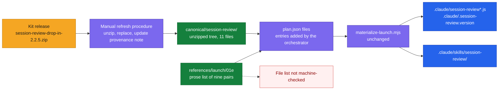
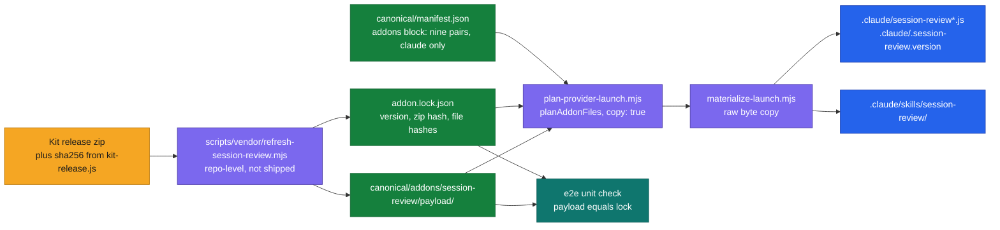
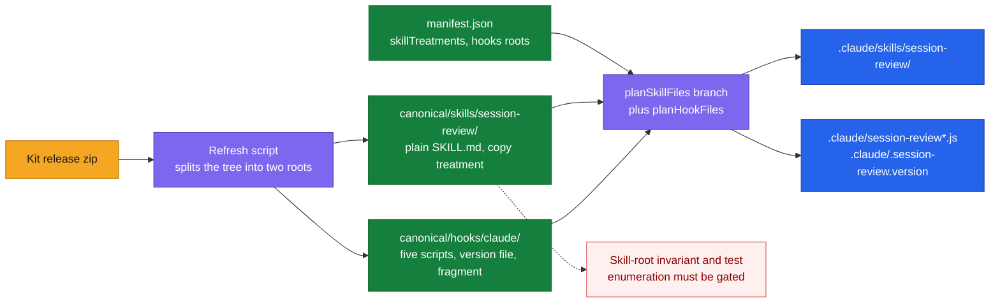
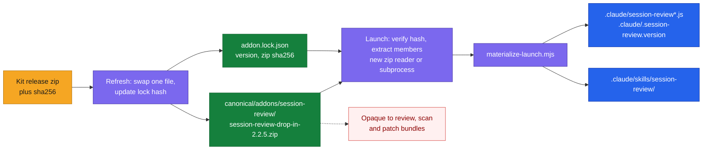
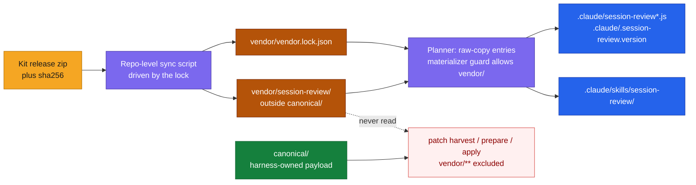

# DESIGN-20261112-T5YB: Session Review Capture Add-on — Research: Packaging and Sync

_Produced by the 🔍 Research phase. Owned by `@product-architect`. Do not edit after Evaluate phase begins._

## Context

Decision 1 covers where the vendored drop-in lives in the package, how the manifest and planner represent copy-only content whose destinations are outside the skills root, and how the harness copy is refreshed from a kit release. In every option `settings.hooks.json` stays an unmodified vendored file; how it is merged is Decision 2. EC numbers refer to `00 Frame.md`.

### Facts that bound every option

**Package contract**

- `README.md` ("The canonical/ root") says everything the harness deploys or patches lives under `canonical/`. Every other top-level item is scaffolding, "not deployable payload".
- `scripts/materialize-launch.mjs` (`prepareFileEntry`) enforces this: a plan source must sit under `canonical/` (or the legacy `skills`/`agents`/`docs` roots).
- Any path under `canonical/` already materializes with no code change. A top-level `vendor/` would not.

**Byte identity through the current materializer**

- The materializer decodes the source as strict UTF-8, runs `providerText` when the entry is provider-tagged, applies `{{TOKEN}}` replacements, then re-encodes.
- That round-trip is byte-identical only if the file is valid UTF-8 and holds no `{{UPPER_CASE}}` or `{{provider:*}}` tokens.
- A later kit release containing such text would fail materialization unless declared in `preserve_tokens`. Through the planner's `createFileAdder` it would be silently substituted if a known of that name exists, which breaks EC5.
- `scripts/finalize-launch.mjs` also rejects any `{{...}}` in a final output that is not listed in `runtime_tokens`.

**Existing precedent for copy-only code**

- `canonical/docs/.og/*.mjs` is deployed "verbatim … no token substitution, this is code" by prose in `references/reindex-graph.md` Step 0. It is not in the manifest or the planner.
- `references/launch/01a-launch-plan.md` and `08-provider-launch.md` sanction extending the plan before it is frozen.

**Skill-root invariant**

- `planSkillFiles` throws `Incomplete skill` for any `canonical/skills/<name>` without `TEMPLATE.md` and `INTENT.md`, and always adds `runtime/*.md` files to the installed skill.
- `apps/harness-bootstrap-e2e/src/utils/build-launch.ts:37` and `src/tests/unit/provider-launch.spec.ts:54,118-124` enumerate every directory under `canonical/skills` as a skill for all three providers.

**Settings**

- `renderConfig` writes `settings.claude` verbatim for every Claude launch. Putting the kit's hooks or env into `canonical/settings.json` would therefore install them when the answer is no (EC8), and would be a harness-edited duplicate of kit content (EC6).

**Release ZIP**

- `scripts/release/release-harness-bootstrap.mjs` copies the whole package directory from the working tree except `state/`. Any location inside `.canonical-implementation-harness/` therefore ships with no release-script change (EC6).

**This repo's own tooling would rewrite vendored files**

- `lint-staged` runs `eslint --fix` and `prettier --write` on `*.js`, and `prettier --write` on `*.md` and `*.json`.
- `.prettierrc.json` sets `singleQuote: true`; the kit uses double quotes and unpadded Markdown tables, so prettier would change the bytes.
- `eslint.config.js` gives Node globals only to `**/*.mjs`, and the kit scripts are CommonJS (`require`, `__dirname`), so they would fail lint.
- `.gitattributes` has no EOL rule for the package. A Windows checkout with `core.autocrlf=true` would give CRLF working-tree copies, and the release script zips the working tree.
- Every option that stores an unpacked tree (A, B, C, E) therefore needs entries in `.prettierignore`, the `eslint.config.js` `ignores`, and `.gitattributes`. `.prettierignore` already carries the precedent comment about phantom drift.

**Security scan**

- `SKILL.md` metadata declares "spawns one pinned local subprocess … No network calls" and Origin is recorded as Internal.
- The 2026-11-03 report's scope note says `canonical/` was "read only where harness-bootstrap's own instructions directly reference or execute them". Location therefore changes what the scanner reads directly.

**Kit facts**

- `claude-drop-in/` holds 11 files: the nine installable ones plus `INSTALL.md` and `settings.hooks.json`.
- `tools/kit-release.js` builds the drop-in zip with `git archive --prefix=session-review-drop-in/ HEAD:claude-drop-in` and prints its sha256.
- The source-to-destination map of the nine files exists only in `tools/deploy-kit.js` (`FILES`) and the `INSTALL.md` table. The `.gitattributes` and `.gitignore` lines exist only as prose in `INSTALL.md` steps 3 and 4. Neither is machine-readable inside the drop-in zip, so any harness copy of them is a transcription.
- `tools/deploy-kit.js` treats line endings as insignificant: it normalises them and writes in the target's convention. `tools/kit-sync.js` records per-file hashes to tell a stale copy from an edited one.

**Checked by the orchestrator on the published 2.2.5 zip (2026-11-12)**

Verified by opening `session-review-drop-in-2.2.5.zip`.

- sha256 of the zip: `11dac095b216202e696a55b5d5dd24b8590ac51cf6997f275c4c875c35770010`.
- It holds exactly 11 files under the `session-review-drop-in/` prefix.
- No file contains a carriage return (all LF), and no file contains `{{...}}` text.
- Every file is byte-identical to the kit's `claude-drop-in/` working tree, whose version file reads `2.2.5`.

**Governance altitude**

- `docs/Harness/` holds no precedent on package internals; precedent comes from the package's own README and references. No option needs a change to `docs/Harness/05 Principles/`. The relevant beliefs are Repeatability (README: same inputs give "the same file selection, paths") and Convergence (the harvest path, which EC11 deliberately keeps the drop-in out of).

### How the options differ

| Aspect | 1 Reference-driven | 2 Manifest add-on | 3 Existing roots | 4 Pinned archive | 5 `vendor/` root |
| --- | --- | --- | --- | --- | --- |
| Location | `canonical/session-review/` | `canonical/addons/session-review/payload/` | `canonical/skills/…` + `canonical/hooks/claude/` | zip under `canonical/addons/…` | package-root `vendor/` |
| Mirrors the kit zip layout | Yes | Yes | No (split) | Is the zip | Yes |
| Manifest change | None | `addons` block | Treatment + hooks roots | `addons` with archive | `vendor` block |
| Script changes | None | Planner, materializer, finalizer, validator | Planner, validator, constants | Planner, materializer, zip reader | As 2, plus source-root guard |
| File list is machine-readable | No (prose) | Yes | Yes | Yes | Yes |
| Mechanical guard against in-harness edits (EC6) | No | Lock + check | Lock + check | Single hash | Lock + check |
| Needs prettier/eslint/EOL ignores | Yes | Yes | Yes (two paths) | No | Yes |
| Can travel in a patch bundle | Yes (text under `canonical/`) | Yes | Yes | No (binary) | No (excluded) |
| Contradicts a current package statement | No | Extends the treatment table | Skill-bundle invariant | "Node standard library only" or the subprocess declaration | Single deployable root |

The option headings below carry both the template letter and the comparison-table number: Option A (1) through Option E (5).

## Options

### Option A (1) — Canonical payload, reference-driven plan entries (minimal change)

**Description:** All three parts take the smallest valid form. _Location:_ `canonical/session-review/` holds the unzipped drop-in tree exactly as the kit zip lays it out (11 files); a sibling provenance note (for example `canonical/session-review.VENDORED.md`) records kit version, zip name, zip sha256 and "local modifications: none". _Manifest and planner:_ no change to `canonical/manifest.json`, `plan-provider-launch.mjs`, `materialize-launch.mjs`, `finalize-launch.mjs`, `lib/manifest.mjs` or `lib/constants.mjs`; a new launch reference (for example `references/launch/01e-launch-session-review.md`, linked from `01-launch.md`) lists the nine source-to-target pairs and tells the orchestrator to extend `plan.json` `files` with nine entries (`provider: "claude"`, `replacements: {}`, no `intent` or `derive`), which the materializer accepts as they are. _Refresh:_ a documented manual procedure — delete the directory, unzip `session-review-drop-in-<version>.zip`, update the provenance note, and re-read `INSTALL.md` against the reference's file list and git lines.

**Files that change:** new `canonical/session-review/**`; new launch reference plus the `01-launch.md` stage table; `README.md` and `references/patch/06-patch-state.md` (canonical-root contents, copy-only rule); `.prettierignore`, `eslint.config.js`, `.gitattributes`; `CHANGELOG.md`.

**Industry precedent:** Chromium `third_party/` with `README.chromium` (name, URL, version, licence, local modifications recorded beside an unmodified copy). In-package: `canonical/docs/.og/`.

**Diagram:**

**Pros:**

- Smallest change, with no schema or script change. It follows the in-package `.og` precedent and the sanctioned plan-extension point.
- Outputs still pass through the plan, receipt and finalizer hashes, so EC5 is checked per file at materialize time (`source_sha256`, write verification).
- Ships in the release ZIP automatically (EC6).
- `provider: "claude"` entries are rejected by the materializer when Claude is not selected, which supports EC8.

**Cons:**

- The file list lives in prose and the entries are hand-authored each launch. That is weaker against README's determinism statement and the Repeatability principle. `INSTALL.md` itself warns that `.session-review.version` is easily skipped.
- Nothing mechanical proves the harness copy equals the kit release (EC6). It rests on the ignore entries and discipline.
- Copy-only status is not machine-readable, so the EC11 harvest exclusion is a prose rule.
- The EC12 deterministic suite cannot reach these entries through `buildPlan`. Tests would duplicate the prose list.
- Token logic still runs. A future kit file containing `{{TOKEN}}` text needs special handling.

**Unknowns / risks:**

- Whether a nested `SKILL.md` inside the package is discovered by Claude Code (OQ1-5).
- Whether a kit refresh becomes a "direct canonical edit" that `patch apply` packages by itself (OQ1-4).

---

### Option B (2) — Manifest-declared add-on, raw-copy plan entries, hash-locked refresh script

**Description:** Differs from Option A in the manifest/planner part and the refresh part; location is still under `canonical/`. _Location:_ `canonical/addons/session-review/payload/` (unzipped tree) plus `canonical/addons/session-review/addon.lock.json` (kit version string, zip filename, zip sha256, per-file sha256). _Manifest:_ `canonical/manifest.json` gains an additive `addons` block naming the payload root, `providers: ["claude"]`, the nine source-to-target pairs (literal `.claude/...` targets, since the paths are fixed and Claude-only), the lock path, and the settings fragment filename. _Planner and materializer:_ `selection.json` gains `addons: ["session-review"]`; `plan-provider-launch.mjs` gets a `planAddonFiles` step that emits `files` entries flagged `copy: true`, checks each source against the lock, and refuses an add-on whose provider is not selected; `materialize-launch.mjs` writes source bytes untouched for `copy: true` and rejects `replacements`, `intent`, `derive` or `render` on such entries; `finalize-launch.mjs` skips the token scan for them; `lib/manifest.mjs` and `lib/constants.mjs` validate the block; the lock joins `ADAPTER_SOURCES` and `requiredAdapterSources`, the two lists that must stay in sync. _Refresh:_ a repo-level script beside `scripts/release/` (for example `scripts/vendor/refresh-session-review.mjs`), not shipped in the package; it takes a local zip path and the expected sha256, replaces the payload as a set, regenerates the lock, fails when the file set differs from the manifest map or when `INSTALL.md` changed, and has a `--check` mode that runs in the e2e unit suite.

**Files that change:** the four scripts and two libs above; `canonical/manifest.json`; `references/launch/01a-launch-plan.md` (plan shape), `08-provider-launch.md` (selection shape), `06-patch-state.md`; `README.md` treatment table; `registry.md`; new unit specs next to `provider-launch.spec.ts` and `materialize-launch.spec.ts`; the three ignore/attribute files; `CHANGELOG.md`.

**Industry precedent:** cookiecutter `_copy_without_render` and Copier (declared paths copied without rendering); Go `go mod vendor` with `vendor/modules.txt`, `go.sum` and `go mod verify`; npm `package-lock.json` `integrity`.

**Diagram:**

**Pros:**

- File selection comes from the manifest, so it is deterministic and testable through `buildPlan` (EC12, Repeatability).
- Byte identity is enforced in code rather than by the absence of tokens (EC5).
- The lock makes an in-harness edit a failing check (EC6).
- The `copy` flag in the receipt gives EC11 a machine-readable basis.
- Per-file hashes give a content identity alongside the version string. That is relevant to the Frame constraint that 2.2.5 raised the version without changing code.
- Reusable for later add-ons.

**Cons:**

- Largest change surface: manifest validator, planner, materializer, finalizer and the documented plan schema.
- Introduces an "add-on" concept and a stricter form of the README's Copy treatment for a single consumer.
- The manifest file map is a harness transcription of the kit's `deploy-kit.js` `FILES`.

**Unknowns / risks:**

- Whether this is additive under `schemaVersion: 1` / `schema_version: 1` or a bump (OQ1-7).
- Interaction of `canonical/addons/**` with `patch prepare/apply` (OQ1-4).
- Unzip tooling for the script: Node has no standard-library zip reader, and the release script already shells out to `zip` (OQ1-8).

---

### Option C (3) — Fit the existing roots: copy-treatment skill plus a provider script root

**Description:** Differs in location and in manifest/planner; refresh is a remapping script. _Location:_ split across two roots — the skill goes to `canonical/skills/session-review/` (plain `SKILL.md` plus `references/`); the five scripts, the version file, `settings.hooks.json` and `INSTALL.md` go to a new `canonical/hooks/claude/`. _Manifest:_ `canonical/manifest.json` gains a per-skill treatment declaration (for example `skillTreatments: { "session-review": { "treatment": "copy", "providers": ["claude"] } }`), a `canonical.hooks` root, and a `providers.claude.hooks: ".claude"` destination. _Planner:_ the skill is selected through the existing `selection.skills` list; `planSkillFiles` branches on treatment (no `TEMPLATE.md`/`INTENT.md` requirement, no rename, no `runtime/` files, no `derive`); a new `planHookFiles` covers the scripts. _Refresh:_ a script that splits the zip tree into the two roots and records both in a lock.

**Files that change:** `plan-provider-launch.mjs`, `materialize-launch.mjs`, `lib/manifest.mjs`, `lib/constants.mjs` (`CANONICAL_PATH_KEYS`, `PROVIDER_PATH_KEYS`); `canonical/manifest.json`; `08-provider-launch.md` and `01b-launch-install.md` Block A; `registry.md`; `build-launch.ts` and `provider-launch.spec.ts` enumeration; the three ignore/attribute files.

**Industry precedent:** Ansible `copy` versus `template` modules within one role; chezmoi (files copied verbatim unless suffixed `.tmpl`); Helm `.Files` versus `templates/`.

**Diagram:**

**Pros:**

- Reuses the selection list, the provider path keys and the manifest's skills root, so `.claude/skills` is derived, not literal.
- Smallest conceptual addition to the manifest: a skill may be copy-treatment.
- Later copy-only skills get the same path.

**Cons:**

- Breaks the invariant that every `canonical/skills/<name>` is a TEMPLATE+INTENT bundle installable for all three providers. The planner and both test enumerations depend on it, and each needs provider gating for EC8.
- The drop-in no longer mirrors the kit zip. "Replace as a set" (EC4) and "refreshed from a kit release" (EC6) then span two directories and a remap.
- It places a closed-vocabulary skill in the tree where patch mappings of kind `skill` and `registry.md` rows normally apply. This is the highest exposure to a downstream `patch harvest` generalising it (EC11).
- The planner would add `runtime/*.md` beside the skill unless exempted.

**Unknowns / risks:**

- Whether Codex and Copilot need an explicit "not supported" declaration.
- Nested `SKILL.md` discovery at `canonical/skills/session-review/SKILL.md` (OQ1-5).

---

### Option D (4) — Pinned release archive, unpacked at launch

**Description:** Differs in all three parts. _Location:_ the kit's own artifact, unmodified, at `canonical/addons/session-review/session-review-drop-in-2.2.5.zip`, marked `binary` in `.gitattributes`, with `addon.lock.json` beside it holding the version string and the zip sha256. _Manifest and planner:_ an `addons` block names the archive, its hash, the `session-review-drop-in/` prefix to strip, the nine member-to-target pairs and `providers: ["claude"]`; either the planner and materializer gain a zip-member source (a new reader in `scripts/lib/`, since Node has no standard-library zip reader), or a pre-step extracts to `package:state/launch/runs/<id>/` and the materializer's source-root guard is widened to read from there. _Refresh:_ replace one file and update the hash in the lock to the value `kit-release.js` prints.

**Files that change:** `canonical/manifest.json`; planner, materializer and a new zip reader or extraction step; `SKILL.md` Capabilities if a subprocess is used; `01a` plan shape; `.gitattributes`; `06-patch-state.md`.

**Industry precedent:** Yarn Berry zero-installs (`.yarn/cache/*.zip` committed, checksums in `yarn.lock`; this repo already uses Yarn 4); Gradle Wrapper (`gradle-wrapper.jar` committed with `distributionSha256Sum`).

**Diagram:**

**Pros:**

- Simplest proof of EC5 and EC6: one hash equals the kit's published artifact.
- Nothing can be edited piecemeal. Prettier, eslint and line-ending conversion cannot touch it, so no ignore entries are needed.
- Refresh is a one-file swap.
- No nested `SKILL.md` in the package.

**Cons:**

- The hook scripts and the headless-dispatch code are opaque to PR review, to the gitleaks workflow and possibly to the InfoSec scanner.
- Extraction needs new path-handling code (zip-slip class) or a new subprocess. The package today declares "Node standard library only" and one pinned subprocess.
- Patch bundles cannot carry it: `06-patch-state.md` says "Unsupported binary updates cannot be represented by this text-diff format". A refresh could reach projects only through a new package ZIP.
- Per-file `source_sha256` in the plan needs a new notion of source.

**Unknowns / risks:**

- Scanner treatment of a nested archive (OQ1-6).
- Availability of `unzip` or `tar` on target machines if a subprocess is chosen.

---

### Option E (5) — Third-party tree outside `canonical/`: package-root `vendor/` with a declarative lock

**Description:** Differs mainly in location and its consequences for the patch contract; planner mechanics are as in Option B. _Location:_ `.canonical-implementation-harness/vendor/session-review/` (unzipped tree) plus `vendor/vendor.lock.json` (source release, zip sha256, per-file hashes); it is explicitly not canonical payload. _Manifest and planner:_ a `vendor` block (in `canonical/manifest.json` with package-relative paths, or a separate `vendor/manifest.json`) declares the nine pairs and `providers: ["claude"]`; the planner emits raw-copy entries as in Option B; the materializer's source-root guard (`['skills','agents','docs','canonical']`) gains `vendor`. _Patch contract:_ `references/patch/06-patch-state.md` adds `vendor/**` to its exclusion line, next to `patch/**` and `state/**`, so harvest, prepare and apply never read or write it. _Refresh:_ a declarative sync — the lock names the pinned release, and a repo-level script re-materialises `vendor/session-review/` from the named zip and rewrites the lock.

**Files that change:** the materializer guard; planner, manifest validator and constants as in Option B; `README.md` (a second deployable root); `06-patch-state.md`; `registry.md` ("Template paths are … rooted at canonical/"); `provider-launch.spec.ts:52` (the fixture copies only `canonical` and `scripts`); the three ignore/attribute files.

**Industry precedent:** Carvel vendir (`vendir.yml` plus `vendir.lock.yml`, directory contents declared and re-synced); Go `vendor/`; `git subtree`.

**Diagram:**

**Pros:**

- Ownership is expressed by path: `canonical/` is harness-owned and harvestable, `vendor/` is kit-owned and never patched.
- EC6 and EC11 reduce to one path rule shared by the patch exclusions, `.prettierignore`, `eslint.config.js` and `.gitattributes`.
- It matches the common `vendor/` and `third_party/` convention that reviewers and scanners recognise.
- README's statement about what the patch operations read and write stays literally true.

**Cons:**

- Contradicts README's "Everything the harness deploys … lives under one folder, `canonical/`". A documented second deployable root is needed.
- Relaxes a guard in the materializer.
- A newer drop-in can reach an already-launched project only through a new package ZIP, never a patch bundle. That may or may not be wanted; it belongs to Decision 3.
- The tree sits in the scanner's direct scope and not under the `canonical/` carve-out noted in the 2026-11-03 scope note.

**Unknowns / risks:**

- Whether the scanner's Origin classification changes when a `vendor/` tree is present (OQ1-6).
- Nested `SKILL.md` discovery (OQ1-5).

---

## Not verified

- Lint and format behaviour was read from `eslint.config.js`, `.prettierrc.json`, `.prettierignore` and `package.json`; eslint, prettier and lint-staged were not run. Whether lint-staged passes cleanly when handed an ignored path is for the implementer to confirm.
- Release workflow: `release.yml` runs `yarn semantic-release` on Ubuntu; whether or where `release:harness-bootstrap` is invoked was not confirmed.
- Claude Code's nested-skill discovery was not tested.
- Not read: `references/launch/02-launch-questions.md`, `01-launch.md` (beyond a grep hit), `01c-launch-docs.md`, the patch recipes `04`, `05` and `07`, and most e2e sources beyond `build-launch.ts` and `provider-launch.spec.ts` lines 40–129.
- Industry references are cited from knowledge, not fetched.
- Licence: no licence file was seen at the kit root. EC6 settles that the copy ships under the harness licence; where that grant is recorded was not visible.
- No Mermaid diagram was rendered.

## Open Questions

Classification proposed by the orchestrator at OQ triage (2026-11-12); the developer confirms or corrects it at the Research sign-off. (V) = the answer would disqualify one or more options; (E) = evaluation input only.

Updated 2026-11-12 with the developer's answers given at the Research sign-off.

| # | Question | V/E (proposed) | Owner | Proposed answer / status |
| --- | --- | --- | --- | --- |
| OQ1-1 | What is "byte-identical" (EC5) measured against: the members of the published zip, or the kit commit's blobs? Does the 2.2.5 zip hold LF files and exactly the 11 files? | (E) | Kit owner; implementer verifies | Resolved 2026-11-12 (developer, kit owner): EC5 means the unmodified kit content, and comparison ignores line-ending differences. The orchestrator's check of the 2.2.5 zip stands: exactly 11 LF-only files, identical to the kit working tree. |
| OQ1-2 | Where is the zip's sha256 durably published? `kit-release.js` only prints it; Options B, D and E pin to it. | (E) — the harness can compute it from the zip at refresh | Kit owner | Open — carried to Evaluate |
| OQ1-3 | Will the file map and the `.gitattributes`/`.gitignore` lines stay only in `deploy-kit.js` and `INSTALL.md` prose? If so, every option holds a harness transcription and needs a change detector on refresh. | (E) — applies to every option equally | Kit owner for the answer; harness author to accept the transcription | Open — carried to Evaluate |
| OQ1-4 | Should a drop-in refresh be deliverable to already-launched projects through `patch prepare/apply`, or only through a new package ZIP? Under Options A–C a refresh is a direct canonical edit; Options D and E rule it out. | (V) — if a refresh must travel in a patch bundle, Options D and E fail | Harness author (overlaps Decision 3, OQ3-1 and OQ3-3) | Resolved 2026-11-12 (developer): a drop-in refresh must be able to travel in a patch bundle, like everything else in the package. Evidence checked by the orchestrator: all 15 existing bundles carry package content (skills, agents, docs, launch references, script libraries, and one binary file added whole); only `patch/**`, `state/**`, populated reports and the local `registry.md` are excluded. Consequence: Option E (5) is no longer viable, because it excludes its folder from patching; Option D (4) can travel only as a whole new file per version, never as a diff. To be confirmed by the harness author at the Review Gate. |
| OQ1-5 | Does Claude Code discover a `SKILL.md` nested inside the installed package (in a consumer repo, `.claude/skills/harness-bootstrap/**/skills/session-review/SKILL.md`)? If it does, an un-installed or duplicate `session-review` skill would appear. | (E) — a discovered duplicate can be avoided by storing the file under another name and mapping it at install, so no option is disqualified | Implementer, tested on CLI 2.1.303 | Open — to test; affects Options A, B, C and E |
| OQ1-6 | How does the InfoSec scanner treat each location (vendored hook scripts under `canonical/`, a top-level `vendor/` tree, a nested zip)? Do `SKILL.md`'s `Capabilities`, `External Connections` and the Origin classification change? | (E) | Harness author, with InfoSec | Open — carried to Evaluate |
| OQ1-7 | Are the new manifest block and plan-entry flag additive under `schemaVersion: 1` / `schema_version: 1`, or is a bump needed? | (E) | Harness author | Open — carried to Evaluate |
| OQ1-8 | Where does the refresh tooling live, and may it use the network or a subprocess? Repo-level `scripts/` is not shipped; package `scripts/` is shipped and scanned. | (E) | Harness author; implementer for mechanics | Open — carried to Evaluate |
| OQ1-9 | On what platform is the release ZIP built? A Windows build without a `.gitattributes` rule would ship CRLF copies. | (E) | Harness author | Open — carried to Evaluate |
| OQ1-10 | Is the version string treated as opaque in whatever lock or provenance record is chosen? Past drop-in zips are named `1.4`, `2026-10-01`, `2026-10-20`, `2.2.4` and `2.2.5`. | (E) | Harness author | Open — carried to Evaluate |
