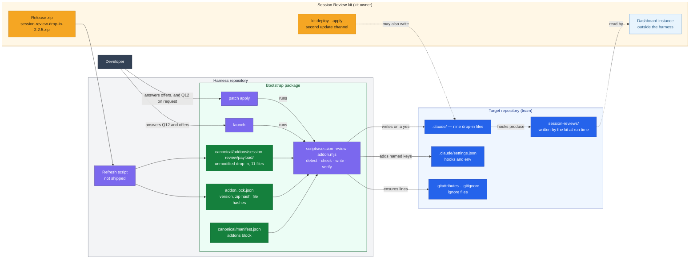
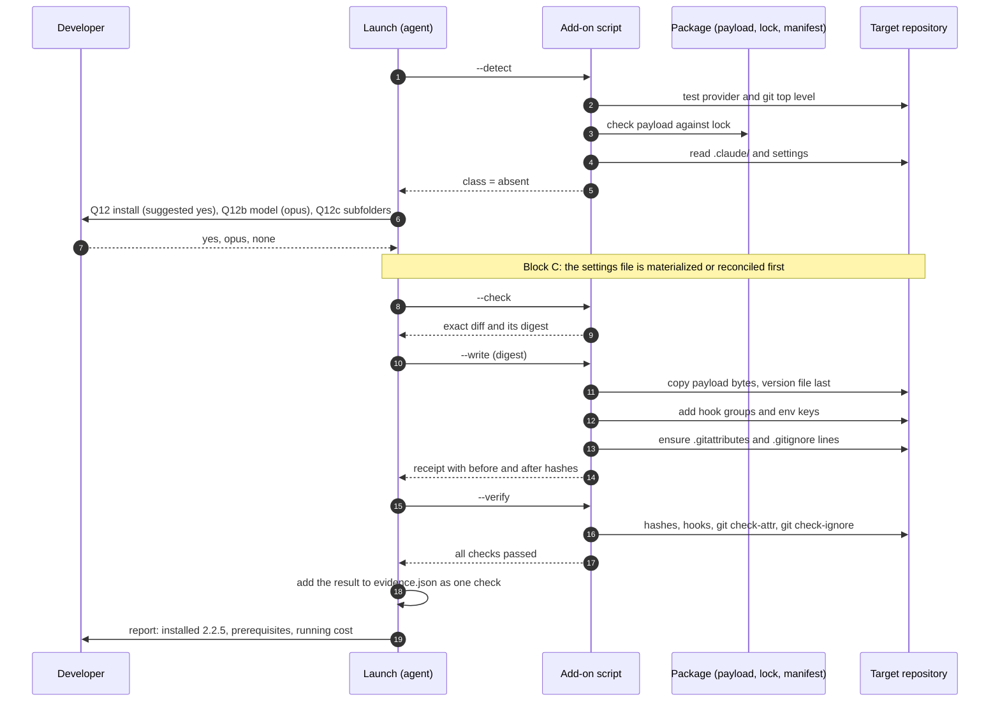
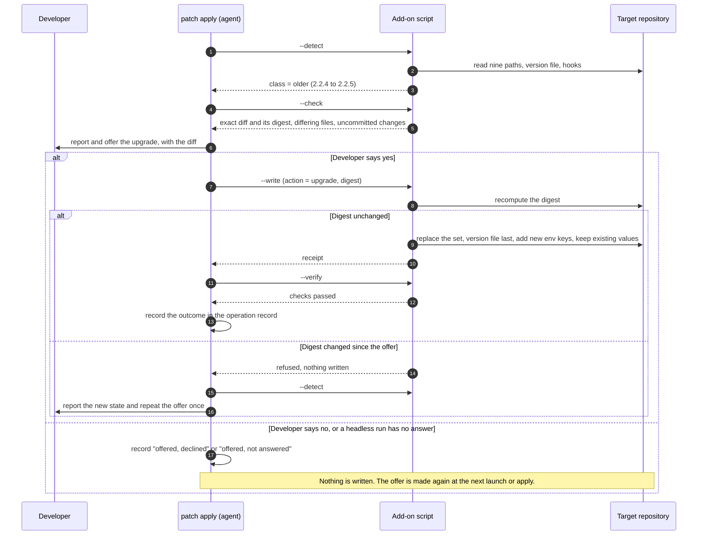
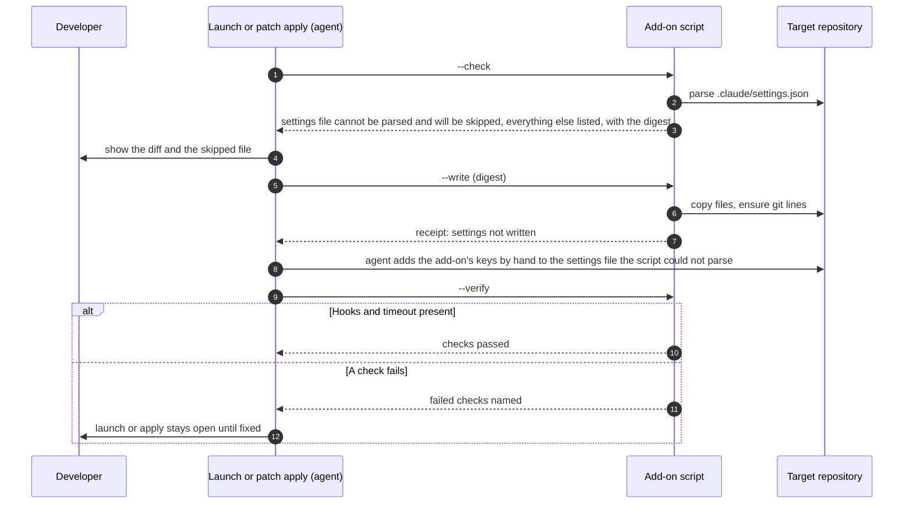

# DESIGN-20261112-T5YB: Session Review Capture Add-on — Architecture

## System context

The harness bootstrap package carries an unmodified copy of the Session Review kit's capture drop-in and installs it into a target repository when Claude is among the selected providers and the developer says yes. One package script is the only harness-side writer of the drop-in in a target repository. It runs at launch and at `patch apply`, decides what to do from what it finds in the repository, keeps no record of ownership, and stays outside the launch plan: the planner, the materializer and the finalizer are unchanged. The kit stays the source of the drop-in, and the kit's dashboard stays outside the harness.

Detail is in [Design - Packaging and Sync.md](<./Design - Packaging and Sync.md>), [Design - Launch Flow.md](<./Design - Launch Flow.md>) and [Design - Ownership After Launch.md](<./Design - Ownership After Launch.md>). Technology choices are in [Stack.md](./Stack.md) and implementation slices in [Efforts.md](./Efforts.md).

## Responsibility distribution

| Element | Owner | Responsibility | Change |
| --- | --- | --- | --- |
| Session Review kit release zip | Kit owner | Source of the drop-in; one zip per release | None |
| Refresh script `scripts/vendor/refresh-session-review.mjs` (harness repository, not shipped in the package) | Harness | Replaces the payload as a set from a named kit zip and its expected sha256 and regenerates the lock. It fails when the kit's file set differs from the manifest's file map. When `INSTALL.md` or `settings.hooks.json` changed beyond the version line, it prints the difference and requires an explicit acknowledgement flag. `--check` proves the payload equals the lock. | New |
| Payload `canonical/addons/session-review/payload/` | Kit content, carried by the harness | The unzipped drop-in as released, content unmodified: nine installable files, `INSTALL.md` and `settings.hooks.json`. D3 permits one stored-name deviation. | New |
| Lock `canonical/addons/session-review/addon.lock.json` | Harness | Kit version, zip name, zip sha256 and a sha256 per payload file | New |
| `addons` block in `canonical/manifest.json` | Harness | Declares the add-on: name, provider `claude`, payload root, lock path, the nine source-to-target pairs and the settings fragment | New, additive under `schemaVersion: 1` |
| Add-on script `scripts/session-review-addon.mjs` with `scripts/lib/session-review.mjs` | Harness | Checks the payload against the lock, detects, shows the exact diff, writes and verifies; the only harness-side writer of the drop-in in a target repository. | New |
| Launch | Harness | Runs detection in Context, asks the question or makes the offer when an action is available, runs the script in Block C after the settings file has been materialized or reconciled, verifies, reports. The launch plan is unchanged. | Changed |
| `patch apply` | Harness | When Claude is an installed provider and the request does not exclude it: one add-on step after the generic deployment — detection, offer, write on a separate yes, verify, record. It asks the install question only on the developer's explicit request. | Changed |
| `patch harvest`, patch state, registry | Harness | Exclude the drop-in paths and the add-on's keys in settings: no mapping, no rendered baseline, no registry row; harvest refuses the paths and ignores the keys; prepare and apply do not sweep `canonical/addons/` for skills. | Changed |
| Target repository `.claude/` | Team | Holds the installed drop-in; the team owns the `env` values | Written only on a yes |
| Kit `deploy` | Kit owner or team lead | The kit's own update channel; not coordinated with the harness | None |
| Dashboard instance | Team lead | Reads `session-reviews/` from repositories; outside the harness | None |

## What the script finds and does

The script first tests whether the add-on applies at all (the Not applicable class). When it does, it checks the payload against the lock and refuses on a mismatch. Detection then compares the installed drop-in with the bundled payload, ignoring line-ending differences, and returns one detection class. The detection class decides the action. A hook counts as registered when a command under that event names the kit's script by file name, in any command form. The full rules are in [Design - Ownership After Launch.md](<./Design - Ownership After Launch.md>).

| Class | What was found | Action |
| --- | --- | --- |
| Not applicable | Claude is not a selected or installed provider; or the project root is not the top level of a git repository; or `git` is unavailable | Nothing is asked or written. The reason is reported, except when Claude is simply not a provider |
| Absent | No kit file and no hook naming a kit script | At launch the install question is asked. At `patch apply` nothing is asked: the report notes in one line that the add-on is available and not installed, and a developer who asks for it explicitly gets the install question in that apply. |
| Same | Version equal, all nine files equal, hooks registered with a `SessionEnd` timeout | Nothing is asked; checks run and are reported |
| Version-only | Version lower, every other file equal, install complete | Reported; offer to update the version file only |
| Older | Version lower, and content differs or a file or hook is missing | Reported; upgrade offered; on a yes the set is replaced and the install completed |
| Newer | Version higher | Left alone and reported |
| Existing, unknown | Kit files present and the version file is not a dotted number; or the version file is missing and at least one present file differs from the bundled payload | Left alone and reported |
| Edited or mixed | Version equal and at least one present file differs | Left alone and reported |
| Partial | No present file differs, but the install is incomplete: hooks without files, files without hooks, a file or the version file missing, or `SessionEnd` registered without a timeout | Reported; offer to complete on a yes; only missing files and missing keys are written |

**Precedence.** Classes are tested in this order, and the first match wins: Not applicable; Absent; then by version — not a dotted number gives Existing, unknown; missing gives Partial when no present file differs and Existing, unknown otherwise; higher gives Newer; lower gives Version-only when the install is complete and equal apart from the version file and Older otherwise; equal gives Same, Partial or Edited or mixed.

Tracked nested settings files that lack the hooks do not change the class. They are listed in the detection result and are included in any install, upgrade or completion that is offered.

## Decision register

EC numbers refer to [`../design/00 Frame.md`](<../design/00 Frame.md>).

| # | Decision | Consequence | Verification |
| --- | --- | --- | --- |
| D1 | The add-on is opt-in and Claude-only (EC1, EC8). | When Claude is not a selected or installed provider the class is Not applicable and nothing else runs: nothing further is read, asked, written or reported. Codex-only and Copilot-only launches are unchanged. | Unit spec: Codex-only and Copilot-only selections yield no add-on action. |
| D2 | Three question keys: `Q12` (fresh install), `Q12b` (review model, default `opus`), `Q12c` (extra subfolders where sessions start, default none) (EC2). | `Q12` is asked at launch whenever the class is Absent, is never resolved from evidence, and blocks a headless launch that has no answer. It is saved as `historical` when the run closes, so a later launch asks again; a resumed run takes the confirmed answer from its own run report. `Q12b` and `Q12c` are asked only with a fresh install. Offers (version-only, upgrade, complete) are separate from `Q12`: each needs its own yes, is scoped to the run and to the detected from-to pair, and is never stored as a reusable answer. `patch apply` asks `Q12` only when the developer asks for the add-on explicitly in that apply. An offer made in a headless apply with no answer is recorded as "offered, not answered", nothing is written, and the apply is not blocked. When `Q12` is not asked, because no action is available or because the action is an offer, the detected class is reported and `Q12` is recorded as not applicable. | Unit spec on answer handling; the e2e launch prompt carries an explicit `Q12`; the e2e apply scenario runs on a fixture without the kit. |
| D3 | The drop-in is vendored as a payload, a lock and a manifest `addons` block (EC6). | The manifest gains one additive block; `schemaVersion` stays 1. The payload mirrors the kit zip. One deviation is permitted: if Claude Code turns out to discover the payload's nested `SKILL.md` as a skill, that one file is stored as `SKILL.md.kit`, with unchanged content and hash, and the manifest pair maps it to `SKILL.md` at install. The payload path is marked `-text` in `.gitattributes` and excluded in `.prettierignore` and the ESLint ignores of this repository. | Refresh `--check` in the unit suite: payload equals lock, lock equals the manifest's file map. |
| D4 | The kit is the source; the harness copy is refreshed only by the refresh script from a named kit zip and is never edited (EC6). | The pinned release is 2.2.5, zip sha256 `11dac095b216202e696a55b5d5dd24b8590ac51cf6997f275c4c875c35770010`. The refresh fails when the kit's file set differs from the manifest's file map, and requires an explicit acknowledgement when `INSTALL.md` or `settings.hooks.json` changed beyond the version line. The copy ships in the release ZIP under the harness licence. | The check fails on any byte change in the payload. |
| D5 | Installed content is the unmodified kit content (EC5). | The script copies payload bytes without decoding or substitution. Every comparison ignores line-ending differences. | Integration spec compares installed hashes with the lock. |
| D6 | A refreshed drop-in can travel in a patch bundle. | Payload, lock and manifest block are text under `canonical/`. Bundle entries under `canonical/addons/` carry the deployment value `addon`: they have no mapping and are excluded from the skill discovery sweep in prepare and apply. A bundle that carries add-on payload states the minimum package version that has the add-on script; on an older package the payload is inert. | Patch grader case carrying a payload change. |
| D7 | One package script performs the install: `scripts/session-review-addon.mjs` with modes `--detect`, `--check`, `--write`, `--verify`. | Node standard library only; it spawns `git` without a shell. `--check` returns a digest over its full result: current target hashes, payload and lock hashes, planned changes. `--write` requires that digest, recomputes it and refuses on any difference, so what was shown is exactly what is applied. The add-on is outside the launch plan: the nine files and the git and ignore files are not plan outputs, and the planner, materializer and finalizer are unchanged. `SKILL.md`'s capability statement changes. | Unit and integration specs. |
| D8 | The script adds named keys to an existing `.claude/settings.json` and never replaces or removes anything. | It adds a hook group under `SessionStart` and under `SessionEnd` only when no existing command names the kit's script, adds `timeout: 15` to the recognised `SessionEnd` entry only when it has no timeout, and adds `env` keys only when absent. A settings file it cannot parse is refused and reported, and the agent reconciles that file by hand. A `SessionEnd` timeout below 15 on the recognised entry is reported by `--check` and `--verify` and is raised by hand, the same path as an unparseable file. This design restates the rule in launch Block C and in test BOOT-005: tooling may add named keys to an existing settings file and never replaces or removes anything. | Integration specs: merge shapes, refusal, idempotent re-run; BOOT-005 gains the scoped case. |
| D9 | The script ensures the kit's `.gitattributes` lines and appends the `.gitignore` negation block at the end of the file. | Both edits are idempotent. | Integration spec with `git check-attr` and `git check-ignore`. |
| D10 | Formatter and pre-commit protection (EC10). | The script reports the formatter and hook configuration it finds and whether the drop-in paths are covered. It adds entries to existing line-based ignore files (`.prettierignore`, `.eslintignore`); anything else is reported with the exact entry to add. | Integration spec with fixture configurations. |
| D11 | Nested settings files follow the kit's install guide. | The script treats every tracked `.claude/settings.json` below the root (found with `git ls-files`, excluding the package directory) and every folder named in `Q12c` as a place that needs the hooks and the `env` block. It creates or key-merges the settings file only: no scripts, no skill. Nested files are written only as part of an install, upgrade or completion the developer accepted; a nested file without the hooks does not by itself trigger an offer. The nested write is implemented after the subfolder-scoping spike in [Efforts.md](./Efforts.md) confirms how Claude Code scopes nested settings. | Integration spec. |
| D12 | Verification is deterministic (EC9). | `--verify` checks: both hooks registered at the root and in every settings file the script wrote in this run; `SessionEnd` timeout at least 15; version file present and equal to the lock's version; the nine files equal to the payload; `eol=lf` on the five scripts and on `session-reviews/**`; review logs not ignored. Tracked nested settings files without the hooks are reported, not failed. In a run in which the script wrote, a failed check keeps the launch or apply from closing as verified; the result enters `evidence.json` as one `checks` entry. In a run in which it did not write, failed checks are reported only. The script has no path that changes an existing value, so a failed settings check is corrected by hand and verification is run again. | Unit spec per failing check. |
| D13 | Ownership is stateless (EC11). | Detection is a pure function of the repository and the bundled payload. The drop-in paths are not plan outputs and never get a `mappings` entry, a rendered baseline or a registry row; `patch harvest` refuses them; the exact-match baseline rule does not apply to them. | Negative grader: no mapping for any drop-in path after launch or apply. |
| D14 | Nine detection classes decide the action, tested in a fixed order (EC3, EC13). | As in the class table and precedence rule under [What the script finds and does](#what-the-script-finds-and-does). Every observable state has exactly one class. EC3's third case is deliberately narrowed, with the developer's agreement on 2026-11-12: an install without a version file whose present files all equal the bundled payload is Partial, and completing it is offered. Nothing is overwritten. | Classifier unit spec, one case per class and per precedence boundary. |
| D15 | Offers for an existing drop-in are made at launch and at `patch apply`, whoever installed it, from any clone. | Nothing in `package:state/` is needed to make them. A fresh install is offered at launch, and at `patch apply` only on the developer's explicit request; an apply in a project without the kit notes in one line that the add-on is available. | Integration spec: `--detect` on a workspace with no package state. |
| D16 | An accepted upgrade replaces the drop-in as a set (EC4). | All payload files are written together, the version file last, so an interrupted write classifies as Older or Partial and the same offer is made again. Existing `env` values and `session-reviews/` are untouched. `env` keys new in the bundled fragment are added with their defaults. A file a newer release no longer ships is reported, not deleted. Before writing, the offer lists the files that differ and any uncommitted changes on the drop-in paths. No backup is taken. | Integration spec: upgrade from an older fixture, and an interrupted write. |
| D17 | The harness never removes the drop-in. | No removal path exists; uninstalling stays the kit's documented manual step. | Grader: no delete operation is reachable for a drop-in path. |
| D18 | Versions compare as dotted numeric segments. | A version file that is not a dotted number gives Existing, unknown. A missing version file has no order: the class is Partial when no present file differs from the bundled payload, and Existing, unknown otherwise. | Unit spec: `1.4` below `2.2.4` below `2.2.5`; `2026-10-01` is Existing, unknown. |
| D19 | The harness does not coordinate with the kit's `deploy`. | A kit instance on an older kit can downgrade a repository, after which the harness offers the upgrade again. This is a documented limitation. | Documentation. |
| D20 | The dashboard stays outside the harness (EC7). | The harness installs nothing dashboard-related. An Engineering Guide page points a lead to the kit's `ONBOARDING.md` and names the pinned kit release. | Document review at Publish. |
| D21 | Live agent runs never dispatch reviews (EC12). | The e2e Claude runner sets `CLAUDE_SESSION_REVIEW=1` and the launch prompt answers `Q12: no`. Deterministic suites cover the classifier, the script in `git init` temporary workspaces, the refresh check and the manifest validator. | The suites. |
| D22 | This repository answers no. | Its saved `Q12` answer is no, because the repository is public and reviews are committed. `patch apply` asks only on an explicit request, which this repository does not make, so nothing is installed here. | The answers file. |
| D23 | The package is re-scanned before the release that ships the add-on. | InfoSec scan covering the vendored hook scripts, the hook registration and the `git` subprocess; `SKILL.md` capability statements updated. | Dated report under `docs/Harness/08 Security Scan/`. |
| D24 | Prerequisites and running cost are surfaced. | The question states that a yes means one headless review per session on the chosen model and that reviews are committed to the repository. The launch report states the kit's requirements: `node`, `git`, Git Bash on Windows, a recent Claude Code CLI (the kit was tested on 2.1.303). | Report template check. |
| D25 | The launch table keeps its 15 rows. | Detection runs in Context and the question in Knowns and plan. In Block C the script runs `--check` and `--write` after the materializer has written a new settings file or the agent has reconciled an existing one, and before evidence is collected, so the evidence and the settings baseline record the file with the add-on's keys. Verification runs at the Block C boundary and in Final audit. Upgrade, version-only and completion offers at launch are made in Block C, with the Block C diff; only the fresh-install question is asked earlier. | Existing stage-count grader. |
| D26 | The outcome is recorded as history only. | The launch or apply operation record gains an `addons` entry (name, detected class, action, from and to version, files written with hashes, checks) outside its outputs list, so no baseline follows from it. It is never read back. When the script wrote during an apply, the apply record also carries one result of deployment `addon` with `provider: "claude"`, which counts as that apply's Claude result; it has no mapping and no baseline. | State grader case. |
| D27 | The add-on's keys in a settings file are never harvested and never removed by an apply. | Hook entries whose command names a kit script, and `env` keys named in the bundled fragment, are ignored by `patch harvest` and kept as retained configuration when an apply reconciles or re-renders the settings file. When the add-on step writes to a settings file during an apply, the apply records that file's deployed hash as it does for any reconciled output. | Harvest spec: a settings file with the add-on's keys yields no harvest candidate for them; apply spec: the keys survive a settings re-render. |
| D28 | At `patch apply` the add-on step runs whenever Claude is an installed provider and the request does not exclude Claude. | It does not depend on whether a mapped output deploys, so a bundle that carries only add-on payload, or an apply with nothing else to deploy, still runs detection and makes the offer. When the script wrote, an apply whose only effect is the add-on step records provider scope `claude` and status applied. When the offer was declined or not answered, nothing was written: the apply's scope and status are what they would be without the step, and the `addons` entry records the offer's outcome. The patch grader is extended to accept an `addon` result as covering its provider. | Apply grader: an add-on-only apply is accepted; a request that excludes Claude records no add-on result. |
| D29 | The script trusts only the locked payload and writes only to fixed targets. | After the Not applicable test and before any mode does anything else, every payload file and the settings fragment are checked against the lock; a mismatch is a refusal. The allowed targets are fixed in the script: the nine `.claude/` paths, settings files at the root, in tracked nested locations and in `Q12c` folders, `.gitattributes`, `.gitignore`, `.prettierignore` and `.eslintignore`. A manifest pair outside them is rejected. Hook commands and `env` keys come only from the vendored fragment. Every write applies the same guards the materializer and the finalizer apply: inside the project root, no symlinked path component, and not under `.git` or the package directory. The `.gitattributes` and `.gitignore` lines are fixed in the script, not declared in the manifest. A `Q12c` entry must be an existing directory inside the root, outside `.git` and the package directory, given as a relative path. Every offer names the bundled kit version and the zip sha256 from the lock. A payload change that arrives in a patch bundle is reviewed as a text diff when the bundle is applied. | Unit specs: lock mismatch, target outside the allowlist, path escaping the root, symlinked target. |
| D30 | The project root must be the top level of a git repository. | The kit's hooks resolve the git top level, so when the project root is a subfolder of a repository, is not in a repository, or `git` is unavailable, the class is Not applicable: nothing is asked, and the reason is reported with a pointer to the kit's own install guide. | Unit spec per precondition. |

## Representative flows

### Normal flow — install at launch

The question is the only developer decision in this flow. `--write` applies exactly what `--check` showed, because it requires the check's digest and refuses on any difference. The launch plan is untouched, and the script runs after the settings file exists, so the evidence records that file with the add-on's keys. Hooks load at the next session start, so reviews begin with the session after the install.

### Upgrade flow — an older install found at `patch apply`

The offer is separate from the apply itself, and it applies equally to a drop-in that was installed by hand. A no writes nothing and is not remembered. The same flow runs at launch. At `patch apply` the step runs whenever Claude is an installed provider and the request does not exclude it, after the generic deployment. `patch apply` asks the install question only when the developer asks for the add-on explicitly. A headless apply with no answer records "offered, not answered" and is not blocked.

### Failure and recovery flow — a settings file the script cannot parse

The refusal is per file, so the rest of the install proceeds. The hand step here is narrower than the Block C reconciliation that precedes the script: it adds only the add-on's hook entries and `env` keys to the one file the script refused. The verify step is what closes the gap, and a failed check leaves the launch or apply open. A refused or failed write leaves no obligation in the launch plan, because the add-on is outside it.

## Plugging into the existing system

**Package files that change:**

Paths are relative to the package root, `.canonical-implementation-harness/`.

- `canonical/manifest.json` (the `addons` block)
- `scripts/lib/manifest.mjs` and `scripts/lib/constants.mjs` (validation of the block)
- New `scripts/session-review-addon.mjs` and `scripts/lib/session-review.mjs`, which also carries the script's path guards; `scripts/lib/fs-safe.mjs`, the materializer and the finalizer are unchanged
- `references/launch/02-launch-questions.md` (`Q12`, `Q12b`, `Q12c`)
- `references/launch/01a-launch-plan.md` (detection in Context and where the question is asked; the plan itself is unchanged), `01b-launch-install.md` (the script in Block C) and `01d-launch-graph-verify.md` (verification in Final audit)
- `references/patch/04-patch-harvest.md`, `05-patch-apply.md`, `06-patch-state.md` and `07-patch-prepare.md` (exclusions, the `addon` deployment value, the key rule for settings, and the add-on step)
- `registry.md` (note)
- `SKILL.md` (capabilities)
- `README.md` and `CHANGELOG.md`

The planner, the materializer and the finalizer do not change.

**Harness repository files that change:**

- New `scripts/vendor/refresh-session-review.mjs`
- `.gitattributes`, `.prettierignore` and `eslint.config.js` (payload protection)
- `scripts/release/release-harness-bootstrap.mjs` (runs the refresh check before zipping)
- `apps/harness-bootstrap-e2e/` (specs, the launch prompt, the runner environment, and the patch grader, which accepts an `addon` result as covering its provider)
- `.canonical-implementation-harness/state/answers.json` (`Q12` no for this repository)

**Documents updated at Publish:**

- New `docs/Harness/09 Session Review/`
- `docs/Harness/index.md` (section row)
- `docs/Harness/02 Quick Start/index.md` (the question that is never resolved from evidence and the new installed content)
- `docs/Harness/04 Adoption/00 Adoption Path.md` (question range)
- The Engineering Guide page for leads, in the canonical docs and in this repository

## How the WAF P1 item is addressed

The Evaluate assessment raised one P1: a package script that adds keys to an existing settings file changes a current harness rule. D8 states the restated rule in full, with its limits: named keys are added, nothing is replaced or removed, an unparseable file is refused. Approval of this design at the Review Gate is the harness author's confirmation of that rule.

## Considered Options

A full options analysis is in the three `design/02 Evaluate - *.md` files: [Packaging and Sync](<../design/02 Evaluate - Packaging and Sync.md>), [Launch Flow](<../design/02 Evaluate - Launch Flow.md>) and [Ownership After Launch](<../design/02 Evaluate - Ownership After Launch.md>).

Five ways to package the drop-in, four ways to run the install and six ownership models were evaluated. The chosen combination is the one that proves mechanically that the harness copy is the unmodified kit, has a script perform every write so that the merges can be tested and re-run at upgrade, and makes the upgrade offer from what is found in the repository so that it works from any clone and for any installer.
