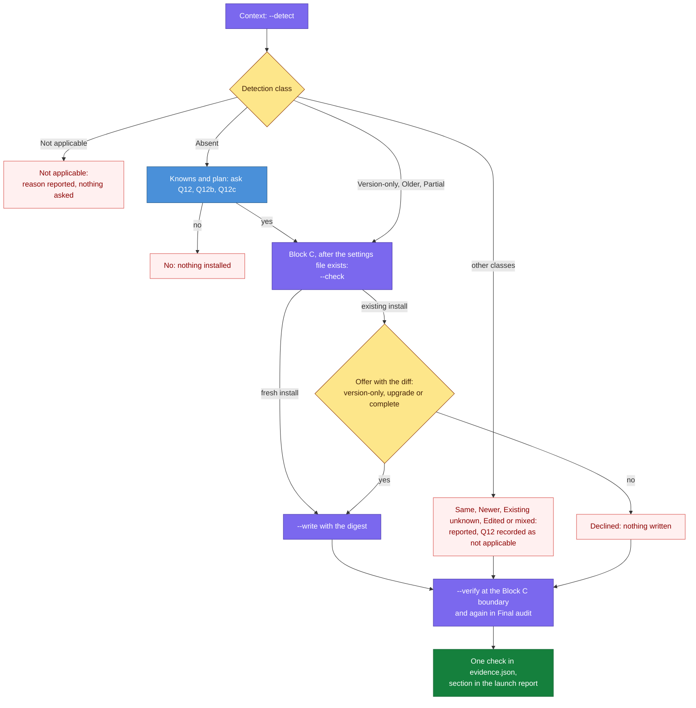

# DESIGN-20261112-T5YB: Session Review Capture Add-on — Design: Launch Flow

Launch installs the drop-in by running one add-on script in four modes: `--detect`, `--check`, `--write` and `--verify`. The launch plan is unchanged.

## Scope

This design implements D2, D7, D8, D9, D10, D11, D12, D24, D25, D29 and D30 from [Architecture.md](./Architecture.md#decision-register). It covers the add-on script's contract, where launch runs it, the questions, the settings merge, the git and ignore files, verification, and the tests.

Detection rules and everything after install are in [Design - Ownership After Launch.md](<./Design - Ownership After Launch.md>). Packaging is in [Design - Packaging and Sync.md](<./Design - Packaging and Sync.md>).

Package paths are relative to `.canonical-implementation-harness/`.

## What launch does, by detection class

The detection class returned by `--detect` decides the path launch takes. The classes are defined in the [detection class table in Architecture.md](./Architecture.md#what-the-script-finds-and-does).



| Launch stage | What happens |
| --- | --- |
| Context | `--detect`; the class and the installed and bundled versions go into the launch report |
| Knowns and plan | When the class is Absent, `Q12`, `Q12b` and `Q12c` are asked. The plan is not changed |
| Block C | After the materializer has written a new `.claude/settings.json` or the agent has reconciled an existing one: `--check`; for an existing install the offer is made here with the diff; on a yes, `--write` with the digest |
| Block C boundary | `--verify` whenever a kit is installed at that point: with `--wrote` after a write, without it otherwise |
| Final audit | `--verify` again on the same condition; after a write the result is one `checks` entry in `evidence.json` |

The launch table keeps its 15 rows, and the planner, the materializer and the finalizer are unchanged (D25).

## Script contract

The add-on script is `scripts/session-review-addon.mjs`, with four modes (D7).

```
node <package>/scripts/session-review-addon.mjs --detect --project <root>
node <package>/scripts/session-review-addon.mjs --check  --project <root> --action <install|upgrade|version-only|complete> [--model <name>] [--folder <relative path>]...
node <package>/scripts/session-review-addon.mjs --write  --project <root> --action <same> --digest <value> [--model <name>] [--folder <relative path>]...
node <package>/scripts/session-review-addon.mjs --verify --project <root> [--wrote]
```

| Mode | Reads | Writes | Output on stdout, as JSON |
| --- | --- | --- | --- |
| `--detect` | Payload and lock, the nine target paths, settings files, git top level and status | Nothing | `class`, `reason` when Not applicable, installed and bundled versions, per-file state (`equal`, `differs`, `missing`), hook state, tracked nested settings files and whether each carries the hooks, uncommitted changes on the drop-in paths |
| `--check` | As detect | Nothing | `digest`, the ordered list of planned changes (copy, settings keys per file, git lines, ignore entries), files that will be skipped with the reason, formatter findings |
| `--write` | As check | Exactly the planned changes | A receipt: each target with its hash before and after, skipped files, the digest |
| `--verify` | Installed files, settings, git attributes and ignore state | Nothing | One entry per check with `passed` or `failed` and a detail line |

| Exit code | Meaning |
| --- | --- |
| `0` | Success, or all checks passed |
| `1` | Refused: Not applicable precondition for a write, lock mismatch, digest mismatch, guard violation |
| `2` | Usage error |
| `3` | Verify ran and at least one check failed |

- Node standard library only. `git` is spawned without a shell, for `rev-parse --show-toplevel`, `ls-files`, `status --porcelain`, `check-attr` and `check-ignore`.
- `--model` and `--folder` are accepted only with `--action install`.
- The digest covers the current hashes of every target, the payload and lock hashes, and the planned changes. `--write` recomputes it and refuses when it differs from the one passed in.
- The receipt is returned to the caller, which records it under `addons` in the operation record (D26). The script stores nothing in `package:state/`.

## Preconditions and guards

The script acts only when the add-on applies, trusts only the locked payload, and writes only to fixed targets (D29, D30).

- The add-on applies only when Claude is a selected or installed provider, the project root is the top level of a git repository, and `git` is available. Otherwise the class is Not applicable.
- The payload and the settings fragment are checked against the lock before any mode acts.
- Allowed targets are fixed in the script: the nine `.claude/` paths, `.claude/settings.json`, nested `.claude/settings.json` files, `.gitattributes`, `.gitignore`, `.prettierignore`, `.eslintignore`.
- Every write must resolve inside the project root, through no symlinked path component, and not under `.git` or the package directory. `scripts/lib/session-review.mjs` carries these guards.
- A `--folder` value must be an existing directory inside the root, outside `.git` and the package directory, given as a relative path.

## Questions

Three question keys cover a fresh install (D2).

| Key | Asked when | Text | Default |
| --- | --- | --- | --- |
| `Q12` | At launch, class Absent. At `patch apply`, only when the developer asks for the add-on | "Install the Session Review kit? Every Claude Code session in this repository then gets one short, anonymous review, written to `session-reviews/` and committed with your work. Each review is one headless run on the model you choose next." | Suggested yes; an explicit answer is required |
| `Q12b` | With a yes to `Q12` | "Review model" | `opus` |
| `Q12c` | With a yes to `Q12` | "Other folders in this repository where your team starts Claude Code sessions" | None; proposed from the containers found in Q2 and Q3 |

- `Q12` is never resolved from evidence.
- A headless launch without an answer blocks.
- During a run the confirmed answer lives in the run report. When the run closes it is saved in `answers.json` as `historical`, so a later launch asks again.
- Offers for an existing install are not questions with keys: each is asked with its diff and is never saved.

## Settings merge

The script adds named keys to a settings file and never replaces or removes anything (D8).

1. Parse the file as JSON. If it cannot be parsed, skip this file, name it in the output, and leave it for the agent to add the keys by hand.
2. For `SessionStart` and for `SessionEnd`: if any command under that event names the kit's script by file name, the hook is registered and its command is left as it is.
3. If it is not registered, append the fragment's hook group to that event's array, creating `hooks` or the array when missing.
4. If the registered or added `SessionEnd` entry has no `timeout`, add `timeout: 15`. An existing timeout is never changed; one below 15 is reported.
5. For each `env` key in the fragment that the file does not have, add it with the fragment's default. On a fresh install `SESSION_REVIEW_MODEL` takes the `Q12b` answer. Existing keys keep their values.
6. Skip the fragment's `_comment` key.
7. Write the file back with its existing indentation and final newline, existing keys in their existing order, new keys appended.

Before — a settings file with one existing hook:

```json
{
  "permissions": { "allow": ["Bash(yarn:*)"] },
  "env": { "CLAUDE_CODE_ENABLE_TASKS": "1" },
  "hooks": {
    "PostToolUse": [
      { "matcher": "Bash", "hooks": [{ "type": "command", "command": "echo checked" }] }
    ]
  }
}
```

After a fresh install with `Q12b` = `opus`. The fragment holds eleven `env` keys; the block lists three of them.

```json
{
  "permissions": { "allow": ["Bash(yarn:*)"] },
  "env": {
    "CLAUDE_CODE_ENABLE_TASKS": "1",
    "SESSION_REVIEW_MODEL": "opus",
    "SESSION_REVIEW_TRIM": "1",
    "SESSION_REVIEW_MIN_LINES": "15"
  },
  "hooks": {
    "PostToolUse": [
      { "matcher": "Bash", "hooks": [{ "type": "command", "command": "echo checked" }] }
    ],
    "SessionStart": [
      { "hooks": [{ "type": "command", "command": "node \"$(git rev-parse --show-toplevel)/.claude/session-review-sweep.js\"" }] }
    ],
    "SessionEnd": [
      { "hooks": [{ "type": "command", "command": "node \"$(git rev-parse --show-toplevel)/.claude/session-review.js\"", "timeout": 15 }] }
    ]
  }
}
```

### Nested settings

Nested settings files receive the hooks and the `env` block only, by the same merge (D11).

- The places are every tracked `.claude/settings.json` below the root (found with `git ls-files`, excluding the package directory) and every `--folder` value.
- Where the file exists, it is merged by the same algorithm.
- Where it does not, the script creates one holding only the fragment's `hooks` and `env`.
- No scripts and no skill are copied there.
- Nested files are written only inside an install, upgrade or completion the developer accepted.
- This part is implemented after the subfolder-scoping spike in [Efforts.md](./Efforts.md).

## Git and ignore files

The script appends missing lines to the git and ignore files and leaves existing lines as they are (D9).

| File | What the script ensures | Rule |
| --- | --- | --- |
| `.gitattributes` | `text eol=lf` lines for the five scripts and for `session-reviews/**` | Each missing line is appended under one comment line; existing lines are left |
| `.gitignore` | The kit's negation block for `session-reviews/logs/` and `session-reviews/logs/*.log` | Appended at the end of the file, after any `*.log` or `logs/` rule; not repeated when already effective |
| `.prettierignore`, when it exists | `session-reviews/` and `.claude/session-review*.js` | Missing lines appended |
| `.eslintignore`, when it exists | `.claude/session-review*.js` | Missing line appended |

The script looks for formatter and pre-commit configuration and reports what it finds (D10).

| Signal | Looked for | What the script does |
| --- | --- | --- |
| Prettier | `.prettierrc*`, a `prettier` key in `package.json`, `.prettierignore` | Adds the ignore lines when `.prettierignore` exists; otherwise reports the lines to add |
| ESLint | `eslint.config.*`, `.eslintrc*`, `.eslintignore` | Adds the line when `.eslintignore` exists; for a flat config, reports the ignore entry to add |
| lint-staged | A `lint-staged` key in `package.json`, `.lintstagedrc*` | Reports which globs match the drop-in or the reviews |
| Husky and pre-commit | `.husky/`, `.pre-commit-config.yaml` | Reports that commit hooks are present |

Every line the script will add appears in the `--check` output, and everything it only reports appears in the launch report with the exact entry to add.

## Verification

`--verify` runs seven deterministic checks and writes nothing (D12).

| Check | Passes when |
| --- | --- |
| Hooks at the root | Both events name the kit's scripts |
| Hooks in files written in this run | The same, for every settings file the script wrote |
| `SessionEnd` timeout | At least 15 |
| Version file | Present and equal to the lock's version |
| Drop-in content | The nine files equal the payload, ignoring line endings |
| Line-ending attributes | `git check-attr eol` reports `lf` for the five scripts and for `session-reviews/**` |
| Review logs tracked | `git check-ignore -v session-reviews/logs/x.log` prints nothing |

- Tracked nested settings files without the hooks are reported, not failed.
- With `--wrote`, any failed check makes the script exit `3`, and the launch or apply does not close as verified until the cause is fixed and verification passes.
- Without `--wrote`, failed checks are reported only.
- The script never changes an existing value, so a failed settings check is fixed by hand.
- `--verify` does not run when the detection class is Not applicable, or when the kit is absent and `Q12` was answered no.

## What the developer is told

The question and the launch report carry the running cost and the kit's requirements (D24).

- The `Q12` text states the running cost and that reviews are committed.
- The launch report section holds the detection class, the action taken, installed and bundled kit versions, the lock's zip sha256, files written, anything skipped or only reported, and the verification result.
- The launch report section also states the kit's requirements: `node` and `git` on PATH, Git Bash on Windows, and a recent Claude Code CLI (the kit was tested on 2.1.303).
- The launch report section states that hooks load at session start, so reviews begin with the next session.

## Failure modes

Each failure has one defined behaviour.

| Failure | Behaviour |
| --- | --- |
| Settings file cannot be parsed | That file is skipped and named; the rest of the install proceeds; the agent adds the keys by hand; verification decides |
| Something changed between `--check` and `--write` | Digest mismatch; nothing is written; detection runs again and the offer is repeated once |
| Write interrupted | The version file is written last, so the next detection gives Older or Partial and the same offer is made |
| Lock mismatch | Every mode refuses |
| Target resolves outside the root, through a symlink, or into `.git` or the package directory | That write is refused and the run reports it |
| A check fails after a write | The launch or apply stays open until fixed |

## Tests

Three layers cover the script: unit specs on the library, integration specs on the script, and changes to existing suites.

**Unit, on `scripts/lib/session-review.mjs`:**

- Lock check
- Each precondition
- Guards
- The settings merge for every shape: no file, no `hooks`, other hooks on the same event, already registered in the current and the older command form, timeout absent, timeout below 15, unparseable
- `env` keys present and absent
- Digest stability

**Integration, running the script in temporary workspaces created with `git init`:**

- Fresh install
- A second run changes nothing
- Nested settings
- Digest mismatch refuses
- Interrupted write re-classifies
- `--verify` for each failing check

**Existing suites:**

- BOOT-005 gains the scoped case: an existing settings file keeps every key and gains only the add-on's.
- The e2e launch prompt answers `Q12: no`.
- The e2e Claude runner sets `CLAUDE_SESSION_REVIEW=1`, so no live run dispatches a review (D21).
