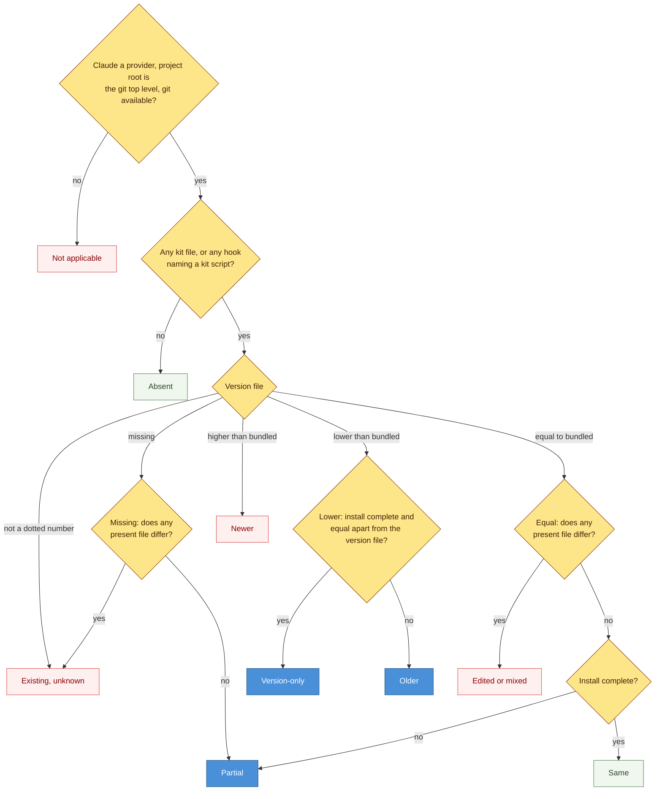
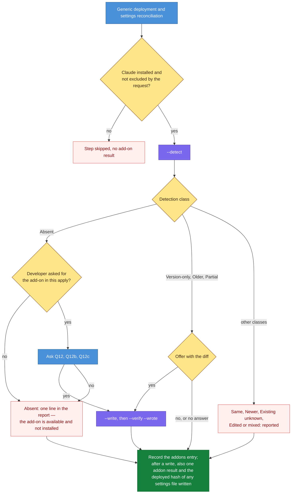

# DESIGN-20261112-T5YB: Session Review Capture Add-on — Design: Ownership After Launch

The harness decides what to do with the Session Review drop-in from what it finds in the repository at each launch and each `patch apply`. It keeps no record of ownership.

## Scope

This file implements D13 to D19 and D26 to D28 from [Architecture.md](./Architecture.md), and the patch side of D6. It covers:

- how detection classifies what is in a repository;
- what is offered for each detection class;
- how an accepted upgrade is applied;
- the add-on step in `patch apply`;
- the rules that keep the drop-in out of the patch baseline.

The add-on script's contract and the first install are in [Design - Launch Flow.md](<./Design - Launch Flow.md>). Packaging is in [Design - Packaging and Sync.md](<./Design - Packaging and Sync.md>). Package paths are relative to `.canonical-implementation-harness/`.

## Classification

Detection is a pure function of the repository and the bundled payload. It keeps and reads no record of who installed the drop-in (D13). The nine detection classes and their actions are in the class table in [Architecture.md](./Architecture.md#what-the-script-finds-and-does); this section gives the rules that decide the class.



| Term | Definition |
| --- | --- |
| Kit file | One of the nine target paths in the manifest's file map |
| Differs | The file's hash, with CRLF read as LF, is not the lock's hash for that file |
| Hook registered | A command under `SessionStart` names `session-review-sweep.js`, and one under `SessionEnd` names `session-review.js`, by file name, in any command form |
| Install complete | All nine files present, both hooks registered, and the `SessionEnd` entry has a timeout |
| Version order | Versions are dotted numbers compared segment by segment as integers, with a missing segment read as 0. A version file that is not a dotted number has no order (D18) |
| Nested settings | Tracked nested `.claude/settings.json` files without the hooks do not change the class; they are listed in the detection result and included in any install, upgrade or completion that is offered |

An install without a version file whose present files all equal the payload is Partial, the one deliberate narrowing of EC3 recorded in D14.

## What is offered

Three detection classes produce an offer, and a yes writes only what the table names.

| Class | The offer | What a yes writes |
| --- | --- | --- |
| Version-only | "The installed kit is identical to the bundled 2.2.5; only its version file says an older version. Update the version file?" | The version file only |
| Older | "The installed kit is older than the bundled release. Upgrade it?", with the list of files that differ and any uncommitted changes on the drop-in paths | The whole set, then missing hook entries and new `env` keys |
| Partial | "The kit is installed incompletely", with what is missing | Only the missing files and the missing keys; nothing present is overwritten |

- Every offer names the bundled kit version and the lock's zip sha256 (D29).
- Each offer needs its own yes and is never saved (D2).
- A no writes nothing and is recorded with `offer: "declined"`.
- A headless run with no answer is recorded with `offer: "not answered"` and is not blocked.
- Nothing remembers a declined offer, so it is made again at the next launch or apply.
- Four classes are reported and left alone: Same; Newer; Existing, unknown; Edited or mixed.

## An accepted upgrade

An accepted upgrade replaces the drop-in as a set, with the version file written last (D16).

1. `--check` lists every change and returns the digest; the offer shows the list.
2. `--write` recomputes the digest and refuses on a difference.
3. The eight non-version files are written from the payload, then the version file last.
4. Hook entries are added where missing; a `SessionEnd` entry without a timeout gains `timeout: 15`.
5. `env` keys that the bundled fragment has and the settings file lacks are added with their defaults. Existing values are kept.
6. Files matching `.claude/session-review*` that the bundled release no longer ships are reported as no longer part of the kit. They are not deleted.
7. `session-reviews/` is never touched. No backup is taken: the drop-in is committed, so the previous content is in git history and the upgrade is a reviewable diff.
8. `--verify --wrote` runs, and the outcome is recorded.

## The add-on step in `patch apply`

`patch apply` runs one add-on step after the generic deployment and before it records final hashes (D28).



- The step runs after the generic deployment and before the apply records final hashes.
- It runs whenever Claude is an installed provider and the request does not exclude Claude, whether or not any mapped output deploys. A bundle that carries only add-on payload still reaches it.
- When the script wrote, an apply whose only effect is the add-on step records provider scope `claude` and status applied.
- After a declined or unanswered offer nothing was written, so the apply's scope and status are what they would be without the step, and the `addons` entry records the offer's outcome.
- A request that excludes Claude records no add-on result.
- A failed check after a write keeps the apply from closing as applied. Failed checks in an apply that wrote nothing are reported only (D12).

## Rules in the patch contract

Four patch references and the registry gain the rules that keep the drop-in and the add-on's keys out of the patch baseline.

| Reference | Rule added |
| --- | --- |
| `references/patch/06-patch-state.md` | The nine drop-in paths never get a `mappings` entry, a rendered baseline or a registry row, and the rule "for exact matches, initialize verified baselines" does not apply to them. Bundle entries under `canonical/addons/` use the deployment value `addon`, with no mapping. The add-on's keys in a settings file are retained configuration |
| `references/patch/05-patch-apply.md` | The add-on step above. The branches "unchanged permanent file: deploy", "local edits" and "missing baseline" never apply to drop-in paths. When an apply reconciles or re-renders a settings file, the add-on's keys are kept |
| `references/patch/04-patch-harvest.md` | Harvest refuses a drop-in path, and ignores the add-on's keys when it compares a settings file with its baseline |
| `references/patch/07-patch-prepare.md` | The discovery sweep skips `canonical/addons/`. A bundle that carries add-on payload states the minimum package version that has the add-on script |
| `registry.md` | One note: the drop-in paths are deliberately unregistered |

The add-on's keys are the hook entries whose command names a kit script and the `env` keys named in the bundled settings fragment (D27).

## What is recorded

The outcome is history only and is never read back as a baseline (D26). A launch or apply operation record carries the entry in this form:

```json
{
  "addons": [
    {
      "name": "session-review",
      "provider": "claude",
      "class": "older",
      "action": "upgrade",
      "from_version": "2.2.4",
      "to_version": "2.2.5",
      "archive_sha256": "11dac095b216202e696a55b5d5dd24b8590ac51cf6997f275c4c875c35770010",
      "offer": "accepted",
      "files": [{ "target": ".claude/session-review-lib.js", "before": "<sha256>", "after": "<sha256>" }],
      "checks": [{ "name": "hooks-root", "status": "passed" }]
    }
  ]
}
```

- The entry sits outside the record's outputs list, so no baseline follows from it.
- When the script wrote during an apply, the apply record also carries one result with deployment `addon` and `provider: "claude"`, which counts as that apply's Claude result and has no mapping.
- `offer` is one of `accepted`, `declined`, `not answered` or `none`.
- When the script wrote a settings file during an apply, the apply records that file's deployed hash as it does for any reconciled output (D27).
- `--verify --wrote` is the form used after a write; the flag is defined in [Design - Launch Flow.md](<./Design - Launch Flow.md>).

## Living with the kit's own `deploy`

Detection classifies whatever the kit's `deploy` left in the repository, like any other state (D19).

| What happened | What the harness sees next | What it does |
| --- | --- | --- |
| The kit's `deploy` upgraded the repository to the bundled release | Same | Nothing |
| The kit's `deploy` upgraded it beyond the bundled release | Newer | Leaves it alone and reports it |
| A kit instance on an older kit downgraded it | Older | Offers the upgrade again |
| The kit's `deploy` wrote files in the repository's line-ending convention | No difference, because comparison ignores line endings | Nothing |

The harness does not coordinate with `deploy`, never removes the drop-in (D17), and documents the downgrade case as a limitation.

## Tests

Three levels verify this design.

**Classifier unit specs**

- One case per detection class.
- Each precedence boundary in the classification diagram.
- Version order, including `1.4`, `2.2.4`, `2.2.5`, `2.2` against `2.2.0`, and `2026-10-01`.
- Hooks in the current and the older command form.
- CRLF copies read as equal.

**Integration**

- `--detect` on a workspace with no package state.
- Upgrade from an older fixture.
- Version-only writes one file.
- Completion writes only what is missing.
- A file the bundled release no longer ships is reported and kept.

**Graders**

- No `mappings` entry for any drop-in path after launch or apply.
- An add-on-only apply is accepted with scope `claude`.
- A request that excludes Claude records no add-on result.
- Harvest yields no candidate for the add-on's keys.
- The keys survive a settings re-render.
- The `addons` entry is present and outside the outputs list.
