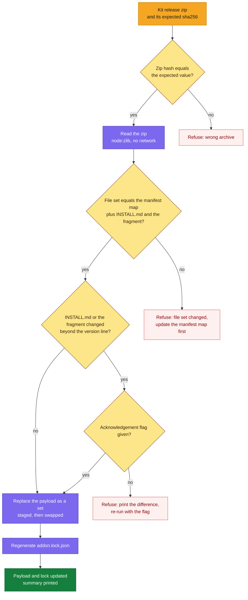

# DESIGN-20261112-T5YB: Session Review Capture Add-on — Design: Packaging and Sync

The bootstrap package carries the kit's drop-in as an unmodified payload with a lock beside it, and only the refresh script changes that payload.

## Scope

This design implements D3, D4, D5, D6 and the lock part of D29 from the [decision register in Architecture.md](./Architecture.md#decision-register).

It covers where the vendored drop-in lives, how the manifest declares it, what the lock holds, how the copy is refreshed from a kit release, how it is protected in this repository, and how a refresh travels in a patch bundle.

The install itself is in [Design - Launch Flow.md](<./Design - Launch Flow.md>). What happens after install is in [Design - Ownership After Launch.md](<./Design - Ownership After Launch.md>).

Package paths in this document are relative to `.canonical-implementation-harness/`, unless they start with `scripts/vendor/` or `scripts/release/` or name a dot-file at the repository root.

## Layout

The payload, the lock and the add-on script ship in the package; the refresh script stays in the harness repository.

```
.canonical-implementation-harness/
  canonical/
    manifest.json                         gains the "addons" block
    addons/
      session-review/
        addon.lock.json
        payload/
          .session-review.version
          INSTALL.md
          session-review.js
          session-review-lib.js
          session-review-run.js
          session-review-sweep.js
          session-review-usage.js
          settings.hooks.json
          skills/session-review/SKILL.md
          skills/session-review/references/output-template.md
          skills/session-review/references/user-mistake-taxonomy.md
  scripts/
    session-review-addon.mjs
    lib/session-review.mjs
scripts/
  vendor/refresh-session-review.mjs       harness repository only, not shipped
```

The payload mirrors the kit's `session-review-drop-in-2.2.5.zip` with its `session-review-drop-in/` prefix removed.

Nine of the eleven payload files are installed into a target repository. `INSTALL.md` and `settings.hooks.json` stay in the package: the first is the kit's own guide, kept so a refresh can show what changed in it; the second is the settings fragment the add-on script merges from.

## Manifest block

`canonical/manifest.json` gains one optional top-level key, `addons`. `schemaVersion` stays 1. Paths in the block are relative to `canonical/`; `source` paths are relative to the payload root.

```json
"addons": {
  "session-review": {
    "providers": ["claude"],
    "payload": "addons/session-review/payload",
    "lock": "addons/session-review/addon.lock.json",
    "settingsFragment": "settings.hooks.json",
    "files": [
      { "source": "session-review.js", "target": ".claude/session-review.js" },
      { "source": "session-review-lib.js", "target": ".claude/session-review-lib.js" },
      { "source": "session-review-sweep.js", "target": ".claude/session-review-sweep.js" },
      { "source": "session-review-run.js", "target": ".claude/session-review-run.js" },
      { "source": "session-review-usage.js", "target": ".claude/session-review-usage.js" },
      { "source": "skills/session-review/SKILL.md", "target": ".claude/skills/session-review/SKILL.md" },
      { "source": "skills/session-review/references/output-template.md", "target": ".claude/skills/session-review/references/output-template.md" },
      { "source": "skills/session-review/references/user-mistake-taxonomy.md", "target": ".claude/skills/session-review/references/user-mistake-taxonomy.md" },
      { "source": ".session-review.version", "target": ".claude/.session-review.version" }
    ]
  }
}
```

The block is validated in `scripts/lib/manifest.mjs`, with field names in `scripts/lib/constants.mjs`:

- `addons` is optional; a manifest without it is valid and behaves as today.
- `providers` is a non-empty subset of the provider names the manifest defines.
- `payload` and `lock` are safe relative paths under `addons/<name>/`.
- `files` is non-empty; every `source` exists under the payload and appears once; every `target` appears once.
- `settingsFragment` names a file in the payload.
- The add-on script additionally rejects any `target` outside its fixed allowlist (D29); the manifest cannot widen what the script writes.

The `.gitattributes` and `.gitignore` lines the install needs are fixed in the add-on script, not declared here.

## Lock

`addon.lock.json` records which kit release the payload came from and a hash for every payload file. The refresh script writes the hash values.

```json
{
  "schemaVersion": 1,
  "addon": "session-review",
  "kit": {
    "version": "2.2.5",
    "archive": "session-review-drop-in-2.2.5.zip",
    "archiveSha256": "11dac095b216202e696a55b5d5dd24b8590ac51cf6997f275c4c875c35770010"
  },
  "files": [
    { "path": ".session-review.version", "sha256": "<sha256 of the file's bytes>" },
    { "path": "INSTALL.md", "sha256": "<sha256 of the file's bytes>" },
    { "path": "session-review.js", "sha256": "<sha256 of the file's bytes>" }
  ]
}
```

- The `files` array holds all eleven payload files; the example shows three.
- The payload is LF-only, so the hash of the bytes and the line-ending-normalised hash are the same value.
- The version string is opaque to the lock and is compared only by the add-on script (D18).
- The add-on script checks every payload file against the lock before it does anything else and refuses on a mismatch (D29).

## Refresh from a kit release

The refresh script replaces the payload as a set from a local kit zip whose hash equals the expected value, then regenerates the lock.



Command contract:

```
node scripts/vendor/refresh-session-review.mjs --zip <path> --sha256 <expected> [--ack-install-changes]
node scripts/vendor/refresh-session-review.mjs --check
```

Refresh behaviour:

- It reads a local zip only and never fetches anything.
- Every zip entry must sit under the `session-review-drop-in/` prefix; an entry that would resolve outside the payload folder is rejected.
- The payload is written to a staging folder and swapped in, so a failed refresh leaves the previous payload intact.
- The summary names the old and new kit versions, the files whose content changed, and whether anything changed apart from the version file.

`--check` behaviour:

- Every payload file's hash equals its lock entry.
- The lock's file list equals the manifest's file map plus `INSTALL.md` and the settings fragment, with no extra file in the payload.
- A non-zero exit on any mismatch.
- It runs in the unit suite and as the first step of `scripts/release/release-harness-bootstrap.mjs`, which refuses to build the ZIP when it fails.

## Protection in this repository

Three entries in the harness repository keep tooling from changing the payload bytes.

| File | Entry | Protects against |
| --- | --- | --- |
| `.gitattributes` | `.canonical-implementation-harness/canonical/addons/session-review/payload/** -text` | Line-ending conversion on checkout, so the working tree, the release ZIP and the kit bytes are the same |
| `.prettierignore` | `.canonical-implementation-harness/canonical/addons/` | Prettier rewriting the kit's scripts, Markdown and JSON at commit |
| `eslint.config.js` ignores | `.canonical-implementation-harness/canonical/addons/` | ESLint fixing or rejecting the kit's CommonJS scripts |

A missed or wrong entry shows up as a failed `--check`, not as a silently changed payload.

## Travel in a patch bundle

A refresh travels in a patch bundle as ordinary canonical text, marked with its own deployment value.

- Payload, lock and manifest block are text under `canonical/`, so a refresh is carried like any other canonical change: added files in full, updated files as unified diffs.
- Bundle entries under `canonical/addons/` carry the deployment value `addon`. They have no mapping, and the skill discovery sweep in `patch prepare` and `patch apply` skips `canonical/addons/`, so the payload's `SKILL.md` is never taken for a new skill.
- A bundle that carries add-on payload states the minimum package version that has the add-on script. Applied to an older package, the payload lands in `canonical/` and is inert, because nothing in that package reads it.
- A payload change in a bundle is reviewed as a text diff when the bundle is applied. After it lands, the add-on script's lock check refuses to run on a partly applied payload.

## Stored name of the skill entry

The payload stores the skill entry as `skills/session-review/SKILL.md`. If the spike in [Efforts.md](./Efforts.md) shows that Claude Code discovers that nested file as a skill, the refresh script stores it as `skills/session-review/SKILL.md.kit` instead, with unchanged content and hash, and the manifest pair's `source` names the stored file; the `target` stays `.claude/skills/session-review/SKILL.md`. The lock's `path` for that file names the stored file too, so `--check` and the add-on script's lock check compare like with like.

## Failure modes

Every failure is caught by a hash, file-set or allowlist check before a changed payload is released or installed.

| Failure | Detected by | Result |
| --- | --- | --- |
| Wrong or tampered kit zip | Zip hash check in the refresh | Refresh refuses; payload unchanged |
| Kit release added or removed a file | File-set check in the refresh | Refresh refuses until the manifest map is updated |
| Kit changed its install steps or settings fragment | Difference check in the refresh | Refresh refuses until acknowledged |
| Payload edited by hand, reformatted or line-ending-converted | `--check` in the unit suite and before release | Suite and release fail |
| Payload partly applied from a bundle | The add-on script's lock check at run time | The script refuses in every mode |
| Manifest pair points outside the allowed targets | The add-on script's allowlist | The script refuses |

## Verification

These specs verify the design:

- Manifest validator: a valid block, each invalid field, and a manifest without the block.
- Refresh on a fixture zip: success, wrong hash, changed file set, changed `INSTALL.md` with and without the flag, and a path escaping the payload.
- `--check`: clean, one byte changed, an extra file, and a missing file.
- The release script refuses on a failed check.
- A patch grader case carrying a payload change as `addon` entries.
- The discovery sweep ignores `canonical/addons/`.
