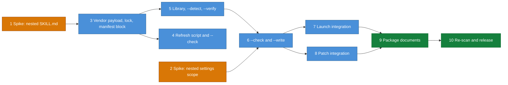

# DESIGN-20261112-T5YB: Session Review Capture Add-on — Efforts

Ten slices, each sized for one focused `/dev` session. Two are spikes that settle a fact about Claude Code before the slice that depends on it.

D-numbers refer to the decision register in [Architecture.md](./Architecture.md#decision-register).

## Work breakdown

| # | Summary | Type | Layer | Depends on |
| --- | --- | --- | --- | --- |
| 1 | Spike: does Claude Code discover a `SKILL.md` nested inside the installed package as a skill? Outcome decides the stored name of the payload's skill entry (D3) | spike | Package | — |
| 2 | Spike: how does Claude Code scope hooks and `env` from a subfolder's `.claude/settings.json`? Outcome confirms the nested settings write (D11) | spike | Package | — |
| 3 | Vendor the 2.2.5 drop-in: payload, lock, the manifest `addons` block with its validation, and the repository protections (`.gitattributes`, `.prettierignore`, ESLint ignores) | chore | Package (canonical), repository config | 1 |
| 4 | Refresh script with `--check`, wired into the unit suite and the release script | feat | Repository scripts | 3 |
| 5 | Add-on library and read-only modes: lock check, preconditions, path guards, classifier and version rule, `--detect`, `--verify` | feat | Package scripts | 3 |
| 6 | Add-on writes: `--check` with its digest and `--write` — set copy with the version file last, settings key-merge, git and ignore lines, nested settings | feat | Package scripts | 5, 2 |
| 7 | Launch integration: `Q12`, `Q12b`, `Q12c`; launch references `01a`, `01b`, `01d`, `02`; the report section and the evidence check; e2e launch prompt and runner guard; BOOT-005 scoped case | feat | Package references, e2e | 6 |
| 8 | Patch integration: the add-on step in `patch apply`, the `addon` deployment value, exclusions and the settings-key rule in harvest, state and prepare, the operation record entry, graders | feat | Package references, e2e | 6 |
| 9 | Package documents: README, CHANGELOG, `SKILL.md` capability statements, the Engineering Guide page for leads; this repository's `Q12` answer | docs | Package documents | 7, 8 |
| 10 | InfoSec re-scan, then release of the package version that ships the add-on (D23) | chore | Release | 9 |

## Sequencing

Slices 7 and 8 can run in parallel once 6 is done, and slice 4 can run alongside 5.

## Completion evidence

| # | Done when |
| --- | --- |
| 1 | A recorded test on the current CLI states whether the nested file is listed as a skill |
| 2 | A recorded test states whether hooks and `env` in a subfolder's settings file apply to a session started there, and whether they shadow the root's |
| 3 | The manifest validator specs pass and the payload equals the kit zip |
| 4 | `--check` passes in the unit suite and the release script refuses on a failed check |
| 5 | The classifier specs cover every class and precedence boundary |
| 6 | The integration specs pass in `git init` workspaces, including refusal on a changed digest |
| 7 | A stubbed launch installs on a yes and installs nothing on a no; live runs dispatch no review |
| 8 | The graders accept an add-on-only apply and find no mapping for a drop-in path |
| 9 | The package documents describe the add-on and `SKILL.md` states the new capabilities |
| 10 | A dated scan report is under `docs/Harness/08 Security Scan/` and the release ZIP is built |

## Effort estimate

No effort estimate is recorded: `/dev` implements the slices and records its own timings.
