# DESIGN-20261112-T5YB: Session Review Capture Add-on — Stack

The add-on introduces no new dependency. It pins one external release and relies on tools the package and the kit already require.

D-numbers refer to the decision register in [Architecture.md](./Architecture.md#decision-register).

```mermaid
flowchart LR
    classDef kit fill:#F5A623,stroke:#B8770B,color:#1A1A1A
    classDef harness fill:#15803d,stroke:#166534,color:#fff
    classDef tool fill:#7B68EE,stroke:#4B3AA8,color:#fff
    classDef target fill:#2563eb,stroke:#1e40af,color:#fff

    ZIP["Kit release 2.2.5<br/>pinned by zip sha256"]:::kit
    REFRESH["Refresh script<br/>node:zlib, no network"]:::tool
    PAYLOAD["Payload and lock<br/>in the package"]:::harness
    SCRIPT["Add-on script<br/>Node standard library, git"]:::tool
    HOOKS["Installed hooks<br/>POSIX shell commands"]:::target
    REVIEW["Headless review<br/>claude CLI, review model"]:::target

    ZIP --> REFRESH --> PAYLOAD --> SCRIPT --> HOOKS --> REVIEW
```

Each step runs on what the step before it produced; the two tables list what each needs.

## In the harness

| Technology | Where it is used | Constraint | Verified by |
| --- | --- | --- | --- |
| Session Review kit drop-in | Payload under `canonical/addons/session-review/` | Release 2.2.5, pinned by the zip sha256 in the lock (D4) | Refresh `--check` |
| Node.js standard library | `scripts/session-review-addon.mjs` and `scripts/lib/session-review.mjs` | The Node.js version the package's existing scripts already require; no third-party module | Unit and integration specs |
| `git` command | The add-on script | Spawned without a shell: `rev-parse --show-toplevel`, `ls-files`, `status --porcelain`, `check-attr`, `check-ignore` (D7) | Integration specs in `git init` workspaces |
| `node:zlib` | `scripts/vendor/refresh-session-review.mjs`, in the harness repository only | Reads a local kit zip; no network access | Refresh spec on a fixture zip |
| Vitest | `apps/harness-bootstrap-e2e/` | The existing test runner; new specs and graders only | The suites |

## On a target machine, required by the kit at run time

| Requirement | Needed for | How the harness handles it |
| --- | --- | --- |
| `node`, `git` and `claude` on PATH | The kit's hooks and its headless review | Stated in the launch report (D24); `git` is also checked by the add-on script (D30) |
| Git Bash on Windows | The hook commands, which are POSIX shell | Stated in the launch report; not checked |
| A recent Claude Code CLI; the kit was tested on 2.1.303 | The headless review's flags (`--permission-mode dontAsk`, `--tools`, `--strict-mcp-config`, `--settings`) | Stated in the launch report; not checked |
| A review model | One headless run per session | Chosen in `Q12b`, default `opus`, written to `SESSION_REVIEW_MODEL` on a fresh install (D2) |

## Compatibility that must hold

- The kit's script paths are fixed: five scripts directly in `.claude/`, the skill in `.claude/skills/session-review/`.
- The project root must be the git top level, because the hook commands resolve it (D30).
- The drop-in works with Claude Code only (D1).
- A kit release that adds or removes a file needs the manifest's file map updated before the refresh accepts it (D4).
