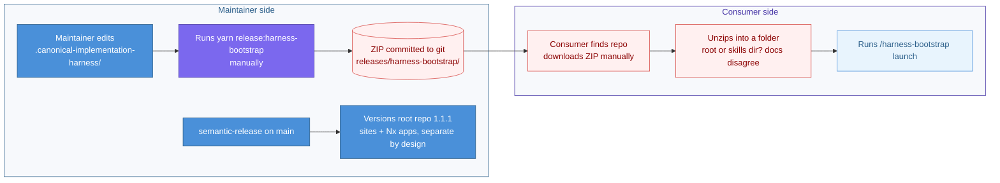

# DESIGN-20261115-CO1T — Harness Distribution and Release Channels

## Problem

The harness ships only as a ZIP committed to git, and every install or update step is manual.

- The package is `.canonical-implementation-harness/`, skill name `harness-bootstrap`.
- It ships as a versioned ZIP under `releases/harness-bootstrap/`: 13 binaries, v1.0.0 → v3.5.0.
- A maintainer builds it by hand: `yarn release:harness-bootstrap` → `scripts/release/release-harness-bootstrap.mjs`.
- Consumers find the repo, download the ZIP, unzip it by hand, then run `/harness-bootstrap launch`.
- Updates are a manual re-download before `patch apply`.

Known defects in the current state:

| Area         | Fact                                                                                                                                                                                                                                                                                           |
| ------------ | ---------------------------------------------------------------------------------------------------------------------------------------------------------------------------------------------------------------------------------------------------------------------------------------------- |
| Install docs | Quick Start says extract into the project root. The package README says extract into the provider skills folder (`.claude/skills/`, `.agents/skills/`, `.github/skills/`).                                                                                                                     |
| Naming       | The package name does not match the brand (Artisyn Implementation Harness). The repo is already renamed to `DataArt/artisyn-implementation-harness`.                                                                                                                                           |
| Versioning   | `SKILL.md` says 3.3.0. `CHANGELOG.md` says 3.5.0. The harness has no release mechanism of its own. semantic-release versions the root repo (`@artisyn-harness/root` 1.1.1, `npmPublish: false`); that is a separate version on purpose, since the repo also holds the sites and other Nx apps. |
| Roadmap      | Roadmap §1 "Registry Distribution" already names this as the next product step.                                                                                                                                                                                                                |

Why now: consumer adoption is growing. 3.5.0 was a consumer-feedback round from Windows users. Every manual step is a support cost.

**Current state:**

## Success

### Known ECs

- EC1: The package is renamed from `harness-bootstrap` to `artisyn-implementation-harness` to match the brand. This covers the package, skill name, release artifact names and docs.
- EC2: The package is published to GitHub Packages as an npm package. It contains the skill plus a simple CLI. The CLI extracts and places the skill into the chosen provider folder(s), then tells the user to run the bootstrap launch.
- EC3: The package is listed on the Claude, Codex and Copilot plugin/skill marketplaces.
- EC4: The package is installable via skills.sh.
- EC5: Install and update have defined mechanisms, with consumer instructions, scripts and guidelines.
- EC6: CI/CD pipelines automate release and distribution to every channel.

### Proposed ECs

- [accepted] EC7: The harness has its own version and release, independent of the repo. The root `package.json` and its semantic-release keep versioning the repo (sites, Nx apps) and are not tied to the harness. The harness has one version source of its own. `SKILL.md`, the harness `CHANGELOG.md`, the published npm `package.json` and every marketplace manifest carry that same version. The harness pipeline sets it; CI checks it.
- [accepted] EC8: A public consumer can install without a GitHub token. GitHub Packages' npm registry requires auth even for public packages, so at least one documented channel must work anonymously. The ZIP stays available as a GitHub Release asset (not committed to git) for offline and manual installs.
- [accepted] EC9: Existing installs migrate safely. Projects installed as `harness-bootstrap` keep their `state/` (launch records, baselines, patch history): it is moved from `package:state/` into the project `.harness/` workdir (EC12) with provenance. Their recorded `package:` path still resolves. The old invocation is either aliased or gets a clear migration message. Immutable patch history keeps the old name.
- [accepted] EC10: Published artifacts are verifiable and clean. Publishing uses provenance or checksums. It excludes `state/`, `.DS_Store` and any secret-bearing file. A release can be pinned and rolled back to a prior version.
- EC11: The current mechanism is retired. Committed ZIPs under `releases/harness-bootstrap/` leave git, the manual `yarn release:harness-bootstrap` script is removed or replaced by the pipeline, and every doc, template and state reference that points consumers at the committed ZIP is updated. _(Added by the developer at Frame sign-off.)_
- EC12: Runtime state lives in the project, not in the package. The package's generated `state/` (answers, baselines, objects, operations, launch and patch records) moves from `package:state/` into the project's `.harness/` workdir, beside evolve's `.harness/evolve/` and `.harness/reflections/`. The rule that `.harness/` is a legacy, read-only migration input is retired. Local patch bundles (`package:patch/`) and harvest edits (`package:canonical/`) stay in the package. _(Added by the developer during Research, 2026-11-15; Frame amended as a scope change.)_

## Decisions

Confirmed by the developer at Frame Step 2 (2026-11-15): four decisions, each with its own Research → Evaluate → Solution loop.

| #   | Decision                                                                                                                                                                                                                                       | Why it's independent                                                                                                 |
| --- | ---------------------------------------------------------------------------------------------------------------------------------------------------------------------------------------------------------------------------------------------- | -------------------------------------------------------------------------------------------------------------------- |
| 1   | Package identity and naming — final package, skill and npm scope names (`@dataart/...`?), slash-command name, alias/deprecation of `harness-bootstrap`                                                                                         | Can be chosen and approved without picking any channel; every channel only consumes the name                         |
| 2   | Channel portfolio and packaging format — which of npm (GitHub Packages / npmjs), Claude/Codex/Copilot marketplaces, skills.sh and Release-asset ZIP to support, in what priority, and what each artifact contains                              | Its own options and tradeoffs (reach, auth friction, manifest formats); works under any name                         |
| 3   | Install and update mechanism — CLI behaviour (provider detection, target folder, overwrite rules, preserving local `patch/` bundles and harvest edits), how updates hand off to `patch apply`, migration of existing installs, consumer guides | Its own options (CLI vs marketplace-native install vs manual); can be reiterated without changing the channel list   |
| 4   | Release pipeline and versioning — version source of truth, the harness's own release mechanism, independent of the root repo's semantic-release, CI publish jobs per channel, removal of ZIPs from git                                         | Its own options (semantic-release vs changesets vs tag-driven); swapping it leaves channels and install UX unchanged |

## Boundaries

**In scope:**

- Rename across package, skill, scripts, docs and CI in this repo.
- npm packaging with an install CLI.
- Marketplace and skills.sh listings.
- Install, update and migration mechanism, plus consumer guides: new `docs/Harness/09 Distribution/` section, Quick Start and Roadmap §1 updates.
- CI/CD release workflows.
- Moving `package:state/` into the project `.harness/` workdir (EC12): the state-location rule in the package docs (`README.md`, `references/00-overview.md`, `launch/01a-launch-plan.md`, `launch/08-provider-launch.md`, `patch/06-patch-state.md`), the path aliases that resolve it, and migration of existing `package:state/` and legacy `.harness/launch/` records.
- Version source of truth.
- The three tracked files still using the old repo URL `DataArt/artisyn-harness`: `CHANGELOG.md`, `docs/Harness/01 Explore/02 Feature Comparison.md`, `docs/Harness/01 Explore/03 Artisyn Capability Audit.md`.

**Out of scope:**

- Changing launch/patch semantics beyond the install entrypoint, package location and state location (EC12). Where local patch bundles and harvest edits are written does not change.
- New providers beyond Claude, Codex and Copilot (e.g. Kiro, Cursor — Roadmap §2).
- Web Explorer or Web Docs site changes beyond linking the install guide.
- Private registries such as Artifactory.
- Licensing or paid marketplace terms.
- Rewriting immutable patch history.

## Constraints

| Constraint            | Detail                                                                                                                                                                                                             |
| --------------------- | ------------------------------------------------------------------------------------------------------------------------------------------------------------------------------------------------------------------ |
| Package manager       | `yarn` only in this repo, never npm/npx. Consumer-facing commands for other package managers are an open question for Research, not settled here.                                                                  |
| Guarded commands      | The developer starts `git push` and deploy-style commands. Pipelines publish; agents never run publish commands directly.                                                                                          |
| Region                | Never hardcoded in source or docs.                                                                                                                                                                                 |
| Public access         | The site and docs are public, with no access gate. Consumer install docs must be readable without auth.                                                                                                            |
| Consumer state        | Release archives never carry state. Consumer state lives in `.harness/` (EC12) and must survive package updates and reinstalls. Local `patch/` bundles and harvest edits in the package must also survive updates. |
| Shared workdir        | `.harness/` is shared with evolve (`.harness/evolve/`, `.harness/reflections/`). Harness state takes its own subfolder and never writes outside it.                                                                |
| Determinism           | Same source version, evidence and decisions give the same file selection and paths at launch.                                                                                                                      |
| Platforms             | Consumers run on macOS, Linux and Windows (3.5.0 Windows feedback). Any CLI must be cross-platform Node.                                                                                                           |
| Harness Bootstrap E2E | The container exercises `.canonical-implementation-harness/` in place. Rename and packaging must keep its fixtures and graders working.                                                                            |
| Provider destinations | Fixed by the canonical manifest: `.claude/skills/`, `.agents/skills/`, `.github/skills/`.                                                                                                                          |
| Rename blast radius   | About 84 tracked files and about 12.4k occurrences, plus three discovery symlinks.                                                                                                                                 |

## Links

- Ticket: DESIGN-20261115-CO1T (local design ID, no tracker ticket)
- Related tickets: none
- Reference docs:
  - `docs/Harness/06 Roadmap/01 Harness Roadmap.md` (§1 Registry Distribution)
  - `docs/Harness/02 Quick Start/index.md`
  - `.canonical-implementation-harness/README.md` (Shared package discovery)
  - `docs/Engineering Guide/04 AI Coding Tool Compatibility.md`
  - `docs/Target Architecture (HLD)/v1/Containers/Harness Bootstrap E2E.md`
  - `scripts/release/release-harness-bootstrap.mjs`
  - `release.config.js`
