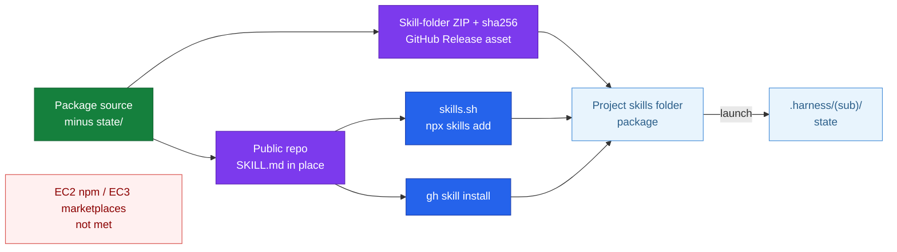
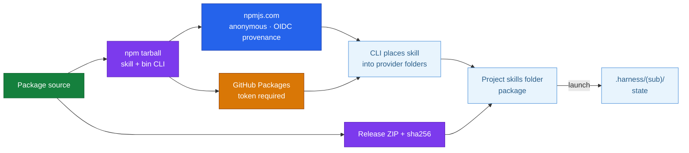
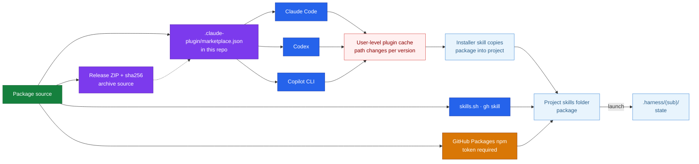
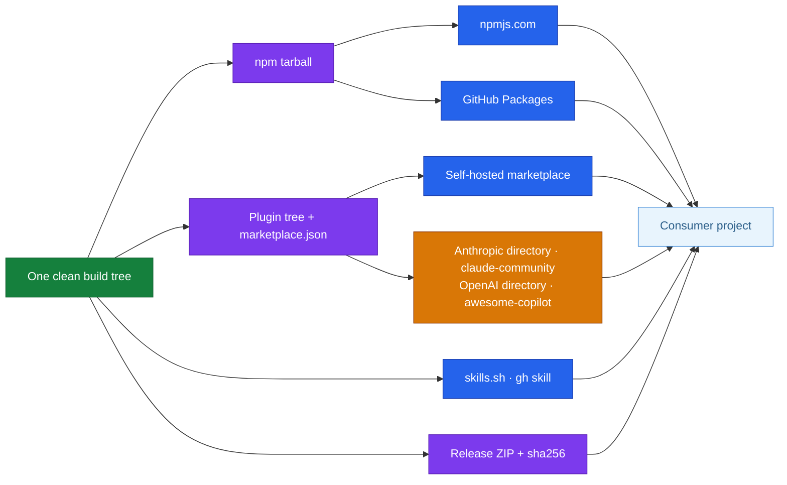

# DESIGN-20261115-CO1T: Harness Distribution and Release Channels — Research: Channels

_Produced by the Research phase. Owned by `@product-architect`. Decision 2 of 4 — see `00 Frame.md` § Decisions. Do not edit after Evaluate phase begins._

## Context

_Revised 2026-11-15 for Frame amendment EC12: runtime `state/` now lives in the project `.harness/` workdir; `package:patch/` and harvest edits stay in the package._

Decision 2 picks which channels ship the harness and what each artifact contains. Every option below must handle the five cross-cutting facts in this table.

| #   | Fact                         | What it means for every option                                                                                                                                                                                                                                                                                                                                                                   |
| --- | ---------------------------- | ------------------------------------------------------------------------------------------------------------------------------------------------------------------------------------------------------------------------------------------------------------------------------------------------------------------------------------------------------------------------------------------------ |
| 1   | Bootstrap, not runtime skill | `launch` writes permanent project copies. State lives in the project `.harness//` workdir, not at `package:state/` (EC12), and survives updates (EC9). The package is removable after launch, apart from local `package:patch/` bundles and canonical harvest edits (D3-2).                                                                                                                 |
| 2   | Plugin cache vs package      | Plugin installs live in a user-level cache (`~/.claude/plugins/cache/<mkt>/<plugin>/<version>/`). The path changes per update and is shared across projects. State is not affected: it lives in `.harness//` (EC12, in scope). Three issues remain: the per-version cache path for `package:` (D3-13), read-only caches vs harvest edits (D3-3), and per-host version skew. Resolved in D3. |
| 3   | Agent Skills spec            | `name` must equal the folder name. Every artifact's top folder carries the D1 name. The version goes in `metadata.version` (EC7).                                                                                                                                                                                                                                                                |
| 4   | Discovery leakage            | skills.sh and `gh skill` scan this repo. They may expose its own operational skills (`dev`, `design`, `evolve`…) and the three `harness-bootstrap` discovery symlinks unless restricted (`skills.sh.json` `paths`). The package source sits in hidden `.canonical-implementation-harness/`.                                                                                                      |
| 5   | Artifact shapes              | All shapes come from one clean tree: the package minus `state/`, `.DS_Store` and secrets (EC10). Consumer packages carry no `state/` (EC12). The build still excludes this repo's tracked `state/` unless D3-15 moves it. See the shapes table below.                                                                                                                                            |

Artifact shapes (fact 5):

| Shape | Artifact                                                                                                                             |
| ----- | ------------------------------------------------------------------------------------------------------------------------------------ |
| (a)   | Skill-folder ZIP + sha256 on a GitHub Release                                                                                        |
| (b)   | npm tarball: skill folder + `bin/` CLI + allowlist `files`                                                                           |
| (c)   | Plugin tree: `.claude-plugin/plugin.json` + `skills/<name>/…` (optional `.codex-plugin/plugin.json`)                                 |
| (d)   | Repo-root `.claude-plugin/marketplace.json` catalog with `source` = relative / `git-subdir` / `archive` (HTTPS zip + sha256) / `npm` |
| (e)   | Agent-Skills-conformant `SKILL.md` read in place by skills.sh / `gh skill`                                                           |

Shared diagram colors: green = package source, purple = artifact, blue = channel, light blue = consumer, amber = gated or external review, red = gap or risk.

## Options

### Option A — Minimal: Release-asset ZIP + skills.sh (+ gh skill for free)

**Description:** CI attaches artifact (a) and its checksum to a GitHub Release. Committed ZIPs leave git (EC11). skills.sh and `gh skill` install straight from the public repo (artifact e). No npm, no plugin manifests. Install copies the skill folder into the project skills folder, which is today's README model. State lives in `.harness//` (EC12).

**Industry precedent:** GitHub CLI and ripgrep ship Release assets. vercel-labs agent-skills install via `npx skills add`. `gh skill publish` creates a GitHub release.

**Diagram:**

**Pros:**

- Smallest change, close to today's contract.
- Anonymous install through the ZIP and skills.sh (EC8).
- Project-local install: no plugin-cache problem.
- One artifact, simple provenance (checksum or attestation).

**Cons:**

- Misses EC2 (GitHub Packages npm) and EC3 (marketplaces) as written.
- No install CLI. Updates are manual unless the user runs `npx skills update` or `gh skill update`.
- The skills.sh listing is driven by install telemetry, not by us.
- `gh skill` needs a gh login and is in preview.

**Unknowns / risks:**

- Whether skills.sh copies or symlinks. A symlink would put local canonical edits and bundles in a shared location. State is safe in `.harness//`.
- Discovery leakage (Context fact 4).
- How `gh skill` resolves tags under per-package tags. This couples to D4.

---

### Option B — npm-centric: npmjs primary, GitHub Packages mirror, Release ZIP fallback

**Description:** One npm tarball (b) holds the skill folder and a cross-platform Node CLI. The CLI places the skill into the chosen provider folders, then prompts `launch` (EC2 behaviour). It is published to npmjs via OIDC trusted publishing. That gives anonymous install and automatic provenance (EC8, EC10). The same tarball is mirrored to GitHub Packages to meet EC2 literally. GitHub Packages is token-gated, so that mirror is org-internal. A Release ZIP covers offline installs. Marketplace and skills.sh entries, if any, are thin pointers: a marketplace `npm` source, or the repo for skills.sh.

**Industry precedent:** shadcn/ui (`npx shadcn add` copies source into the project), Husky (`npx husky init`), Storybook (`npx storybook init`), Nx (`create-nx-workspace`). Roadmap §1 targets a `yarn add`-style install.

**Diagram:**

**Pros:**

- The CLI controls placement and overwrite in the project, including preservation of local bundles and canonical edits. This avoids the plugin-cache issue.
- Registry semver gives pin and rollback (EC10).
- Strongest provenance (npm OIDC).
- Matches Roadmap §1.

**Cons:**

- Two registries on one version (EC7).
- `@dataart` scope availability on npmjs is unknown. GitHub Packages forces the scope to `@dataart`.
- Consumers need Node.
- A new cross-platform CLI to maintain.
- Agent-native discovery is secondary.

**Unknowns / risks:**

- Whether `@dataart` is available on npmjs, and whether public publishing is allowed.
- The consumer command (`npx` / `yarn dlx` / `pnpm dlx`) vs this repo's yarn-only rule.
- Whether the Roadmap's `@artisyn-harness/bootstrap` name is superseded (D1).

---

### Option C — Repo-as-marketplace-centric: one self-hosted catalog for Claude, Codex, Copilot CLI

**Description:** This repo carries `.claude-plugin/marketplace.json` (d). Claude Code reads it natively. Codex and Copilot CLI read it as a legacy-compatible fallback. Push = publish, with no external review. The plugin `source` is either the plugin tree (c) or the Release ZIP via `archive` + sha256. The `archive` source avoids committing build output (EC11). skills.sh and `gh skill` read the same repo. npm ships only on GitHub Packages (EC2, internal, token-gated). A Release ZIP covers manual installs. An installer copy of the package into the project is needed only for harvesters or for a stable `package:` (Context fact 2).

**Industry precedent:** the anthropics/claude-code plugin marketplace; obra/superpowers via its own GitHub marketplace repo; awesome-copilot as a GitHub-hosted catalog; Homebrew taps (a git repo as the index).

**Diagram:**

**Pros:**

- One manifest reaches all three providers (EC3 self-listing).
- Native `plugin update` commands and opt-in auto-update.
- Anonymous install for a public repo (EC8).
- No registry account.

**Cons:**

- An installer copy is needed only for harvesters or for a stable `package:`. Non-harvesters may run from the cache if D3-13 allows.
- Invocation is namespaced as `/<plugin>:<skill>`. This couples to D1.
- Users must add the marketplace first. Discovery is weak without official listings.
- A relative-path `source` puts build output in git.

**Unknowns / risks:**

- Whether Codex needs `policy.installation`, `policy.authentication` and `category` on Claude-format entries.
- How Codex and Copilot handle the `${CLAUDE_PLUGIN_ROOT}` alias during the installer copy.
- Whether Codex and Copilot support the `archive` source.
- Discovery leakage (Context fact 4).

---

### Option D — Everything: every channel + official curated directories

**Description:** One build produces one clean tree, wrapped per channel. npm tarballs go to npmjs and GitHub Packages. A self-hosted marketplace lives in this repo. Submissions go to `claude-community`, the Anthropic directory on claude.ai, the OpenAI/Codex directory portal and awesome-copilot. skills.sh, `gh skill` and the Release ZIP are also supported.

**Industry precedent:** ESLint and Prettier (npm + VS Code Marketplace + Open VSX); Playwright (npm + VS Code extension); GitHub CLI (Homebrew, winget, apt, Release assets).

**Diagram:**

**Pros:**

- Maximum reach and discovery.
- Official directories auto-update (Anthropic directory syncs as `<name>@synced`).
- Meets EC2, EC3 and EC4 under the broadest reading.

**Cons:**

- External review gates sit on the release path, with timelines we do not control. `claude-plugins-official` is partner-only. The Anthropic directory needs a paid plan.
- Many manifests on one version (EC7).
- Largest CI surface (EC6) and provenance surface (EC10).
- Curated copies lag, so pin and rollback are harder.

**Unknowns / risks:**

- Directory eligibility and review for a bootstrap that writes many project files.
- Whether curated listings accept the installer-copy pattern.
- Directory commercial and licensing terms. These are out of scope per the Frame but may block.

---

## Governance notes

Every option keeps state project-local by construction (EC12).

| Area                   | Note                                                                                                                                                                              |
| ---------------------- | --------------------------------------------------------------------------------------------------------------------------------------------------------------------------------- |
| Roadmap §1             | The target block (`internal npm / GitHub Packages / Artifactory`, `@artisyn-harness/bootstrap`) needs a Publish update. Artifactory is out of scope.                              |
| Adoption Path          | `docs/Harness/04 Adoption/00 Adoption Path.md` "Getting Started" still says copy `.harness-bootstrap/` and read `01 Bootstrap.md`. It is stale. Add it to the Publish doc impact. |
| Provider compatibility | `docs/Engineering Guide/04 AI Coding Tool Compatibility.md` lacks Copilot. Roadmap §5.12 (verified host support) applies before C or D claims Copilot support.                    |

## Open Questions

Classification confirmed by the developer at Research sign-off (2026-11-15). V = Viability (the answer disqualifies options; resolve before the Evaluate matrix). E = Evaluation-input (detail or cost; defer to Evaluate or implementation).

| #     | Question                                                                                                                                                             | Owner                                    | Proposed V/E     | Reason                                                                                                                                  |
| ----- | -------------------------------------------------------------------------------------------------------------------------------------------------------------------- | ---------------------------------------- | ---------------- | --------------------------------------------------------------------------------------------------------------------------------------- |
| D2-1  | EC3 meaning: self-hosted marketplace (C) or official curated directories (D)?                                                                                        | Developer                                | V                | "Official directories required" makes D mandatory and drops A and C as EC3-compliant                                                    |
| D2-2  | GitHub Packages (EC2): primary or internal mirror, given EC8? Is public npmjs publishing allowed?                                                                    | Developer + DataArt GitHub/npm org admin | V                | If public npmjs is not allowed, B loses its anonymous path. If GitHub Packages must be primary, EC8 needs a different anonymous channel |
| D2-3  | Is the `@dataart` scope available on npmjs.com?                                                                                                                      | DataArt org admin                        | V                | If unavailable, the npmjs channel needs another scope or is dropped (B)                                                                 |
| D2-4  | Plugin channels: does the plugin run the package in place from the cache, or copy it into the project? State location is answered by EC12.                           | D3 (via D3-3, D3-13)                     | V (through D3-3) | State part answered by EC12. The remaining run-in-place-or-copy choice depends on D3-3 and D3-13; it stays V until D3-3 is resolved     |
| D2-5  | Does Codex accept a Claude-format marketplace entry without `policy.*` / `category`? Do Codex and Copilot honour the `archive` source?                               | `@architect` spike                       | E                | Fallback is shipping native manifests too; cost only                                                                                    |
| D2-6  | Do skills.sh / `gh skill` expose the repo's own skills and symlinks? Does skills.sh copy or symlink?                                                                 | `@architect` spike                       | E (spike)        | Exposure is fixable with `skills.sh.json` `paths`; copy/symlink feeds D3-6                                                              |
| D2-7  | How does `gh skill` resolve the latest release under per-package tags?                                                                                               | D4                                       | E                | Pin-by-tag works regardless; tracked as D4-Q9                                                                                           |
| D2-8  | Consumer install commands (`npx` / `yarn dlx` / `pnpm dlx`), given this repo is yarn-only?                                                                           | Developer                                | E                | Doc detail; this repo's yarn-only rule does not bind consumers                                                                          |
| D2-9  | Is plugin namespacing `/<plugin>:<skill>` accepted, or do names collapse?                                                                                            | D1                                       | E                | Same as D1-2                                                                                                                            |
| D2-10 | Does the immutable `patch/` history ship in every artifact (size; `patch apply` needs it)? Shipping it must also work with the local-bundle merge on update (D3-14). | Developer + D3                           | E                | Size/cost detail; merge behaviour owned by D3-14                                                                                        |

## Sources

External facts verified 2026-11-15.

| Topic                                                           | Source                                                                                                                                                                                                                           |
| --------------------------------------------------------------- | -------------------------------------------------------------------------------------------------------------------------------------------------------------------------------------------------------------------------------- |
| Claude Code plugins, marketplaces, cache path, namespacing      | https://code.claude.com/docs/en/plugins-reference · https://code.claude.com/docs/en/plugin-marketplaces · https://code.claude.com/docs/en/plugins/publish.md · https://code.claude.com/docs/en/plugins/anthropic-marketplaces.md |
| Codex plugins and marketplace fallback                          | https://developers.openai.com/codex/plugins/build/                                                                                                                                                                               |
| GitHub Packages npm registry (token required, `@dataart` scope) | https://docs.github.com/en/packages/working-with-a-github-packages-registry/working-with-the-npm-registry                                                                                                                        |
| Copilot agent skills and Copilot CLI plugins                    | https://docs.github.com/en/copilot/concepts/agents/about-agent-skills · https://docs.github.com/en/copilot/how-tos/copilot-cli/customize-copilot/plugins-finding-installing                                                      |
| `gh skill`                                                      | https://cli.github.com/manual/gh_skill                                                                                                                                                                                           |
| skills.sh                                                       | https://skills.sh · https://github.com/vercel-labs/skills                                                                                                                                                                        |
| npm trusted publishing (OIDC, provenance)                       | https://docs.npmjs.com/trusted-publishers                                                                                                                                                                                        |
| Agent Skills spec (`name` = folder, `metadata.version`)         | https://agentskills.io/specification                                                                                                                                                                                             |
