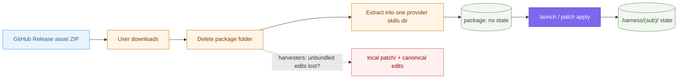
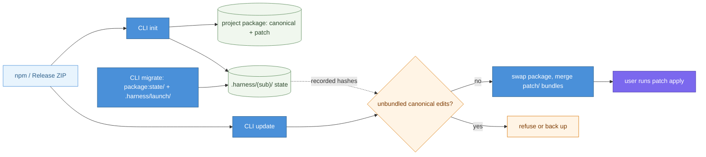
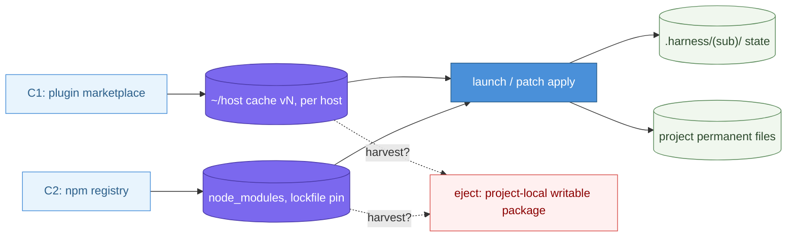
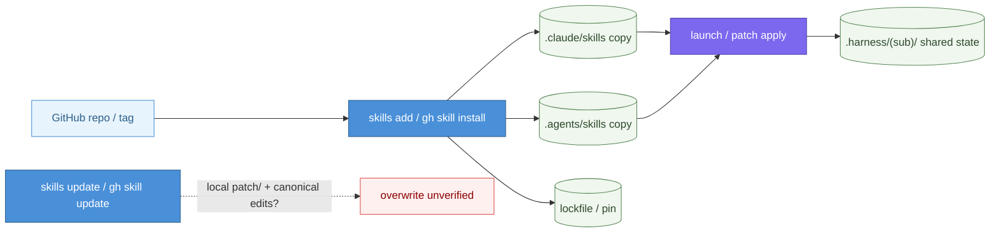
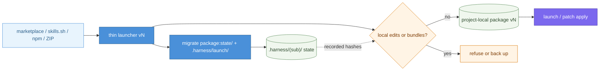

# DESIGN-20261115-CO1T: Harness Distribution and Release Channels — Research: Install and Update

_Produced by the Research phase. Owned by `@product-architect`. Do not edit after Evaluate phase begins._

Decision 3 of 4 — see `00 Frame.md` § Decisions.

## Context

> **Revised 2026-11-15 after Frame amendment EC12.** Only `state/` moves to project `.harness/`. `package:patch/` and harvest edits stay in the package. This supersedes the first D3 option set.

**Changes from the first option set:**

| Option  | Change                                                                                                                                                                          |
| ------- | ------------------------------------------------------------------------------------------------------------------------------------------------------------------------------- |
| A       | Kept. Simpler: no "keep `state/`" carve-out on update.                                                                                                                          |
| B       | Kept. Simpler: the swap no longer has to skip `state/`.                                                                                                                         |
| C (new) | Merges old C (plugin cache) and old E (npm dependency + sync). Both lose the state blocker. Both still hit the read-only-package-vs-harvest wall. Both use the same fix: eject. |
| D       | Kept. Now viable for consumers who do not harvest.                                                                                                                              |
| E (new) | Channel-delivered launcher that copies the full package into the project.                                                                                                       |

`.harness//` is the new state root. The subfolder name is open (D3-10).

### Repo findings beyond the Frame

| #   | Finding                                                                                                                                                                                                                                                                                                                      | Source                                           |
| --- | ---------------------------------------------------------------------------------------------------------------------------------------------------------------------------------------------------------------------------------------------------------------------------------------------------------------------------- | ------------------------------------------------ |
| R1  | `project-patch/` is not `package:patch/`. `project-patch/` = `package:state/patch/`: project execution bundles, apply and harvest receipts, `APPLIED.md`. It sits under `state/`, so it moves to `.harness/`. Only the portable bundles, `package-patch/` = `package:patch/`, stay in the package.                           | `06-patch-state.md` § Path aliases               |
| R2  | `package:patch/` mixes shipped immutable bundle history with local harvest and prepare bundles (listed in `package-patch/REGISTRY.md`). `package:canonical/` is both shipped upstream content and the harvest target. Every update path must handle both.                                                                    | `06-patch-state.md`; `package-patch/REGISTRY.md` |
| R3  | `00-overview.md` lists "local patch bundles" under `state/`. This contradicts `06-patch-state.md`. Publish must fix the wording against EC12.                                                                                                                                                                                | `00-overview.md:40-42`                           |
| R4  | This source repo tracks its own state inside the package (`.canonical-implementation-harness/state/answers.json`, `index.json`, `objects/`, `operations/`). `answers.json` sits at the `state/` root, but the contract says `state/launch/answers.json`. There is no `.harness/` state today; `.harness/` holds only evolve. | `.canonical-implementation-harness/state/`       |
| R5  | The package docs do not say whether evolve's `.harness/evolve/` and `.harness/reflections/` are committed or ignored in consumer projects.                                                                                                                                                                                   | Package docs                                     |
| R6  | The package ships Node scripts (`scripts/provider-adapter.mjs`, `plan-provider-launch.mjs`, `finalize-launch.mjs`). Whether launch requires Node is unverified. If it does, "the consumer needs Node" weighs less.                                                                                                           | `scripts/`                                       |

### Facts every option must handle under EC12

| #   | Fact                                                                                                                                                                                                                                                                                                                                                                                                                                                                                                                                                                                                                                                                                               |
| --- | -------------------------------------------------------------------------------------------------------------------------------------------------------------------------------------------------------------------------------------------------------------------------------------------------------------------------------------------------------------------------------------------------------------------------------------------------------------------------------------------------------------------------------------------------------------------------------------------------------------------------------------------------------------------------------------------------- |
| 1   | **Subfolder name.** State gets its own subfolder that never collides with `evolve/` or `reflections/`. Choices: (a) named after the skill (D1), for example `.harness/artisyn-harness/` — a future rename moves state again; (b) neutral and rename-proof, for example `.harness/bootstrap/`; (c) role folders `.harness/launch/` + `.harness/patch/` — clashes with legacy `.harness/launch/` and spreads state.                                                                                                                                                                                                                                                                                  |
| 2   | **Layout.** Keep the current tree under the new root: `launch/{answers.json, runs/, reports/}`, `registry.md`, `index.json`, `objects/`, `operations/`, `patch/` (old `project-patch/`, with `APPLIED.md`). Moving without reshaping keeps patch semantics unchanged.                                                                                                                                                                                                                                                                                                                                                                                                                              |
| 3   | **Path aliases.** `state/` = `.harness//`. `project-patch/` = `.harness//patch/`. `registry.md` = `.harness//registry.md`. Local reports = `.harness//launch/reports/`. `package-patch/` stays `package:patch/`. The contract needs a named state root beside `package:`. It is project-relative, resolved from the project root, and never inferred from the package location or the provider. Files to change: `06-patch-state.md` § Path aliases, § Local bookkeeping; `05-patch-apply.md:7-9`; `01a-launch-plan.md:9-28`; `08-provider-launch.md:11-17, 132-133, 217-218`; README § Local toolkit; `00-overview.md:34-44` (also fix "local patch bundles under `state/`"). |
| 4   | **Project root resolution.** Scripts today resolve their own package folder. With the package outside the project (C1), the project and state roots cannot come from the package path. The contract must name the source: the working folder or a host project variable.                                                                                                                                                                                                                                                                                                                                                                                                                           |
| 5   | **Migration sources.** (a) `package:state/` from `harness-bootstrap/` in any of the three provider folders. (b) Legacy `.harness/launch/`: now the same working folder, so the read-only rule retires, but it is still a provenance import that does not merge conflicting IDs. (c) Both at once, which needs a precedence rule. (d) This repo's own tracked `.canonical-implementation-harness/state/`, with a different layout. Migration is idempotent, keeps the source until verified, and leaves a marker at the old location.                                                                                                                                                               |
| 6   | **Commit or ignore.** Today the consumer ignore rule covers package and state together (`01a-launch-plan.md:12`, README). Under EC12 it no longer covers state. Choices: ignore `.harness//`; commit it (teammates share baselines, so `patch apply` has history; risk of merge conflicts on `index.json` and size growth from `objects/`); or split (commit `index.json`, `registry.md`, answers, `APPLIED.md`; ignore `objects/` and reports). Committing changes who holds patch history. That may touch "patch semantics" and needs a ruling. The rule must not override evolve's unspecified status by accident. Launch must still not untrack files as a side effect.                   |
| 7   | **Several providers.** One state root serves all providers, independent of package location. The provider-scoped records in `06-patch-state.md` carry over. Options with more than one physical package (C1, D) must record which package version each operation used.                                                                                                                                                                                                                                                                                                                                                                                                                             |
| 8   | **The package is not fully stateless.** `package:canonical/` is upstream content and the harvest target. `package:patch/` + `REGISTRY.md` hold shipped and local bundles. Every update path needs a `patch/` merge rule and a local-edit check. Comparing against `recorded_sha256` in `.harness//index.json` is now possible on every channel that can run a check.                                                                                                                                                                                                                                                                                                                          |
| 9   | **Package removable after launch (old D3-2).** With state and the `objects/` baselines in `.harness/`, `patch apply` after a reinstall has exact bases. The rule holds for consumers who do not harvest. For harvesters it holds only once local bundles are sent or backed up.                                                                                                                                                                                                                                                                                                                                                                                                                    |
| 10  | **EC10.** Artifacts exclude state by construction. This repo tracks state in the package tree. So the build must keep excluding it, or this repo moves its own state too (D3-15). This affects E2E fixtures.                                                                                                                                                                                                                                                                                                                                                                                                                                                                                       |

## Options

### Option A — Manual Release-asset unzip with a fixed guide (kept, simpler)

**Description:** The ZIP is a GitHub Release asset (EC8, EC11). There is no CLI. The guide names one provider skills folder, and Quick Start is fixed to match. State lives in `.harness//`, so the package folder holds nothing irreplaceable. Update: download, delete the package folder, extract, run `patch apply`. Harvesters run `patch prepare` first so every edit is bundled. Otherwise local bundles in `package:patch/` and unbundled canonical edits are lost. Migration is a guide step: move `harness-bootstrap/state/` to `.harness//` and record provenance by hand.

**Industry precedent:** WordPress manual plugin upload; Terraform, Go and Rust Release-asset binaries.

**Diagram:**

**Pros:**

- Almost no tooling.
- Offline and tokenless (EC8).
- Deterministic: the same ZIP bytes give the same files.
- Clean delete-and-extract update: no stale files and no "keep `state/`" carve-out.

**Cons:**

- Fully manual.
- Does not meet EC2 alone.
- Harvesters must remember to run `patch prepare` first.
- Windows Explorer "Extract All" nests a folder.
- Manual migration puts EC9 provenance at risk.

**Unknowns / risks:**

- The guide cannot enforce a local-edit check.
- No pin beyond the package version files.

---

### Option B — Project-local copy CLI (create-\* / shadcn style) (kept, simpler)

**Description:** A small cross-platform Node CLI offers `init`, `update`, `migrate` and `doctor`. It ships on npm and is also packed into the Release ZIP.

- **Init** writes one physical package to one project location. B1: the first provider folder. B2: a neutral folder plus discovery entries. It records `package:`, creates `.harness//` if missing, and prints "run launch".
- **Update** stages the new version and runs a local-edit check two ways. It compares `package:canonical/` with `recorded_sha256` in `.harness//index.json`, which now survives the swap. It checks `package-patch/REGISTRY.md` for local bundles. It swaps the package, merges new shipped bundles into `package:patch/` and keeps local ones. On unbundled canonical edits it refuses or backs up. Then it prints "run `patch apply`".
- **Migrate** moves `*/skills/harness-bootstrap/state/` and legacy `.harness/launch/` into `.harness//` with provenance. It renames the package folder (D1) and leaves a stub at the old name.

**Industry precedent:** shadcn/ui CLI; `create-vite`; Storybook `init`/`upgrade`; Angular `ng update`; `nx migrate`.

**Diagram:**

**Pros:**

- Meets EC2 exactly.
- Simpler swap: no state carve-out.
- The edit check uses baselines that survive the swap.
- One cross-platform code path; no symlinks under B1.
- Automated migration (EC9).

**Cons:**

- A new artifact to build and test; Harness Bootstrap E2E needs new fixtures.
- GitHub Packages needs a token, so anonymous install needs npmjs or the ZIP.
- Needs a `package:patch/` merge rule.

**Unknowns / risks:**

- The consumer command: `npx`, `yarn dlx` or `pnpm dlx`.
- Stub-skill behaviour on all three hosts (B2).
- Concurrent CLI and agent writes to `.harness//`.

---

### Option C — Read-only versioned install, state in `.harness/`, eject for harvesters (merges old C and E)

**Description:** The package runs from a versioned location the consumer does not edit. Two sub-variants:

- **C1 — host plugin cache.** `claude`, `codex` or `copilot plugin install`. The package lives in `~/.claude/plugins/cache/<mkt>/<plugin>/<version>/`, one cache per host.
- **C2 — pinned npm dependency.** `yarn add -D @<scope>/...` (Roadmap §1). The package lives in `node_modules` at a stable project-relative path. A bin `sync` exposes it in the provider skill folders.

EC12 removes the old blocker. Launch and apply write state to project `.harness//`, which survives cache churn and reinstalls. Update: `<host> plugin update` or a dependency bump, then `patch apply`, which takes its bases from `.harness//objects/`. Migration: the first run imports `harness-bootstrap/state/` or legacy `.harness/launch/` with provenance.

One wall remains. `harvest` and `prepare` write into `package:canonical/` and `package:patch/`. The cache and `node_modules` are wiped on update, and the C1 cache is shared across the user's projects. The fix is **eject**: copy the installed version into a project-local writable package (B-style) and switch `package:` to it. Later updates follow B. Consumers who do not harvest never eject.

**Industry precedent:** Install — VS Code extensions (user-level extension, workspace state); Claude, Codex and Copilot plugins; Husky; shared ESLint configs; Renovate. Eject — Create React App `eject`; Expo `prebuild`; Go `replace` plus vendoring.

**Diagram:**

**Pros:**

- One-command install and update.
- Native pin and auto-update (C1), or lockfile plus Renovate (C2).
- No package files to commit or ignore under C1.
- State is per project and survives updates.
- C2 keeps `package:` stable and project-relative.

**Cons:**

- Under C1, `package:` is a user-level path that changes each version. Today `package:` is project-relative (`08-provider-launch.md:11-17`). This needs a ruling (D3-13).
- C1 per-host caches cause version skew between providers that share one `.harness/` state. Determinism is at risk.
- C1 invocation is namespaced (`/plugin:skill`) (D1).
- C2 is Node-only. Yarn PnP has no `node_modules`. GitHub Packages needs a token.
- Eject is a second mode: two update paths to document and test.

**Unknowns / risks:**

- The Codex equivalent of `${CLAUDE_PLUGIN_ROOT}` (Copilot has aliases; Codex is unverified).
- Project root resolution when the package is outside the project. Claude has `${CLAUDE_PROJECT_DIR}`; the others are unverified.
- Plugin cache behaviour on Windows.
- Whether eject keeps the version link, so later updates know their base.

---

### Option D — Generic skill installers (skills.sh / gh skill) (kept; viable for non-harvesters)

**Description:** The consumer runs `npx skills add <owner>/<repo>` or `gh skill install <owner>/<repo> <skill>@<tag> --scope project`. The tool copies the skill into the provider folders and writes `skills-lock.json` or a pin. EC12 removes the state risk. Wipe-and-replace no longer destroys launch and patch history. Copies in `.claude/skills` and `.agents/skills` share one `.harness//`. One risk remains. A tool update may overwrite or delete local `package:patch/` bundles and unbundled `package:canonical/` edits. Harvest edits land in one copy, so the copies drift. Migration is a guide step, or runs on first launch or apply.

**Industry precedent:** skills.sh / Vercel `skills`; `gh skill`; Go `go get` with `go.sum`; `vendir`.

**Diagram:**

**Pros:**

- No CLI of our own.
- Lockfile hash plus commit gives pin and rollback (EC10).
- Wide reach; anonymous install via skills.sh.
- State is safe from tool updates.

**Cons:**

- Per-provider copies break "one physical package" (`host-capabilities.md`). Harvest picks one copy, and the copies drift.
- No hook for an edit check or for automated migration.
- `gh skill` needs a gh login and is in preview.
- skills.sh needs Node ≥ 22.20.

**Unknowns / risks:**

- Whether the tools delete unknown files on update (D3-6, now scoped to `patch/` and `canonical/`).
- Whether skills.sh copies or symlinks.
- Whether the size of the `canonical/` tree passes Agent Skills validation.

---

### Option E — Channel-delivered launcher, package copied into the project (new)

**Description:** Every channel (plugin marketplace, skills.sh, npm, ZIP) delivers a thin launcher: a small skill, or a plugin skill plus a bundled script. The first run copies the full versioned package into one project-local location. It records `package:`, creates `.harness//`, runs EC9 migration, and hands off to launch. Updates go through the same launcher with B's check (recorded hashes in `.harness/`, local bundles in `REGISTRY.md`), then `patch apply`. The package is always project-local and writable, so harvest works. The channel only delivers the launcher and the version.

**Industry precedent:** Gradle and Maven wrappers; `corepack`; `rustup` toolchain files; Homebrew casks that run an installer.

**Diagram:**

**Pros:**

- Every channel ends in the same project-local writable package. Harvest is preserved and `package:` is stable.
- Anonymous install via marketplace or skills.sh (EC3, EC4, EC8).
- One update and migration path, regardless of channel.
- No per-host skew: the project package sets the version.

**Cons:**

- Two versioned things: launcher and package.
- A launcher skill that writes many files may face curated-directory review (D2 Option D).
- Does not meet EC2 alone unless the npm CLI is the launcher (then E includes B).
- Launcher plus package entry adds skill-list noise.

**Unknowns / risks:**

- Whether hosts let a plugin skill run a bundled script that writes into the project.
- Version mismatch rules between launcher and package.
- Whether the launcher stays or is removed after launch.

---

## Comparison

| Concern                             | A                         | B                                      | C1                   | C2                            | D                         | E                                      |
| ----------------------------------- | ------------------------- | -------------------------------------- | -------------------- | ----------------------------- | ------------------------- | -------------------------------------- |
| Package location                    | project provider dir      | project (B1 provider dir / B2 neutral) | user cache per host  | `node_modules` + synced entry | per-provider copies       | project-local, copied by launcher      |
| State location                      | `.harness//`         | `.harness//`                      | `.harness//`    | `.harness//`             | `.harness//`         | `.harness//`                      |
| Writable harvest target             | yes, manual prepare-first | yes, guarded update                    | no, eject needed     | no, eject needed              | at risk on tool update    | yes, guarded update                    |
| One shared package across providers | yes, manual               | yes                                    | no (per-host caches) | yes                           | no (copies; state shared) | yes                                    |
| Meets EC2 alone                     | no                        | yes                                    | no                   | partly                        | no                        | only if launcher = npm CLI             |
| Anonymous install (EC8)             | yes                       | via npmjs or ZIP                       | yes                  | via npmjs only                | skills.sh yes, gh no      | yes, via marketplace / skills.sh / ZIP |
| Migration automated                 | no                        | yes                                    | yes, first run       | yes, sync                     | no                        | yes                                    |

The options are combinable. B or E can sit beside C or D as the harvester path.

## Open Questions

V = Viability: the answer disqualifies options, so resolve it before the Evaluate matrix. E = Evaluation-input: detail or cost, deferred to Evaluate or implementation.

| #     | Question                                                                                                                      | Owner                            | Proposed V/E               | Status / reason                                                                                                                                                      |
| ----- | ----------------------------------------------------------------------------------------------------------------------------- | -------------------------------- | -------------------------- | -------------------------------------------------------------------------------------------------------------------------------------------------------------------- |
| D3-1  | Can `state/` move out of the package?                                                                                         | —                                | —                          | Answered by EC12 (developer, 2026-11-15): yes, to `.harness//`.                                                                                                 |
| D3-2  | Is the package removable after launch?                                                                                        | Developer                        | E                          | Changed: removable for consumers who do not harvest (state and baselines are in `.harness/`). Open: is removal allowed with unsent local bundles or unbundled edits? |
| D3-3  | Is consumer-side `patch harvest`/`prepare` supported?                                                                         | Developer                        | V                          | Sharper: the only blocker for C and the main risk for D. "Yes" means C needs eject and D is limited to non-harvesters.                                               |
| D3-4  | Where does the package live with several providers?                                                                           | Developer                        | E                          | Easier: the location no longer carries state. Affects discovery and the Quick Start fix only.                                                                        |
| D3-5  | Windows: do hosts follow symlinks or junctions? Does a stub skill pointing outside its folder work?                           | `@architect` spike               | E                          | Unchanged.                                                                                                                                                           |
| D3-6  | Do skills.sh and `gh skill update` replace the whole folder?                                                                  | `@architect` spike               | V if D3-3 = yes            | Scope changed: the risk is local `package:patch/` bundles and `package:canonical/` edits, not `state/`.                                                              |
| D3-7  | Which consumer command syntax?                                                                                                | Developer                        | E                          | Unchanged (= D2-8).                                                                                                                                                  |
| D3-8  | Old invocation: alias or stub?                                                                                                | Developer (D1)                   | E                          | Unchanged (= D1-5).                                                                                                                                                  |
| D3-9  | What share of consumers are non-Node?                                                                                         | Developer                        | E                          | Weaker if launch already needs Node for its scripts. Verify first (R6).                                                                                              |
| D3-10 | `.harness/` subfolder name: skill-named (D1), neutral, or role folders?                                                       | Developer + D1                   | E (settle before Solution) | New. Must avoid `evolve/`, `reflections/` and legacy `launch/`.                                                                                                      |
| D3-11 | Do consumers commit, ignore or split `.harness//`?                                                                       | Developer + `@product-architect` | E (needs scope ruling)     | New. Committed baselines change who holds patch history.                                                                                                             |
| D3-12 | Migration precedence and ID conflicts when both `package:state/` and `.harness/launch/` exist.                                | `@product-architect` + Developer | E                          | New.                                                                                                                                                                 |
| D3-13 | Is `package:` recorded as a path, or as name + version + channel, when outside the project?                                   | Developer + `@product-architect` | V for C1                   | New. "Must stay project-relative" drops C1 unless eject is mandatory.                                                                                                |
| D3-14 | What is the `package:patch/` merge rule on update (shipped + local bundles; `REGISTRY.md` shipped + appended)?                | Developer                        | E                          | New. The Boundaries forbid moving bundles, so this is a merge rule, not a new folder.                                                                                |
| D3-15 | Does this source repo move its own tracked `state/` into its `.harness//`, including the root `answers.json` layout fix? | Developer                        | E                          | New. Affects E2E fixtures and EC10 build exclusions.                                                                                                                 |
| D3-16 | Who runs migration per channel: CLI, first launch or apply, launcher, or user?                                                | Developer                        | E                          | New. Takes over D1-6.                                                                                                                                                |

Classification confirmed by the developer at Research sign-off (2026-11-15).

## Evaluate Step 1b resolutions (2026-11-15)

Viability questions answered by the developer before the Evaluate matrix, or resolved by a verification spike. Full table: `Report.md` § Assumptions.

| #     | Resolution                                                                                                                                                                                                                                                                                                               |
| ----- | ------------------------------------------------------------------------------------------------------------------------------------------------------------------------------------------------------------------------------------------------------------------------------------------------------------------------ |
| D1-1  | Literal full name `artisyn-implementation-harness` for skill and command. Identity options C and D drop out.                                                                                                                                                                                                             |
| D2-1  | EC3 = our own marketplace in this repo. Official directories are optional and later.                                                                                                                                                                                                                                     |
| D2-2  | No public npmjs. npm lives only on GitHub Packages (token). Anonymous installs go through the marketplace, skills.sh or the Release ZIP.                                                                                                                                                                                 |
| D2-3  | Moot (no npmjs). Registry shows zero `@dataart` packages.                                                                                                                                                                                                                                                                |
| D3-3  | No consumer-side `patch harvest`/`prepare`. Only this source repo harvests. The consumer package may be read-only.                                                                                                                                                                                                       |
| D3-6  | Spike: skills.sh (default symlink mode) deletes and recreates `.agents/skills/<name>`; `gh skill update` overwrites per file and keeps extras. Harmless now: no consumer harvest, state in `.harness/`. Sources: github.com/vercel-labs/skills `src/installer.ts`; github.com/cli/cli `pkg/cmd/skills/update/update.go`. |
| D3-13 | Follows from D3-3: read-only installs are allowed, so `package:` may be a user-level plugin-cache path, recorded as path + name + version + channel.                                                                                                                                                                     |
| D4-Q1 | Commit-generated CHANGELOG is acceptable.                                                                                                                                                                                                                                                                                |
| D4-Q2 | Fully automatic publish on merge. No human gate.                                                                                                                                                                                                                                                                         |
