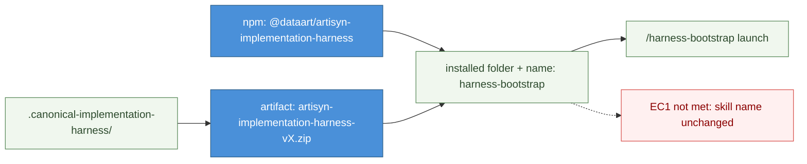
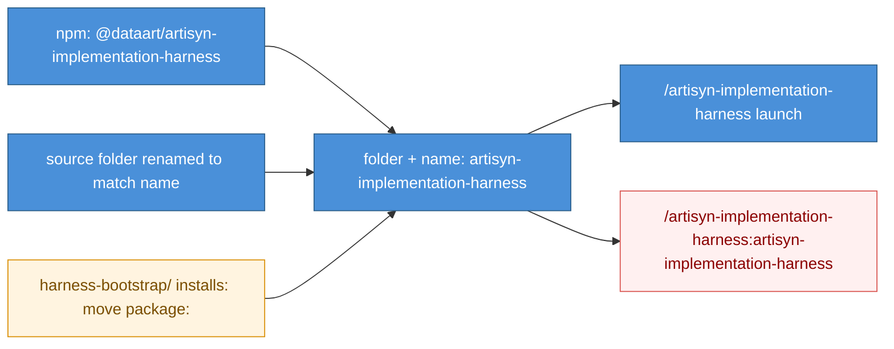
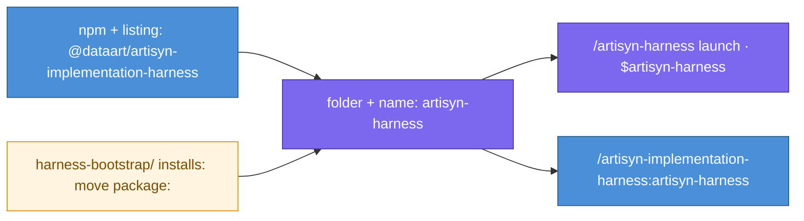
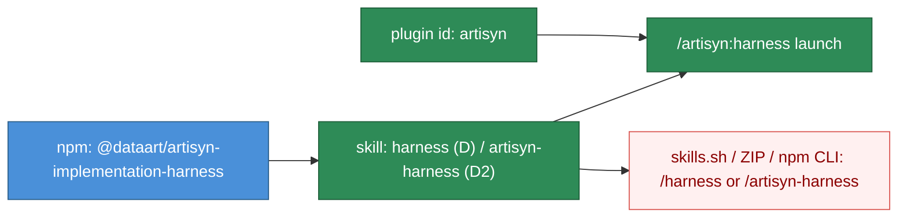
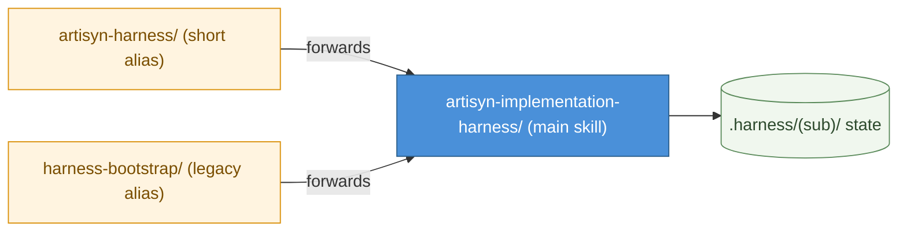

# DESIGN-20261115-CO1T: Harness Distribution and Release Channels — Research: Package Identity

_Produced by the Research phase. Owned by `@product-architect`. Do not edit after Evaluate phase begins._

Decision 1 of 4 — see `00 Frame.md` § Decisions.

## Context

_Revised 2026-11-15 for Frame amendment EC12: runtime `state/` now lives in the project `.harness/` workdir; `package:patch/` and harvest edits stay in the package._

Every naming option must handle the facts below. EC1 asks for the rename to `artisyn-implementation-harness`; EC9 asks for safe migration of existing installs; EC11 retires the committed ZIPs.

**Facts every option must handle:**

- `package:` is the project-relative path of the physical package. For consumer installs it is the extracted `harness-bootstrap/`. State lives in the project `.harness//` workdir, not in the package (EC12; subfolder name open, D3-10). Renaming the installed folder moves only `package:`, local `package:patch/` bundles and canonical edits. State stays in `.harness//`. Only pre-EC12 installs carry state at `package:state/`. The one-time EC9 migration moves it to `.harness//` with provenance. Sources: package README § Shared package discovery, `references/launch/08-provider-launch.md:11-13`, `references/patch/06-patch-state.md`.
- Coupling with D3-10: if the state subfolder takes a skill-tied name, D1 also names the state folder, and any later rename moves state again. A neutral name removes this coupling.
- Patch bundle paths are package-root-relative (`canonical/...`, `SKILL.md`, `harness-bootstrap.md`). A folder rename does not invalidate them. Renaming the package-root `harness-bootstrap.md` would be a `rename` entry. History already patches it under the old name.
- `state/index.json` stores `"snapshot": "release:artisyn-harness-bootstrap-v3.2.0.zip"` references (lines 184, 861–886). After EC12 these refs live in `.harness//index.json`. The artifact rename and EC11 (ZIPs leave git) change how they resolve.
- Installed outputs (`canonical/`) contain zero `harness-bootstrap` occurrences. The old name appears only in package-internal files: `SKILL.md`, `README.md`, `harness-bootstrap.md`, `references/launch/01-launch.md`, `references/patch/03-patch.md`, `reports/report.template.md`, immutable `patch/**` and `state/**`. Launch tasks are prefixed `[harness-bootstrap <run_id>]` (`01-launch.md:28`).
- The source folder `.canonical-implementation-harness/` declares `name: harness-bootstrap`. This violates the Agent Skills spec (name = folder). It is discoverable only through three `harness-bootstrap` symlinks.
- The short form "artisyn-harness" is already in use: Roadmap target `@artisyn-harness/bootstrap`, root `@artisyn-harness/root`, ZIPs `artisyn-harness-bootstrap-v*.zip`.
- External constraints:
  - GitHub Packages scope = owner, so `@dataart/...`. The npmjs `@dataart` scope is unverified.
  - Agent Skills `name`: at most 64 chars, lowercase, digits and hyphens, equal to the folder name. No version field.
  - Plugin skills are invoked as `/plugin:skill`. Reserved prefixes: `claude-`, `anthropic-`, `anthropics-`, `cc-plugin-`.
  - Codex invokes `$name`; Claude and Copilot invoke `/name`.
  - skills.sh and `gh skill` discover a root `SKILL.md`, `skills/` up to 3 levels deep, agent dirs and `marketplace.json`.
- `docs/Harness/05 Principles/index.md` has no naming principle. Options are judged against EC1–EC11.

## Options

### Option A — Brand only the outer layer (minimal change)

**Description:** The npm package becomes `@dataart/artisyn-implementation-harness`. The artifact becomes `artisyn-implementation-harness-v{ver}.zip`. Docs carry the brand. The skill folder, `name` and command stay `harness-bootstrap`. The source folder stays `.canonical-implementation-harness/`. No legacy handling is needed.

**Industry precedent:** `@angular/cli` → `ng`; `typescript` → `tsc`; a Homebrew formula name differs from its binary name.

**Diagram:**

**Pros:**

- No rename migration: `package:`, patch history and E2E stay untouched. The EC12 state move from `package:state/` to `.harness//` is still needed, as under every option.
- None of the ~12.4k occurrences change.

**Cons:**

- Fails EC1 as written (skill name).
- Two names: users install X and type `/harness-bootstrap`.
- The plugin shows `/artisyn-implementation-harness:harness-bootstrap`.

**Unknowns / risks:**

- The generic `harness-bootstrap` may clash on skills.sh.
- The source-folder spec violation remains.

---

### Option B — Full brand name on every layer

**Description:** The npm package is `@dataart/artisyn-implementation-harness`. The skill folder and `name` are `artisyn-implementation-harness` (30 chars). The command is `/artisyn-implementation-harness launch` (`$…` in Codex). The plugin uses the same name, so the plugin command is `/artisyn-implementation-harness:artisyn-implementation-harness launch`. The source folder is renamed to match, which fixes the spec violation (`skills/` plugin layout per D2). The package-root `harness-bootstrap.md` is renamed. Old-name handling: see [Legacy handling](#legacy-harness-bootstrap-handling).

**Industry precedent:** Babel 6→7 moved to `@babel/*` and deprecated the old packages; `node-sass` → `sass`; Rome → Biome.

**Diagram:**

**Pros:**

- One name end to end. EC1 is met literally.
- No mapping table.
- The source folder becomes valid for skills.sh and `gh skill`.

**Cons:**

- Long to type. The plugin form repeats the name.
- Biggest blast radius: ~84 files, E2E fixtures, symlinks.
- The installed folder changes for every consumer, so `package:` moves. The state move is the same under every option.

**Unknowns / risks:**

- Does host autocomplete make the length acceptable?
- Users may confuse the plugin name with the single skill name.

---

### Option C — Brand for package, short name for skill and command

**Description:** The npm package and plugin listing are `@dataart/artisyn-implementation-harness`. The skill folder and `name` are `artisyn-harness`, so the command is `/artisyn-harness launch` (`$artisyn-harness` in Codex). The plugin is named after the package, so the plugin command is `/artisyn-implementation-harness:artisyn-harness launch`. The source folder is renamed `artisyn-harness/` (or `skills/artisyn-harness/` per D2).

**Industry precedent:** `@nestjs/cli` → `nest`; `@vue/cli` → `vue`; `@aws-amplify/cli` → `amplify`. In this repo: `@artisyn-harness/root`, `artisyn-harness-bootstrap-v*.zip`, Roadmap `@artisyn-harness/bootstrap`.

**Diagram:**

**Pros:**

- Easy to type and still branded.
- Reuses the existing short form.
- Avoids the generic `harness`.

**Cons:**

- EC1 is only partly met (branded, not literal). The developer must agree.
- The plugin command stays long unless the plugin is renamed (see Option D).
- One mapping to learn.

**Unknowns / risks:**

- Is `artisyn-harness` free on skills.sh and the marketplaces?
- Existing installs still need the `package:` move. The state move is the same under every option.

---

### Option D — Split name between plugin namespace and skill

**Description:** The npm package is `@dataart/artisyn-implementation-harness`. The marketplace display uses the full brand. The plugin id is `artisyn` and the skill is `harness`, so the command is `/artisyn:harness launch`. Variant D2 names the skill `artisyn-harness`, giving `/artisyn:artisyn-harness`; this avoids a bare `harness` in non-namespaced channels. Non-namespaced channels (skills.sh, ZIP, npm CLI) expose the bare skill name (`/harness` or `/artisyn-harness`).

**Industry precedent:** Anthropic `document-skills` → `/document-skills:pdf`; `superpowers` → `/superpowers:<skill>`; Terraform `namespace/name`.

**Diagram:**

**Pros:**

- Shortest plugin command.
- The namespace leaves room for future Artisyn skills (Roadmap §2).

**Cons:**

- The command differs by channel. Docs need a per-channel table.
- A bare `harness` is generic and likely to clash.
- The plugin id differs from the npm name.

**Unknowns / risks:**

- Do Codex and Copilot keep the namespace or flatten it? Confirmed for Claude only.
- The `package:` path differs by channel (overlaps D3). State does not; it stays in `.harness//`.

---

### Option E — Full brand main name + permanent short alias skill

**Description:** As Option B, the main skill is `artisyn-implementation-harness`. On top, one or more thin forwarding skill folders ship: short `artisyn-harness`, legacy `harness-bootstrap`, or both. Each is spec-valid. Each `SKILL.md` says to follow `../artisyn-implementation-harness/SKILL.md`. `package:` always resolves to the main folder. State lives in `.harness//` (EC12).

**Industry precedent:** npm `bin` with multiple commands (`tsc`, `tsserver`); Homebrew `formula_renames.json` and aliases; GitHub repo redirects; the `docker-compose` shim.

**Diagram:**

**Pros:**

- Full brand for EC1, plus a short or old command for typing and EC9.
- Old docs and habits keep working.

**Cons:**

- Two or three skill folders per provider. Discovery gets noisy and descriptions cost tokens.
- An alias must never resolve `package:` to itself. State is not at risk; it lives in `.harness//`.
- Permanent maintenance unless an end date is set.

**Unknowns / risks:**

- Is skill-to-skill forwarding reliable on all three hosts?
- Do skills.sh and the marketplaces list aliases separately?

---

## Legacy `harness-bootstrap` handling

These approaches combine with Options B–E. The immutable-history rule is always needed.

| Approach                               | Existing installs get                                                                                                                                                   | Precedent                          | Main risk                                        |
| -------------------------------------- | ----------------------------------------------------------------------------------------------------------------------------------------------------------------------- | ---------------------------------- | ------------------------------------------------ |
| Permanent alias skill                  | `/harness-bootstrap` keeps working                                                                                                                                      | Homebrew aliases, `docker-compose` | Ongoing skill-list noise                         |
| Deprecation shim with end version      | Old command prints a migration message; removed at a stated major                                                                                                       | `npm deprecate`, Babel 6           | Needs a removal version (D4)                     |
| Hard break + migration step            | Old folder stops working; the installer or the first new launch moves `harness-bootstrap/state/` to `.harness//`, not into the new folder                          | Rome→Biome, Terraform `moved`      | Fails EC9 unless a message ships somewhere       |
| Immutable-history rule (always needed) | `patch/**`, `state/**`, `release:artisyn-harness-bootstrap-v*.zip` keep their bytes; read-time mapping like the existing `adoptors/`→`adaptors/` in `06-patch-state.md` | The repo's own `adoptors/` mapping | Needs a rule for old `release:` names after EC11 |

## Source folder `.canonical-implementation-harness/`

| Approach                               | Effect                                                                               |
| -------------------------------------- | ------------------------------------------------------------------------------------ |
| Keep + symlinks                        | Zero E2E churn; spec still broken; skills.sh/`gh skill` symlink-following unverified |
| Rename to skill name                   | Spec-valid; E2E fixtures, graders and symlinks are updated                           |
| Move to `skills/<name>/` plugin layout | Matches plugin and skills.sh discovery; couples to D2                                |

## Open Questions

Classification confirmed by the developer at Research sign-off (2026-11-15).

V = Viability (the answer disqualifies options; resolve before the Evaluate matrix). E = Evaluation-input (detail or cost; defer to Evaluate or implementation).

| #    | Question                                                                                                                                                         | Owner                           | Proposed V/E      | Reason                                                                                                        |
| ---- | ---------------------------------------------------------------------------------------------------------------------------------------------------------------- | ------------------------------- | ----------------- | ------------------------------------------------------------------------------------------------------------- |
| D1-1 | EC1: literal `artisyn-implementation-harness` as skill/command, or is an Artisyn-branded short form (`artisyn-harness`) acceptable? Decides C and D eligibility. | Developer                       | V                 | "Literal only" disqualifies C and D                                                                           |
| D1-2 | Do Codex/Copilot plugins keep `/plugin:skill` or flatten it?                                                                                                     | D2 spike                        | E                 | Changes command text per channel, not which naming option is viable                                           |
| D1-3 | Are `artisyn-harness`/`artisyn`/`harness` taken on skills.sh, awesome-copilot, claude-community? Is `@dataart` usable on npmjs?                                  | Developer / DataArt org admin   | E                 | Name collisions are checked per chosen name; npmjs scope is tracked under D2-3                                |
| D1-4 | Do skills.sh/`gh skill` follow source-repo symlinks, or do they need a real spec-valid folder?                                                                   | D2 spike                        | E                 | Affects only the source-folder sub-choice; renaming the folder is cheap either way                            |
| D1-5 | Which legacy approach for EC9: alias, shim + removal version, or hard break + message?                                                                           | Developer; removal version → D4 | E                 | Every naming option B–E can pair with any approach; choose in Evaluate                                        |
| D1-6 | Who moves `harness-bootstrap/state/`: CLI, first new launch/`patch apply`, or the user? Is the moved `package:` recorded with provenance?                        | D3-16                           | Answered in shape | EC9/EC12 settle the shape: state moves to `.harness//` with provenance. Who runs the move moves to D3-16 |
| D1-7 | Old `release:artisyn-harness-bootstrap-v*.zip` snapshot refs (now in `.harness//index.json`) after rename + EC11 — is a read-time mapping acceptable?       | Developer + D4                  | E                 | A read-time mapping (like `adoptors/`) works under every option                                               |
| D1-8 | Rename the package-root `harness-bootstrap.md`, or keep it for history continuity?                                                                               | Developer                       | E                 | Patch `rename` entry is supported either way                                                                  |
| D1-9 | Change the launch task prefix `[harness-bootstrap <run_id>]`? Affects resume of in-flight launches.                                                              | Developer + D3                  | E                 | Cosmetic; only affects in-flight launch resume                                                                |
