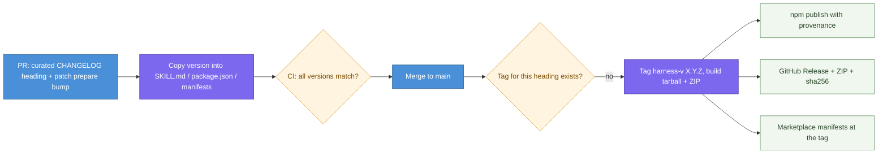
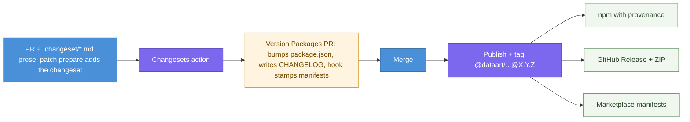
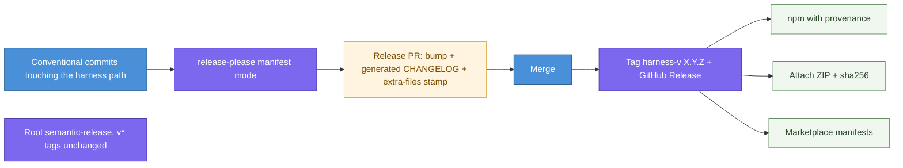
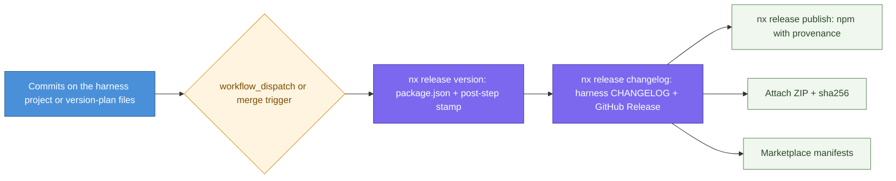
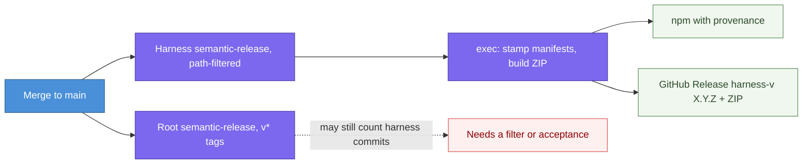

# DESIGN-20261115-CO1T: Harness Distribution and Release Channels — Research: Release Pipeline

_Produced by the Research phase. Owned by `@product-architect`. Do not edit after Evaluate phase begins._

_Decision 4 of 4 — see `00 Frame.md` § Decisions._

## Context

The harness needs one version source that every artifact carries, and a pipeline that tags and publishes it without touching root releases.

### What the repo shows today

| Fact                                                    | Evidence                                                                                                                                                                                                                                                                       |
| ------------------------------------------------------- | ------------------------------------------------------------------------------------------------------------------------------------------------------------------------------------------------------------------------------------------------------------------------------ |
| `SKILL.md` has two conflicting versions                 | Frontmatter `metadata.version: 3.3.0` (line 4); body `Version:` 3.5.0 (line 23)                                                                                                                                                                                                |
| No package versioning rule exists                       | `CHANGELOG.md` line 3 points to `references/00-overview.md`, which has none. The only semver rule is `patterns/skill-authoring.md` § "Canonical template versions", and it covers templates, not the package. The solution must name one owner of the package versioning rule. |
| The release script takes its version from the CHANGELOG | It reads the first `## X.Y.Z` heading                                                                                                                                                                                                                                          |
| `patch prepare` bumps the version                       | `references/patch/07-patch-prepare.md:57-60` tells the agent to bump the package version and update the CHANGELOG. This file ships inside the package, so it is a package-contract rule, not only this repo's CI.                                                              |
| Root semantic-release counts harness commits            | `release.config.js` has no path filter. A harness `feat(...)` bumps root today. Tag format is the default `v${version}`. `@semantic-release/git` commits back to main with `[skip ci]`.                                                                                        |
| `main` is not protected                                 | `docs/Engineering Guide/07 Branching Strategy.md` says so, and says tags are only `vX.Y.Z`. That doc must change under any option.                                                                                                                                             |
| Tooling                                                 | Nx 23.3.1, Yarn 4.9.2 (4.9.0 and later support provenance), Node 24 or later. Yarn workspaces cover only `apps/*`.                                                                                                                                                             |

### Pipeline steps shared by every option

- **Tags:** root keeps `v*`. The harness uses `artisyn-implementation-harness-v3.6.0`. The two do not collide.
- **Stamp and validate:** one source version is written into `SKILL.md`, the published `package.json`, `.claude-plugin/plugin.json`, marketplace entries and any Codex/Copilot manifests. A CI check on every PR fails on mismatch (EC7).
- **Build:** npm tarball and ZIP, excluding `state/`, `.DS_Store` and secrets (EC10).
- **Publish:** npm with provenance (npmjs trusted publishing needs `id-token: write`). ZIP and sha256 go on the harness GitHub Release. The tagged commit publishes the marketplace manifests (EC6, EC8).
- **Retire:** delete `releases/harness-bootstrap/` and the `release:harness-bootstrap` script (EC11).
- **Rollback:** move npm dist-tags or deprecate; never unpublish. Marketplace and `gh skill` users pin to a tag (EC10).

## Options

### Option A — Minimal: CHANGELOG heading stays the source, small custom publish-on-version-change workflow

**Description:** The maintainer, or `patch prepare`, writes a curated `## X.Y.Z` entry in the PR. A script stamps all manifests, and CI checks they match. On merge to main, a custom workflow checks whether tag `artisyn-implementation-harness-v<heading>` exists. If not, it tags, builds, publishes to all channels and creates a GitHub Release whose body is that CHANGELOG section. A developer-pushed tag (guarded) or `workflow_dispatch` can also trigger it.

**Industry precedent:** The "publish when version changed" pattern (`EndBug/version-check` action). Changesets' own publish step works the same way.

**Diagram:**

**Pros:**

- Smallest change.
- Curated CHANGELOG and the `patch prepare` bump stay as they are.
- No new release tool; reuses the current script logic.
- The bump is deliberate and reviewed in the PR.

**Cons:**

- Manual bump: a forgotten bump means no release.
- Custom code to maintain.
- No release PR or preview.

**Unknowns / risks:**

- Root semantic-release still counts harness commits unless filtered (Q3).
- The heading regex becomes load-bearing.

---

### Option B — Changesets (explicit change files)

**Description:** The harness gets a real `package.json` as its version source. The harness folder, or a packaging folder built from it, joins Yarn workspaces. Each PR adds `.changeset/*.md` with a bump level and prose. The Changesets action keeps a "Version Packages" PR open. That PR bumps `package.json`, writes the prose into the harness CHANGELOG, and a version hook stamps the other manifests. Merging it publishes and tags `@dataart/artisyn-implementation-harness@X.Y.Z` (the monorepo default). A follow-up job attaches the ZIP. The `patch prepare` "bump + CHANGELOG" step becomes "add a changeset".

**Industry precedent:** Astro, SvelteKit, pnpm, Radix UI.

**Diagram:**

**Pros:**

- Author-written prose fits the curated CHANGELOG.
- Bumps are explicit and reviewed.
- The release PR is a human gate.
- Mature tooling.

**Cons:**

- New tool and file convention.
- The CHANGELOG gets Changesets subheadings (`### Minor Changes`).
- The harness joins the workspace graph (E2E fixtures, Frame constraint).
- Tag format differs from the `-v` style.

**Unknowns / risks:**

- Changesets v3 is on main; which major to pin is open.
- The bot may need a GitHub App token to open the PR and trigger publish.
- Root still counts harness commits.

---

### Option C — release-please manifest mode (commit-derived bump + release PR)

**Description:** One component, the harness path. The bump comes from Conventional Commits that touch it. Tags are `artisyn-implementation-harness-v<ver>`. The release PR bumps the version source (harness `package.json` or a manifest) and writes the CHANGELOG. `extra-files` stamps `SKILL.md` and the JSON/YAML manifests (`extra-files` behavior is from agent knowledge; verify). Publish jobs run on release creation. Root semantic-release stays unchanged. The alternative is to move root into release-please as `"."` with `exclude-paths`, replacing semantic-release.

**Industry precedent:** googleapis client-library monorepos (for example `google-cloud-node`).

**Diagram:**

**Pros:**

- Built-in commit-path filtering.
- The release PR is a review point; the generated CHANGELOG is editable.
- Native component tags that do not collide.

**Cons:**

- The CHANGELOG is generated from commit subjects. Curated prose only comes from manual PR edits.
- Two release tools, unless root migrates.
- The `patch prepare` bump step is removed, so the shipped guide changes.

**Unknowns / risks:**

- Does `extra-files` handle `SKILL.md` frontmatter and body cleanly?
- Root still counts harness commits unless migrated or filtered.
- Releases created with `GITHUB_TOKEN` do not trigger other workflows.

---

### Option D — Nx Release independent mode, limited to the harness project

**Description:** The harness, or a packaging project built from it, becomes an Nx project. `nx.json` `release` sets `projects` to the harness only, `projectsRelationship: "independent"` and `releaseTagPattern: {projectName}-v{version}`. The bump comes from Conventional Commits filtered by the project graph, or from Nx "version plans" (prose files like Changesets; agent knowledge, verify for Nx 23). `nx release` versions `package.json`. A post-version step stamps the other manifests. `nx release publish` publishes, and a job attaches the ZIP. Root semantic-release stays.

**Industry precedent:** The Nx repo itself; Nx-based plugin monorepos.

**Diagram:**

**Pros:**

- Reuses Nx 23, already in the repo.
- Path filtering comes from the project graph.
- The tag pattern is native.
- Version plans keep curated prose.
- One workspace tool for build, test and release.

**Cons:**

- The harness becomes an Nx project (E2E fixtures).
- Stamping manifests other than `package.json` needs custom code or version actions.
- The commit specifier gives a generated CHANGELOG (same tension as C).

**Unknowns / risks:**

- Version plans and custom version actions in Nx 23 are UNVERIFIED.
- No release PR by default. The gate is whoever runs the workflow (`workflow_dispatch`).
- Root still counts harness commits.

---

### Option E — Second semantic-release, path-filtered (semantic-release-monorepo / multi-semantic-release)

**Description:** A second semantic-release config with a monorepo plugin. Only commits that touch the harness path count. `tagFormat` is `artisyn-implementation-harness-v${version}`. `@semantic-release/exec` stamps manifests and builds the ZIP. `@semantic-release/npm` publishes with provenance in the same job.

**Industry precedent:** Community plugins `semantic-release-monorepo` and `@anolilab/multi-semantic-release` (maintenance and adoption UNVERIFIED).

**Diagram:**

**Pros:**

- One release tool family; the team knows the config.
- Fully automatic: no bump step, no release PR.
- Publishes in the same job, so there is no token-trigger gap.

**Cons:**

- The CHANGELOG is fully generated. Curated prose is lost unless the file stays off the release path.
- No human gate before publish.
- Plugin health is uncertain.
- The `patch prepare` bump step is removed.

**Unknowns / risks:**

- Root semantic-release has no native path filter. A scope rule is a possible workaround (Q3).
- Release commits back to main need a bot push, and `main` protection is not configured.

---

## Cross-cutting risks

| Risk                        | Detail                                                                                                                                                                                                                                                                                                                                                                                                                    |
| --------------------------- | ------------------------------------------------------------------------------------------------------------------------------------------------------------------------------------------------------------------------------------------------------------------------------------------------------------------------------------------------------------------------------------------------------------------------- |
| Token-triggered workflows   | Tags and releases created with `GITHUB_TOKEN` do not trigger workflows. Publish needs an App or PAT token, or must run in the same workflow. B, C and D are most exposed.                                                                                                                                                                                                                                                 |
| Wrong "latest" release      | The newest GitHub Release may be a root `v*` release. The `gh skill install` default, marketplace `owner/repo#tag` and the "Latest" badge could resolve to it.                                                                                                                                                                                                                                                            |
| Missed stamp blocks updates | Claude plugins update only when `version` changes. A missed stamp silently blocks updates, so the CI match check is essential.                                                                                                                                                                                                                                                                                            |
| Governance altitude         | Tool choice, workflow names and token setup belong in this repo's Engineering Guide and LLD, not `docs/Harness/`. `docs/Harness/` states the contract only: one version source carried by every artifact, prefixed tags, provenance, pin and rollback, no committed binaries. Changing the `patch prepare` bump instruction reaches every downstream copy, so it is a package-contract change to record in the CHANGELOG. |

## Open Questions

V = Viability: the answer disqualifies options; resolve before the Evaluate matrix. E = Evaluation-input: detail or cost; defer to Evaluate or implementation.

| #   | Question                                                                                                                                                                                                               | Owner                             | Proposed V/E | Reason                                                                                      |
| --- | ---------------------------------------------------------------------------------------------------------------------------------------------------------------------------------------------------------------------- | --------------------------------- | ------------ | ------------------------------------------------------------------------------------------- |
| Q1  | Must the harness CHANGELOG stay hand-written prose (A, B, D with version plans), or is commit-generated acceptable (C, D with commits, E)?                                                                             | Developer                         | V            | "Curated required" disqualifies C and E (and D with the commit specifier)                   |
| Q2  | Is a human gate before publish (release PR, manual dispatch, developer-pushed tag) required, or is fully automatic on merge acceptable?                                                                                | Developer                         | V            | "Required" disqualifies E                                                                   |
| Q3  | Should root semantic-release stop counting harness commits? How: scope convention (`(harness)` with `release: false` in root `releaseRules`), path filter, or accept the root bump?                                    | Developer + @architect            | E            | EC7 (accepted) already says yes; the mechanism is a detail every option needs               |
| Q4  | What does `patch prepare` do in the new model: keep the bump (A), write a changeset or version plan (B, D), or drop the bump (C, E)? Is this a package-contract change under EC9 / the launch-patch boundary?          | Developer + @product-architect    | E            | Follows from the chosen tool; record as a CHANGELOG contract change                         |
| Q5  | Where does the version source live: CHANGELOG heading, a new harness `package.json` (in the package folder or a separate packaging folder), or a tool manifest? Does joining Yarn workspaces or Nx break E2E fixtures? | @architect                        | E            | Cost and effort for B, C, D                                                                 |
| Q6  | Should `SKILL.md` keep both version fields or drop one?                                                                                                                                                                | Developer (D1/D4 overlap)         | E            | Proposed answer: keep only `metadata.version` (Agent Skills convention), drop the body line |
| Q7  | Which doc owns the package versioning rule?                                                                                                                                                                            | @product-architect + @docs-writer | E            | Doc placement                                                                               |
| Q8  | Is a GitHub App or PAT allowed for cross-workflow triggers, or must everything run in one workflow with `GITHUB_TOKEN`?                                                                                                | Developer (repo admin)            | E            | If not, publish runs in the same workflow; design detail                                    |
| Q9  | How to stop root `v*` releases becoming "latest" for `gh skill` and marketplace defaults: mark root not-latest, keep harness newer, or always pin?                                                                     | @architect                        | E            | A mitigation exists under every option (mark root not-latest or always pin)                 |
| Q10 | Must `main` be protected before any commit-back option (A optional, E required, B/C via PR)?                                                                                                                           | Developer (repo admin)            | E            | Sequencing prerequisite                                                                     |
| Q11 | npmjs trusted publishing for `@dataart` (org availability UNVERIFIED), or provenance only via GitHub Packages + ZIP sha256? Depends on D2.                                                                             | Developer                         | E            | Consequence of D2-3                                                                         |

Classification confirmed by the developer at Research sign-off (2026-11-15).

## Evaluate Step 1b resolutions (2026-11-15)

Viability questions answered by the developer before the Evaluate matrix, or resolved by a verification spike. Full table: `Report.md` § Assumptions.

| #     | Resolution                                                                                                                                                                                                                                                                                                               |
| ----- | ------------------------------------------------------------------------------------------------------------------------------------------------------------------------------------------------------------------------------------------------------------------------------------------------------------------------ |
| D1-1  | Literal full name `artisyn-implementation-harness` for skill and command. Identity options C and D drop out.                                                                                                                                                                                                             |
| D2-1  | EC3 = our own marketplace in this repo. Official directories are optional and later.                                                                                                                                                                                                                                     |
| D2-2  | No public npmjs. npm lives only on GitHub Packages (token). Anonymous installs go through the marketplace, skills.sh or the Release ZIP.                                                                                                                                                                                 |
| D2-3  | Moot (no npmjs). Registry shows zero `@dataart` packages.                                                                                                                                                                                                                                                                |
| D3-3  | No consumer-side `patch harvest`/`prepare`. Only this source repo harvests. The consumer package may be read-only.                                                                                                                                                                                                       |
| D3-6  | Spike: skills.sh (default symlink mode) deletes and recreates `.agents/skills/<name>`; `gh skill update` overwrites per file and keeps extras. Harmless now: no consumer harvest, state in `.harness/`. Sources: github.com/vercel-labs/skills `src/installer.ts`; github.com/cli/cli `pkg/cmd/skills/update/update.go`. |
| D3-13 | Follows from D3-3: read-only installs are allowed, so `package:` may be a user-level plugin-cache path, recorded as path + name + version + channel.                                                                                                                                                                     |
| D4-Q1 | Commit-generated CHANGELOG is acceptable.                                                                                                                                                                                                                                                                                |
| D4-Q2 | Fully automatic publish on merge. No human gate.                                                                                                                                                                                                                                                                         |
