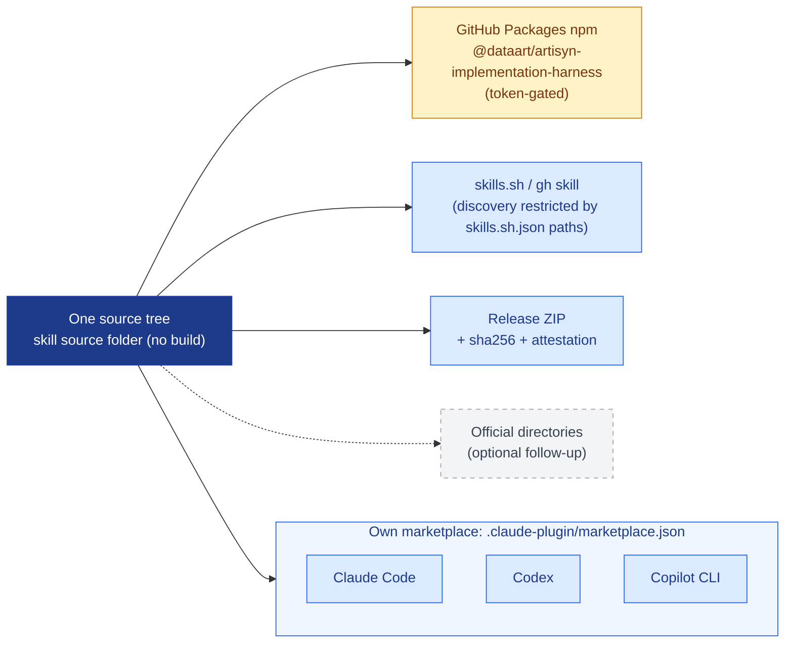

# DESIGN-20261115-CO1T: Harness Distribution and Release Channels — Evaluate: Channels

_Produced by the Evaluate phase. This is the judgment artifact for one decision._

Decision 2 of 4 — options from `01 Research - Channels.md`.

**Inputs:** Frame EC1–EC12. Research options A (minimal ZIP + skills.sh), B (npm-centric), C (repo-as-marketplace), D (everything). Step 1b answers: D2-1 own marketplace, official directories optional; D2-2 no public npmjs, npm only on GitHub Packages; D3-3 no consumer harvest; D3-6 spike harmless.

Option B is scored in its reduced form. With no public npmjs (D2-2), B becomes "GitHub Packages npm primary + ZIP fallback". Its anonymous-install and npm-provenance advantages are gone.

## Requirements × Options Matrix

Option C is the only option that meets EC2, EC3, EC4 and EC8 together.
✅ satisfies · ⚠️ partially (see note) · ❌ does not satisfy

| Requirement                                                 | A — Minimal                                                | B — npm-centric (GitHub Packages only after Step 1b)          | C — Repo-as-marketplace                                                                                  | D — Everything                               |
| ----------------------------------------------------------- | ---------------------------------------------------------- | ------------------------------------------------------------- | -------------------------------------------------------------------------------------------------------- | -------------------------------------------- |
| R1: EC2 npm package on GitHub Packages with install CLI     | ❌ no npm                                                  | ✅                                                            | ✅ GitHub Packages included                                                                              | ✅                                           |
| R2: EC3 own marketplace for Claude, Codex, Copilot (D2-1)   | ❌                                                         | ⚠️ only a thin pointer, optional                              | ✅ one `.claude-plugin/marketplace.json` read by all three                                               | ✅                                           |
| R3: EC4 skills.sh                                           | ✅                                                         | ⚠️ secondary                                                  | ✅ same repo                                                                                             | ✅                                           |
| R4: EC8 anonymous install path                              | ✅ ZIP + skills.sh                                         | ⚠️ only ZIP (npm needs a token)                               | ✅ marketplace, skills.sh, ZIP                                                                           | ✅                                           |
| R5: EC10 provenance / pin / rollback                        | ⚠️ checksum only; no pin for skills.sh beyond the lockfile | ⚠️ GitHub Packages has no npm provenance; attestations needed | ⚠️ attestations + marketplace `version`/ref pin                                                          | ⚠️ largest surface                           |
| R6: EC11 no committed build output                          | ✅                                                         | ✅                                                            | ⚠️ ok if the plugin source is the skill source folder itself (no build); state must not be in it (D3-15) | ⚠️                                           |
| R7: EC6 CI surface / release-path control                   | ✅ small                                                   | ✅                                                            | ✅ push = publish for the marketplace; no external review                                                | ❌ external review gates on the release path |
| R8: EC12 / D3-3 fit (read-only installs fine)               | ✅                                                         | ✅                                                            | ✅ plugin cache acceptable now                                                                           | ✅                                           |
| R9: Discovery for new users                                 | ⚠️ skills.sh telemetry only                                | ⚠️ user must know the registry + token                        | ⚠️ user adds the marketplace first                                                                       | ✅ official listings                         |
| R10: Repo's own skills not leaked to skills.sh / `gh skill` | ⚠️ needs `skills.sh.json` paths                            | n/a                                                           | ⚠️ same                                                                                                  | ⚠️ same                                      |

## Tradeoffs

C trades a dependence on three hosts' plugin formats for no registry account and push-to-publish.

| Option                                           | Operational Excellence                    | Security                                                  | Reliability           | Performance Efficiency | Cost Optimization            | Sustainability | Integration Complexity                                                    | Vendor Lock-in                                                        |
| ------------------------------------------------ | ----------------------------------------- | --------------------------------------------------------- | --------------------- | ---------------------- | ---------------------------- | -------------- | ------------------------------------------------------------------------- | --------------------------------------------------------------------- |
| A — Minimal (fails EC2, EC3)                     | ✅ tiny                                   | ⚠️ checksum only                                          | ✅                    | ✅                     | ✅                           | ✅             | ✅                                                                        | ✅                                                                    |
| B — npm-centric (fails EC3 as primary, weak EC8) | ⚠️ CLI to maintain                        | ⚠️ token-gated; no npm provenance on GitHub Packages      | ✅                    | ✅                     | ✅                           | ✅             | ⚠️                                                                        | ⚠️ GitHub Packages only                                               |
| C — Repo-as-marketplace                          | ✅ push = publish, native update commands | ⚠️ marketplace must pin to the release ref, not main head | ✅                    | ✅                     | ✅ no registry account       | ✅             | ⚠️ Codex may need a native `policy.*` manifest; namespaced plugin command | ⚠️ depends on three hosts' plugin formats (Claude format read by all) |
| D — Everything (not required, D2-1)              | ❌ many manifests + reviews               | ⚠️                                                        | ⚠️ curated copies lag | ✅                     | ❌ paid-plan / partner gates | ⚠️             | ❌                                                                        | ⚠️                                                                    |

## Recommendation

**Recommended option: Option C — Repo-as-marketplace, with GitHub Packages npm, skills.sh, `gh skill` and the Release ZIP alongside.**

The portfolio uses one clean source tree. The skill itself has no build step.

| #   | Channel                                                                                         | Shape                                                                                                                                                                                                                                                                                                                                                                                                                    |
| --- | ----------------------------------------------------------------------------------------------- | ------------------------------------------------------------------------------------------------------------------------------------------------------------------------------------------------------------------------------------------------------------------------------------------------------------------------------------------------------------------------------------------------------------------------ |
| 1   | **Own marketplace**                                                                             | `.claude-plugin/marketplace.json` at the repo root lists plugin `artisyn-implementation-harness`. Its source is the skill source folder (relative path). Plugin `version` is stamped from the harness version. Claude reads it natively; Codex and Copilot CLI read it as legacy-compatible. A native Codex `.agents/plugins/marketplace.json` (with `policy.*`, `category`) is added only if OQ-1 shows Codex needs it. |
| 2   | **GitHub Packages npm** `@dataart/artisyn-implementation-harness` (EC2)                         | Tarball = skill folder + install CLI (D3). Token-gated; documented as the org/internal channel.                                                                                                                                                                                                                                                                                                                          |
| 3   | **skills.sh** and **`gh skill`**                                                                | Install straight from the public repo. `skills.sh.json` `paths` restricts discovery to the harness skill folder, so this repo's own operational skills are not exposed.                                                                                                                                                                                                                                                  |
| 4   | **Release ZIP**                                                                                 | ZIP + sha256 + build attestation as a GitHub Release asset on the harness tag (EC8 offline, EC11).                                                                                                                                                                                                                                                                                                                       |
| 5   | Official directories (claude-community, Anthropic directory, OpenAI directory, awesome-copilot) | Optional follow-up, not in this delivery.                                                                                                                                                                                                                                                                                                                                                                                |

- **Why.** C is the only option meeting EC2, EC3 (as answered), EC4 and EC8 together. B's advantages vanished with D2-2 (no public npmjs). D adds external review gates and paid/partner listings that D2-1 made optional. A misses EC2 and EC3.
- **Accepted tradeoffs.** Users add the marketplace once (`claude plugin marketplace add DataArt/artisyn-implementation-harness`). The plugin command is namespaced (accepted in D1). GitHub Packages has no npm provenance; GitHub artifact attestations replace it.
- **Disqualified.** A (EC2, EC3). B (EC3 as primary; EC8 weak after D2-2). D (cost and release-path gates without a requirement).
- **Falsifiable.** If Codex or Copilot stop reading the Claude-format marketplace, add native manifests. If org adoption needs zero-setup discovery, add official directory listings.

**Open questions to resolve before implementation:**

| #    | Question                                                                                                                                                                                    | Owner                           | Impact if unresolved                          |
| ---- | ------------------------------------------------------------------------------------------------------------------------------------------------------------------------------------------- | ------------------------------- | --------------------------------------------- |
| OQ-1 | Does Codex accept the Claude-format marketplace entry without `policy.*`/`category`? Do Codex and Copilot honour a relative-path plugin source?                                             | `@architect` verification spike | Codex/Copilot install path                    |
| OQ-2 | Marketplace pin: the plugin source must resolve to the released tag, not main head (a relative path ships main). Use `git-subdir` with `ref` = harness tag, or keep main == latest release. | `@architect` + D4               | Unreleased content reaches users (WAF P1)     |
| OQ-3 | Does the immutable `patch/` history ship in every artifact (size), or only in npm/ZIP?                                                                                                      | Developer                       | Artifact size                                 |
| OQ-4 | Consumer install commands to document for GitHub Packages (`.npmrc` + `npx`/`yarn dlx`/`pnpm dlx`)                                                                                          | Developer + `@docs-writer`      | Guide wording                                 |
| OQ-5 | Which GitHub Release is "latest" for `gh skill` when root `v*` releases are newer                                                                                                           | D4                              | `gh skill` default resolves the wrong release |

## Closing WAF Assessment — Option C

| Pillar                 | Rating | Strengths                                                                                           | Gaps                                                                                                                               | Recommendations                                                                                                                                                                       |
| ---------------------- | ------ | --------------------------------------------------------------------------------------------------- | ---------------------------------------------------------------------------------------------------------------------------------- | ------------------------------------------------------------------------------------------------------------------------------------------------------------------------------------- |
| Operational Excellence | 🟢     | Push = publish; native `plugin update`; one source tree                                             | Five channels to keep in step                                                                                                      | P2: one CI job stamps and validates every manifest (D4)                                                                                                                               |
| Security               | 🟡     | No registry secrets for marketplace/skills.sh; GitHub Packages via `GITHUB_TOKEN` `packages: write` | Relative-path marketplace source ships main head; skills.sh may expose the repo's own skills; no npm provenance on GitHub Packages | **P1:** marketplace entry pinned to the released tag/version (OQ-2). **P1:** `skills.sh.json` restricts discovery to the harness skill. P2: artifact attestations for tarball and ZIP |
| Reliability            | 🟢     | Anonymous fallback channels; ZIP works offline                                                      | Codex/Copilot rely on legacy-compatible reading                                                                                    | P2: verification spike (OQ-1) before announcing Codex/Copilot support                                                                                                                 |
| Performance Efficiency | 🟢     | No build for marketplace/skills.sh                                                                  | —                                                                                                                                  | —                                                                                                                                                                                     |
| Cost Optimization      | 🟢     | No registry account, no paid listing                                                                | —                                                                                                                                  | —                                                                                                                                                                                     |
| Sustainability         | 🟢     | One artifact tree                                                                                   | Patch history in every artifact                                                                                                    | P3: decide OQ-3                                                                                                                                                                       |

**P1s:** (1) pin the marketplace plugin source to the released tag; (2) restrict skills.sh / `gh skill` discovery to the harness skill folder.
