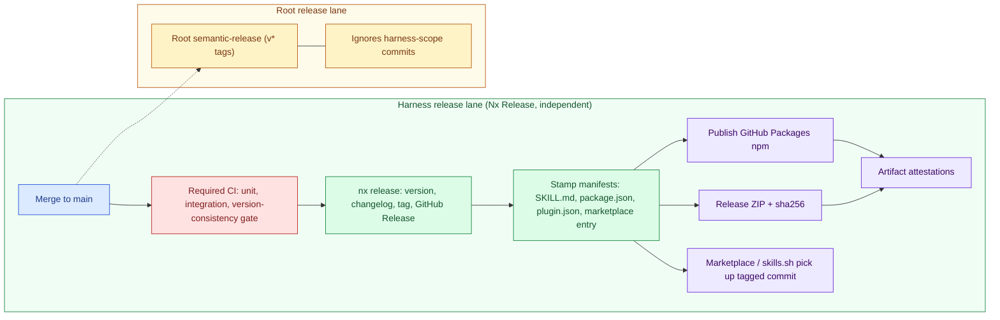

# DESIGN-20261115-CO1T: Harness Distribution and Release Channels — Evaluate: Release Pipeline

_Produced by the Evaluate phase. Decision 4 of 4 — options from `01 Research - Release Pipeline.md`._

**Inputs:** Frame EC6, EC7, EC10, EC11. Research options A–E. Step 1b answers: Q1 a commit-generated CHANGELOG is acceptable; Q2 publish is fully automatic on merge, with no human gate. D2: no npmjs; channels are the marketplace (git), GitHub Packages npm, skills.sh / gh skill (git) and the Release ZIP.

## Requirements × Options Matrix

✅ satisfies · ⚠️ partially (see note) · ❌ does not satisfy

| Requirement                                                                                 | A CHANGELOG heading + custom workflow         | B Changesets                     | C release-please                           | D Nx Release independent                                               | E Second path-filtered semantic-release       |
| ------------------------------------------------------------------------------------------- | --------------------------------------------- | -------------------------------- | ------------------------------------------ | ---------------------------------------------------------------------- | --------------------------------------------- |
| R1 Q2: fully automatic on merge, no human gate                                              | ⚠️ automatic, but a human must write the bump | ❌ Version Packages PR is a gate | ❌ release PR is a gate                    | ✅ conventional-commits specifier on push to `main`                    | ✅                                            |
| R2 Q1: generated CHANGELOG acceptable (no manual prose step)                                | ❌ manual curated entry required              | ❌ changeset prose per PR        | ✅                                         | ✅ per-project changelog                                               | ✅                                            |
| R3 EC7: harness version independent of root; root not bumped by harness-only commits        | ⚠️ needs root filter                          | ⚠️ needs root filter             | ⚠️ needs root filter or root migration     | ⚠️ needs root filter (harness side path-filtered by the project graph) | ⚠️ needs root filter; harness side via plugin |
| R4 EC7: one version stamped into `SKILL.md`, `package.json`, plugin / marketplace manifests | ✅ script                                     | ✅ version hook                  | ⚠️ extra-files (unverified for `SKILL.md`) | ⚠️ post-version step / version action                                  | ✅ `@semantic-release/exec`                   |
| R5 Non-colliding tags `artisyn-implementation-harness-v*`                                   | ✅                                            | ⚠️ `@scope/name@x.y.z` style     | ✅                                         | ✅ `releaseTagPattern`                                                 | ✅ `tagFormat`                                |
| R6 Same-job publish (no `GITHUB_TOKEN` trigger gap)                                         | ✅                                            | ⚠️ follow-up job                 | ⚠️ release event                           | ✅ one workflow run                                                    | ✅                                            |
| R7 Tool health / repo fit                                                                   | ⚠️ custom code                                | ✅ mature, new tool              | ✅ mature, second tool                     | ✅ Nx 23 already in the repo; conventional commits verified for Nx 22+ | ⚠️ community plugin health UNVERIFIED         |
| R8 EC11: retires committed ZIPs + manual script                                             | ✅                                            | ✅                               | ✅                                         | ✅                                                                     | ✅                                            |
| R9 EC10: attestations / checksum per artifact                                               | ✅ add step                                   | ✅                               | ✅                                         | ✅                                                                     | ✅                                            |
| R10 `patch prepare` change (package contract)                                               | ✅ none                                       | ⚠️ add changeset                 | ⚠️ drop bump                               | ⚠️ drop bump                                                           | ⚠️ drop bump                                  |

## Tradeoffs

| Option                                                       | Operational Excellence                      | Security                   | Reliability                              | Performance Efficiency | Cost Optimization        | Sustainability | Integration Complexity                                                     | Vendor Lock-in                  |
| ------------------------------------------------------------ | ------------------------------------------- | -------------------------- | ---------------------------------------- | ---------------------- | ------------------------ | -------------- | -------------------------------------------------------------------------- | ------------------------------- |
| A CHANGELOG heading + custom workflow (fails Q1 / Q2 intent) | ⚠️ forgotten bump = no release; custom code | ✅                         | ⚠️ heading regex is load-bearing         | ✅                     | ✅                       | ✅             | ✅                                                                         | ✅                              |
| B Changesets (fails Q2: PR gate)                             | ✅ mature                                   | ✅                         | ✅                                       | ✅                     | ⚠️ new tool + convention | ✅             | ⚠️ workspace join                                                          | ✅                              |
| C release-please (fails Q2: PR gate)                         | ✅                                          | ⚠️ release-event token gap | ✅                                       | ✅                     | ⚠️ second release tool   | ✅             | ⚠️                                                                         | ⚠️ Google tool                  |
| D Nx Release independent                                     | ✅ one workspace tool; dry-run support      | ✅                         | ✅ project-graph filtering               | ✅ cached              | ✅ no new dependency     | ✅             | ⚠️ harness becomes an Nx project (touches E2E fixtures); custom stamp step | ⚠️ tied to Nx (already adopted) |
| E Second path-filtered semantic-release                      | ✅ familiar config                          | ✅                         | ⚠️ plugin health; root filter workaround | ✅                     | ✅                       | ✅             | ⚠️ two semantic-release configs                                            | ✅                              |

## Recommendation

**Recommended: Option D — Nx Release in independent mode, limited to the harness project, conventional-commit driven, publishing automatically on merge to main.**

- **Shape:**
  - **Project and version source.** The harness source folder (D1 / D2 path) becomes an Nx project with its own `package.json` (`@dataart/artisyn-implementation-harness`). That file is the single version source (EC7). `nx.json` `release` sets `projects: [harness]`, `projectsRelationship: "independent"`, release tag pattern `{projectName}-v{version}` (gives `artisyn-implementation-harness-v3.6.0`), the conventional-commits specifier, and a project changelog in the harness `CHANGELOG.md`. The changelog is generated from now on; existing curated entries stay above the cut.
  - **Version stamping.** A post-version step stamps the version into `SKILL.md` `metadata.version`, `.claude-plugin/plugin.json` and the marketplace entry. The body `Version:` line in `SKILL.md` is dropped (Q6). A CI gate on every PR fails if any of them disagree.
  - **Release workflow.** Runs on `push` to `main`, after CI passes: `nx release` (version + changelog + tag + GitHub Release) → build tarball and ZIP (excludes `state/`, `.DS_Store`, secrets) → `npm publish` to GitHub Packages with `GITHUB_TOKEN` (`packages: write`) → attach ZIP + sha256 → GitHub artifact attestations for both → marketplace and skills.sh pick up the tagged commit. It is one workflow run, so there is no token-trigger gap.
  - **Root lane.** Root semantic-release keeps the repo version (`v*`) and stops counting harness-only commits. Harness commits use scope `harness` (or the D1 name), and root `releaseRules` set `release: false` for that scope. Nx needs no scope because it filters by project path.
  - **Retirement (EC11).** Retire `releases/harness-bootstrap/`, `scripts/release/release-harness-bootstrap.mjs` and the `release:harness-bootstrap` script. `patch prepare` stops bumping the version and editing the CHANGELOG; it only packages bundles. This is a package-contract change, recorded in the CHANGELOG. The package versioning rule lives in one place: `references/00-overview.md` (Q7).
- **Why:** after Q1 and Q2, only D and E are fully automatic with a generated changelog. D beats E on tool health (Nx 23 is already in the repo; E relies on an unverified community plugin), on the native tag pattern and on project-graph path filtering. B and C fail Q2 (PR gates). A fails Q1 and Q2.
- **Accepted tradeoffs:** the harness joins the Nx project graph, so E2E fixtures adjust once. Version stamping beyond `package.json` is a small custom step.
- **Disqualified:** A (manual bump), B and C (human PR gate), E (plugin health risk for no added benefit).
- **Falsifiable:** if Nx Release cannot run unattended with conventional commits in Nx 23, or the stamp step proves brittle, fall back to E.

## Open questions

Open before implementation. Proposals are not decisions.

| #    | Question                                                                                                                                        | Owner                  | Impact if unresolved                  |
| ---- | ----------------------------------------------------------------------------------------------------------------------------------------------- | ---------------------- | ------------------------------------- |
| OQ-1 | Confirm Nx 23 `release` config keys (`releaseTag.pattern` vs `releaseTagPattern`, `specifierSource`) and a post-version hook                    | @architect             | Config wrong                          |
| OQ-2 | Root semantic-release filter mechanism: scope rule vs commit convention enforcement (commitlint scope list)                                     | @architect + Developer | Root bumps on harness commits         |
| OQ-3 | "Latest" GitHub Release: root `v*` releases vs harness tags for `gh skill` defaults. Mark root releases not-latest, or document `@tag` pinning? | @architect             | `gh skill` installs the wrong release |
| OQ-4 | `main` branch protection before automatic publish (CI must pass)                                                                                | Developer (repo admin) | Broken release on red `main`          |
| OQ-5 | Bot identity for tag and GitHub Release creation: is `GITHUB_TOKEN` sufficient in one workflow?                                                 | @architect             | Workflow permissions                  |
| OQ-6 | First release version under the new name. Proposed: 4.0.0, because the rename and the state move are breaking.                                  | Developer              | Version semantics                     |

## Closing WAF Assessment — Option D Nx Release independent

| Pillar                 | Rating | Strengths                                                                                                                     | Gaps                                                                         | Recommendations                                                                                                                                       |
| ---------------------- | ------ | ----------------------------------------------------------------------------------------------------------------------------- | ---------------------------------------------------------------------------- | ----------------------------------------------------------------------------------------------------------------------------------------------------- |
| Operational Excellence | 🟢     | Fully automatic, one workflow, dry-run, reuses Nx                                                                             | Generated CHANGELOG loses curated prose                                      | P2: conventional-commit lint for the harness scope                                                                                                    |
| Security               | 🟡     | `GITHUB_TOKEN` least privilege (`contents: write`, `packages: write`, `id-token: write`, `attestations: write`); attestations | No human gate: a bad commit on `main` publishes; `main` is not protected yet | **P1:** the release job runs only after required CI (unit, integration, version-consistency gate) passes on `main`, with branch protection enabled    |
| Reliability            | 🟡     | Non-colliding tags; idempotent re-run on an existing tag                                                                      | A missed stamp silently blocks Claude plugin updates; root may still bump    | **P1:** CI version-consistency gate across `SKILL.md`, `package.json`, `plugin.json` and the marketplace entry. P2: root `releaseRules` filter + test |
| Performance Efficiency | 🟢     | Nx cache                                                                                                                      | —                                                                            | —                                                                                                                                                     |
| Cost Optimization      | 🟢     | No new paid service                                                                                                           | —                                                                            | —                                                                                                                                                     |
| Sustainability         | 🟢     | No committed binaries (EC11)                                                                                                  | —                                                                            | —                                                                                                                                                     |

**P1s:** (1) automatic release gated on required CI + branch protection; (2) version-consistency gate on every PR.
