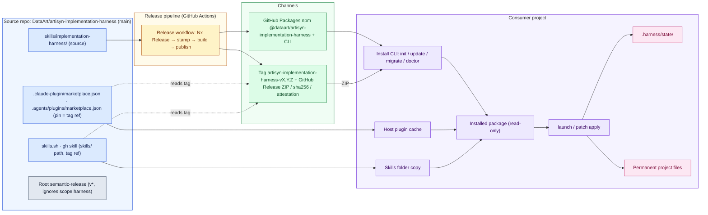
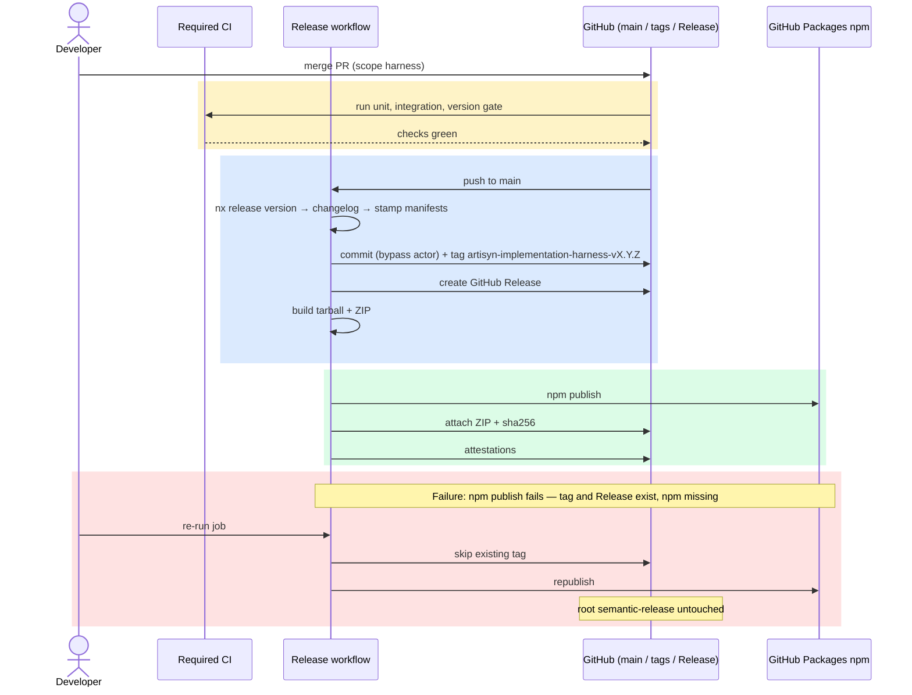
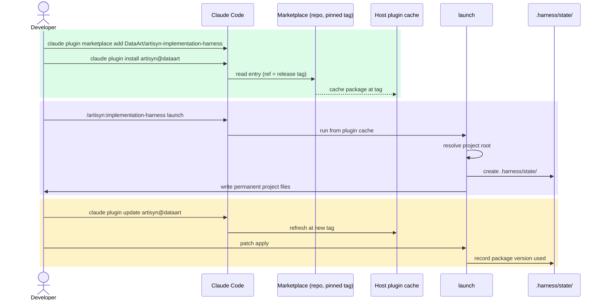
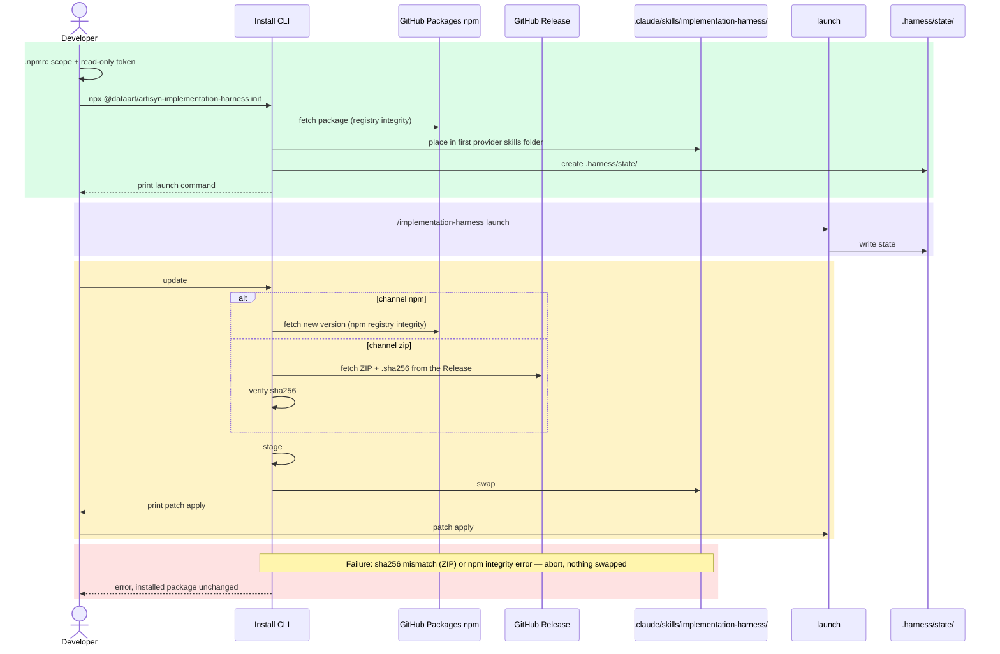
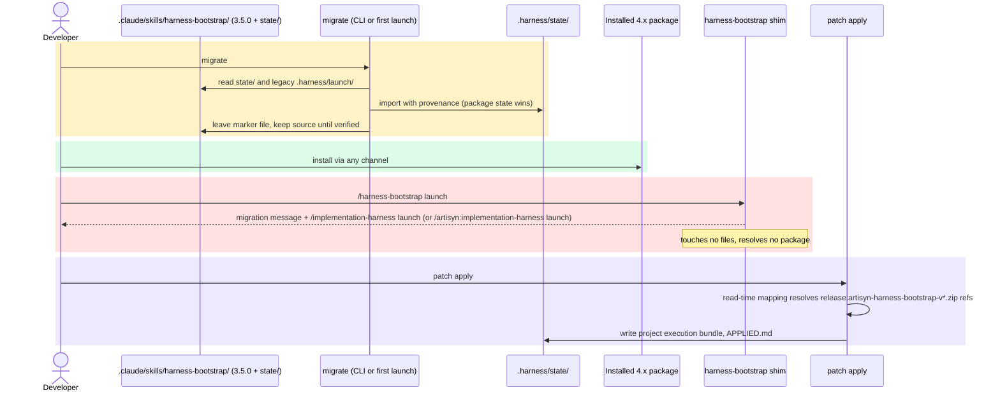

# DESIGN-20261115-CO1T — Harness Distribution and Release Channels — Architecture

Integrated end-to-end solution for distributing the Artisyn Implementation Harness package. Decisions are settled; rationale is in `design/02 Evaluate - *.md`. This document is the delta against `docs/Harness/` (product) and this repo's release tooling.

---

## Scope and boundaries

Abstraction level: product/package distribution — C4 system context zoomed into the containers of this repo's delivery pipeline.

| Boundary                                                          | What it covers in this solution                                                                                                                                                                                                                                                                                                                                                                                                                   |
| ----------------------------------------------------------------- | ------------------------------------------------------------------------------------------------------------------------------------------------------------------------------------------------------------------------------------------------------------------------------------------------------------------------------------------------------------------------------------------------------------------------------------------------- |
| **Source repo** `DataArt/artisyn-implementation-harness` (`main`) | Harness source at `skills/implementation-harness/` (renamed from `.canonical-implementation-harness/`); three in-repo discovery symlinks `.claude/skills/implementation-harness`, `.agents/skills/implementation-harness`, `.github/skills/implementation-harness` → `../../skills/implementation-harness`; marketplace manifests (marketplace `dataart`, plugin `artisyn`); release workflow; this repo's own harness state at `.harness/state/` |
| **Release pipeline** (GitHub Actions)                             | Nx Release (independent mode, harness project only) → stamp → build → publish                                                                                                                                                                                                                                                                                                                                                                     |
| **Channels** (five)                                               | (1) self-hosted plugin marketplace in this repo for Claude Code, Codex and Copilot CLI; (2) GitHub Packages npm `@dataart/artisyn-implementation-harness` (token-gated, carries the install CLI); (3) skills.sh; (4) `gh skill`; (5) GitHub Release asset `artisyn-implementation-harness-v{ver}.zip` + sha256 + build attestation                                                                                                                |
| **Consumer project**                                              | Installed package (read-only, replaceable; project-local or host plugin cache), runtime state at `.harness/state/` (shared with evolve's `.harness/`), permanent files written by launch                                                                                                                                                                                                                                                          |

Official curated directories are out of scope. Launch and patch semantics are unchanged beyond the entrypoint name, the package location and the state location.

---

## Container and boundary diagram

The root semantic-release lane stays separate: it versions the repo as `v*` and ignores commits with scope `harness`.

---

## Responsibility table

| Boundary                                        | Owns                                                                                                                                                                                                   | Does not own                                         |
| ----------------------------------------------- | ------------------------------------------------------------------------------------------------------------------------------------------------------------------------------------------------------ | ---------------------------------------------------- |
| Source folder `skills/implementation-harness/`  | `SKILL.md` (`name: implementation-harness`, `metadata.version`), `canonical/`, `references/`, `scripts/`, `patterns/`, `patch/` (immutable bundle history), `package.json` (version source, `bin` CLI) | State (lives in `.harness/state/`)                   |
| Release workflow                                | Version bump, changelog, tag, GitHub Release, stamping, build, publish to GitHub Packages, ZIP + attestations                                                                                          | Root repo version (semantic-release)                 |
| Marketplace manifests (repo root)               | Plugin entry per host format, pinned to the release tag                                                                                                                                                | Plugin content                                       |
| Install CLI (`bin` in npm package, also in ZIP) | Provider detection, placement, checksum-verified swap, migration, doctor                                                                                                                               | Launch adaptation, patch apply                       |
| Host plugin systems / skills.sh / gh skill      | Fetch + cache/copy + update + pin                                                                                                                                                                      | State, migration (done by first launch/apply)        |
| Installed package                               | Read-only runtime of launch/patch                                                                                                                                                                      | Writable state                                       |
| `.harness/state/`                               | Answers, `index.json` baselines, `objects/`, `operations/`, launch `runs/` and `reports/`, `patch/` (project execution bundles, `APPLIED.md`), `registry.md`                                           | Evolve's `.harness/evolve/`, `.harness/reflections/` |

---

## Decision register

| #    | Decision                        | Outcome and scope                                                                                                                                                                                                                                                                                                                                                                                                                                                                                                                                                                                                                                                                                                                                                                                                                                                                                                       | Interfaces affected                                                                            | Failure / recovery                                                                                                                                                                  | Verification                                                                                                                                                                                                          |
| ---- | ------------------------------- | ----------------------------------------------------------------------------------------------------------------------------------------------------------------------------------------------------------------------------------------------------------------------------------------------------------------------------------------------------------------------------------------------------------------------------------------------------------------------------------------------------------------------------------------------------------------------------------------------------------------------------------------------------------------------------------------------------------------------------------------------------------------------------------------------------------------------------------------------------------------------------------------------------------------------- | ---------------------------------------------------------------------------------------------- | ----------------------------------------------------------------------------------------------------------------------------------------------------------------------------------- | --------------------------------------------------------------------------------------------------------------------------------------------------------------------------------------------------------------------- |
| D-01 | Name                            | Package `@dataart/artisyn-implementation-harness` (`bin` `artisyn-implementation-harness`); skill folder and `name` `implementation-harness`; direct-channel command `/implementation-harness launch` (`$implementation-harness` in Codex); plugin `artisyn` in this repo's marketplace `dataart`, plugin command `/artisyn:implementation-harness launch` (`$artisyn:implementation-harness` in Codex, `$implementation-harness` if Codex flattens); ZIP `artisyn-implementation-harness-v{ver}.zip`; launch task prefix `[implementation-harness <run_id>]`; package-root doc `harness-bootstrap.md` → `implementation-harness.md` (patch `rename` entry). The full name `artisyn-implementation-harness` is used only for the npm package, `bin`, repo, Nx project, tag and ZIP (EC1 as amended at Solution sign-off)                                                                                                | Skill entrypoint, plugin id, marketplace id, npm name, ZIP name, task prefix, package-root doc | Old command reaches the D-03 shim, which prints the new command                                                                                                                     | Grep gate: no `harness-bootstrap` outside `patch/**`, state history and the shim; no `artisyn-implementation-harness` used as a skill, folder or command name                                                         |
| D-02 | Source location                 | `.canonical-implementation-harness/` → `skills/implementation-harness/`; in-repo symlinks renamed to `implementation-harness`; E2E fixtures, release scripts and docs updated                                                                                                                                                                                                                                                                                                                                                                                                                                                                                                                                                                                                                                                                                                                                           | Repo layout, discovery symlinks, E2E fixtures, release scripts                                 | A stale path fails the E2E suite before merge                                                                                                                                       | E2E suite green on the new path; skills.sh discovery resolves `skills/`                                                                                                                                               |
| D-03 | Legacy shim                     | Shim lives at `skills/harness-bootstrap/` in this repo (one `SKILL.md`); prints a migration message and the new command; never touches files or resolves `package:`; removed in 5.0.0 (recorded in `CHANGELOG`). It is carried by every 4.x artifact: the marketplace plugin lists it as a second skill (`/artisyn:harness-bootstrap`), the npm tarball and ZIP include it, and skills.sh discovers it under `skills/`. In a consumer project, `migrate` (CLI or first launch) replaces the old `harness-bootstrap/SKILL.md` and package files with the shim after the state migration is verified and marked; the old folder's `state/` stays in place with its `MIGRATED.md` marker until the developer deletes it (`doctor` reports it). There is never a second folder named `harness-bootstrap`                                                                                                                    | Legacy `/harness-bootstrap` command, `migrate`                                                 | Shim is inert; nothing to recover                                                                                                                                                   | 4.x artifacts contain the shim; 5.x do not; E2E: a 3.5.0 project ends with one `harness-bootstrap/` folder holding only the shim and the marked legacy `state/`                                                       |
| D-04 | Immutable history               | `patch/**` bytes unchanged; read-time mapping resolves old `release:artisyn-harness-bootstrap-v*.zip` snapshot refs and `harness-bootstrap.md` paths (same mechanism as `adoptors/` → `adaptors/`). Read-time mapping is label-only: `release:artisyn-harness-bootstrap-v{ver}.zip` reads as `release:artisyn-implementation-harness-v{ver}`; bytes always come from `.harness/state/objects/` (no network at apply time); a missing base fails before any write                                                                                                                                                                                                                                                                                                                                                                                                                                                        | Patch bundle snapshot refs, patch apply resolver                                               | Unmapped or missing base → apply aborts before writes                                                                                                                               | E2E migration test: a 3.5.0 install applies a 4.0.0 patch (WAF P1)                                                                                                                                                    |
| D-05 | Channels                        | Five channels as in Scope; official directories out of scope                                                                                                                                                                                                                                                                                                                                                                                                                                                                                                                                                                                                                                                                                                                                                                                                                                                            | Marketplace manifests, npm registry, skills.sh, `gh skill`, GitHub Release assets              | A failed channel publish leaves the other channels valid; re-run the release job (D-16)                                                                                             | Install smoke test per channel in E2E (deterministic for ZIP, npm and skills.sh layout; agent-E2E for marketplace); per-channel smoke test runs without a GitHub token for marketplace, skills.sh, `gh skill` and ZIP |
| D-06 | Marketplace manifests           | Plugin root = repo root: `.claude-plugin/plugin.json` at repo root (`name: artisyn`, stamped `version`, `skills: ["./skills/implementation-harness", "./skills/harness-bootstrap"]`). `.claude-plugin/marketplace.json` (`name: dataart`) holds **one** plugin entry (`name: artisyn`) with a `github` source (`repo` = this repo, `ref` = release tag), which both Claude Code and Copilot CLI read; no `path` is needed because the plugin root is the repo root; plugin `version` stamped. Codex has its own file `.agents/plugins/marketplace.json` (`name: dataart`, plugin `name: artisyn`): source `git-subdir`, `url` = this repo, `path` = `.`, `ref` = release tag, plus `policy.installation`, `policy.authentication`, `category`. Manifests are updated by the release commit.                                                                                                                             | Claude, Codex and Copilot plugin manifests                                                     | Pin stays on the last good tag until the next release commit. Rollback for the marketplace channel is a new release commit that re-pins `ref` to the previous tag (a patch release) | `claude plugin validate --strict`; CI version-consistency gate (WAF P1); marketplace pin ≠ `main` head (WAF P1)                                                                                                       |
| D-07 | skills.sh / gh skill            | `skills.sh.json` `paths: ["skills"]` restricts discovery; `gh skill install DataArt/artisyn-implementation-harness implementation-harness@<tag>`; `gh skill publish` not required. Pinning is mandatory on git channels: `gh skill install … @<harness tag>` is the only documented form, the marketplace entries pin `ref`, skills.sh pins by commit in `skills-lock.json`; docs and `doctor` show the pinned command, and the ZIP link in docs is the tag URL, never `/releases/latest`. Root `v*` GitHub Releases may be newer and are irrelevant to harness installs                                                                                                                                                                                                                                                                                                                                                | Repo-root `skills.sh.json`, `skills/` path, consumer docs, `doctor`                            | Discovery of other skill folders is blocked by the path allowlist                                                                                                                   | `npx skills add` lists exactly the harness and the shim in 4.x, only the harness from 5.0.0 (WAF P1); docs lint rejects `/releases/latest` and unpinned `gh skill install` examples                                   |
| D-08 | npm                             | Tarball = `skills/implementation-harness/` minus state + `bin/` CLI (`bin` name stays `artisyn-implementation-harness`, so the CLI command is `npx @dataart/artisyn-implementation-harness init`); `files` allowlist; published to GitHub Packages with `GITHUB_TOKEN` (`packages: write`); consumers use `.npmrc` scope + read-only token. The `.npmrc` scope mapping may be committed; the token lives in user-level npm config or an environment variable reference, never in the repo                                                                                                                                                                                                                                                                                                                                                                                                                               | npm package contents, GitHub Packages auth                                                     | Allowlist violation fails CI before publish                                                                                                                                         | `npm pack --dry-run` file list in CI                                                                                                                                                                                  |
| D-09 | Release ZIP                     | Same tree as npm, `artisyn-implementation-harness-v{ver}.zip` + `.sha256` + GitHub artifact attestation, attached to the harness GitHub Release. Committed ZIPs under `releases/harness-bootstrap/`, `scripts/release/release-harness-bootstrap.mjs` and `release:harness-bootstrap` removed. Integrity per channel: npm → registry tarball integrity (`npm` verifies on install); ZIP → `.sha256` next to the asset (CLI `update` and the manual guide verify it); git channels → tag/commit SHA. Build attestations are maintainer/CI verification (`gh attestation verify`), not an install-time check                                                                                                                                                                                                                                                                                                               | GitHub Release assets, repo `releases/` folder, release scripts                                | sha256 mismatch rejects the ZIP at install (D-11); attestation is verified by maintainers                                                                                           | `git ls-files releases/` empty; `gh attestation verify` passes                                                                                                                                                        |
| D-10 | Install contract (all channels) | Installed package is read-only and replaceable; consumers do not harvest or prepare; `package:` recorded as `{path, name, version, channel}` (project-relative or host cache path); update = refresh by channel, then `patch apply`; package removable after launch. `package:` is split: `.harness/state/launch/package.json` (committed) holds `{name, version, channel}`; `.harness/state/launch/package.local.json` (ignored) holds the per-machine `path`. When the local file is missing, launch and `doctor` re-resolve the path by searching the provider skills folders and the host plugin cache for the recorded name and version, then rewrite the local file                                                                                                                                                                                                                                               | `package:` record (two files), launch and patch apply resolvers, `doctor`                      | `doctor` reports a missing or skewed package                                                                                                                                        | `doctor` reports; E2E update test                                                                                                                                                                                     |
| D-11 | Install CLI                     | `init` (detect `.claude/`, `.agents/`, `.github/` or `--provider`; place package at `<provider>/skills/implementation-harness/` in the first selected provider; create `.harness/state/`; print `/implementation-harness launch`); `update` (fetch by channel — npm registry tarball under `npm` integrity, or ZIP + `.sha256` from the GitHub Release — verify, stage, swap, same-version no-op, `--force` for downgrade, print `patch apply`); `migrate` (EC9); `doctor` (location/version per provider, skew, state health). Cross-platform, Node ≥ 22 (same floor as the package scripts)                                                                                                                                                                                                                                                                                                                           | CLI commands, provider skills folders, `.harness/state/`                                       | Checksum mismatch aborts `update` with nothing swapped                                                                                                                              | Unit tests + E2E fixtures per command on macOS, Linux and Windows runners                                                                                                                                             |
| D-12 | State root                      | `.harness/state/` (neutral, rename-proof); tree unchanged (`launch/{answers.json,runs/,reports/}`, `registry.md`, `index.json`, `objects/`, `operations/`, `patch/` incl. `APPLIED.md`). Aliases: `state/` = `.harness/state/`, `project-patch/` = `.harness/state/patch/`, `package-patch/` = `package:patch/`. Resolved from project root (`git rev-parse --show-toplevel`, else cwd), never from package path or provider. One state root for all providers; each operation records the package version used                                                                                                                                                                                                                                                                                                                                                                                                         | State path aliases, launch and patch apply writers                                             | Writes outside `.harness/state/` fail the E2E guard                                                                                                                                 | Launch and apply write only under `.harness/state/`; E2E                                                                                                                                                              |
| D-13 | Commit rule for consumers       | Commit `index.json`, `registry.md`, `launch/answers.json`, `launch/package.json`, `patch/APPLIED.md`; ignore `objects/`, `launch/runs/`, `launch/reports/`, `launch/package.local.json` (launch writes the ignore entries, never untracks). This repo moves its own state to `.harness/state/` under the same rule                                                                                                                                                                                                                                                                                                                                                                                                                                                                                                                                                                                                      | Consumer `.gitignore`, this repo's state location                                              | Launch re-writes missing ignore entries on the next run                                                                                                                             | E2E launch fixture checks `.gitignore` entries                                                                                                                                                                        |
| D-14 | Migration (EC9)                 | Sources: `*/skills/harness-bootstrap/state/` (any provider folder), `<project>/.canonical-implementation-harness/state/` (3.5.0 root-extract install, also this repo's own case) and legacy `.harness/launch/`; precedence: package state wins, legacy records imported with provenance when IDs do not collide; idempotent; source kept until verified; marker file left at the old location; run by CLI `migrate` or by the first launch/apply that detects old state                                                                                                                                                                                                                                                                                                                                                                                                                                                 | CLI `migrate`, launch and patch apply detection                                                | Re-run is idempotent; source stays until verification passes                                                                                                                        | E2E from a 3.5.0 fixture (WAF P1)                                                                                                                                                                                     |
| D-15 | Versioning                      | Harness `package.json` is the single version source; stamped into `SKILL.md` `metadata.version` (body `Version:` line removed), `.claude-plugin/plugin.json` and both marketplace entries. CI gate on every PR fails on mismatch (WAF P1). First release: ticket 6 sets the harness `package.json` to `3.5.0` (the last shipped version); the rename lands as `feat(harness)!: …` (breaking), so the first automatic run produces exactly `4.0.0`. Versioning rule lives in `references/00-overview.md`; `CHANGELOG` points there                                                                                                                                                                                                                                                                                                                                                                                       | `package.json`, `SKILL.md`, `plugin.json`, marketplace manifests                               | Mismatch blocks the PR                                                                                                                                                              | CI version-consistency gate                                                                                                                                                                                           |
| D-16 | Release mechanism               | Nx Release independent mode, `release.projects: ["artisyn-implementation-harness"]`, `releaseTag.pattern: "{projectName}-v{version}"`, conventional-commits specifier, project changelog into the harness `CHANGELOG.md` below a "curated history" cut line. Workflow on push to `main` after required CI: version → changelog → stamp → tag → GitHub Release → build tarball + ZIP → publish npm → attach ZIP + sha256 → attestations, in one run. The release commit carries `[skip ci]` and the workflow has an actor guard (`github.actor != '<release bot>'`), so the release commit never retriggers the release lane. First release: the harness `package.json` starts at `3.5.0` and the breaking rename commit yields `4.0.0` (D-15). Root semantic-release unchanged except `releaseRules` ignore scope `harness`. `patch prepare` stops bumping versions and `CHANGELOG` (package-contract change, recorded) | `nx.json` release config, release workflow, root `release.config.js`, `patch prepare`          | Failed publish step: re-run is idempotent — skips the existing tag, republishes                                                                                                     | `nx release --dry-run` in CI; E2E for stamping                                                                                                                                                                        |
| D-17 | Branch protection               | Ruleset on `main` (PR + required CI); the release workflow identity is a bypass actor for release commits and tags (WAF P1)                                                                                                                                                                                                                                                                                                                                                                                                                                                                                                                                                                                                                                                                                                                                                                                             | GitHub ruleset, workflow identity                                                              | A human direct push is rejected                                                                                                                                                     | Direct push by a human rejected                                                                                                                                                                                       |
| D-18 | Docs retirement                 | Quick Start, Roadmap §1, Adoption Path, Tool Compatibility (add Copilot), package README, `00-overview`, `01a-launch-plan`, `08-provider-launch`, `05-patch-apply`, `06-patch-state` (state root; legacy `.harness/` rule retired), old-repo-URL fixes in `CHANGELOG` and two Explore docs. Owned by Publish                                                                                                                                                                                                                                                                                                                                                                                                                                                                                                                                                                                                            | Product docs, Engineering Guide, package docs                                                  | —                                                                                                                                                                                   | Affected-documents list below is closed at Publish                                                                                                                                                                    |

---

## Requirement coverage

| Requirement (Frame)                                                                                                                                                          | Decisions                             |
| ---------------------------------------------------------------------------------------------------------------------------------------------------------------------------- | ------------------------------------- |
| EC1 Rename (EC1 as amended at Solution sign-off: package `@dataart/artisyn-implementation-harness`, skill `implementation-harness`, plugin `artisyn`, marketplace `dataart`) | D-01, D-02                            |
| EC2 npm package on GitHub Packages with a placing CLI                                                                                                                        | D-08, D-11                            |
| EC3 Marketplaces: Claude, Codex, Copilot                                                                                                                                     | D-05, D-06                            |
| EC4 skills.sh                                                                                                                                                                | D-07                                  |
| EC5 Install and update mechanisms, instructions, guides                                                                                                                      | D-10, D-11, D-18                      |
| EC6 CI/CD automates release and distribution                                                                                                                                 | D-16                                  |
| EC7 Harness version independent of the repo; one version source                                                                                                              | D-15, D-16                            |
| EC8 Anonymous install path; ZIP as Release asset                                                                                                                             | D-05, D-09                            |
| EC9 Existing installs migrate safely                                                                                                                                         | D-03, D-04, D-14                      |
| EC10 Verifiable, clean, pinnable, rollback-able artifacts                                                                                                                    | D-08, D-09, D-15                      |
| EC11 Retire committed ZIPs and the manual release script                                                                                                                     | D-09, D-16                            |
| EC12 Runtime state in the project `.harness/` workdir                                                                                                                        | D-12, D-13, D-14                      |
| Constraint: guarded publish (pipelines only)                                                                                                                                 | D-16, D-17                            |
| Constraint: cross-platform Node CLI                                                                                                                                          | D-11                                  |
| Constraint: Harness Bootstrap E2E keeps working                                                                                                                              | D-02 (verification), Efforts ticket 1 |
| Constraint: provider destinations fixed                                                                                                                                      | D-11 (placement order)                |

---

## Flows

### F1 — Release

### F2 — Install via marketplace (Claude)

### F3 — Install via npm CLI

### F4 — Migration from 3.5.0

---

## WAF P1 coverage

| P1                                        | Addressed by                           |
| ----------------------------------------- | -------------------------------------- |
| Old snapshot refs resolve                 | D-04 + E2E migration test              |
| Marketplace pinned to tag                 | D-06 (`ref` = tag, stamped by release) |
| Discovery restricted                      | D-07 `skills.sh.json`                  |
| Idempotent verified migration             | D-14 + E2E from 3.5.0                  |
| Release only after CI on protected `main` | D-16 + D-17                            |
| Version-consistency gate                  | D-15                                   |

---

## Affected documents and verification obligations

| Area                           | Documents                                                                                                                                                                                           |
| ------------------------------ | --------------------------------------------------------------------------------------------------------------------------------------------------------------------------------------------------- |
| Product docs (`docs/Harness/`) | New `09 Distribution/` (channels, install, update, migration, versioning contract); `02 Quick Start/index.md`; `06 Roadmap/01 Harness Roadmap.md` §1; `04 Adoption/00 Adoption Path.md`; `index.md` |
| Engineering Guide              | `04 AI Coding Tool Compatibility.md` (+Copilot, state root); `07 Branching Strategy.md` (tags); `05 Getting Started.md`                                                                             |
| HLD                            | `Containers/Harness Bootstrap E2E.md` (path); new container or section for the release pipeline (project track, during `/dev`)                                                                      |
| Package docs                   | `README`, `references/00-overview.md`, `launch/01a-launch-plan.md`, `launch/08-provider-launch.md`, `patch/05-patch-apply.md`, `patch/06-patch-state.md`, `patch/07-patch-prepare.md`, `CHANGELOG`  |
| Repo                           | `CLAUDE.md`, root `README.md`, `.github/ISSUE_TEMPLATE/bug_report.yml`, old-URL fixes                                                                                                               |

| Obligation | Evidence                                                                     |
| ---------- | ---------------------------------------------------------------------------- |
| E2E        | Rename, CLI commands, migration from 3.5.0, update                           |
| CI gates   | Version consistency, `npm pack` allowlist, `claude plugin validate --strict` |
| Release    | `nx release --dry-run` in CI                                                 |
| Channels   | Per-channel install smoke test                                               |

---

## Considered Options

A full options analysis is in `design/02 Evaluate - *.md` (four decisions). Identity: brand-only, full name, short name, namespace split and alias variants were compared; the full name for the package, repo, Nx project, tag and ZIP, with `implementation-harness` as the skill name and `artisyn` as the plugin in the `dataart` marketplace (EC1 as amended at Solution sign-off), plus a one-major shim, was chosen. Channels: minimal ZIP + skills.sh, npm-centric, repo-as-marketplace and all-channels-with-directories were compared; repo-as-marketplace plus GitHub Packages, skills.sh/gh skill and the Release ZIP was chosen. Install: manual unzip, copy CLI, read-only cache/dependency installs, generic installers and a channel launcher were compared; the copy CLI with native marketplace and skills.sh paths on one `.harness/state/` contract was chosen. Release: a custom version-change workflow, Changesets, release-please, Nx Release and a second semantic-release were compared; Nx Release in independent mode with automatic publish was chosen.
