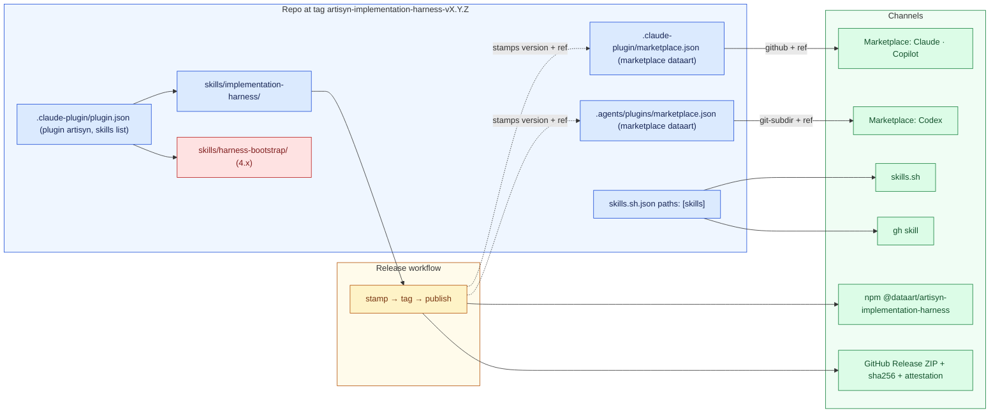

# DESIGN-20261115-CO1T — Design: Channels

Detail companion to `Architecture.md` (decisions D-05 Channels, D-06 Marketplace manifests, D-07 skills.sh / gh skill, D-08 npm, D-09 Release ZIP).

---

## Repo layout

The plugin root is the repo root; one layout serves Claude, Codex, Copilot, skills.sh, gh skill, npm and the ZIP.

```
skills/implementation-harness/              # the package (skill name: implementation-harness)
  SKILL.md  package.json  CHANGELOG.md  README.md  implementation-harness.md
  canonical/ references/ scripts/ patterns/ patch/ reports/
  bin/artisyn-implementation-harness.mjs    # install CLI entry (D-11); bin name stays artisyn-implementation-harness
skills/harness-bootstrap/SKILL.md           # shim (4.x only)
.claude-plugin/plugin.json                  # plugin manifest: name "artisyn", version (stamped), skills list
.claude-plugin/marketplace.json             # Claude + Copilot; marketplace name "dataart"
.agents/plugins/marketplace.json            # Codex; marketplace name "dataart"
skills.sh.json                              # { "paths": ["skills"] }
.harness/state/                             # this repo's own harness state
```



---

## Manifests

### `.claude-plugin/plugin.json`

The plugin manifest sits at the repo root and lists both skill folders; the per-skill `.claude-plugin/plugin.json` inside the package folder is not used.

```json
{
  "name": "artisyn",
  "version": "4.0.0",
  "description": "Artisyn Implementation Harness — install the AI-first engineering lifecycle into a project",
  "author": { "name": "DataArt" },
  "repository": "https://github.com/DataArt/artisyn-implementation-harness",
  "license": "<repo LICENSE>",
  "skills": ["./skills/implementation-harness", "./skills/harness-bootstrap"]
}
```

Marketplace sources point at the repo at the release tag, so all three hosts find `skills/implementation-harness/SKILL.md` through the same root. The plugin name `artisyn` and the skill name `implementation-harness` form the plugin command `/artisyn:implementation-harness`. After 5.0.0 the `skills` list drops the shim entry.

### `.claude-plugin/marketplace.json` (Claude; Copilot reads it 4th in its lookup order)

```json
{
  "name": "dataart",
  "owner": { "name": "DataArt" },
  "plugins": [
    {
      "name": "artisyn",
      "version": "4.0.0",
      "description": "…",
      "category": "development",
      "source": {
        "source": "github",
        "repo": "DataArt/artisyn-implementation-harness",
        "ref": "artisyn-implementation-harness-v4.0.0"
      }
    }
  ]
}
```

This file holds one plugin entry; its `github` + `ref` source is read by both Claude Code and Copilot CLI, and no `path` is needed because the plugin root is the repo root. `version` and `ref` are stamped by the release. Rollback for the marketplace channel is a new release commit that re-pins `ref` to the previous tag (a patch release).

### `.agents/plugins/marketplace.json` (Codex)

```json
{
  "name": "dataart",
  "owner": { "name": "DataArt" },
  "plugins": [
    {
      "name": "artisyn",
      "version": "4.0.0",
      "category": "development",
      "policy": { "installation": "AVAILABLE", "authentication": "NONE" },
      "source": {
        "source": "git-subdir",
        "url": "https://github.com/DataArt/artisyn-implementation-harness",
        "path": ".",
        "ref": "artisyn-implementation-harness-v4.0.0"
      }
    }
  ]
}
```

---

## Consumer commands

Each channel pins to the release tag or a semver; `main` head is never the install source. Pinning is mandatory on git channels: the `gh skill install … @<tag>` form below is the only documented one, docs and `doctor` show it, and the ZIP link in docs is the tag URL, never `/releases/latest` (root `v*` GitHub Releases may be newer and are irrelevant to harness installs). A docs lint rejects `/releases/latest` and unpinned `gh skill install` examples.

| Channel               | Install                                                                                                                                                                                                                                                                                                                                                        | Update                                                                         | Pin                     |
| --------------------- | -------------------------------------------------------------------------------------------------------------------------------------------------------------------------------------------------------------------------------------------------------------------------------------------------------------------------------------------------------------- | ------------------------------------------------------------------------------ | ----------------------- |
| Claude                | `claude plugin marketplace add DataArt/artisyn-implementation-harness` · `claude plugin install artisyn@dataart`; command `/artisyn:implementation-harness launch`                                                                                                                                                                                             | `claude plugin update artisyn@dataart`                                         | marketplace `ref` (tag) |
| Codex                 | `codex plugin marketplace add DataArt/artisyn-implementation-harness` then `/plugins`; command `$artisyn:implementation-harness launch` (`$implementation-harness` if Codex flattens)                                                                                                                                                                          | `codex plugin marketplace upgrade`                                             | marketplace `ref` (tag) |
| Copilot CLI           | `copilot plugin marketplace add DataArt/artisyn-implementation-harness` · `copilot plugin install artisyn@dataart`; command `/artisyn:implementation-harness launch`                                                                                                                                                                                           | `copilot plugin update artisyn`                                                | marketplace `ref` (tag) |
| skills.sh             | `npx skills add DataArt/artisyn-implementation-harness --skill implementation-harness`; command `/implementation-harness launch`                                                                                                                                                                                                                               | `npx skills update`                                                            | `skills-lock.json`      |
| gh skill              | `gh skill install DataArt/artisyn-implementation-harness implementation-harness@artisyn-implementation-harness-v4.0.0 --agent <host> --scope project` (the `@<tag>` form is the only documented one); command `/implementation-harness launch`                                                                                                                 | `gh skill install … @<new tag>`                                                | `@tag`                  |
| npm (GitHub Packages) | `.npmrc`: `@dataart:registry=https://npm.pkg.github.com` (the scope mapping may be committed) + token with `read:packages` in user-level npm config or an environment variable reference, never in the repo; `npx @dataart/artisyn-implementation-harness init` (places `<provider>/skills/implementation-harness/`); command `/implementation-harness launch` | `npx @dataart/artisyn-implementation-harness update`                           | semver                  |
| ZIP                   | download `artisyn-implementation-harness-v4.0.0.zip` + `.sha256` from the GitHub Release at the tag URL; verify; unzip into `<provider>/skills/implementation-harness/`; or run the bundled CLI; command `/implementation-harness launch`                                                                                                                      | bundled CLI `update` (fetches ZIP + `.sha256` from the Release) or re-download | version in file name    |

---

## Artifact contents

Immutable `patch/` history ships in every artifact.

| Artifact                                   | Includes                                               | Excludes                                                                                            |
| ------------------------------------------ | ------------------------------------------------------ | --------------------------------------------------------------------------------------------------- |
| npm tarball                                | package folder files per the `files` allowlist, `bin/` | state, `.DS_Store`, `*.local.*`, `.env*`, E2E fixtures                                              |
| ZIP                                        | same as the tarball                                    | same as the tarball                                                                                 |
| git ref (marketplace, skills.sh, gh skill) | repo at the tag                                        | this repo's `.harness/state/` is outside the plugin paths; no `.gitattributes export-ignore` needed |

---

## Integrity

Integrity is checked per channel at install time; build attestations are a maintainer/CI verification, not an install-time check.

| Channel                                                            | Install-time check                             | Who runs it                       |
| ------------------------------------------------------------------ | ---------------------------------------------- | --------------------------------- |
| npm                                                                | registry tarball integrity                     | `npm` on install                  |
| ZIP                                                                | `.sha256` next to the asset (`sha256sum -c`)   | CLI `update` and the manual guide |
| git (marketplace, skills.sh, gh skill)                             | tag / commit SHA                               | host tool                         |
| Attestation (`actions/attest-build-provenance` on tarball and ZIP) | `gh attestation verify <file> --owner DataArt` | maintainers and CI                |

---

## Verification

| Check             | Evidence                                                                                                                 |
| ----------------- | ------------------------------------------------------------------------------------------------------------------------ |
| Manifests         | `claude plugin validate --strict` on `plugin.json` and both marketplace files in CI                                      |
| npm allowlist     | `npm pack --dry-run` file list matches the allowlist                                                                     |
| Discovery         | `npx skills add` dry run lists exactly two skills (`implementation-harness` + `harness-bootstrap` shim); one after 5.0.0 |
| Tokenless install | per-channel smoke test runs without a GitHub token for marketplace, skills.sh, `gh skill` and ZIP                        |
| Pinned examples   | docs lint rejects `/releases/latest` and unpinned `gh skill install` examples                                            |
