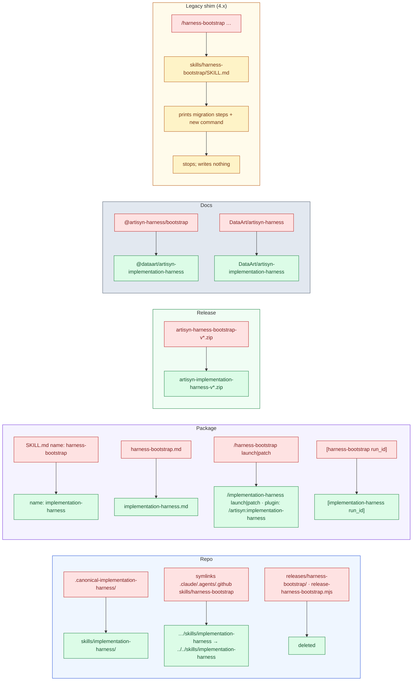

# DESIGN-20261115-CO1T — Design: Package Identity

Detail companion to `Architecture.md` (decisions D-01 Name, D-02 Source location, D-03 Legacy shim, D-04 Immutable history).

---

## Rename map

The npm package, `bin`, repo, Nx project, tag and ZIP carry the full name `artisyn-implementation-harness`; the skill folder, `name`, symlinks and command are `implementation-harness`; the plugin is `artisyn` in this repo's marketplace `dataart` (EC1 as amended at Solution sign-off). `harness-bootstrap` survives only in immutable history and the 4.x shim.



| Old                                                                                                                                                     | New                                                                                                                                                                                                                       | Where                             |
| ------------------------------------------------------------------------------------------------------------------------------------------------------- | ------------------------------------------------------------------------------------------------------------------------------------------------------------------------------------------------------------------------- | --------------------------------- |
| `.canonical-implementation-harness/`                                                                                                                    | `skills/implementation-harness/`                                                                                                                                                                                          | repo (`git mv`)                   |
| `.claude/skills/harness-bootstrap`, `.agents/skills/harness-bootstrap`, `.github/skills/harness-bootstrap` (symlinks)                                   | same dirs, `implementation-harness` → `../../skills/implementation-harness`                                                                                                                                               | repo                              |
| SKILL.md `name: harness-bootstrap`                                                                                                                      | `name: implementation-harness`                                                                                                                                                                                            | package                           |
| SKILL.md body `Version:` line                                                                                                                           | removed; `metadata.version` only                                                                                                                                                                                          | package                           |
| `harness-bootstrap.md` (package root)                                                                                                                   | `implementation-harness.md`                                                                                                                                                                                               | package, via patch `rename` entry |
| `/harness-bootstrap launch\|patch…` in SKILL.md, README, `references/launch/01-launch.md`, `references/patch/03-patch.md`, `reports/report.template.md` | `/implementation-harness …` (direct channels); `/artisyn:implementation-harness …` (plugin channels)                                                                                                                      | package                           |
| task prefix `[harness-bootstrap <run_id>]` (`01-launch.md:28`)                                                                                          | `[implementation-harness <run_id>]`                                                                                                                                                                                       | package                           |
| — (new)                                                                                                                                                 | plugin `artisyn` in marketplace `dataart`: `.claude-plugin/plugin.json` `name: "artisyn"`, `.claude-plugin/marketplace.json` and `.agents/plugins/marketplace.json` `name: "dataart"` with plugin entry `name: "artisyn"` | repo                              |
| `artisyn-harness-bootstrap-v*.zip`                                                                                                                      | `artisyn-implementation-harness-v*.zip`                                                                                                                                                                                   | release                           |
| `@artisyn-harness/bootstrap` (Roadmap)                                                                                                                  | `@dataart/artisyn-implementation-harness`                                                                                                                                                                                 | docs                              |
| `releases/harness-bootstrap/`                                                                                                                           | deleted                                                                                                                                                                                                                   | repo                              |
| `scripts/release/release-harness-bootstrap.mjs`, `release:harness-bootstrap` script                                                                     | deleted                                                                                                                                                                                                                   | repo                              |
| `apps/harness-bootstrap-e2e` fixtures and graders referencing `.canonical-implementation-harness`                                                       | new path                                                                                                                                                                                                                  | E2E (app name unchanged)          |
| Repo URL `DataArt/artisyn-harness` in `CHANGELOG.md`, `docs/Harness/01 Explore/02`, `03`                                                                | `DataArt/artisyn-implementation-harness`                                                                                                                                                                                  | docs                              |

Untouched: `patch/**`, `.harness/state/**` history, `state/objects/*` bytes.

---

## Rename gate

`scripts/check-rename.mjs` runs in CI and fails when `grep -rn "harness-bootstrap"` returns a hit outside the allowed set. It also fails when `artisyn-implementation-harness` is used as a skill, folder or command name: the full name is valid only as the npm package, `bin`, repo, Nx project, tag and ZIP name.

| Allowed location                         | Reason                          |
| ---------------------------------------- | ------------------------------- |
| `skills/implementation-harness/patch/**` | Immutable bundle history (D-04) |
| `.harness/state/**`                      | Recorded run history            |
| `skills/harness-bootstrap/`              | The shim (D-03)                 |
| `CHANGELOG.md` history entries           | Released history                |

---

## Legacy shim skill (D-03)

The folder `skills/harness-bootstrap/` holds only `SKILL.md`; the shim prints the migration steps and stops.

```
---
name: harness-bootstrap
description: Deprecated name of the Artisyn Implementation Harness. Prints the migration steps and stops.
metadata: { version: "<stamped>", deprecated: "true", removed-in: "5.0.0" }
---
This skill was renamed to `implementation-harness` (package `@dataart/artisyn-implementation-harness`). Do not run launch or patch from here.
Tell the developer: 1) install the new package (…channel commands…); 2) run `/implementation-harness migrate` (plugin: `/artisyn:implementation-harness migrate`) or the install CLI `migrate`; 3) use `/implementation-harness launch|patch` (plugin: `/artisyn:implementation-harness launch|patch`). Then stop.
```

| Rule                    | Value                                                                                                                                                                                                                                                                                                                                                 |
| ----------------------- | ----------------------------------------------------------------------------------------------------------------------------------------------------------------------------------------------------------------------------------------------------------------------------------------------------------------------------------------------------- |
| Lives at                | `skills/harness-bootstrap/` in this repo (one `SKILL.md`)                                                                                                                                                                                                                                                                                             |
| Ships in                | every 4.x artifact: marketplace plugin (as a second skill, `/artisyn:harness-bootstrap`; `/harness-bootstrap` on direct channels), npm tarball, ZIP; skills.sh discovers it under `skills/`                                                                                                                                                           |
| Placement in a consumer | `migrate` (CLI or first launch) replaces the old `harness-bootstrap/SKILL.md` and package files with the shim after the state migration is verified and marked; the old folder's `state/` stays in place with its `MIGRATED.md` marker until the developer deletes it (`doctor` reports it). There is never a second folder named `harness-bootstrap` |
| Removed in              | 5.0.0                                                                                                                                                                                                                                                                                                                                                 |
| File access             | none; the shim never reads or writes files and never resolves `package:`                                                                                                                                                                                                                                                                              |
| Version                 | `metadata.version` stamped by the release (D-15)                                                                                                                                                                                                                                                                                                      |

---

## Read-time legacy mapping (D-04)

Old values are resolved when records are read; history files are never rewritten. The mapping lives in `references/patch/06-patch-state.md` and in the apply procedure.

| Recorded value                                 | Resolves to                                                                |
| ---------------------------------------------- | -------------------------------------------------------------------------- |
| `release:artisyn-harness-bootstrap-v{ver}.zip` | `release:artisyn-implementation-harness-v{ver}` (label-only; same version) |
| `harness-bootstrap.md` path in old bundles     | `implementation-harness.md`                                                |
| `adoptors/`                                    | `adaptors/` (existing mapping)                                             |

Bytes always come from `.harness/state/objects/`; apply makes no network call. A missing base aborts the apply before any write.

---

## Verification

| Check       | Evidence                                                                                                                                                                              |
| ----------- | ------------------------------------------------------------------------------------------------------------------------------------------------------------------------------------- |
| Rename gate | `scripts/check-rename.mjs` green in CI (both rules: no stray `harness-bootstrap`, no `artisyn-implementation-harness` as a skill/folder/command name)                                 |
| New path    | E2E suite green on `skills/implementation-harness/`                                                                                                                                   |
| Mapping     | E2E: 3.5.0 fixture → `migrate` → `patch apply` of the 4.0.0 bundle succeeds                                                                                                           |
| Shim        | Agent-E2E asserts the shim prints the message and writes nothing; E2E: a 3.5.0 project ends with one `harness-bootstrap/` folder holding only the shim and the marked legacy `state/` |
