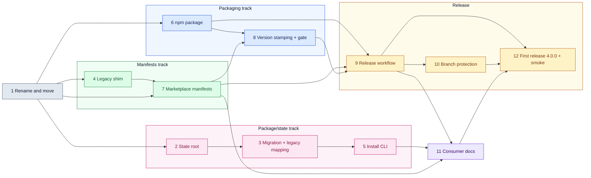

# DESIGN-20261115-CO1T — Efforts

Twelve tickets deliver the solution in `solution/Architecture.md`; ticket 1 (rename) unblocks three parallel tracks. Decision IDs refer to the Architecture decision register. The estimate column is empty for the developer to fill.

---

## WBS

| #   | Summary                                                                                                                                                                                                                                                                                                                                                                                                                                                                                                                                                                                 | Type  | Layer                | Depends on |
| --- | --------------------------------------------------------------------------------------------------------------------------------------------------------------------------------------------------------------------------------------------------------------------------------------------------------------------------------------------------------------------------------------------------------------------------------------------------------------------------------------------------------------------------------------------------------------------------------------- | ----- | -------------------- | ---------- |
| 1   | Rename and move: `.canonical-implementation-harness/` → `skills/implementation-harness/`; rename symlinks to `implementation-harness`, `SKILL.md` `name: implementation-harness` and version fields, package-root doc `implementation-harness.md`, task prefix `[implementation-harness <run_id>]`, commands `/implementation-harness …` in package docs (npm package, `bin`, repo, tag and ZIP keep `artisyn-implementation-harness`); fix E2E fixtures/graders and release scripts to the new path; old-repo-URL fixes; add rename gate `scripts/check-rename.mjs` to CI (D-01, D-02) | chore | Repo + Package + E2E | —          |
| 2   | State root: move `package:state/` to `.harness/state/` in package docs and procedures (aliases, project-root resolution, commit rule, migration section, legacy `.harness/` rule retired); move this repo's own state; launch writes ignore entries (D-12, D-13)                                                                                                                                                                                                                                                                                                                        | feat  | Package              | 1          |
| 3   | Migration + read-time legacy mapping: migrator (sources, precedence, provenance, marker, idempotency), mapping for old snapshot refs and `harness-bootstrap.md`; E2E from a 3.5.0 fixture (D-04, D-14)                                                                                                                                                                                                                                                                                                                                                                                  | feat  | Package + E2E        | 2          |
| 4   | Legacy shim skill `skills/harness-bootstrap/` (4.x only, message only); agent-E2E assertion (D-03)                                                                                                                                                                                                                                                                                                                                                                                                                                                                                      | feat  | Package              | 1          |
| 5   | Install CLI `bin/artisyn-implementation-harness.mjs`: `init` / `update` / `migrate` / `doctor`; unit + E2E fixtures incl. Windows paths (D-10, D-11)                                                                                                                                                                                                                                                                                                                                                                                                                                    | feat  | Package              | 2, 3       |
| 6   | Harness npm package: `package.json` (name, `bin`, `files` allowlist, `publishConfig`, `engines`; set harness `package.json` version to 3.5.0 so the breaking rename commit releases as 4.0.0), join Yarn workspaces + Nx project; `npm pack --dry-run` gate (D-08, D-15)                                                                                                                                                                                                                                                                                                                | feat  | Repo + Package       | 1          |
| 7   | Marketplace manifests: repo-root `.claude-plugin/plugin.json` (plugin `artisyn`, skills `./skills/implementation-harness` + shim) + `marketplace.json` (marketplace `dataart`), `.agents/plugins/marketplace.json` (marketplace `dataart`), `skills.sh.json`; `claude plugin validate --strict` in CI (D-06, D-07)                                                                                                                                                                                                                                                                      | feat  | Repo                 | 1, 4       |
| 8   | Version stamping + gate: `scripts/release/stamp-harness-version.mjs` (+ `--check` CI job) (D-15)                                                                                                                                                                                                                                                                                                                                                                                                                                                                                        | feat  | Repo                 | 6, 7       |
| 9   | Release workflow `release-harness.yml`: Nx Release config, publish to GitHub Packages, ZIP + sha256 + attestations, GitHub Release; root `releaseRules` scope filter; commit-scope check; retire committed ZIPs and old release script; `patch prepare` bump removed (D-09, D-16)                                                                                                                                                                                                                                                                                                       | feat  | Repo                 | 6, 7, 8    |
| 10  | Branch protection ruleset on `main` + release bypass actor (GitHub App) — developer/admin task, documented in Engineering Guide (D-17)                                                                                                                                                                                                                                                                                                                                                                                                                                                  | chore | Repo admin           | 9          |
| 11  | Consumer docs: `docs/Harness/09 Distribution/` (channels, install per channel, update, migration, versioning contract), Quick Start, Roadmap §1, Adoption Path, Tool Compatibility (+Copilot), Branching Strategy (tags), Getting Started, `CLAUDE.md`, root `README`, issue template; docs lint: no `/releases/latest`, pinned `gh skill` examples (D-07, D-18)                                                                                                                                                                                                                        | docs  | Docs                 | 5, 7, 9    |
| 12  | First release 4.0.0 and per-channel install smoke (Claude, Codex, Copilot marketplace; skills.sh; `gh skill`; npm; ZIP) — agent-E2E where needed (guarded: developer starts) (D-05)                                                                                                                                                                                                                                                                                                                                                                                                     | chore | Release + E2E        | 9, 10, 11  |

---

## Sequencing

After ticket 1, three tracks run in parallel: package/state (2 → 3 → 5), packaging (6 → 8) and manifests (4, 7). They join at the release workflow (9).

---

## Spikes resolved during design

No spike tickets remain; these were closed during design:

- skills.sh and `gh skill` update behaviour — resolved by source read.
- Codex and Copilot marketplace formats — resolved from official docs.
- Nx 23 release keys — resolved from the schema.
- `@dataart` npmjs scope — moot (GitHub Packages chosen).

Two checks stay inside ticket 7 as implementation-time verification: the Codex `policy.authentication` enum value, and the Copilot plugin kind for a Claude-format plugin.

---

## Rollout and rollback

Rollout: tickets 1–11 merge to `main` with the release workflow disabled until ticket 10 is done. The workflow is guarded by the repository variable `HARNESS_RELEASE_ENABLED`; ticket 12 flips it and cuts 4.0.0. Existing 3.5.0 consumers keep working from their ZIP until they migrate; the shim guides them to the new command.

Rollback: `npm deprecate` plus a dist-tag move; the marketplace `ref` is reverted by a patch release; consumers pin by tag.

---

## Risks

| Risk                                                 | Impact                                | Mitigation                                                                                |
| ---------------------------------------------------- | ------------------------------------- | ----------------------------------------------------------------------------------------- |
| Codex/Copilot ignore or reject the manifests         | marketplace channel reduced to Claude | ticket 7 verifies on real hosts; fallback: native manifests are already separate per host |
| Root semantic-release still bumps on harness commits | repo version noise                    | commit-scope check + `releaseRules`; tested in ticket 9                                   |
| Migration data loss                                  | consumer loses launch history         | source never deleted; verify-then-mark; E2E from 3.5.0                                    |
| Automatic publish of a bad `main`                    | broken release                        | required CI + protected `main`; `npm deprecate` path                                      |

---

## Effort estimate

Estimates are supplied by the developer.

| #         | Description                                                       | Estimate |
| --------- | ----------------------------------------------------------------- | -------- |
| 1         | Rename and move to `skills/implementation-harness/` + rename gate |          |
| 2         | State root `.harness/state/`                                      |          |
| 3         | Migration + read-time legacy mapping                              |          |
| 4         | Legacy shim skill                                                 |          |
| 5         | Install CLI                                                       |          |
| 6         | Harness npm package                                               |          |
| 7         | Marketplace manifests                                             |          |
| 8         | Version stamping + gate                                           |          |
| 9         | Release workflow                                                  |          |
| 10        | Branch protection ruleset + bypass actor                          |          |
| 11        | Consumer docs                                                     |          |
| 12        | First release 4.0.0 + per-channel smoke                           |          |
| **Total** |                                                                   |          |
