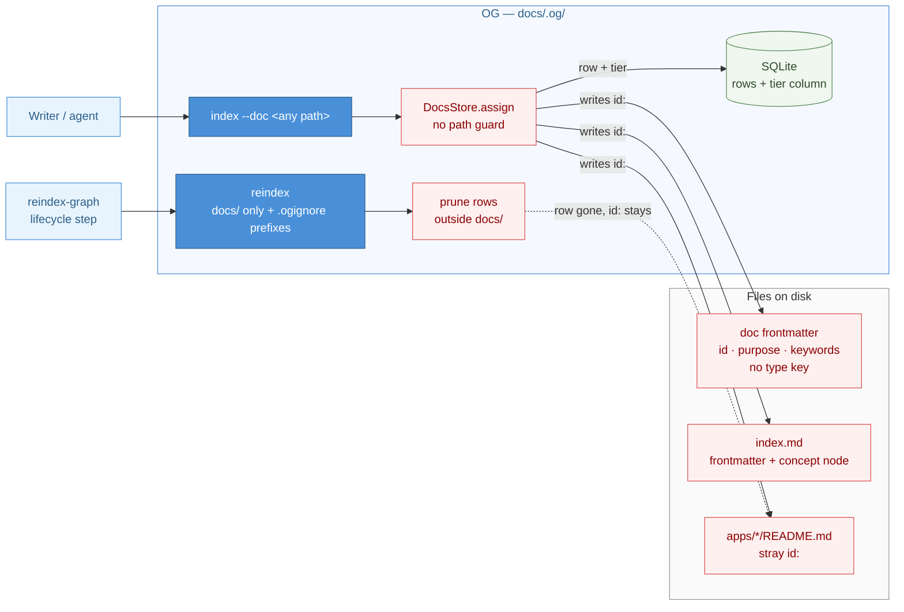

# DESIGN-20261117-7931 — OKF-Compatible Knowledge Base

## Problem

The harness docs are close to OKF but do not conform to it, and OG can write IDs into files it should never touch.

**What we have.** The harness keeps its knowledge in `docs/` as markdown. Each doc has OG frontmatter: `id`, `purpose`, `keywords`.

**What OKF expects.** Google Cloud's Open Knowledge Format (OKF, v0.2, experimental) is an emerging convention for giving agents curated context. It uses markdown files with YAML frontmatter. Each file needs a `type` key. Links are untyped. Two filenames are reserved:

- `index.md`: a navigation listing with no frontmatter, except `okf_version` at the bundle root.
- `log.md`.

**Gaps found in code (established):**

| #   | Gap                                                                                                                                      | Evidence                                                           |
| --- | ---------------------------------------------------------------------------------------------------------------------------------------- | ------------------------------------------------------------------ |
| 1   | No doc has a `type` key. The tier lives only in the OG database column.                                                                  | OG frontmatter is `id`, `purpose`, `keywords`                      |
| 2   | Every `index.md` carries frontmatter and is indexed as a concept node.                                                                   | OKF reserves `index.md` without frontmatter                        |
| 3   | `index --doc` has no scope guard. It stamps an `id:` into any file it is given: outside `docs/`, an `index.md`, or an `.ogignore`d path. | `DocsStore.assign` write path                                      |
| 4   | `reindex` scans only `docs/` and prunes all other rows. The stray `id:` stays in the file.                                               | `apps/web-explorer/README.md` has `id: ffe6a029` with no graph row |
| 5   | The OG docs still describe an `AppReadme` tier for `apps/*/README.md`. The code no longer keeps it.                                      | `07 Operational Graph/01 Ops Model.md`                             |
| 6   | `.ogignore` holds path prefixes only. It cannot say "every `index.md`".                                                                  | `.ogignore` format                                                 |

**Why now.** The harness ships into other projects. A published convention lets external agents and consumers read the knowledge base without learning OG. The leak also copies stray IDs into every consuming project.

**Current state:**

The tier is derived from the path and stored only in SQLite. No file carries it.

## Success

### Known ECs

- EC1: The harness knowledge base under `docs/` conforms to OKF v0.2. Every concept doc carries a frontmatter `type`. `index.md` files follow OKF's reserved-file rule.
- EC2: OG never writes frontmatter into an `index.md` and never indexes one into the graph.
- EC3: OG never writes into or indexes any file outside `docs/`.
- EC4: The rules land first in the canonical package (`skills/implementation-harness/`). They reach this repo through `/implementation-harness patch prepare` → `patch apply`. The repo dogfoods its own patch flow.
- EC5: The docs flow is adjusted so writers produce conformant frontmatter: `@docs-writer`, Documentation Principles, Documents Flow, and the `/design publish` and `/dev document` steps.
- EC6: OG stays the single query layer. OKF adds a file convention, not a second graph. Skills keep querying OG only.

### Proposed ECs

- [proposed] EC7 — No silent provenance loss. Four authored graduation edges point into index pages: 2 `story-to-hld` into the HLD index, plus 1 `story-to-hld` and 1 `impl-to-engineering-guide` into the Engineering Guide index. Each is retargeted or explicitly dropped. Node and edge counts are diffed before and after migration. The stray `id:` in `apps/web-explorer/README.md` is removed.
- [proposed] EC8 — The site still works. VitePress still renders `docs/index.md` (home layout, needs `layout`/`hero` frontmatter) and the section landing pages. The docs build passes.
- [proposed] EC9 — Guards fail loud and are tested. `index --doc` on a guarded path exits non-zero with a clear message. `index --doc` honors `.ogignore`, not only `reindex`. Both are covered in `cli.test.mjs`.
- [proposed] EC10 — Safe for consuming projects and reversible. `patch apply` is idempotent on a project that already has stamped `index.md` or out-of-docs IDs, and does not break it. A deterministic check verifies conformance (the spec ships no validator). The OKF version is pinned, so the convention can be dropped cheaply if OKF does not catch on.

## Decisions

Each decision gets its own Research → Evaluate → Solution loop. The delivery order (canonical first, then patch to this repo) is a fixed constraint, not a decision.

| #   | Decision                                                                                                                                                                                                                                                                                                                                                                                                                                                                                                                                                                                                                                                                                              | Why it's independent                                                                                                                                                                                                                           |
| --- | ----------------------------------------------------------------------------------------------------------------------------------------------------------------------------------------------------------------------------------------------------------------------------------------------------------------------------------------------------------------------------------------------------------------------------------------------------------------------------------------------------------------------------------------------------------------------------------------------------------------------------------------------------------------------------------------------------- | ---------------------------------------------------------------------------------------------------------------------------------------------------------------------------------------------------------------------------------------------- |
| 1   | **Frontmatter and graph schema** — the key set every doc carries. Whether source files rename `purpose`→`description` and `keywords`→`tags` (OKF names) or keep OG names and map them. Where `type` comes from (derived from the tier vs authored) and its value list. What stays OG-only (`id`). The matching `docs` table in SQLite: its columns (`tier`, `purpose`, `keywords` today) may be renamed, added (`type`) or dropped to follow the frontmatter, and `search` follows them. What changes for `@docs-writer`, Documentation Principles, and the migration of every existing doc. Also how an existing database is migrated, since the schema has no version today. Covers EC1, EC5, EC10. | It is a schema choice. It can be settled without deciding the bundle layout or the guard. Its options (rename in place, keep and map, dual keys during a transition) stand alone. The table shape follows the key set, so both are one choice. |
| 2   | **OKF bundle layout** — where the bundle root and `okf_version` sit. How `index.md` meets the reserved-file rule, given VitePress needs `docs/index.md` home frontmatter and some index pages carry real content. Whether to add `log.md`. Whether conformance lives in the source tree or a generated export. Covers EC1, EC8, EC10.                                                                                                                                                                                                                                                                                                                                                                 | It is about files and folders, not key names or OG code. Options: in-place, generated export, hybrid.                                                                                                                                          |
| 3   | **OG scope guard** — what OG may write to and index: where the guard sits (`assign`, `index --doc`, `reindex`), the rule set (only under `docs/`, never `index.md`, `.ogignore` honored on every write path), what happens to the `AppReadme` tier and `impl-to-readme` edge, and how the 4 graduation edges into index pages and the stray `apps/web-explorer/README.md` id are migrated. Covers EC2, EC3, EC6, EC7, EC9.                                                                                                                                                                                                                                                                            | It fixes a real leak that exists with or without OKF. It is a code and edge-migration choice with its own options (built-in rule vs extended `.ogignore` syntax vs config list), and could ship on its own.                                    |

The decisions meet in two places. At `index.md`, Decision 3 decides whether index pages leave the graph, and Decision 2 decides what their frontmatter becomes. At OG's columns, Decision 1's key names decide what `assign` reads. Evaluate checks the picks agree.

## Boundaries

**In scope:**

- OKF frontmatter for docs under `docs/`: the `type` key and the key names.
- OG's SQLite schema (`docs` table columns), and migrating existing databases in this repo and in consuming projects.
- `index.md` handling.
- The OG scope guard: `index`, `reindex`, `assign`.
- The fate of the `AppReadme` tier and the `impl-to-readme` edge.
- Migrating existing docs and edges.
- Updating the OG docs (`07 Operational Graph`), Documents Flow, Documentation Principles and `@docs-writer`.
- Canonical package changes, plus a patch bundle applied to this repo.

**Out of scope:**

- Writing typed edges into the files. They stay in SQLite; OKF defers lineage.
- Replacing OG's query model. Commands (`search`, `query`, `index`, `reindex`) keep their roles; only their columns and guards change.
- Treating harness config (skills, agents, CLAUDE.md) as OKF concepts.
- OKF trust fields (`status`, `verified`, `stale_after`). Possible follow-up.
- Publishing the bundle to any external catalog.

## Constraints

| Constraint                                                                                                                                                                                                                                 | Status                                           |
| ------------------------------------------------------------------------------------------------------------------------------------------------------------------------------------------------------------------------------------------ | ------------------------------------------------ |
| OKF is v0.2 and experimental. This frame read `SPEC.md` through a summary only.                                                                                                                                                            | Open: Research must re-verify against the source |
| The canonical OG code is byte-identical to this repo's `docs/.og/`. One canonical change patches cleanly.                                                                                                                                  | Established                                      |
| VitePress needs frontmatter on `docs/index.md` (home layout).                                                                                                                                                                              | Established                                      |
| Some section `index.md` pages carry real content, not only navigation: `09 Distribution`, `05 Principles`, `02 Quick Start`.                                                                                                               | Established                                      |
| `.ogignore` is prefix-only.                                                                                                                                                                                                                | Established                                      |
| OG is deterministic, with no model calls.                                                                                                                                                                                                  | Established                                      |
| `id` is additive-only and never reassigned.                                                                                                                                                                                                | Established                                      |
| The schema in `docs/.og/schema.mjs` is `CREATE TABLE IF NOT EXISTS` with no version, so a column change needs an explicit migration. A rebuild from files is not enough: authored edges (graduation and `references`) live only in SQLite. | Established                                      |
| Guarded commands (`git push`, `cdk deploy`, the agent E2E run) are never run by the agent.                                                                                                                                                 | Repo convention                                  |
| `yarn` only. No hardcoded region. Node 24 for `node:sqlite`.                                                                                                                                                                               | Repo convention                                  |

## Links

- Ticket: DESIGN-20261117-7931 (local design ID, no tracker ticket)
- Related tickets: none
- Reference docs:
  - `docs/Harness/07 Operational Graph/` (01 Ops Model, 02 Storage and Build Model)
  - `docs/Harness/03 Lifecycles/05 Documents Flow.md`
  - `docs/Engineering Guide/Documentation/01 Principles.md`
  - `skills/implementation-harness/references/reindex-graph.md`
  - `skills/implementation-harness/references/patch/`
  - OKF spec: https://raw.githubusercontent.com/GoogleCloudPlatform/knowledge-catalog/main/okf/SPEC.md
