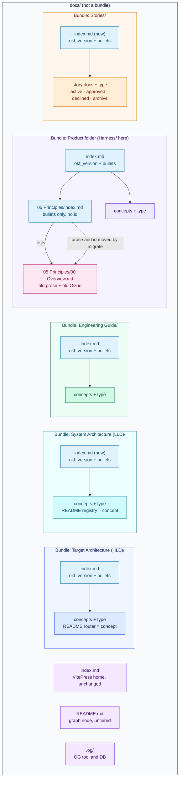

# DESIGN-20261117-7931: OKF-Compatible Knowledge Base — Evaluate: Decision 3, OKF bundle layout

_Produced by the 🏗 Evaluate phase. This is the judgment artifact. Options come from `design/01 Research - OKF Bundle Layout.md`._

**Step 1b outcome (all decisions).** Assumptions #18 is proposed. The DB migrates inside OG on open, using `PRAGMA user_version`. A deterministic `cli.mjs migrate` command rewrites frontmatter and finds pending work by OG-era keys. `reindex-graph` runs it before `build`. OG reads both old and new keys until a project is migrated. Greenfield starts at v1. An already migrated project is a no-op. Launch writes the Product folder (Q10c) to an OG config file. Assumptions #19: Options 1, 3 and 5 depend on a VitePress `rewrites` spike. Option 6 does not need rewrites.

## Requirements × Options Matrix

✅ satisfies · ⚠️ partially (see note) · ❌ does not satisfy

| Requirement                                       | 1 Rename-away                      | 2 Area bundles     | 3 Single `docs/` bundle         | 4 Generated export bundle | 5 Hybrid                          | 6 Five tier bundles                    |
| ------------------------------------------------- | ---------------------------------- | ------------------ | ------------------------------- | ------------------------- | --------------------------------- | -------------------------------------- |
| EC1 source conforms in place (developer)          | ⚠️ index rule holds only vacuously | ✅                 | ✅                              | ❌ export only            | ⚠️ index rule only in the overlay | ✅                                     |
| Stories inside a bundle (developer)               | ✅                                 | ❌ outside         | ✅                              | ❌                        | ❌                                | ✅                                     |
| EC8 VitePress home and site keep working          | ⚠️ depends on rewrites spike       | ✅                 | ⚠️ depends on spike; home moves | ✅                        | ⚠️ depends on spike               | ✅ home outside bundles; no rewrites   |
| EC10 visible `okf_version` pin                    | ❌                                 | ✅ ×4              | ✅ ×1                           | ✅                        | ✅                                | ✅ ×5                                  |
| Generator-neutral canonical rule                  | ✅                                 | ✅                 | ⚠️ VitePress workaround         | ✅                        | ⚠️                                | ✅ "each OG tier root is a bundle"     |
| Aligns with OG tiers (Decision 1 `type` fallback) | ⚠️                                 | ⚠️ no Story tier   | ⚠️                              | ⚠️                        | ⚠️                                | ✅ 1:1                                 |
| EC7 graduation edges into index pages survive     | ✅ pages stay                      | ⚠️ needs `id` move | ⚠️ needs `id` move              | n/a                       | ✅                                | ⚠️ needs `id` move (done by `migrate`) |
| Blast radius                                      | medium                             | medium             | high                            | low                       | high                              | medium                                 |

## Tradeoffs

| Dimension              | 1 Rename-away         | 2 Area bundles | 3 Single `docs/` bundle          | 4 Generated export bundle | 5 Hybrid            | 6 Five tier bundles          |
| ---------------------- | --------------------- | -------------- | -------------------------------- | ------------------------- | ------------------- | ---------------------------- |
| Operational Excellence | ⚠️ renames + rewrites | ⚠️ 4 pins      | ❌ every index and the home move | ⚠️ second artifact        | ❌ two moving parts | ⚠️ 5 pins, hand-kept indexes |
| Security               | ✅                    | ✅             | ✅                               | ✅                        | ✅                  | ✅                           |
| Reliability            | ⚠️ `docUrl.ts` drift  | ✅             | ⚠️                               | ✅                        | ⚠️                  | ✅                           |
| Performance Efficiency | ✅                    | ✅             | ✅                               | ✅                        | ✅                  | ✅                           |
| Cost Optimization      | ⚠️                    | ✅             | ❌                               | ⚠️                        | ⚠️                  | ✅                           |
| Sustainability         | ✅                    | ✅             | ✅                               | ⚠️ duplicate tree         | ⚠️                  | ✅                           |
| Integration Complexity | ⚠️ VitePress rewrites | ✅             | ❌ VitePress workaround          | ⚠️                        | ⚠️                  | ✅                           |
| Vendor Lock-in         | ✅                    | ✅             | ✅                               | ✅                        | ✅                  | ✅                           |

## Recommendation

**Recommended option: Option 6 — Five tier bundles**

Each OG tier root is its own OKF bundle. `docs/` itself is not a bundle.

### Layout rules

| Topic                  | Rule                                                                                                                                                                                      |
| ---------------------- | ----------------------------------------------------------------------------------------------------------------------------------------------------------------------------------------- |
| Bundles                | The five OG tier roots: `Target Architecture (HLD)/`, `System Architecture (LLD)/`, `Engineering Guide/`, `Stories/`, and the Product folder (from launch Q10c; `Harness/` in this repo). |
| Bundle root `index.md` | Frontmatter holds only `okf_version: "0.2"`. Body is `# Section` headings with `* [Title](relative-url) - description` bullets. LLD and Stories gain one.                                 |
| Section `index.md`     | Bullet list only. Its prose moves to a named concept page, following the `00 Overview.md` pattern that `03 Lifecycles` already uses.                                                      |
| OG `id` on moved prose | The new concept page takes over the old index page's OG `id`. The 4 graduation edges and the `references` edges survive without retargeting (Research OQ14). `migrate` does the move.     |
| Index upkeep           | Writers maintain `index.md` files (`@docs-writer` rule). OG does not generate them. This matches Decision 4: OG never writes or indexes `index.md`.                                       |
| Conformance check      | `og check` lists missing `type`, index entries pointing at missing files, and concepts missing from their folder's index. It reports and exits 0.                                         |
| Outside every bundle   | `docs/index.md` (VitePress home, unchanged), `docs/README.md` (stays a graph node, untiered), `docs/.og/`.                                                                                |
| README routers         | HLD `README.md` and LLD `README.md` stay concepts with `type`.                                                                                                                            |
| Links                  | File-relative only. OKF and VitePress both resolve them.                                                                                                                                  |
| Story concept IDs      | Concept-ID churn when a Story folder moves to `approved/`, `declined/` or `archive/` is accepted. The OG `id` stays stable.                                                               |
| `log.md`               | Not adopted now. It is optional in OKF. P3 follow-up.                                                                                                                                     |
| Frozen Story files     | The one-time migration may edit frontmatter only in archived and approved Story files. Documents Flow states this exception.                                                              |
| Missing tier root      | A greenfield project without LLD or Product has no such bundle. No empty bundle is required.                                                                                              |

### Why

Option 6 is the only option that meets all three developer answers: source conforms in place, Stories sit inside a bundle, and the bundles are the five tiers. It also meets EC8 without VitePress rewrites. It maps 1:1 to OG tiers, so Decision 1's `type` fallback is the bundle tier.

| Option                    | Disqualifier                                                                         |
| ------------------------- | ------------------------------------------------------------------------------------ |
| 1 Rename-away             | The `index.md` rule holds only vacuously, and there is no visible `okf_version` pin. |
| 2 Area bundles            | Stories stay outside every bundle.                                                   |
| 3 Single `docs/` bundle   | Needs VitePress rewrites and moves the home page.                                    |
| 4 Generated export bundle | Source does not conform in place.                                                    |
| 5 Hybrid                  | Needs rewrites and a home move; the `index.md` rule holds only in the overlay.       |

**Falsifiability.** If OKF defines nested-bundle rules that treat `docs/` as one bundle, revisit this decision.

### Cross-decision consistency

| Check                                                                                                                                                      | Status |
| ---------------------------------------------------------------------------------------------------------------------------------------------------------- | ------ |
| Decision 3 keeps `index.md` in source as navigation. Decision 4 keeps it out of the graph, and OG never writes it.                                         | ✅     |
| Decision 1's `type` fallback = Decision 3's bundle tier = OG tier.                                                                                         | ✅     |
| Decision 2's `migrate` command carries Decision 1's rewrite, Decision 3's index-page `id` move and Decision 4's stray-`id` cleanup in one idempotent pass. | ✅     |
| Decision 2's `og.config.json` supplies Decision 3's Product bundle root and the Product tier for Decisions 1 and 4.                                        | ✅     |
| One fix outside the four decisions, already in Frame scope: the Product folder is set at launch.                                                           | ✅     |

**Open questions to resolve before implementation:**

| #    | Question                                                                                               | Owner                       | Impact if unresolved                    |
| ---- | ------------------------------------------------------------------------------------------------------ | --------------------------- | --------------------------------------- |
| OQ-1 | What are the new overview page names per section?                                                      | `@docs-writer`, in Solution | Blocks the `migrate` index-page move    |
| OQ-2 | Which VitePress nav entries point at content-bearing index routes and must move to the overview pages? | dev                         | Nav links land on bullet-only pages     |
| OQ-3 | What does the Stories root `index.md` contain?                                                         | `@docs-writer`              | Stories bundle has no `okf_version` pin |

## WAF Assessment (Option 6)

| Pillar                 | Rating | Headline                                                                                                      |
| ---------------------- | ------ | ------------------------------------------------------------------------------------------------------------- |
| Operational Excellence | 🟡     | Five `okf_version` pins and writer-maintained indexes. P2: `og check` reports drift on every `reindex-graph`. |
| Security               | 🟢     | Public docs only; no new exposure.                                                                            |
| Reliability            | 🟢     | No VitePress rewrites; home untouched; edges survive through the `id` move.                                   |
| Performance Efficiency | 🟢     | No runtime cost.                                                                                              |
| Cost Optimization      | 🟢     | No generator and no export artifact.                                                                          |
| Sustainability         | 🟢     | One source tree; no duplicate bundle.                                                                         |

| Priority | Action                                                       |
| -------- | ------------------------------------------------------------ |
| P1       | None.                                                        |
| P2       | `og check` conformance report, run on every `reindex-graph`. |
| P3       | Adopt `log.md`.                                              |
