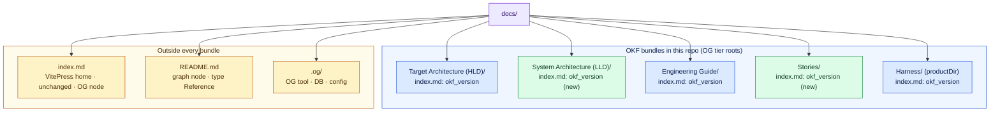
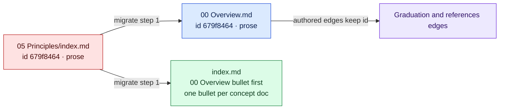

# DESIGN-20261117-7931 — Design: OKF bundle layout

Each OG tier root is one OKF bundle, and its `index.md` is navigation only. Prose moves out of
`index.md` into `00 Overview.md`. OG commands other than `migrate` never write an `index.md` or
`log.md` under `docs/`, except the docs-root `docs/index.md`.

See [Architecture](Architecture.md) for the components this change touches and the delivery order.

## Bundles and what sits outside

Each OG tier root is one bundle. This repo has five. A tier root that does not exist is an absent
bundle. The Product bundle path comes from `docs/.og/og.config.json` (`productDir`). In this repo it
is `docs/Harness/`.



| Path                                | Role                     | Bundle root `index.md`                                                                    |
| ----------------------------------- | ------------------------ | ----------------------------------------------------------------------------------------- |
| `docs/Target Architecture (HLD)/`   | HLD bundle               | Exists; migration rewrites it                                                             |
| `docs/System Architecture (LLD)/`   | LLD bundle               | New; migration creates it here                                                            |
| `docs/Engineering Guide/`           | Engineering Guide bundle | Exists; migration rewrites it                                                             |
| `docs/Stories/`                     | Stories bundle           | New; migration creates it here                                                            |
| `docs/Harness/` (from `productDir`) | Product bundle           | Exists; migration rewrites it                                                             |
| `docs/index.md`                     | VitePress home           | Outside; unchanged byte-for-byte; stays an OG node with its `id`; not reported by `check` |
| `docs/README.md`                    | Root router              | Outside; stays a graph node (`Reference`)                                                 |
| `docs/.og/`                         | OG tool and data         | Outside; never a doc                                                                      |

`log.md` is not used in any bundle.

OG treats every `index.md`/`log.md` under `docs/` as reserved, except the docs-root `docs/index.md`
(the VitePress home). So `docs/index.md` is an ordinary in-scope doc for OG. `migrate` does not strip, rename, stamp or
retarget it. Its 2 authored `references` edges stay attached to its `id`.

## Bundle root `index.md` contract

The bundle root `index.md` has one frontmatter key: `okf_version: "0.2"`. The body is `# Section`
headings, each followed by `* [Title](relative-url) - description` bullets.

Example: `docs/System Architecture (LLD)/index.md`.

```markdown
---
okf_version: '0.2'
---

# Registry

- [Component Registry](README.md) - Which LLD component docs exist and which container owns each

# Web Docs

- [Web Docs Overview](Web%20Docs/00.%20Overview.md) - <the doc's description value>

# Implementation Harness E2E

- [Implementation Harness E2E Overview](Implementation%20Harness%20E2E/00.%20Overview.md) - <the doc's description value>
- [Fixtures](Implementation%20Harness%20E2E/01.%20Fixtures.md) - <the doc's description value>
```

Rules:

- No other frontmatter key. No `id`. OG does not index `index.md`.
- Bullet title is the target doc's `title`. Bullet description is its `description`.
- `check` and the parser accept `okf_version` in single or double quotes, and both `*` and `-`
  bullets. Prettier reformatting causes no repeated diffs.

Who creates a bundle root `index.md`:

| Situation                                               | Creator                                                                              |
| ------------------------------------------------------- | ------------------------------------------------------------------------------------ |
| Greenfield launch                                       | Launch, for each tier root it creates                                                |
| Project upgraded from an older harness                  | `migrate` creates a missing root `index.md` or adds `okf_version` to an existing one |
| First doc written into a bundle with no root `index.md` | `@docs-writer`, with `okf_version: "0.2"` only and a bullets body                    |

`migrate --check` is pending when a present bundle root lacks `index.md` or `okf_version: "0.2"`.

## Section `index.md` contract

A section `index.md` lives in a folder inside a bundle. It has no frontmatter. Its body holds only
headings, blank lines and link bullets. A section `index.md` is optional. Story folders need none.

Example: `docs/Harness/05 Principles/index.md` after migration.

```markdown
# Principles

- [Principles Overview](00%20Overview.md) - State the beliefs the harness is built on: repeatability, convergence, and architecture coherence
```

## Index-page prose moves to `00 Overview.md`

A section `index.md` is content-bearing when its body has anything other than headings, blank lines
and link-only bullets. A link-only bullet is `* [Title](url)`, optionally followed by ` - text`.
`migrate` moves the rest to `00 Overview.md` in the same folder. That page takes over the old index
page's OG `id`. Its authored edges (the 4 graduation edges and `references` edges) stay attached to
the same `id`.

`migrate` also writes the navigation. The remaining `index.md` keeps its headings and link bullets
and gets:

1. a first bullet that links `00 Overview.md`;
2. one link bullet per concept doc in that folder, in file-name order, as
   `* [title](relative-url) - description` from each doc's frontmatter.

A doc that already has a bullet is not linked twice. The OG frontmatter is removed. After `migrate`,
`check` reports zero `unlistedConcepts` for migrated folders.



Before, `docs/Harness/05 Principles/index.md`:

```markdown
---
id: 679f8464
purpose: 'State the beliefs the harness is built on: repeatability, convergence, and architecture coherence'
keywords: [principles, repeatability, convergence, architecture coherence]
---

# Principles

The beliefs the harness is built on.

| Principle | What it means |
| --------- | ------------- |
| ...       | ...           |
```

After, `docs/Harness/05 Principles/00 Overview.md`:

```markdown
---
id: 679f8464
type: Product Concept
title: Principles
description: 'State the beliefs the harness is built on: repeatability, convergence, and architecture coherence'
tags: [principles, repeatability, convergence, architecture coherence]
generated: { by: process:okf-migration, at: <first git commit date of index.md, UTC> }
updated: { by: process:okf-migration, at: <last git commit date of index.md, UTC> }
---

# Principles

The beliefs the harness is built on.

| Principle | What it means |
| --------- | ------------- |
| ...       | ...           |
```

After, `docs/Harness/05 Principles/index.md`:

```markdown
# Principles

- [Principles Overview](00%20Overview.md) - State the beliefs the harness is built on: repeatability, convergence, and architecture coherence
```

`05 Principles/` has no other concept docs, so its `index.md` holds only the `00 Overview` bullet.

A folder with child docs gets one bullet per doc. Before, `docs/Harness/07 Operational Graph/index.md`
holds an intro paragraph and a Markdown table that links the four pages. Both are prose, so both move
to `00 Overview.md`. After, `docs/Harness/07 Operational Graph/index.md`:

```markdown
# Operational Graph

- [Operational Graph Overview](00%20Overview.md) - Navigation index introducing the deterministic operational graph over the repo's doc tiers
- [Ops Model](01%20Ops%20Model.md) - Describe the knowledge graph's system context and how lifecycle skills wire into it
- [Storage and Build Model](02%20Storage%20and%20Build%20Model.md) - Describe the knowledge graph's SQLite schema and the single-file build model
- [Visualization Model](03%20Visualization%20Model.md) - Describe the IDE-side and docs-site graph surfaces that share the knowledge graph's data file
- [Graph Explorer](04%20Graph%20Explorer.md) - Interactive table of every doc the operational graph has indexed, grouped by tier
```

**Collision rule.** If `00 Overview.md` already exists in the folder, `migrate` lists the folder in
`overviewConflicts` in its JSON output. It skips the prose move and the frontmatter strip, so that
`index.md` is left unchanged. `migrate --check` stays pending until a writer resolves the collision.
The folder's authored edges stay attached. The `index.md` row is pruned only after a writer resolves
the collision. Any leftover edges then appear in `orphanedAuthored` of that reindex.

Folders affected in this repo:

| Bundle            | Folder                                   |
| ----------------- | ---------------------------------------- |
| HLD               | `docs/Target Architecture (HLD)/` (root) |
| Engineering Guide | `docs/Engineering Guide/` (root)         |
| Product           | `docs/Harness/` (root)                   |
| Product           | `docs/Harness/00 The Story/`             |
| Product           | `docs/Harness/01 Explore/`               |
| Product           | `docs/Harness/02 Quick Start/`           |
| Product           | `docs/Harness/05 Principles/`            |
| Product           | `docs/Harness/06 Roadmap/`               |
| Product           | `docs/Harness/07 Operational Graph/`     |
| Product           | `docs/Harness/08 Security Scan/`         |
| Product           | `docs/Harness/09 Distribution/`          |

For the three bundle roots, the new `00 Overview.md` sits next to the bundle root `index.md`.

**Fallback strip.** When the parser rejects the frontmatter of an `index.md` inside a bundle,
`migrate` strips `id`, `purpose` and `keywords` by removing those top-level key lines, including the
continuation lines of a wrapped flow list. It does no full YAML parse. The strip and stray-id cleanup
apply only to `index.md` files inside a bundle.

## `index.md` writers

`migrate` is the one OG command that writes an `index.md` inside a bundle. `index`, `reindex` and
`build` never write an `index.md` or `log.md` inside a bundle. After migration, writers keep
`index.md` bullets current.

| Writer change                                          | `index.md` edit                                                 |
| ------------------------------------------------------ | --------------------------------------------------------------- |
| Adds a concept doc                                     | Add a bullet in that folder's `index.md`, if the folder has one |
| Adds the first doc to a bundle with no root `index.md` | Create the bundle root `index.md`                               |
| Renames or moves a doc                                 | Update the title and URL; move the bullet if the folder changed |
| Removes a doc                                          | Remove its bullet                                               |
| Changes a doc's `description`                          | Update the bullet description                                   |

Writers are `@docs-writer` and the lifecycle steps that write docs (`/design publish`,
`/dev document`). Principles and Documents Flow state the rule.

## `check` command contract

`node docs/.og/cli.mjs check --dir <root>` prints a JSON conformance report and exits 0. It never
writes files. `reindex-graph` prints it after `build`.

| Category             | Finding                                                                                                                                                                        |
| -------------------- | ------------------------------------------------------------------------------------------------------------------------------------------------------------------------------ |
| Missing fields       | In-scope doc lacks `type`, `description` or `tags`                                                                                                                             |
| Broken index entries | An `index.md` bullet points at a file that does not exist                                                                                                                      |
| Unlisted concepts    | A concept doc's own folder has an `index.md` that does not link it. Folders without `index.md` are not checked                                                                 |
| Unversioned bundles  | A present bundle root has no `index.md`, or its `index.md` lacks `okf_version`                                                                                                 |
| Frontmatter errors   | A doc's frontmatter uses a YAML form outside the accepted subset (path, line, reason); see [Design - Target Frontmatter Format](Design%20-%20Target%20Frontmatter%20Format.md) |

`check` accepts single and double quotes and both `*` and `-` bullets.

```json
{
  "missingFields": [{ "path": "docs/Stories/.../design/00 Frame.md", "fields": ["description"] }],
  "brokenIndexEntries": [
    { "index": "docs/Harness/07 Operational Graph/index.md", "target": "05 Old Page.md" }
  ],
  "unlistedConcepts": [
    { "path": "docs/Engineering Guide/06 MCP Setup.md", "index": "docs/Engineering Guide/index.md" }
  ],
  "unversionedBundles": [],
  "frontmatterErrors": [],
  "counts": {
    "missingFields": 1,
    "brokenIndexEntries": 1,
    "unlistedConcepts": 1,
    "unversionedBundles": 0,
    "frontmatterErrors": 0
  }
}
```

Exit code is 0 with or without findings. `check` reports; writers fix.

## Concepts, links and IDs

- **README routers stay concepts.** `docs/Target Architecture (HLD)/README.md` is a `Version Router`.
  `docs/System Architecture (LLD)/README.md` is a `Component Registry`. Both keep their OG `id` and
  get a bullet in the bundle root `index.md`.
- **Links are file-relative.** Bullets and body links use paths relative to the file that holds them,
  with spaces URL-encoded (`00%20Overview.md`).
- **Story concept IDs change on move.** An OKF concept ID is the path inside the bundle. When a Story
  folder moves to `approved/`, `declined/` or `archive/`, its concept IDs change. The OG `id` in
  frontmatter does not change, so graph edges stay attached.

## Archive exception

Story files under `approved/` and `archive/` are read-only, with one exception: `migrate` may edit
their frontmatter. It never changes their body. Documents Flow states this exception.

## VitePress and inbound links

Index routes stay valid. A content-moved folder route renders the new `index.md`, whose first bullet
links its `00 Overview` page. This repo retargets every link in `docs/README.md` that targets a
content-moved folder's index to that folder's `00 Overview` page (Efforts item 8).

| Item                                        | Effect                                                                                      |
| ------------------------------------------- | ------------------------------------------------------------------------------------------- |
| `docs/index.md` (home)                      | Unchanged byte-for-byte, frontmatter and links included                                     |
| `docs/README.md` line 29                    | `Harness/index.md` retargeted to `Harness/00%20Overview.md`                                 |
| `docs/README.md` line 30                    | `Harness/00 The Story/index.md` retargeted to `Harness/00 The Story/00 Overview.md`         |
| `docs/README.md` line 31                    | `Harness/08 Security Scan/index.md` retargeted to `Harness/08 Security Scan/00 Overview.md` |
| Sidebar                                     | No change; it already skips `index.md`                                                      |
| Nav in `apps/web-docs/.vitepress/config.ts` | Entries that point at a content-moved folder route point at its `00 Overview` page          |
| URL rewrites                                | Not used                                                                                    |

The home hero and features links are not retargeted. They point at `/Harness/`,
`/Harness/00%20The%20Story/`, `/Target Architecture (HLD)/`, `/Engineering Guide/` and
`/System Architecture (LLD)/README`. These routes stay valid. The folder routes render the bullet
`index.md`, whose first bullet links `00 Overview`.

Nav entries that change in this repo:

| Nav text          | Before                               | After                                             |
| ----------------- | ------------------------------------ | ------------------------------------------------- |
| Explore           | `/Harness/01%20Explore/`             | `/Harness/01%20Explore/00%20Overview`             |
| Quick Start       | `/Harness/02%20Quick%20Start/`       | `/Harness/02%20Quick%20Start/00%20Overview`       |
| Principles        | `/Harness/05%20Principles/`          | `/Harness/05%20Principles/00%20Overview`          |
| Roadmap           | `/Harness/06%20Roadmap/`             | `/Harness/06%20Roadmap/00%20Overview`             |
| Operational Graph | `/Harness/07%20Operational%20Graph/` | `/Harness/07%20Operational%20Graph/00%20Overview` |
| Security Scan     | `/Harness/08%20Security%20Scan/`     | `/Harness/08%20Security%20Scan/00%20Overview`     |
| Distribution      | `/Harness/09%20Distribution/`        | `/Harness/09%20Distribution/00%20Overview`        |

Lifecycles and Adoption already point at named pages and do not change.

## Greenfield launch

Launch (`01c-launch-docs.md`) creates four or five bundle root `index.md` files, one per tier root
it creates. The Product bundle root is created only when Q10c names a Product folder. Each has
`okf_version: "0.2"` and bullets for the docs launch seeds. Seeded overview prose goes to
`00 Overview.md` from the start, so `migrate --check` reports nothing pending on a fresh project.

## Verification

| Check                   | Evidence                                                                                                                                                                                                                                                                                                                                                                                                                                                                      |
| ----------------------- | ----------------------------------------------------------------------------------------------------------------------------------------------------------------------------------------------------------------------------------------------------------------------------------------------------------------------------------------------------------------------------------------------------------------------------------------------------------------------------- |
| Bundle conformance      | After migration in this repo, `check` reports zero `brokenIndexEntries`, `unlistedConcepts`, `unversionedBundles` and `frontmatterErrors`, and no doc missing `type`. `migrate` wrote a bullet for every concept doc in each migrated folder. Story folders have no `index.md` and are not checked. `docs/index.md` is not reported. `missingFields` lists only the `description` items `migrate` reported for writers, and is zero after the writer review in Efforts item 8 |
| Bundle versions         | All five bundle roots in this repo carry `okf_version: "0.2"`                                                                                                                                                                                                                                                                                                                                                                                                                 |
| Edge preservation       | `migrate` JSON: authored edges after = before − `mergedEdges`; the 4 graduation edges resolve to the new `00 Overview.md` pages; `orphanedAuthored` and `overviewConflicts` are empty                                                                                                                                                                                                                                                                                         |
| Home page               | `docs/index.md` is byte-identical before and after `migrate`; it is still an OG node and its 2 authored `references` edges stay attached                                                                                                                                                                                                                                                                                                                                      |
| Generated bullets       | `docs/Harness/07 Operational Graph/index.md` lists `00 Overview` first, then the four pages in file-name order                                                                                                                                                                                                                                                                                                                                                                |
| Idempotence             | A second `migrate` run reports no changes                                                                                                                                                                                                                                                                                                                                                                                                                                     |
| Greenfield              | Fixture launch with no DB: four or five bundle roots exist (five only when Q10c names a Product folder); `check` reports zero `unversionedBundles`; `migrate --check` reports not pending                                                                                                                                                                                                                                                                                     |
| Collision               | Fixture folder with an existing `00 Overview.md`: listed in `overviewConflicts`, `index.md` byte-identical, `migrate --check` pending                                                                                                                                                                                                                                                                                                                                         |
| Quote and bullet styles | Fixture `index.md` files with single quotes and `-` bullets: `check` reports no findings                                                                                                                                                                                                                                                                                                                                                                                      |
| Site build              | `yarn nx run web-docs:build` passes; home and section pages render; content-moved index routes render their bullet pages                                                                                                                                                                                                                                                                                                                                                      |
| Nav and home links      | Every nav entry in `config.ts` and the three retargeted `docs/README.md` links resolve to a built `00 Overview` or named page. Every hero and features link in the unchanged `docs/index.md` resolves to a built page                                                                                                                                                                                                                                                         |
