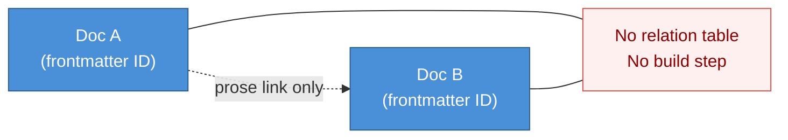
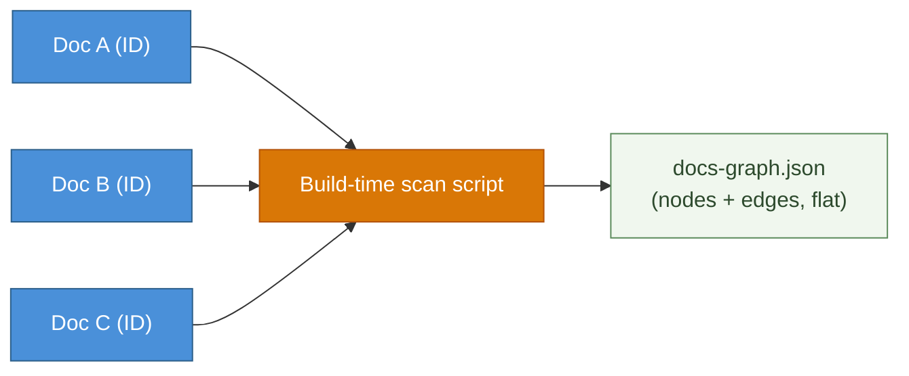
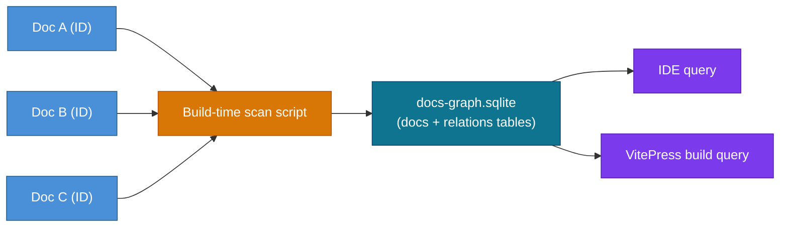
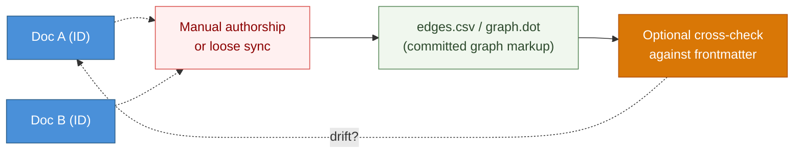
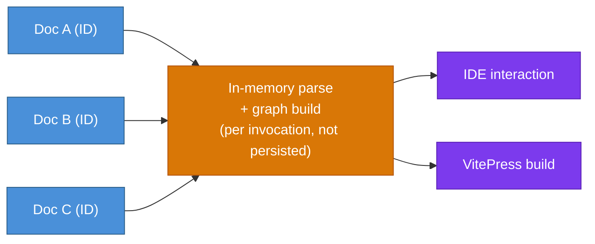

# DESIGN-20261102-Q5MU: Deterministic Docs Knowledge Graph — Research: Graph storage format

_Produced by the 🔍 Research phase. Owned by `@product-architect`. Do not edit after Evaluate phase begins._

## Context

This decision covers only how the deterministic relation table/index — built from frontmatter IDs — is stored. It does not cover graph topology (what relation types exist), infrastructure footprint, visualization, or lifecycle/bootstrap wiring; those are separate decisions in this same multi-decision design. The harness's current footprint is a static VitePress site plus CI — no running service — and `docs/Harness/06 Roadmap/01 Harness Roadmap.md` §5.9 cautions against building indexing capability speculatively, ahead of a measured need.

## Options

### Option A — No structured index; manual links only (do-nothing baseline)

**Description:** Keep the status quo. Frontmatter IDs (EC1) may still be added for stable identity, but no relation table is built or stored anywhere — relationships remain expressed only as prose cross-references / markdown links, same as today.

**Industry precedent:** Plenty of documentation sites (e.g. most wiki-style docs, including VitePress's own default config) rely purely on manual wikilink/relative-path links with no generated relation index — this is the common/default state, not a specific named precedent.

**Diagram:**



**Pros:**

- Zero storage format to design, build, or maintain — literally no new artifact.
- No regeneration step, no staleness risk, no schema to version.
- Fully consistent with Roadmap §5.9's caution against building indexing speculatively.

**Cons:**

- Does not satisfy EC2 ("a deterministic relation table is built between docs") at all — this option effectively declines the design's core requirement rather than meeting it with a lightweight format.
- Leaves the Problem statement's "implicit relationships require full re-reads" unresolved — the measured gap in Frame's rationale stays open.
- No IDE or VitePress representation is possible (EC3/EC4 have nothing to render).

**Unknowns / risks:**

- If chosen, this is really a scope rejection of EC2 rather than a storage-format choice.

---

### Option B — Flat deterministic generated file (JSON/YAML)

**Description:** A build-time script scans frontmatter IDs across doc collections and emits a single generated file (e.g. `docs-graph.json`) — a flat array/object of nodes and edges, regenerated deterministically from source on each run.

**Industry precedent:** Static-site generators' own content graphs (Eleventy's collections, Docusaurus's content-docs plugin) emit flat JSON manifests at build time as their "index." Obsidian's graph plugins also operate off a flat generated adjacency structure rather than a database.

**Diagram:**



**Pros:**

- Human-readable, diffable in PRs, trivially git-friendly (text format).
- No new runtime dependency or binary format — any language/tool can read JSON/YAML.
- Matches the "deterministically regenerable from frontmatter alone" proposed EC directly.
- Easy to consume from both an IDE extension/script and a VitePress build step (both already operate in a Node/JS toolchain).

**Cons:**

- No query language — any non-trivial lookup (e.g. "all docs that implement container X") requires custom traversal code rather than a query.
- At larger scale, a single flat file risks becoming a merge-conflict hotspot if multiple branches regenerate it independently.
- No built-in integrity constraints (e.g. nothing stops two docs from claiming the same ID) — validation must be hand-rolled in the build script.

**Unknowns / risks:**

- Whether the file is committed to git or purely a CI/build artifact affects whether "deterministic" also means "byte-stable across regenerations" (key ordering, etc.) — flagged for Evaluate (also interacts with the infra-footprint decision).

---

### Option C — SQLite file

**Description:** A build-time script scans frontmatter IDs and writes a `.sqlite` file with `docs` and `relations` tables, queried via SQL by any consumer (IDE tooling, VitePress build plugin, a future CLI).

**Industry precedent:** Obsidian's core "Bases" / community graph-indexing plugins and some static-site search tools (e.g. Pagefind) generate a local SQLite index at build time without any server.

**Diagram:**



**Pros:**

- Real query language (SQL) — joins, filters, and graph-adjacent queries (e.g. transitive closure via recursive CTEs) are native, no custom traversal code needed.
- Single-file, no server process — still fits the "no new always-on service" constraint.
- Schema + constraints (foreign keys, uniqueness on doc ID) give structural teeth to graceful-degradation/no-duplicate-ID guarantees.
- Wide tooling support across Node (IDE-side) and CI without extra services.

**Cons:**

- Binary format — not human-diffable in PRs.
- Adds a new file format/dependency (e.g. `better-sqlite3`) to a toolchain that is currently just VitePress/Vite + Node.
- Heavier than the problem may require at current doc-collection scale, risking violating Roadmap §5.9's caution against building indexing capability ahead of measured need.

**Unknowns / risks:**

- Research found no known consumer actually needing SQL query power over simple key-lookup — this was later resolved (V-tier) as "no" during OQ triage, weakening this option's case without fully disqualifying it.

**Sub-options (Node.js/TypeScript implementation choices):**

1. **`better-sqlite3`** (most common, synchronous API) — requires native build tools, but has prebuilt binaries for most platforms so usually no compiler needed. Install: `yarn add better-sqlite3` and `yarn add -D @types/better-sqlite3`. Example usage:
   ```typescript
   import Database from 'better-sqlite3';
   const db = new Database('data.db');
   db.exec('CREATE TABLE IF NOT EXISTS foo (id INTEGER PRIMARY KEY, name TEXT)');
   db.prepare('INSERT INTO foo (name) VALUES (?)').run('bar');
   const rows = db.prepare('SELECT * FROM foo').all();
   ```
2. **`node:sqlite`** (built into Node 22.5+, no dependency at all) — still marked experimental in recent Node versions, so check this repo's Node engine version before relying on it. Example usage:
   ```typescript
   import { DatabaseSync } from 'node:sqlite';
   const db = new DatabaseSync('data.db');
   ```
3. **`sql.js`** (WASM, no native build, runs in-browser too) — only worth considering if the graph needs to be queried in a browser/VitePress client context rather than a Node build script; otherwise it's unnecessary overhead compared to options 1–2.

This sub-options breakdown clarifies Option C is practically implementable without a native-compiler dependency (via `better-sqlite3`'s prebuilt binaries or `node:sqlite`'s zero-dependency approach) — a factor relevant to OQ-5 below ("Should the storage format be required to be usable without any new dependency beyond the existing Node/VitePress toolchain?"); it does not change OQ-5's existing resolution, only a nuance worth weighing.

---

### Option D — In-repo graph markup committed as source (CSV edge list / DOT / GraphML)

**Description:** The relation table is a small, semi-automatically maintained text file in a standard graph interchange format (CSV edge list `from_id,to_id,relation_type`, or Graphviz DOT), committed to the repo and optionally cross-checked against frontmatter at build time.

**Industry precedent:** Graphviz DOT files are a long-standing interchange format for architecture/dependency diagrams; CSV edge lists are a common export format for Gephi/NetworkX.

**Diagram:**



**Pros:**

- Readable, diffable, uses an already-standardized graph format — can be opened directly in existing graph-viz tools (Graphviz, Gephi) with zero custom tooling.
- Low barrier to entry for a first cut.

**Cons:**

- Conflicts with the proposed EC "deterministically regenerable from frontmatter alone, no hidden manual state" if hand-authored.
- Two sources of truth risk (frontmatter vs. a separately committed edge list) unless strictly validated.
- DOT/GraphML carry visualization-oriented baggage (layout hints, styling) that blurs into the separate visualization decision.

**Unknowns / risks:**

- Whether "committed graph markup" can be made strictly derived (CI regenerates, fails build on drift) or inevitably invites manual edits over time.

---

### Option E — No persisted index; derived in-memory at query time

**Description:** No storage artifact written to disk between runs — frontmatter across all docs is parsed fresh every time a consumer needs the graph (IDE extension on open, VitePress plugin at build start, a lifecycle-stage script at context-gathering time), held only in memory for that single operation.

**Industry precedent:** Many "zero-config" static-site tools recompute their link graphs on every build without caching (early Jekyll/Hugo link-checker plugins), commonly replaced by a cache once build time becomes a measured pain point.

**Diagram:**



**Pros:**

- Nothing to keep in sync or regenerate stale — always computed from current frontmatter.
- No new file format or artifact to design, version, or explain to downstream projects — smallest possible footprint, strongly aligned with "minimal or no new operational infrastructure" and Roadmap §5.9's caution.
- No committed-artifact merge-conflict or staleness bug class exists at all.

**Cons:**

- Every consumer must re-implement (or share a library for) the same parse-all-frontmatter-and-build-graph logic.
- No persisted artifact means no stable thing to point the IDE at for instant lookups — likely implies non-trivial in-memory build cost on every IDE interaction.
- Harder to inspect/debug "what does the graph currently say" without running a tool — no file to diff in a PR.

**Unknowns / risks:**

- Unclear whether the latency of a full re-parse at IDE-interaction time is acceptable — an empirical question about doc-collection size.

---

## Open Questions

| #    | Question                                                                                                                                                                                     | Owner                                                  | Resolution / status                                                                                                                                                                                                      |
| ---- | -------------------------------------------------------------------------------------------------------------------------------------------------------------------------------------------- | ------------------------------------------------------ | ------------------------------------------------------------------------------------------------------------------------------------------------------------------------------------------------------------------------ |
| OQ-1 | (E) Does "deterministic" (EC2) require byte-for-byte stable regeneration (fixed key ordering), or only logical equivalence across runs?                                                      | Evaluate                                               | Deferred to Evaluate Step 3                                                                                                                                                                                              |
| OQ-2 | (V) Is SQL-style query capability (joins, transitive closure) actually needed by any known consumer, or does simple key/ID lookup cover all current EC3/EC4/EC5 touchpoints?                 | Research (resolved)                                    | Resolved: no known consumer needs SQL query power — weakens Option C's case without disqualifying it outright                                                                                                            |
| OQ-3 | (E) Will the chosen storage artifact be committed to git, or produced fresh by CI/build each time — does that interact with diffability as a desirable property?                             | Evaluate (interacts with the infra-footprint decision) | Deferred to Evaluate Step 3                                                                                                                                                                                              |
| OQ-4 | (V) At what doc-collection scale does a persisted index stop being optional — what's the measured gap Roadmap §5.9 asks this design to point to?                                             | Research (resolved)                                    | Resolved: the measured gap is the qualitative re-derivation cost already documented in Frame's Problem statement, not doc-tree volume — Option A (no index) is disqualified as it fails EC2 outright regardless of scale |
| OQ-5 | (V) Should the storage format be required to be usable without any new dependency beyond the existing Node/VitePress toolchain, or is adding one library (e.g. a SQLite binding) acceptable? | Research (resolved)                                    | Resolved: yes, avoid new runtime/native dependencies unless Evaluate shows a plain-text format is materially insufficient — disfavors Option C unless proven necessary                                                   |
