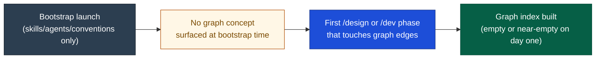
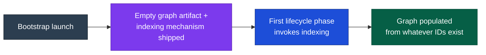
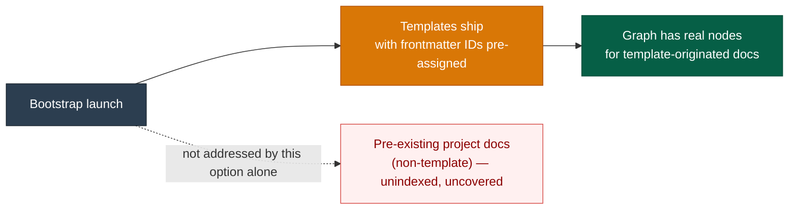
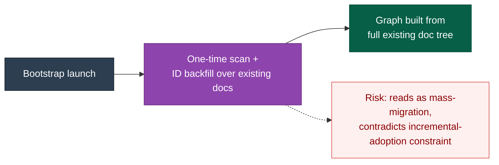

# DESIGN-20261102-Q5MU: Deterministic Docs Knowledge Graph — Research: Harness bootstrap impact

_Produced by the 🔍 Research phase. Owned by `@product-architect`. Do not edit after Evaluate phase begins._

## Context

This decision covers only how graph indexing is seeded/initialized when the harness bootstraps into a new project — not storage format, topology, infrastructure footprint, visualization, or ongoing lifecycle wiring; those are separate decisions in this same multi-decision design. `docs/Harness/index.md` states `docs/Harness/package/` is the self-contained bootstrap package (copy the folder, point an AI assistant at `01 Bootstrap.md`), but it does not exist in this checkout today. `docs/Harness/06 Roadmap/01 Harness Roadmap.md` §1 describes the package evolving from a copied git folder toward `yarn add @artisyn-harness/bootstrap`; §5.9 cautions against speculative indexing. Frame requires graceful degradation and incremental adoption, not mass-migration.

## Options

### Option A — No bootstrap-time step at all (indexing fully deferred to first /design or /dev run)

**Description:** Bootstrap instantiates the harness (skills, agents, conventions) exactly as today, untouched. The graph-indexing script/skill is simply invoked the first time a lifecycle phase that reads/writes graph edges runs in the new project. If no doc yet carries a frontmatter ID, the first index build is just an empty/near-empty graph.

**Industry precedent:** Matches how most static-site generators (plain VitePress/Docusaurus) build their nav/search index — no scaffold-time index step; the first build/dev run derives it from whatever content is present.

**Diagram:**

**Pros:**

- Zero coupling between this decision and the bootstrap-package question that doesn't yet have an answer (no package exists to modify).
- Directly satisfies the Roadmap §5.9 caution against speculative indexing.
- Smallest possible diff to `01 Bootstrap.md`'s behavior.
- Consistent with "minimal or no new operational infrastructure."

**Cons:**

- The new project's first lifecycle run silently does extra work (first-index latency) with no bootstrap-time signal that a graph even exists as a concept.
- A team could run several tickets before ever producing an index if context-gathering/documentation touchpoints are the only trigger and get skipped.

**Unknowns / risks:**

- Depends entirely on the lifecycle-impact decision's answer — if lifecycle phases don't reliably invoke indexing, the graph may never get seeded in a new project at all. Later resolved: the lifecycle-impact decision confirmed Context Gathering's required graph read gives this a reliable early trigger.

---

### Option B — Bootstrap package ships an empty graph + indexing script, run on first use

**Description:** Whatever the bootstrap package becomes, it carries a placeholder empty graph artifact plus the indexing mechanism itself (the script/skill, not its output). `01 Bootstrap.md` instructs the new project that the first index build happens automatically on first invocation — same trigger as Option A — but the mechanism and an explicit empty starting state are bootstrap-delivered.

**Industry precedent:** Nx generators scaffold a workspace with `project.json`/`nx.json` present from the start even though `nx graph` computes the graph lazily on demand — the metadata scaffold ships at init, the computation is deferred.

**Diagram:**

**Pros:**

- Makes the graph's existence discoverable at bootstrap time without requiring bootstrap to do any indexing work itself.
- Still satisfies graceful degradation.
- Robust to the package-folder gap — this is a statement about what the package should contain whenever it's built, not a patch to a folder that exists today.

**Cons:**

- Introduces a bootstrap-time dependency on the storage-format and infra-footprint decisions being settled first, creating sequencing risk.
- "Ships a script" implies the harness-authoring side must maintain and version that script per project type, which butts against Roadmap §5.9's caution if done before demand is measured.

**Unknowns / risks:**

- Whether "indexing script" belongs inside the bootstrap package at all, or is better delivered as a shared skill invoked identically pre- and post-bootstrap — overlaps with the infra-footprint decision's "build-time script vs running service" framing.

---

### Option C — Bootstrap requires the new project's template docs to already carry frontmatter IDs (pre-seeded templates)

**Description:** Any doc templates the bootstrap package provides ship with frontmatter IDs already assigned, so the graph has real, non-empty nodes to index from the moment a new project's first doc exists. `01 Bootstrap.md` would state this as a requirement on template authors, not on the adopting project.

**Industry precedent:** Backstage's create-app / software-catalog pattern — a scaffolded component ships with a catalog-info.yaml carrying a stable metadata.name already filled in, so the catalog has a real entry from day one rather than an empty placeholder.

**Diagram:**

**Pros:**

- Avoids an empty-graph state entirely for template-originated docs.
- Aligns with "doc IDs must be stable identity" — IDs assigned once, at template-authoring time, never need backfilling for those files.

**Cons:**

- Only covers docs that originate from harness-provided templates — does nothing for a new project's existing docs if it's bootstrapping into an already-documented codebase (a real scenario per `docs/Harness/04 Adoption/`).
- Also assumes the bootstrap package ships doc templates, which is not confirmed to be true today.

**Unknowns / risks:**

- Unclear whether `docs/Harness/package/`, when it exists, will include doc templates versus only skills/agents/conventions — this option's premise may not hold. This is left as an open, unresolved item (marked conditional) since it depends on a future decision outside this design's authority.

---

### Option D — Bootstrap runs a one-time backfill/ID-assignment pass over any pre-existing docs

**Description:** At bootstrap time, a one-time pass scans the new project's existing doc tree (if any), assigns frontmatter IDs to docs that lack one, and builds the initial graph from the result — the only option that explicitly handles a project bootstrapping into an already-documented codebase.

**Industry precedent:** Yeoman generators that run a one-time scaffold plus a conflict-resolution pass over existing files; also resembles an Nx migration generator run once at major-version adoption to retrofit existing files with new required fields.

**Diagram:**

**Pros:**

- Produces the most complete initial graph of all options — covers both template-originated and pre-existing docs in one step.

**Cons:**

- Heaviest option — a one-time mass-assignment pass is close to what Frame's Constraints explicitly rule out ("adoption must be incremental, not a one-time mass-migration requirement").
- Requires bootstrap to carry logic (a scan+assign step) well beyond "copy folder, point assistant at a doc."
- Conflicts with Roadmap §1's direction toward a thin, versioned install if the install step now needs write-access mutation logic.

**Unknowns / risks:**

- How IDs would be assigned deterministically without collision across many pre-existing docs in one pass is unspecified.
- Whether "bootstrap" is the right lifecycle moment for a repo-wide mutation at all, given bootstrap's current scope is instantiation, not backfill. Later resolved (V-tier): this option conflicts with Frame's explicit incremental-adoption constraint — disqualified.

---

## Open Questions

| #    | Question                                                                                                                                                                                    | Owner                 | Resolution / status                                                                                                                                                                                                                                                                            |
| ---- | ------------------------------------------------------------------------------------------------------------------------------------------------------------------------------------------- | --------------------- | ---------------------------------------------------------------------------------------------------------------------------------------------------------------------------------------------------------------------------------------------------------------------------------------------- |
| OQ-1 | (V) Is a "bootstrap package" assumed to ship doc templates at all, or only skills/agents/conventions — does Option C's premise even hold once `docs/Harness/package/` exists?               | Research (unresolved) | Cannot be confirmed from within this design — `docs/Harness/package/` doesn't exist in this checkout; Option C is marked **conditional** on a future bootstrap-package content decision, not disqualified                                                                                      |
| OQ-2 | (V) Which lifecycle phase(s) are guaranteed to run early enough to make Options A/B's "first use" trigger reliable — does this depend on the lifecycle-impact decision being settled first? | Research (resolved)   | Resolved: yes, reliable — the lifecycle-impact decision confirmed Context Gathering's required graph read provides the trigger                                                                                                                                                                 |
| OQ-3 | (V) Does "minimal or no new operational infrastructure" rule out a bootstrap-time scan/mutation step (Option D) as itself a form of footprint?                                              | Research (resolved)   | Resolved: independent of the infra framing, Frame's explicit incremental-adoption constraint already disqualifies Option D (reads as mass-migration)                                                                                                                                           |
| OQ-4 | (E) Should this decision be sequenced after the storage-format and infra-footprint decisions are settled, since Options B and D describe bootstrap shipping or invoking that mechanism?     | Evaluate              | Deferred to Evaluate Step 3                                                                                                                                                                                                                                                                    |
| OQ-5 | (V) Is bootstrapping into an already-documented existing codebase (not just greenfield) an in-scope scenario for this design, or deferred?                                                  | Research (resolved)   | Resolved: yes, in-scope — `docs/Harness/04 Adoption/` documents exactly this scenario; however Option D's heavy mass-migration approach to it is already disqualified above, so existing-codebase bootstrapping is left to Options A/B's deferred-indexing path, not a dedicated backfill pass |
