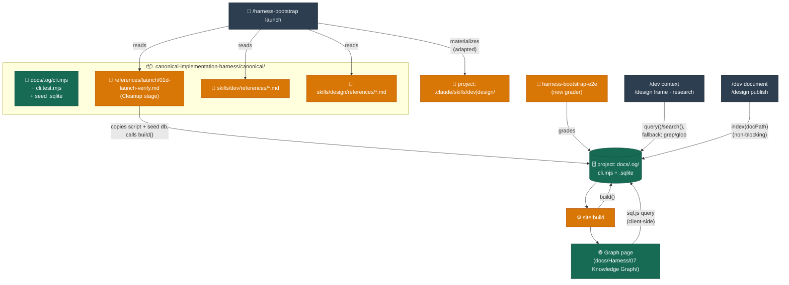

# DESIGN-20261102-Q5MU: Deterministic Docs Knowledge Graph — Plan

| Field   | Value                                                             |
| ------- | ----------------------------------------------------------------- |
| Ticket  | DESIGN-20261102-Q5MU                                              |
| Intent  | [0-intent.md](0-intent.md)                                        |
| Branch  | `feat/dev-20261102-q5mu-deterministic-docs-knowledge-graph`       |
| Created | 2026-11-02 (revised same day — see `0-intent.md`'s appended note) |

<!-- Revision note: this plan was substantially rewritten after the developer
flagged that the first draft scaffolded apps/docs-graph as a repo-local NX project,
missing that this is cross-project harness tooling that must ship from the harness's
real existing packaging root, .canonical-implementation-harness/canonical/ (not the
not-yet-existing docs/Harness/package/ the approved design assumed). See 0-intent.md's
appended note for the full correction. -->

## Solution

The core module ships as portable canonical package content, not a repo-local NX
project: `.canonical-implementation-harness/canonical/docs/.og/cli.mjs` (plus
`cli.test.mjs` alongside it, and a schema-initialized empty seed `.sqlite`),
using only `node:sqlite`'s `DatabaseSync` (Node built-in, zero runtime deps) so it
works in any bootstrapped project regardless of whether that project uses NX, yarn,
or anything else. `/harness-bootstrap launch`'s existing Close stage
(`references/launch/01d-launch-verify.md`) is extended to copy this folder verbatim
(script + seed db, never the test file) into the target project's `docs/.og/` and
call `build()` proactively, silent on success. The dev/design lifecycle wiring
(read-path query with required grep/glob fallback; write-path automatic `index()`)
is authored at its canonical source — `.canonical-implementation-harness/canonical/skills/dev|design/references/*.md`
— and reaches this repo's own live `.claude/skills/` the same way it would reach
any other project: by running `/harness-bootstrap launch`, which this plan's own
validation step (Step 10) exercises directly against this repo. `harness-bootstrap-e2e`
gets a new grader so the og-adoption contract (file lands, test file does not) is
covered by the existing e2e scenario/grading pipeline, not just manual inspection.
Only after that validation run has materialized `docs/.og/cli.mjs` and
`graph.sqlite` into this repo does the `site` NX project (`apps/docs-web`) wire
its build to call `build()` and ship a new graph page — reusing the already
nav-linked `docs/Harness/07 Knowledge Graph/` section. No new container joins
`CLAUDE.md`'s table; this is additive tooling consumed by the existing Web
container's static build and by the harness-bootstrap package itself.

`sql.js` appears twice, for different reasons: as a root-level **devDependency**
(test-only, used by `cli.test.mjs`'s cross-runtime read check) and, separately,
as `apps/docs-web`'s own **runtime** dependency (the browser bundle for the graph
page). Neither is a dependency of the canonical script itself.

One naming reconciliation across the design's two decision files: `solution/Design -
Graph storage format.md` names the relation columns `from_id`/`to_id`;
`solution/Design - Graph structure and topology.md` refers to the same columns as
`source_id`/`target_id`. This plan standardizes on `from_id`/`to_id` (the
schema-of-record) everywhere, including in skill-wiring prose.

At the developer's direction, this plan uses `docs/.og/` ("operational graph") in
place of the approved design's `docs/kb/docs-graph.*` naming — one vocabulary
instead of two, with generically-named files (`cli.mjs`, `constants.mjs`,
`utils.mjs`, `edges.mjs`, `cli.test.mjs`, `graph.sqlite`) mirroring `timing.mjs`'s
own satellite-module convention (Step 2). RF-005 in `2-report.md` flags a
follow-up: the published nav section `docs/Harness/07 Knowledge Graph/` still
reads "Knowledge Graph", not renamed by this ticket.

## Acceptance Criteria

- [ ] `AC-1` — `canonical/docs/.og/cli.mjs` exposes `build()`/`index()`/`reindex()`/`query()`/`search()`; zero new runtime dependencies beyond `node:sqlite` (a Node built-in)
- [ ] `AC-2` — ID assignment is additive-only (inserts only the `id` frontmatter key), idempotent (skips docs that already have one), and collision-checked — proven by a fixture test
- [ ] `AC-3` — the six named graduation edges and the computed `mirrors-consistent`/`mirrors-gap` edge are produced correctly from a fixture doc/HLD/LLD tree, including a known gap and a malformed name (skip + report, not abort)
- [ ] `AC-4` — `sql.js` opens and queries the exact `.sqlite` file `node:sqlite` wrote, with no conversion step
- [ ] `AC-5` — `build()` emits a generated Mermaid artifact (`.mmd`/`.md`) using the tier colors from `solution/Architecture.md`
- [ ] `AC-6` — `cli.test.mjs` lives alongside the script in `canonical/docs/.og/` and is never copied into a bootstrapped project — verified by the new e2e grader
- [ ] `AC-7` — `/harness-bootstrap launch`'s Close stage copies `canonical/docs/.og/*` (excluding the test file) into `project:docs/.og/*` verbatim and calls `build()` proactively, silent on success, non-zero exit plus diagnostic on failure
- [ ] `AC-8` — the canonical `dev`/`design` skill references (`01-context-gathering.md`, `06-document.md`, `03-frame.md`, `04-research.md`, `09-publish.md`) document the `query()`/`index()` wiring: required grep/glob fallback on the read path, non-blocking automatic write on the write path
- [ ] `AC-9` — `harness-bootstrap-e2e` has a registered grader, a scenario step referencing it, and a unit test covering og adoption (file present, test file absent)
- [ ] `AC-10` — running `/harness-bootstrap launch` against this repo (separate session) assigns IDs to existing docs still missing one, materializes `docs/.og/cli.mjs` + `graph.sqlite` here, and the resulting `.claude/skills/dev|design/` substantively contain the query/index wiring
- [ ] `AC-11` — `yarn nx run site:build` produces `docs/.og/graph.sqlite` inside `apps/docs-web/.vitepress/dist` as a static asset
- [ ] `AC-12` — the new VitePress graph page renders a list/table grouped by tier via client-side `sql.js`, falling back to a server-rendered static table if the asset fetch or WASM init fails
- [ ] `AC-13` — `yarn nx run site:build` still passes after the new page is added (NFR-5: no dead internal links)
- [ ] `AC-14` — no second script, storage backend, or new container is introduced; `CLAUDE.md`'s container table is unchanged; this repo's own `apps/` tree gains no new NX project for this ticket
- [ ] `AC-15` — `cli.mjs` is parametrized the same way as `.claude/skills/dev/scripts/timing.mjs`: a CLI entry (`build`/`index`/`reindex`/`query`/`search` subcommands via `parseArgs`) alongside sibling `constants.mjs`/`utils.mjs`/`edges.mjs`, plus named exports for in-process `import` by the VitePress build hook

## Steps

### Step 1 — Tests: canonical docs-graph module

**Changes:**

- `.canonical-implementation-harness/canonical/docs/.og/cli.test.mjs` — new
  cases for `AC-1`–`AC-5`: schema create/insert/uniqueness-violation rejection; ID
  assignment (additive/idempotent/collision-safe, title fallback from the first `# `
  heading stored in the DB only, never written to frontmatter); the six graduation
  edges from a fixture doc tree; `mirrors-consistent`/`mirrors-gap` from fixture
  HLD/LLD pairs (including one gap and one malformed name); a `sql.js` cross-runtime
  read of a `node:sqlite`-produced fixture file; Mermaid artifact emission with tier
  `classDef` colors matching `solution/Architecture.md`; and CLI-surface cases (each
  subcommand below parses its flags and dispatches, per `AC-15`). Framework: Node's
  built-in `node:test`, run directly with `node --test` (no NX project — this content
  must stay runnable in any bootstrapped project, not just this NX workspace)
- `package.json` (repo root) — `sql.js` as a **devDependency**, test-only, used by
  this file's cross-runtime case (see Solution's note on `sql.js`'s two uses)

**Verification:**

> Run: `node --test .canonical-implementation-harness/canonical/docs/.og/cli.test.mjs`
> Expected: suite runs; every new case fails or errors for the expected reason (module not implemented yet)

### Step 2 — Canonical script: module layout, CLI dispatch, SQLite schema + CRUD

Parametrized to mirror `.claude/skills/dev/scripts/timing.mjs`'s own shape (a
self-contained CLI entry, `constants.mjs`, `utils.mjs`, and a satellite module for
one distinct concern), since this script must be as reusable and reviewable as the
harness's own existing CLI tooling — not a one-off ad hoc file.

**Changes:**

- `.canonical-implementation-harness/canonical/docs/.og/constants.mjs` — schema
  table/column names, the six edge-type names, tier `classDef` colors (from
  `solution/Architecture.md`), file names (`graph.sqlite`)
- `.canonical-implementation-harness/canonical/docs/.og/utils.mjs` — generic helpers:
  short collision-safe hashing, additive-only frontmatter read/write, atomic file
  writes — no dependency on another file in this folder, matching `utils.mjs`'s role
  in the `timing.mjs` convention
- `.canonical-implementation-harness/canonical/docs/.og/cli.mjs` — the CLI
  entry (`node:util`'s `parseArgs`, a command-dispatch map at the bottom, same
  pattern as `timing.mjs`'s `dispatchCommand`) **and** the programmatic module:
  named exports `build()`/`index()`/`reindex()`/`query()`/`search()` for in-process
  `import` (used by Step 11's VitePress build hook), plus CLI subcommands
  `build --dir <root>`, `index --dir <root> --doc <path> [--edge <type> --to <path>]`,
  `reindex --dir <root>`, `query --dir <root> --related-to <id|path> [--edge <type>]`,
  `search --dir <root> --term <text>` (used by lifecycle-skill instructions and the
  launch Cleanup-stage hook, which can only shell out, not `import`). `docs` table
  (`id` TEXT PK, `tier`, `path`, `title`, `purpose` nullable, `keywords` nullable,
  `updated_at`) and `relations` table (`from_id`, `to_id`, `edge_type`, `derived`
  0|1, `UNIQUE(from_id, to_id, edge_type)`), via `node:sqlite`'s `DatabaseSync`
- `.canonical-implementation-harness/canonical/docs/.og/graph.sqlite` — the
  schema-initialized empty seed database shipped in the package

**Verification:**

> Run: `node --test .canonical-implementation-harness/canonical/docs/.og/cli.test.mjs`
> Expected: the schema create/insert/uniqueness-rejection cases and the CLI-dispatch cases now pass; everything else still fails for its original reason
> Run: `node .canonical-implementation-harness/canonical/docs/.og/cli.mjs --help` (or an unknown subcommand)
> Expected: a clear usage/error message, confirming the CLI entry itself works end to end, not just the exported functions

### Step 3 — Canonical script: ID generation + frontmatter + index()/reindex()

**Changes:**

- `.canonical-implementation-harness/canonical/docs/.og/utils.mjs` — short hash of
  the doc's initial repo-relative path, uniqueness-checked against already-assigned
  IDs in the run; additive-only frontmatter write (inserts only `id`, never touches
  other keys); `title` derived from the doc's first `# ` heading when absent from
  frontmatter, stored in the DB row only
- `.canonical-implementation-harness/canonical/docs/.og/cli.mjs` — `index()`/
  `reindex()` wiring the above into the `docs` table; skips docs that already have an ID

**Verification:**

> Run: `node --test .canonical-implementation-harness/canonical/docs/.og/cli.test.mjs`
> Expected: ID-assignment cases now pass; edge, cross-runtime and Mermaid cases still fail for their original reason
> Then: make a scratch copy of this repo's real `docs/` tree (e.g. to a temp dir — never
> the live tree) and run `node cli.mjs reindex --dir <scratch-copy>` against it
> Expected: every real doc missing an ID gets one, additively, with no content loss;
> this real-doc corpus (not just the synthetic fixtures) becomes an additional input
> for Step 4's edge-computation testing, since real docs exercise naming/structure
> edge cases a hand-built fixture tree might miss. The live `docs/` tree itself stays
> untouched until Step 10's actual launch run

### Step 4 — Canonical script: edge computation + build()/query()/search()

**Changes:**

- `.canonical-implementation-harness/canonical/docs/.og/edges.mjs` — a satellite
  module (mirroring `quality.mjs`'s role alongside `timing.mjs`: one distinct
  concern, imported by the main file, not inlined into it) computing the six
  authored graduation edges per `docs/Harness/03 Lifecycles/05 Documents Flow.md`'s
  `/dev document` and `/design publish` outputs, written as `derived=0` rows, and
  `mirrors-consistent`/`mirrors-gap` (`derived=1`) by an exact, case-sensitive
  basename diff of `Target Architecture (HLD)/<Version>/Containers/<Name>.md`
  against `System Architecture (LLD)/<Name>/`, per
  `docs/Engineering Guide/Documentation/02 Structure.md`; a malformed name is
  skipped and reported, never aborts the build
- `.canonical-implementation-harness/canonical/docs/.og/cli.mjs` — `build()`
  (transactional: rolls back on partial failure) wiring `edges.mjs` in; `query()`,
  `search()`

**Verification:**

> Run: `node --test .canonical-implementation-harness/canonical/docs/.og/cli.test.mjs`
> Expected: edge and mirror cases now pass (including the gap and the malformed-name skip); cross-runtime and Mermaid cases still fail for their original reason
> Then: re-run `node cli.mjs build --dir <scratch-copy>` against the Step 3
> scratch copy of this repo's real `docs/` tree (already ID'd) and confirm real
> graduation edges and a real `mirrors-consistent`/`mirrors-gap` read come out sane
> (spot-check a few known Story→HLD/LLD pairs) — a live sanity check on top of the
> fixture-based assertions above

### Step 5 — Canonical script: cross-runtime compatibility + generated Mermaid artifact

**Changes:**

- `.canonical-implementation-harness/canonical/docs/.og/cli.mjs` — `build()`
  additionally emits a `.mmd`/`.md` artifact of the full graph, using the tier
  `classDef` colors from `solution/Architecture.md` (HLD `#1D4ED8`, LLD `#0E7490`,
  EngineeringGuide `#065F46`, Story `#D97706`, Product `#7C3AED`, AppReadme `#4B5563`)

**Verification:**

> Run: `node --test .canonical-implementation-harness/canonical/docs/.og/cli.test.mjs`
> Expected: all cases from Step 1 now pass, including the `sql.js` cross-runtime read and the Mermaid artifact case

### Step 6 — Canonical launch wiring: proactive og build at Cleanup

**Changes:**

- `.canonical-implementation-harness/references/launch/01d-launch-verify.md` — add,
  within the existing "## Cleanup" section (stage 13, not "## Close"/stage 14 —
  corrected per the plan architecture re-audit, RF-003 below): copy
  `package:canonical/docs/.og/cli.mjs`, `constants.mjs`, `utils.mjs`,
  `edges.mjs`, and `graph.sqlite` verbatim into `project:docs/.og/` (never
  `cli.test.mjs` — tests are canonical-only tooling, not deployed payload; no
  token substitution, this is code/binary, not prose), then run
  `node cli.mjs build --dir <project root>`; silent on success, non-zero exit
  plus diagnostic on failure. Placed in Cleanup specifically so the new files are in
  scope for Final audit's existing hash/baseline recording ("Answers, per-output
  outcomes and final canonical/rendered baselines are recorded per Patch State after
  cleanup" — `01d-launch-verify.md` Final audit section), which runs immediately
  after Cleanup and before Close. Still additive at the end of the 14-stage
  sequence, never inserted earlier than stage 13

**Verification:**

> Run: `node cli.mjs build --dir <scratch copy>` directly (not yet via the
> full launch run — that is Step 10) against a scratch copy of this repo's current
> doc tree
> Expected: every existing doc missing an ID gets one, additively; a second run is a
> no-op (idempotent) — confirm by diffing frontmatter before/after both runs

### Step 7 — Canonical dev/design wiring: Context/Research read path

**Changes:**

- `.canonical-implementation-harness/canonical/skills/dev/references/01-context-gathering.md`
  — add an instruction to attempt
  `node docs/.og/cli.mjs query --related-to <doc> --dir .` (or `search
--term <text>`) against `docs/.og/graph.sqlite` before the existing
  grep/glob pattern, with a required (not best-effort) fallback to grep/glob when
  the graph is missing, stale, or the call errors; never blocks the stage
- `.canonical-implementation-harness/canonical/skills/design/references/03-frame.md`,
  `.canonical-implementation-harness/canonical/skills/design/references/04-research.md`
  — the same instruction for their own context-gathering steps

**Verification:**

> Trace the documented path by hand against each edited file: confirm the fallback
> instruction is unconditional and the CLI subcommands referenced (`query`,
> `search`) match the surface built in Step 2

### Step 8 — Canonical dev/design wiring: Document/Publish write path

**Changes:**

- `.canonical-implementation-harness/canonical/skills/dev/references/06-document.md`
  — add an instruction to call
  `node docs/.og/cli.mjs index --dir . --doc <path> --edge <type> --to <path>`
  automatically when a doc graduates, non-blocking on failure (report and continue)
- `.canonical-implementation-harness/canonical/skills/design/references/09-publish.md`
  — the same instruction for its own publish step

**Verification:**

> Run `node cli.mjs index --dir <scratch> --doc <fixture path> --edge
<type> --to <path>` directly against a sample fixture doc, confirm an ID and the
> matching graduation edge are written; run it against an unwritable target path and
> confirm it returns a diagnostic rather than throwing uncaught, matching the
> "non-blocking" instruction text in both edited files

### Step 9 — harness-bootstrap-e2e: og-adoption grader

**Changes:**

- `apps/harness-bootstrap-e2e/src/graders/docs-adoption.grader.ts` — new
  `gradeDocsGraphAdopted(root)`: `project:docs/.og/cli.mjs`, `constants.mjs`,
  `utils.mjs`, `edges.mjs`, and `graph.sqlite` all exist;
  `project:docs/.og/cli.test.mjs` does **not** exist (tests stay
  canonical-only)
- `apps/harness-bootstrap-e2e/src/graders/_registry.ts` — register the new grader
- `apps/harness-bootstrap-e2e/src/scenarios/bootstrap.ts` — register it in
  `bootstrapScenario.graders` (the scenario-level array, alongside
  `docsIndexExists()`/`containerAgentsDeployed()`), not the `launch` step's own
  `graders` list (which gates only on `agentRunSucceeded()` — corrected per the plan
  architecture re-audit, RF-004 below)
- `apps/harness-bootstrap-e2e/src/tests/unit/graders/docs-adoption.grader.spec.ts`
  — new unit cases for `gradeDocsGraphAdopted`

**Verification:**

> Run: `yarn nx run harness-bootstrap-e2e:unit`
> Expected: new grader cases pass; existing docs-adoption cases unaffected

### Step 10 — Validate: run `/harness-bootstrap launch` against this repo

**Changes:** none — validation only, per the developer's direction and
`solution/Efforts.md` step 11's original intent (relocated to the corrected
packaging root).

**Verification:**

> In a **separate session**, the developer runs `/harness-bootstrap launch` against
> this repo
> Expected: every existing doc still missing an ID gets one assigned;
> `docs/.og/cli.mjs` and `graph.sqlite` materialize at the project root;
> `.claude/skills/dev/references/01-context-gathering.md`/`06-document.md` and
> `.claude/skills/design/references/03-frame.md`/`04-research.md`/`09-publish.md`
> substantively contain the query/index wiring (grep for `query()`/`index(docPath)`
> and the fallback language — not a byte-diff against canonical, since launch's
> install stage adapts content)
> Run: `yarn nx run harness-bootstrap-e2e:unit`
> Expected: the Step 9 grader passes against this repo's own now-materialized state

### Step 11 — Web (site project): build wiring

**Changes:**

- `scripts/ci/site-build.sh` — call `docs/.og/cli.mjs`'s `build()` before
  `vitepress build`, so `docs/.og/graph.sqlite` lands inside
  `apps/docs-web/.vitepress/dist` as a fetchable static asset (the file already
  exists in this repo's tree after Step 10 — no new project dependency to declare)

**Verification:**

> Run: `yarn nx run site:build`
> Expected: build succeeds; `apps/docs-web/.vitepress/dist` contains the `.sqlite` asset
> Run: `yarn nx run site:typecheck` and `yarn nx run site:lint`
> Expected: both still pass

### Step 12 — Web (site project): graph page

**Changes:**

- `docs/Harness/07 Knowledge Graph/04 Graph Explorer.md` — new page under the
  section already linked from `config.ts`'s nav (`Knowledge Graph` →
  `/Harness/07%20Knowledge%20Graph/`), auto-picked up by `scanSection`'s sidebar
  scan — no `config.ts` nav edit needed
- `apps/docs-web/.vitepress/theme/GraphExplorer.vue` (registered in
  `apps/docs-web/.vitepress/theme/index.ts`, following the existing
  `GiscusComments.vue` pattern) — fetches the `.sqlite` asset, queries it
  client-side via `sql.js`, renders a list/table grouped by tier using the tier
  colors from Step 5; on asset-fetch or WASM-init failure, renders a
  server-rendered static table from the same build-time query results instead
- `apps/docs-web/package.json` — `sql.js` as a **runtime** dependency (browser-side;
  the root devDependency from Step 1 is test-only and unrelated)

**Verification:**

> Run: `yarn nx run site:serve`, open the new page
> Expected: a table renders, grouped by tier
> Then: block the `.sqlite` request in devtools (or temporarily rename the built
> asset) and reload
> Expected: the fallback static table renders instead of a blank or broken page
> Run: `yarn nx run site:build`
> Expected: still passes — NFR-5 (`docs/Target Architecture (HLD)/v1/Non-Functional Concerns/Requirements.md`): no dead internal links introduced

Run required verification before dependent steps; request human verification only
when needed (Step 10 is inherently the developer's own run, in a separate session).

## Addendum (post-approval, authorized by the developer during Implement — see RF-020/RF-021)

### Step 13 — Standalone `reindex-graph` route in `harness-bootstrap` (revised per RF-022)

**Changes:**

- `.canonical-implementation-harness/SKILL.md` — new route `reindex-graph`,
  frontmatter description, Input line
- `.canonical-implementation-harness/canonical/docs/.og/docs.mjs` — `DocsStore.missing(fields)`,
  a pure query (no writes) for docs lacking `purpose`/`keywords`
- `.canonical-implementation-harness/canonical/docs/.og/cli.mjs` — new `list` export +
  CLI subcommand wrapping it; `renderMermaid()` rewritten from a `flowchart` to a
  tier-rooted `mindmap` (edges aren't drawn — `mindmap` is a tree, not a graph)
- `.canonical-implementation-harness/references/reindex-graph.md` — new reference, two
  steps: (1) deterministic build (`node docs/.og/cli.mjs build`, report real
  `skipped`/`pruned`); (2) intelligent scan — `list --missing purpose,keywords`, then
  the agent reads each returned doc and writes `purpose:`/`keywords:` per
  Documentation Principles, never fabricating graduation edges (pre-existing docs
  have no stored Story/ticket provenance to recover)
- `.canonical-implementation-harness/references/launch/01d-launch-graph-verify.md` —
  Materialize stage now delegates to this reference: first install runs both steps,
  a refresh runs Step 1 only
- `.canonical-implementation-harness/references/00-overview.md` — new table row
- `apps/harness-bootstrap-e2e/src/scenarios/reindex-graph.ts` — new scenario,
  separate from `bootstrapScenario`: seeds a workspace with the operational-graph
  package already materialized (simulating launch's own Materialize stage, done
  deterministically in test setup) and one doc with no ID/purpose/keywords, runs
  `/harness-bootstrap reindex-graph` as a real agent step, verifies the doc got an
  ID, the db was rebuilt, and `purpose:`/`keywords:` were actually written
- `apps/harness-bootstrap-e2e/src/cases/reindex-graph.spec.ts` +
  `cases/_registry.ts`/`scenarios/_registry.ts` — register the new scenario/case

**Verification:**

> Run: `node --test .canonical-implementation-harness/canonical/docs/.og/cli.test.mjs`
> Expected: all cases pass, including `list()`'s missing-field query/validation and
> the mindmap's tier-branch/quote-escaping cases
> Run: `yarn nx run harness-bootstrap-e2e:unit`
> Expected: new scenario typechecks/lints; existing cases unaffected
> Run the new scenario's case (live agent, guarded — the developer runs it)
> Expected: the agent runs both `reindex-graph.md` steps; the seeded doc gets an ID
> _and_ `purpose:`/`keywords:` frontmatter; `docs-operational-graph.sqlite`'s bytes
> change; no copy step runs (only the build+scan, since the precondition files
> already exist)

### Step 14 — Apply the collapsible-sidebars patch bundle (developer-authorized, unrelated prior work)

**Changes:** none authored here — applies an already-prepared external bundle:
`/Users/anton/projects/collinson/ADLC workshops/.patch/0027-2026-10-30-docs-web-collapsible-sidebars`.
Its manifest lists: updates to `apps/docs-web/.vitepress/config.ts`, `theme/Layout.vue`,
`theme/custom.css`; new `theme/SidebarToggles.vue`, `theme/SidebarFocusToggle.vue`,
`theme/useSidebarCollapse.ts`. No new dependencies per the bundle's own manifest.

Two of those three "updated" files were also touched by Steps 11/12 in this same
session (`config.ts` gained a `buildEnd` hook; `Layout.vue` gained the
`GraphExplorer` slot injection) — merge by hand per the bundle's own "Apply
notes", never a blind overwrite.

**Verification:**

> Run: `yarn nx run site:typecheck` and `yarn nx run site:lint`
> Expected: both pass after the merge
> Run: `yarn nx run site:build`
> Expected: succeeds; Step 11's `buildEnd` graph-db copy and Step 12's
> `GraphExplorer` injection both still work (re-check the rendered HTML)
> Run: `yarn nx run site:serve`, open any doc page
> Expected: both edge-tab handles and the focus-mode toggle render and collapse/restore their panels

### Step 15 — Interactive node-link graph view (Cytoscape.js)

**Changes:** `03 Visualization Model.md`'s own data-access pattern calls for
"render graph from query results" → "interactive graph" — Step 12's table
satisfies the file list but not that intent; it never queries or draws the
`edges` table at all. Adds a real node-link rendering using
[Cytoscape.js](https://js.cytoscape.org/#notation/graph-model):

- `apps/docs-web/package.json` — `cytoscape` as a runtime dependency
- `apps/docs-web/.vitepress/theme/graphExplorer.data.ts` — extend the build-time
  query to also select every row from `edges` (currently `docs` only)
- `apps/docs-web/.vitepress/theme/GraphExplorer.vue` — extend the live sql.js
  query the same way; render a Cytoscape canvas above the existing table (not a
  replacement — the table stays as the always-available, dependency-light
  fallback), nodes colored by tier (`TIER_COLORS`), one visual style per
  `edge_type` (dashed for `derived=1`, solid for authored); same
  fetch/WASM-failure fallback behavior as the table (skip the canvas, keep the
  table) rather than a blank canvas

**Verification:**

> Run: `yarn nx run site:typecheck` and `yarn nx run site:lint`
> Expected: both pass
> Run: `yarn nx run site:build`
> Expected: succeeds; `site:serve`, open the Graph Explorer page
> Expected: an interactive graph renders above the table — pan/zoom work, nodes are colored by tier, edges are visible
> Then: block the `.sqlite` request in devtools and reload
> Expected: the canvas doesn't render (no error), the static table still does

### Step 16 — Package and release this ticket's canonical changes

Deliberately last (per developer instruction) — everything else in the ticket,
including Steps 14/15's unrelated app-level additions, lands before this runs, so
the released package reflects the ticket's final state in one pass.

**Changes:** none — this step runs existing `harness-bootstrap` operations against
the canonical edits Steps 1–13 made directly (no story-side files; Steps 14/15 are
`apps/docs-web`-only and touch no canonical source).

**Verification (all developer-run, guarded — same pattern as Step 10):**

> In a separate session, the developer runs, in order:
>
> 1. `/harness-bootstrap patch prepare` — bundles this ticket's direct canonical
>    edits (the operational-graph package, launch/skill wiring, `reindex-graph`,
>    Documentation Principles) into a portable bundle
> 2. `/harness-bootstrap patch apply` — personalizes the bundle into this repo's
>    own permanent files, reconciling with the already-run `/harness-bootstrap
launch` from Step 10
> 3. `yarn release:harness-bootstrap` — cuts the versioned ZIP other projects'
>    `/harness-bootstrap launch` installs from (`releases/harness-bootstrap/`,
>    per `CLAUDE.md`'s Why)
>    Expected: `patch prepare` produces one bundle covering exactly this ticket's
>    canonical diff; `patch apply` reports no conflicts against the Step 10 launch
>    state; the release script produces a new versioned archive

Run required verification before dependent steps; request human verification only
when needed (Steps 10 and 16 are inherently the developer's own runs, in a
separate session).
