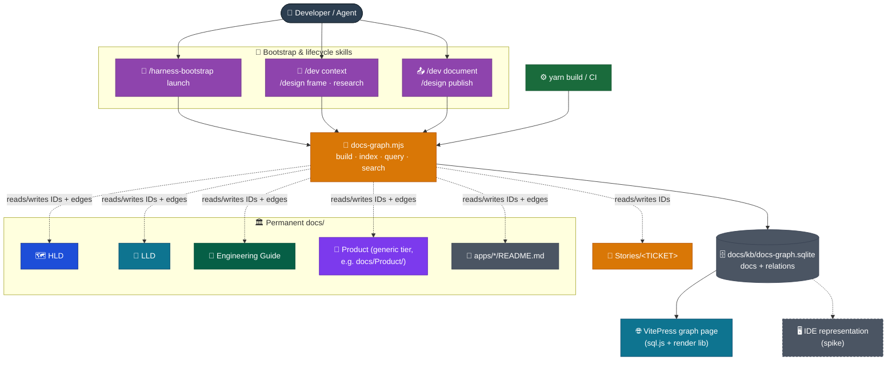
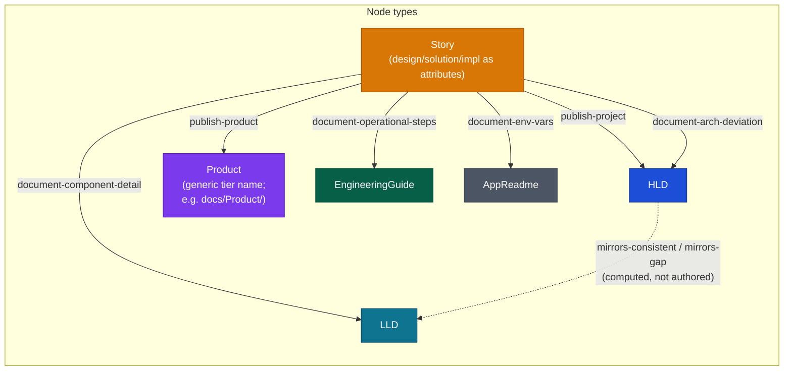
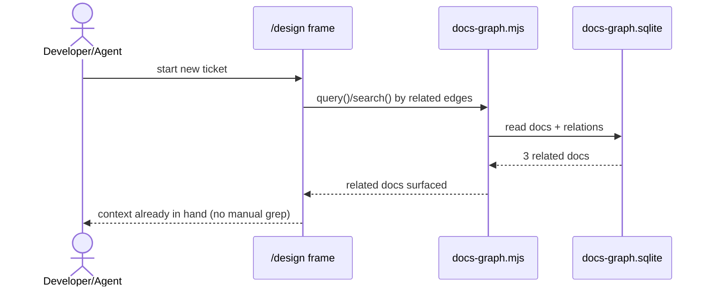
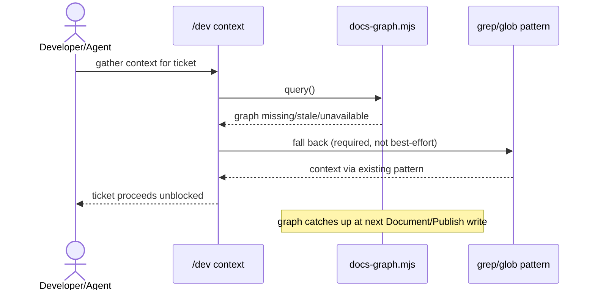
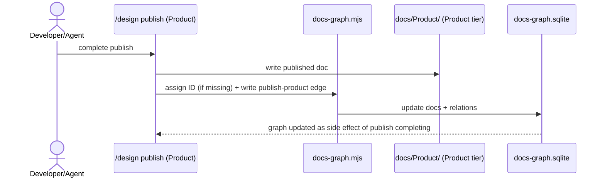

# DESIGN-20261102-Q5MU: Deterministic Docs Knowledge Graph — Architecture

A deterministic knowledge graph over the repo's doc tiers (HLD, LLD, Engineering
Guide, Stories, Product), built from a unique frontmatter ID per doc and a
relation table derived from the six named graduation actions already defined in
`docs/Harness/03 Lifecycles/05 Documents Flow.md`. One script, one SQLite file,
no new always-on infrastructure.

## System context

No new container joins `CLAUDE.md`'s Architecture table (Web / Auth /
Infrastructure / Discuss). `docs-graph.mjs` and `docs/kb/docs-graph.sqlite` are
additive tooling: a repo-root script plus one file consumed by the existing Web
container's build (`apps/docs-web/`). Data flow stays Browser → CloudFront → S3
static build; the graph page ships as part of that same static output.

## Responsibility distribution

| Component                                                     | Responsibility                                                                                                                                                                         | Owner                                                                                               |
| ------------------------------------------------------------- | -------------------------------------------------------------------------------------------------------------------------------------------------------------------------------------- | --------------------------------------------------------------------------------------------------- |
| `docs-graph.mjs`                                              | Single Node.js ES module (zero new npm deps). Exposes `build()`, `index()`/`reindex()`, `query()`, `search()`. Every consumer below calls this one script — there is no second script. | This repo (harness canonical source); ships inside `docs/Harness/package/` once that package exists |
| `docs/kb/docs-graph.sqlite`                                   | Relation store: `docs` table (ID, tier, path, unique ID constraint) and `relations` table (typed edges between doc IDs, foreign-key constrained)                                       | Produced and consumed only by `docs-graph.mjs`, via `node:sqlite` (`DatabaseSync`)                  |
| Frontmatter ID assignment                                     | Deterministic, collision-safe, additive-only (inserts one frontmatter field, never touches other content), idempotent (skips docs that already have an ID)                             | `docs-graph.mjs`, invoked at bootstrap and at each graduation write                                 |
| Lifecycle skills (`/dev context`, `/design frame`/`research`) | Query the graph for related docs by edge; fall back to grep/glob if the graph is empty, stale, or the script is unavailable                                                            | Skill authors, additive to existing context-resolution pattern                                      |
| Lifecycle skills (`/dev document`, `/design publish`)         | Invoke `docs-graph.mjs` automatically to assign an ID (if missing) and write the corresponding graduation edge as part of completing                                                   | Skill authors; tool-automated, not a manual authoring step                                          |
| `apps/docs-web/` build                                        | Runs `docs-graph.mjs`'s `build()` as part of `yarn build`/CI; serves the published graph page, which queries `docs-graph.sqlite` client-side via `sql.js`                              | Web container                                                                                       |
| IDE representation                                            | Same shared `.sqlite` source; rendering mechanism carried forward as a spike ticket in `solution/Efforts.md`                                                                           | Deferred — not invented here                                                                        |

## Node and edge model

The six solid edges are the named graduation actions from Documents Flow, each a
Story-to-destination-tier edge. The seventh edge, `mirrors-consistent` /
`mirrors-gap`, is computed at build time by diffing
`Target Architecture (HLD)/<Version>/Containers/<Name>.md` file names against
`System Architecture (LLD)/<Name>/` folder names — a direct implementation of the
naming convention already enforced in
`docs/Engineering Guide/Documentation/02 Structure.md`. HLD version supersession
is not modeled as a graph edge — the folder-per-version/README-router convention
already covers it. A Story's `design/`, `solution/`, `impl/` subfolders are
attributes of its single `Story` node, not separate sub-nodes.

## Decision register

| #   | Decision              | Chosen outcome                                                                                                                                               | Scope / ownership                                                                                                                                                                        | Affected interfaces                                                                                      | Failure / recovery                                                                                                                                                                                                                                                                                                    | Verification                                                                                                        |
| --- | --------------------- | ------------------------------------------------------------------------------------------------------------------------------------------------------------ | ---------------------------------------------------------------------------------------------------------------------------------------------------------------------------------------- | -------------------------------------------------------------------------------------------------------- | --------------------------------------------------------------------------------------------------------------------------------------------------------------------------------------------------------------------------------------------------------------------------------------------------------------------- | ------------------------------------------------------------------------------------------------------------------- |
| 1   | Storage format        | SQLite via `node:sqlite` (Node built-in, zero new deps)                                                                                                      | `docs-graph.mjs` owns reads/writes; file at `docs/kb/docs-graph.sqlite`                                                                                                                  | `node:sqlite`'s `DatabaseSync` API                                                                       | Experimental-API risk scoped to this one script; fallback is flat JSON if the API proves insufficient                                                                                                                                                                                                                 | CI smoke test exercising schema ops (create, insert, uniqueness-violation rejection)                                |
| 2   | Structure / topology  | Tier-typed nodes + lifecycle-action edges + a derived mirror edge                                                                                            | `docs-graph.mjs`'s build step owns both the frontmatter parse and the HLD↔LLD folder-name diff                                                                                           | Documents Flow's six named graduation actions; Structure.md's HLD-container/LLD-folder naming convention | A missing/renamed LLD folder surfaces as a `mirrors-gap` edge, consumable by `/where-we-are`                                                                                                                                                                                                                          | Test fixture of known HLD/LLD container pairs (including edge-case naming) validated against the mirror-match logic |
| 3   | Infra footprint       | Single reusable script, invoked by both the VitePress build and agent/CLI on demand                                                                          | `docs-graph.mjs`, versioned alongside this repo's own skills                                                                                                                             | VitePress build pipeline; agent/CLI invocation surface                                                   | Transient process execution only — no standing service to fail; build failure is a visible CI signal                                                                                                                                                                                                                  | CI build step passes/fails visibly; agent invocation independently testable against a fixture doc tree              |
| 4   | Visualization surface | Both surfaces (IDE + VitePress), one shared `.sqlite` source; VitePress queries it client-side via `sql.js`                                                  | VitePress graph page under `apps/docs-web/`; IDE mechanism deferred to a spike                                                                                                           | `sql.js` WASM runtime; a to-be-chosen graph-rendering library                                            | IDE-side rendering mechanism and VitePress graph-library choice are implementation obligations, not invented here                                                                                                                                                                                                     | Doc-tree sizing spike before committing to a specific rendering library/mechanism                                   |
| 5   | Lifecycle impact      | Read required (Context/Research); write required but tool-automated (Document/Publish)                                                                       | `docs-graph.mjs` invoked automatically inside existing phase prompts — no new command surface                                                                                            | `/dev context`, `/design frame`/`research`, `/dev document`, `/design publish`                           | Required-read fallback contract and automated-write failure/retry behavior are implementation obligations (spikes)                                                                                                                                                                                                    | Fallback and failure-mode behavior verified once specified                                                          |
| 6   | Bootstrap impact      | Script ships in the bootstrap package, runs proactively at launch, auto-assigns IDs + builds the initial graph, silently on success (no confirmation prompt) | Harness maintainers own script versioning across bootstrap-package releases; the specific ownership assignment is tracked as a spike ticket in `solution/Efforts.md`, not left open here | `/harness-bootstrap launch`, `docs/Harness/package/` (once it exists)                                    | Idempotent, additive-only ID assignment (skip-if-present) avoids collision/retry risk; on failure the script exits non-zero and prints a diagnostic, consistent with Decision 3's principle that failures stay visible rather than silent; deterministic ID generation scheme is an implementation obligation (spike) | Fixture-based test of the ID generation scheme across a representative existing doc tree                            |

## Representative flows

### Normal flow — context gathering uses the graph

### Failure / recovery flow — graph missing or stale

### Graduation flow — publish writes an edge as a side effect

## Plugging into the existing system

No HLD/LLD/NFR document requires an update yet. This design's own Publish phase
routes its content to `docs/Harness/07 Knowledge Graph` (Product track) — this is
cross-project harness tooling, not this repo's own application architecture. No
change to `CLAUDE.md`'s container table or to the Browser → CloudFront → S3 data
flow: the graph page is part of the same static build output already produced by
the Web container.

## Considered Options

A full options analysis is in `design/02 Evaluate - {Decision}.md` (one file per decision: Graph storage format, Graph structure and topology, Representation infra footprint, Visualization surface, Harness lifecycle impact, Harness bootstrap impact). In summary: six independent decisions were each researched (3-5 options) and evaluated against Frame's evaluation criteria and the AWS Well-Architected Framework; the architecture above reflects the recommended option for each, confirmed by the developer.
