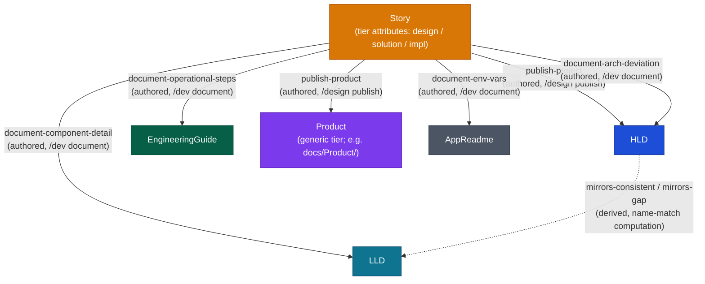
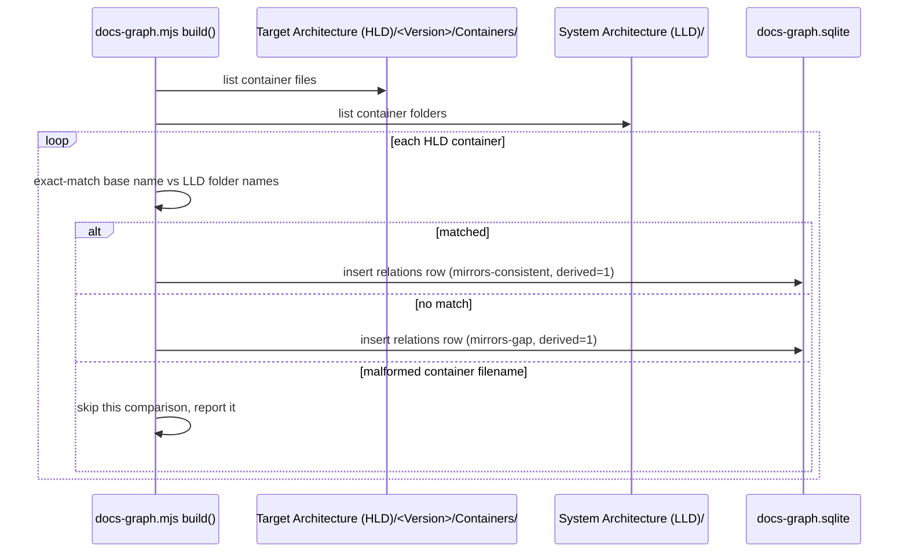

# DESIGN-20261102-Q5MU: Deterministic Docs Knowledge Graph — Design: Graph structure and topology

Six node types, seven edge types: six authored graduation edges written automatically
by lifecycle skills, plus one derived mirror edge computed from HLD/LLD naming — no
edge in this graph is ever hand-authored by a developer.

## Node and edge computation

Solid edges are authored as a side effect of a lifecycle skill completing. The
dashed edge is derived: it is recomputed from file/folder names and never written
by a skill or a developer.

## Node identification

Each node's identity is its doc's frontmatter ID (schema in
`solution/Design - Graph storage format.md`). A node's `tier` attribute is one of
the six types: HLD, LLD, EngineeringGuide, Story, Product, AppReadme. A `Story`
node additionally carries `design`/`solution`/`impl` as attributes of that single
node — Stories are transient working folders, not a permanent tier, and do not
split into per-subfolder nodes.

## Authored edge computation

Trigger: `/dev document` or `/design publish` completing (trigger mechanics in
`solution/Design - Harness lifecycle impact.md`). Processing: the completing skill
assigns a frontmatter ID to the destination doc if it doesn't have one, then writes
one row to `relations` with `edge_type` set to the matching named value
(`publish-product`, `publish-project`, `document-arch-deviation`,
`document-component-detail`, `document-operational-steps`, `document-env-vars`),
`source_id` the Story node, `target_id` the destination doc, `derived = 0`. No
other write path produces these six edge types.

## Derived edge computation — `mirrors-consistent` / `mirrors-gap`

No frontmatter ID and no lifecycle trigger are required. Processing, run at build
time:

1. List every `Target Architecture (HLD)/<Version>/Containers/<Name>.md` file.
2. List every `System Architecture (LLD)/<Name>/` folder.
3. For each HLD container, check whether a same-named LLD folder exists.
4. Compare the HLD file's base name (minus `.md`) to the LLD folder name with an
   exact, case-sensitive string match — no normalization is applied in this
   version.
5. Emit a `relations` row with `edge_type = mirrors-consistent` on match,
   `edge_type = mirrors-gap` on no match, `derived = 1`.

## Consumer contract

`/where-we-are` reads `mirrors-gap` rows directly from the graph instead of
re-walking the HLD/LLD folder trees itself. This is the integration point this
design settles; `/where-we-are`'s own implementation change is out of scope here.

## Failure / recovery path

If one HLD container filename is malformed and the comparison errors, that single
comparison is skipped and reported. The build does not fail as a whole — consistent
with the graceful-degradation posture in `solution/Architecture.md`.

## Compatibility rule

The `edge_type` vocabulary is closed to the seven named values for this version.
Adding a new edge type is an additive schema change (a new allowed value in the
`edge_type` column) and is never a breaking change to existing rows.

## Out of scope for this version

HLD version supersession is not modeled as a graph edge — the existing
folder-per-version/README-router convention already covers it. Section-level or
sub-document node granularity is not implemented; node granularity is doc-level
only.

## Migration / rollout

None. This is new capability over existing data, not a change to it. The mirror
edge computation reads only file and folder names, not frontmatter, so it runs
against the existing HLD/LLD folder trees immediately with no migration step.

## Verification

A test fixture of known HLD/LLD container pairs, including at least one legitimate
mismatch case, validates the mirror-match logic before `/where-we-are` is allowed
to consume `mirrors-gap` rows.
