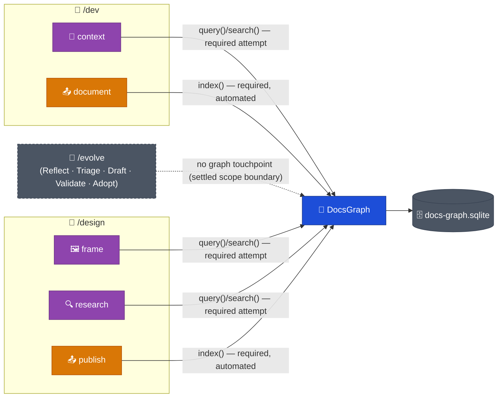

# DESIGN-20261102-Q5MU: Deterministic Docs Knowledge Graph — Design: Harness lifecycle impact

Context Gathering/Research gain a required `DocsGraph.query()`/`.search()` attempt
that falls back to the existing grep/glob pattern on miss; Document/Publish gain a
required but tool-automated `DocsGraph.index()` call that writes a graduation edge
as a side effect of phase completion. Neither pair gains new command surface or a
new developer-facing gate.

## Touchpoints across the lifecycle



## Read path — Context Gathering / Research

**Trigger**: `/dev context`, `/design frame`, `/design research` start as today —
reading the ticket and resolving context sources.

**Processing**: the phase adds one required step — call `DocsGraph.query()`/
`.search()` for docs related by graph edge to the ticket's subject matter. This is
additive to the existing manual glob/grep pattern, never a replacement for it.

**Output**: on a non-empty result, the surfaced related docs join the phase's
context set alongside grep/glob results.

**Failure/recovery**: if the graph file is missing, stale, or the call errors, the
phase falls back to the existing grep/glob pattern as its sole context source and
proceeds. This is not a blocking failure — the graph query is a required _attempt_,
not a required _result_. The exact staleness-detection mechanism (e.g. a max-age
check against the SQLite file's modification time) is an `Efforts.md` spike.

## Write path — Document / Publish

**Trigger**: `/dev document`, `/design publish` complete their existing work —
writing LLD/Engineering Guide content, or publishing to the Product tier
(e.g. `docs/Product/`) or `Target Architecture (HLD)/` per the resolved track.

**Processing**: as part of phase completion, the phase calls
`DocsGraph.index(docPath)` for the doc(s) it just touched. This call assigns a
frontmatter ID to the doc if it doesn't have one yet, and writes the corresponding
graduation edge into `relations` — one of the six named types from
`docs/Harness/03 Lifecycles/05 Documents Flow.md`, selected by which phase/track
just ran: `publish-product`, `publish-project`, `document-arch-deviation`,
`document-component-detail`, `document-operational-steps`, `document-env-vars`.

**Output**: `docs-graph.sqlite` gains new/updated `docs` and `relations` rows as a
side effect of Document/Publish completing — no new state owned by the lifecycle
skills themselves; `DocsGraph` owns all persistence (schema in
`solution/Design - Graph storage format.md`).

**Failure/recovery**: if `index()` fails (non-zero exit + diagnostic, per
`solution/Architecture.md`'s Decision 6 reconciliation), the phase's own completion
is not blocked — the doc content is already written; only the graph-indexing
side-effect failed. The failure is reported to the developer/agent as a warning,
and the doc remains eligible for the next `index()`/`reindex()` pass to pick it up.
Exact retry/backoff behavior beyond "report and don't block" is an `Efforts.md`
spike.

## Sequence — both flows

```mermaid
sequenceDiagram
    actor Dev as Developer/Agent
    participant Read as Context Gathering / Research
    participant Write as Document / Publish
    participant Module as DocsGraph
    participant Fallback as grep/glob pattern
    participant DB as docs-graph.sqlite

    Dev->>Read: start phase
    Read->>Module: query()/search()
    alt graph present and fresh
        Module->>DB: read docs + relations
        DB-->>Module: related docs
        Module-->>Read: results
    else missing, stale, or error
        Module-->>Read: no results
        Read->>Fallback: fall back (required, not best-effort)
        Fallback-->>Read: context via existing pattern
    end
    Read-->>Dev: phase proceeds unblocked

    Dev->>Write: complete doc work
    Write->>Module: index(docPath)
    alt write succeeds
        Module->>DB: assign ID (if missing) + write graduation edge
        DB-->>Module: commit
        Module-->>Write: success
    else write fails
        Module-->>Write: non-zero exit + diagnostic
        Note over Write: warning reported; phase completion not blocked
        Note over DB: doc stays eligible for next index()/reindex() pass
    end
    Write-->>Dev: phase completes
```

## Changed interfaces

`/dev context`, `/design frame`, `/design research`, `/dev document`,
`/design publish` each gain one new internal step — a `DocsGraph` method call. No
change to these commands' external invocation syntax or developer-facing approval
gates. No new command surface is introduced (confirms `solution/Architecture.md`'s
decision not to add a dedicated `/dev index` step).

## Track-specific behavior

The six graduation edges already encode track routing: `publish-product` fires for
Product-track `/design publish`, `publish-project` for Project-track. No separate
Product-vs-Project branching logic is needed beyond selecting the correct edge type
per the resolved track, already determined by Context Gathering's existing
track-resolution pattern.

## Scope boundary

`/evolve`'s Reflect, Triage, Draft, Validate, and Adopt phases do not gain a graph
touchpoint in this version. Its graduated docs (skills, agents, conventions) are
not indexed by this design. This is a settled scope boundary for this version, not
an open question.

## Compatibility rule

The required-read step degrading to existing grep/glob behavior makes this change
backward-compatible with any ticket or session where the graph is entirely absent
— e.g. a project that hasn't bootstrapped this capability yet. Phases behave
exactly as they do today in that case.

## Implementation boundary

The max-age/staleness check used to decide when a present graph file counts as
"stale" and the retry/backoff behavior for a failed `index()` beyond "report and
don't block" are both `Efforts.md` spikes, not settled here.

## Verification

Fallback behavior (missing/stale graph) is tested by running Context Gathering
against a fixture with no `docs-graph.sqlite` present and confirming it proceeds
via grep/glob with no error surfaced to the developer. Automated-write behavior is
tested by running `/dev document`/`/design publish` against a fixture doc and
confirming the correct edge type and ID assignment land in the database, and that
a simulated `index()` failure doesn't block phase completion.
