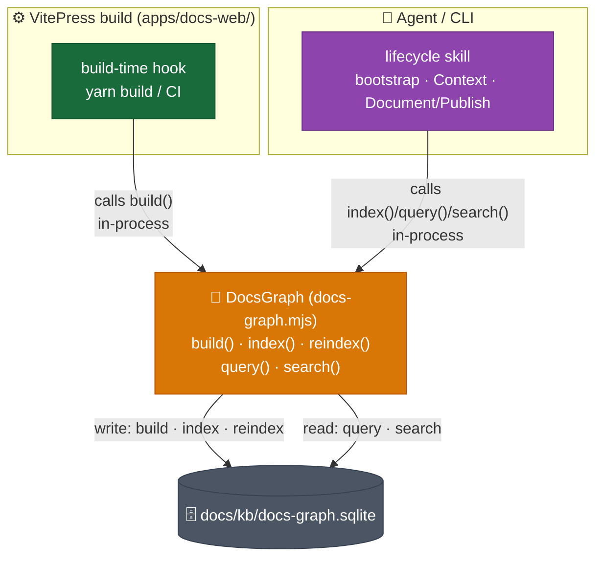
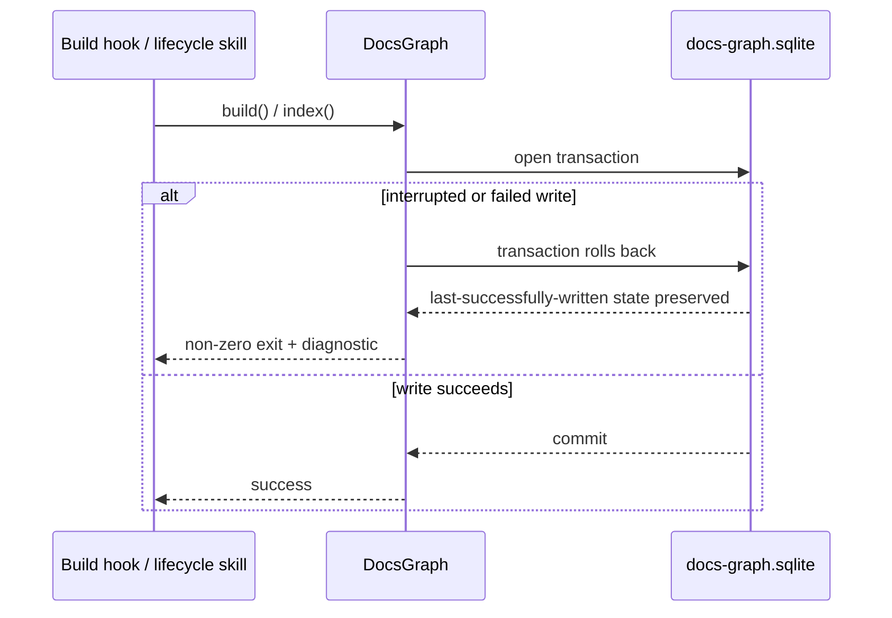

# DESIGN-20261102-Q5MU: Deterministic Docs Knowledge Graph — Design: Representation / infra footprint

One module, `docs-graph.mjs`, exposes four methods — `build()`, `index()`/`reindex()`,
`query()`, `search()` — called in-process by two invocation contexts, the VitePress
build and any lifecycle skill or CLI. No subprocess, no IPC boundary, no second
script, no new infra tier.

## Module and invocation contexts



Both invocation paths call the identical module — this is Option B from
`design/02 Evaluate - Representation infra footprint.md` with a richer
implementation shape, not a sixth infra tier.

## Module interface

```typescript
class DocsGraph {
  constructor(dbPath: string); // path to docs/kb/docs-graph.sqlite
  build(): Promise<BuildResult>; // full scan + rebuild from doc tree
  index(docPath: string): Promise<void>; // index/update a single doc (lifecycle write hooks)
  reindex(): Promise<BuildResult>; // alias for build() when called post-bootstrap
  query(opts: QueryOptions): Promise<DocNode[]>; // by tier, edge type, related-to-ID
  search(term: string): Promise<DocNode[]>; // free-text over indexed titles/paths
}
```

Exact parameter/return shapes are an `Efforts.md` implementation detail — the
shape above is the settled contract surface, not final TypeScript.

## Invocation contexts

1. **VitePress build** (`apps/docs-web/`): a build-time hook calls `build()` once
   per `yarn build`/CI run, synchronous with the existing static-site build. No
   separate deploy step.
2. **Agent/CLI, on demand**: any lifecycle skill — bootstrap, Context Gathering,
   Document/Publish (see `solution/Design - Harness lifecycle impact.md` and
   `solution/Design - Harness bootstrap impact.md`) — imports the same module and
   calls `index()`/`query()`/`search()` directly, in-process.

## State changes

`build()`, `index()`, and `reindex()` are the only write paths. They mutate
`docs/kb/docs-graph.sqlite` (schema in `solution/Design - Graph storage format.md`).
`query()` and `search()` are read-only.

## Failure / recovery



`build()`/`index()` calls are idempotent and safe to re-run. A failed or
interrupted run leaves the database in its last-successfully-written state, via
`node:sqlite` transaction semantics — never a half-written row. A failure during
a required-write call (Document/Publish) surfaces a non-zero exit and a
diagnostic; how the calling phase handles that is defined in
`solution/Design - Harness lifecycle impact.md`.

## Compatibility rule

The four public methods — `build`, `index`/`reindex`, `query`, `search` — are a
stable contract. This repo's own lifecycle skills and any future
downstream-bootstrapped project's tooling both depend on this exact surface.
Internal implementation (SQL statements, file layout) may change freely; method
names and signatures do not change without a deliberate versioning decision.

## Implementation boundary

This design does not fix where `docs-graph.mjs` physically lives in the repo
(e.g. `scripts/`, `.harness/`, or elsewhere) — that is an `Efforts.md`
implementation decision. It also does not specify CI build-time cost mitigation
(incremental/cached scanning); that is flagged as an `Efforts.md` spike if
build-time scan cost proves material.

## Verification

The module is independently testable against a fixture doc tree, no live
bootstrap required. Unit tests cover `build()` producing a valid schema,
`index()` updating a single doc idempotently, and `query()`/`search()` returning
expected results against known fixture data.
