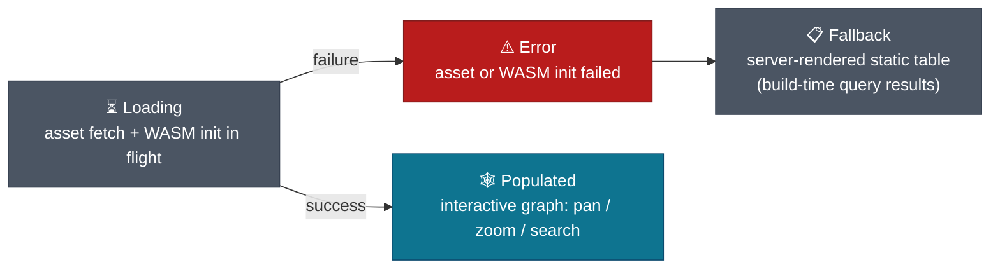

# DESIGN-20261102-Q5MU: Deterministic Docs Knowledge Graph — Design: Visualization surface

A VitePress page under `apps/docs-web/` fetches `docs-graph.sqlite` as a static
asset and queries it client-side with `sql.js` — no new endpoint, no JSON export,
no transform between the Node-side build and the browser-side read. The IDE-side
rendering mechanism and the VitePress graph-rendering library are both
implementation obligations tracked in `solution/Efforts.md`, not settled here.

## Page load sequence

```mermaid
sequenceDiagram
    actor Browser as Browser
    participant Page as VitePress graph page
    participant Asset as docs-graph.sqlite (static asset)
    participant SqlJs as sql.js (WASM runtime)
    participant Lib as Graph-rendering library (spike)

    Browser->>Page: navigate to graph page
    Page->>Page: render loading/empty state
    Page->>Asset: fetch docs-graph.sqlite
    alt asset fetch succeeds
        Asset-->>Page: file bytes
        Page->>SqlJs: init WASM runtime
        alt WASM init succeeds
            SqlJs-->>Page: runtime ready
            Page->>SqlJs: open file in-memory, run read-only query
            SqlJs-->>Page: docs + relations rows
            Page->>Lib: pass nodes + edges
            Lib-->>Browser: interactive graph (pan/zoom/search)
        else WASM init fails
            SqlJs-->>Page: init error
            Page->>Page: render server-rendered static table fallback
            Page-->>Browser: plain-table rendering (build-time query results)
        end
    else asset fetch fails
        Asset-->>Page: fetch error
        Page->>Page: render server-rendered static table fallback
        Page-->>Browser: plain-table rendering (build-time query results)
    end

    classDef browser fill:#2C3E50,stroke:#1A252F,color:#fff
    classDef page    fill:#0E7490,stroke:#0c4a6e,color:#fff
    classDef asset   fill:#4B5563,stroke:#374151,color:#fff
    classDef sqljs   fill:#D97706,stroke:#B45309,color:#fff
    classDef lib     fill:#4B5563,stroke:#374151,color:#fff,stroke-dasharray: 4 3

    class Browser browser
    class Page page
    class Asset asset
    class SqlJs sqljs
    class Lib lib
```

## Processing

1. **Trigger** — a VitePress page component (new, under `apps/docs-web/`) requests
   graph data on page load.
2. **Fetch** — the component fetches `docs-graph.sqlite` as a static asset, served
   alongside the built site at the same origin. No new endpoint.
3. **Init** — the component initializes `sql.js`'s WASM runtime in the browser.
4. **Query** — `sql.js` opens the fetched file in-memory and runs read-only SQL
   queries against the same `docs`/`relations` schema defined in
   `solution/Design - Graph storage format.md`. No separate JSON export, no
   transform step between the Node-side `build()` and this browser-side read.
5. **Render** — query results (nodes + edges) pass to a graph-rendering library
   for visual layout. Library choice is a spike (`solution/Efforts.md`); pan,
   zoom and search are expected of that library and not specified further here.

## Failure / recovery

If the `.sqlite` asset fails to fetch, or `sql.js`'s WASM runtime fails to
initialize (for example, browser incompatibility), the page falls back to a
static message plus a plain-table rendering of the same data, server-rendered at
build time by reusing the same query results VitePress's build step already
computes. The graph is never a hard dependency for the page to render something
useful.

## UI states



The populated state colors nodes by tier, reusing the exact classDef palette
already established for Mermaid diagrams in this repo (`solution/Architecture.md`'s
node and edge model, matching `docs/Harness/03 Lifecycles/05 Documents Flow.md`'s
house style):

| Tier             | Color                                                  |
| ---------------- | ------------------------------------------------------ |
| HLD              | `#1D4ED8` (blue)                                       |
| LLD              | `#0E7490` (teal)                                       |
| EngineeringGuide | `#065F46` (green)                                      |
| Story / Product  | `#D97706` (Story, amber) / `#7C3AED` (Product, purple) |
| AppReadme        | `#4B5563` (grey)                                       |

## IDE-side surface (deferred)

The IDE representation shares the same `.sqlite` file as its data source. The
rendering mechanism — for example a generated Mermaid artifact opened via editor
preview, versus some other approach — is an implementation obligation tracked as
a spike in `solution/Efforts.md`. This design does not specify a mechanism.

## Compatibility rule

The VitePress page's data-access layer depends only on the stable `docs`/
`relations` schema and the `(from_id, to_id, edge_type)` composite-uniqueness
contract defined in `solution/Design - Graph storage format.md`'s compatibility
rule. Additive schema changes (nullable columns with defaults) do not break this
page. A breaking schema change would.

## Implementation boundaries

Not specified in this Design.md, each tracked as an Efforts.md implementation
obligation:

- The exact graph-rendering library.
- The page's URL and navigation placement within `apps/docs-web/`.
- The IDE-side rendering mechanism.

## Verification

A doc-tree sizing spike (`solution/Efforts.md`) runs before committing to a
graph-rendering library, confirming the library's performance characteristics
match the actual and projected node count. A browser-compatibility smoke test
confirms `sql.js` loads and queries correctly across the same browser matrix
this repo's VitePress site already supports.
