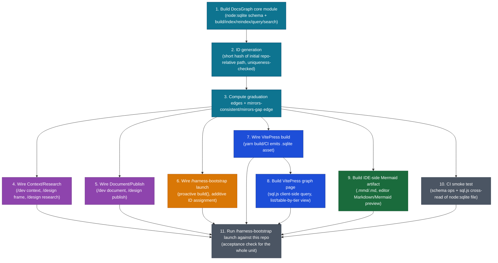

# DESIGN-20261102-Q5MU: Deterministic Docs Knowledge Graph — Efforts

## WBS — single unit

| #   | Summary                                                                                                                                                                                                                                                    | Type | Layer                                                                               | Depends on |
| --- | ---------------------------------------------------------------------------------------------------------------------------------------------------------------------------------------------------------------------------------------------------------- | ---- | ----------------------------------------------------------------------------------- | ---------- |
| 1   | Implement the Deterministic Docs Knowledge Graph in this repo (canonical harness), end to end, then validate by running `/harness-bootstrap launch` against this repo to confirm the proactive index/ID-assignment and lifecycle wiring behave as designed | feat | Harness tooling (repo-wide: core module + lifecycle wiring + VitePress + bootstrap) | —          |

This is one ticket, implemented in one session. The steps below are its ordered
build sequence, not separate tickets. Previously-deferred spikes are resolved
pragmatically inline during the run, then checked against reality in step 11 —
not researched ahead of time.

## Build sequence

1. Build the `DocsGraph` core module: `node:sqlite`-backed `docs`/`relations` schema
   (per `solution/Design - Graph storage format.md`, including the `title`/`purpose`
   columns and frontmatter format), with `build()`/`index()`/`reindex()`/`query()`/
   `search()` methods.
2. Implement ID generation: a short hash of the doc's initial repo-relative path,
   checked for uniqueness against already-assigned IDs in the same run.
3. Compute the six named graduation edges (from
   `docs/Engineering Guide/Lifecycles/05 Documents Flow.md`) and the derived
   `mirrors-consistent`/`mirrors-gap` edge (from
   `docs/Engineering Guide/Documentation/02 Structure.md`'s HLD-container/LLD-folder
   naming convention).
4. Wire Context Gathering/Research (`/dev context`, `/design frame`,
   `/design research`) to query the graph, with fallback to existing grep/glob when
   the graph is missing, stale, or unavailable.
5. Wire Document/Publish (`/dev document`, `/design publish`) to call `index()` on
   the graduating doc: assign an ID if missing, write the corresponding graduation
   edge. Non-blocking on failure — report and continue.
6. Wire `/harness-bootstrap launch` to call `build()` proactively: assign IDs to
   any existing doc missing one (additive-only, idempotent), build the initial
   graph. Silent on success; non-zero exit plus diagnostic on failure.
7. Wire the VitePress build (`apps/docs-web/`) to call `build()` as part of
   `yarn build`/CI, producing the static `.sqlite` asset.
8. Build a minimal VitePress graph page: fetch the `.sqlite` asset, query it
   client-side via `sql.js`, render as a list/table grouped by tier.
9. Build a minimal IDE-side representation: a generated Mermaid artifact
   (`.mmd`/`.md`) emitted by the same `build()` call, openable via existing editor
   Markdown/Mermaid preview.
10. Add a CI smoke test: schema creation/insert/uniqueness-rejection, and a check
    that `sql.js` can open and query the same file `node:sqlite` produced, with no
    conversion step.
11. Run `/harness-bootstrap launch` against this repo to validate the whole flow
    end to end: confirm existing docs without IDs get one assigned, the initial
    graph builds, and the VitePress/IDE representations reflect it. This step is
    the acceptance check for the whole unit.

## Effort Estimate

| #   | Description                                    | Estimate |
| --- | ---------------------------------------------- | -------- |
| 1   | Full implementation + bootstrap validation run | 3h       |
