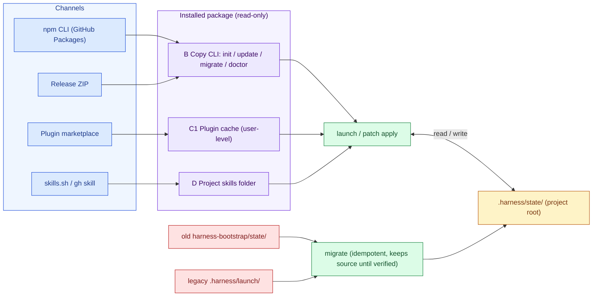

# DESIGN-20261115-CO1T: Harness Distribution and Release Channels — Evaluate: Install and Update

_Produced by the Evaluate phase. Decision 3 of 4 — options from `01 Research - Install and Update.md`._

**Inputs:** Frame EC1–EC12. Research options A–E (C split into C1 and C2). Step 1b answers: D3-3 no consumer harvest (the consumer package may be read-only, so eject is not needed), D3-13 `package:` may be a user-level cache path, D3-6 harmless, D2-2 npm only on GitHub Packages. Options are combinable.

## Requirements × Options Matrix

✅ satisfies · ⚠️ partially (see note) · ❌ does not satisfy

| Requirement                                                                   | A Manual unzip | B Copy CLI                                             | C1 Plugin cache                      | C2 npm dependency                             | D skills.sh / gh skill                                                                | E Launcher                                                  |
| ----------------------------------------------------------------------------- | -------------- | ------------------------------------------------------ | ------------------------------------ | --------------------------------------------- | ------------------------------------------------------------------------------------- | ----------------------------------------------------------- |
| R1 EC2: npm package with a CLI that places the skill and says "run launch"    | ❌             | ✅                                                     | ❌                                   | ⚠️ `sync` bin, but a dependency, not a placer | ❌                                                                                    | ⚠️ only if the launcher is the npm CLI (then it contains B) |
| R2 EC5: defined install and update mechanism                                  | ⚠️ guide only  | ✅ `init` / `update`                                   | ✅ `plugin install` / `update`       | ✅ dependency bump + `sync`                   | ✅ `skills add` / `update`, `gh skill install` / `update`                             | ✅                                                          |
| R3 EC8: anonymous path                                                        | ✅             | ⚠️ npm needs a token; the ZIP-bundled CLI is anonymous | ✅ public marketplace                | ❌ GitHub Packages token                      | ✅ skills.sh; gh needs login                                                          | ✅                                                          |
| R4 EC9: automated migration of `package:state/` and legacy `.harness/launch/` | ❌ manual      | ✅ `migrate`                                           | ✅ first run (launch / apply)        | ✅ `sync`                                     | ⚠️ first launch / apply only                                                          | ✅                                                          |
| R5 EC12: state in `.harness/`, package replaceable                            | ✅             | ✅                                                     | ✅                                   | ✅                                            | ✅                                                                                    | ✅                                                          |
| R6 D3-3: read-only consumer package acceptable                                | ✅             | ✅                                                     | ✅ no eject needed                   | ✅ no eject needed                            | ✅                                                                                    | ✅                                                          |
| R7 One shared package across providers                                        | ⚠️ manual      | ✅                                                     | ⚠️ cache per host, so version skew   | ✅                                            | ✅ skills.sh symlink mode keeps one `.agents/skills` store; gh skill copies per agent | ✅                                                          |
| R8 Determinism (same version, same files)                                     | ✅             | ✅                                                     | ⚠️ hosts may load different versions | ✅ lockfile                                   | ✅ lockfile / pin                                                                     | ✅                                                          |
| R9 Non-Node consumers (Python, .NET, docs-only)                               | ✅             | ⚠️ needs Node (launch scripts may need Node anyway)    | ✅                                   | ❌ needs `package.json`                       | ⚠️ Node ≥ 22.20 / gh                                                                  | ⚠️                                                          |
| R10 Effort to build and test                                                  | ✅ guide       | ⚠️ new CLI + E2E fixtures                              | ✅ host-native                       | ⚠️ `sync` + Yarn PnP edge cases               | ✅ none                                                                               | ❌ launcher + package, two versioned things                 |

## Tradeoffs

| Option                 | Operational Excellence               | Security                                             | Reliability                                      | Performance Efficiency | Cost Optimization  | Sustainability | Integration Complexity                                            | Vendor Lock-in                  |
| ---------------------- | ------------------------------------ | ---------------------------------------------------- | ------------------------------------------------ | ---------------------- | ------------------ | -------------- | ----------------------------------------------------------------- | ------------------------------- |
| A Manual unzip         | ❌ all manual                        | ⚠️ checksum by hand                                  | ⚠️ Windows nested extract                        | ✅                     | ✅                 | ✅             | ✅                                                                | ✅                              |
| B Copy CLI             | ✅ one cross-platform path, `doctor` | ✅ verifies checksum before swap                     | ✅ idempotent, hash-checked                      | ✅                     | ⚠️ CLI maintenance | ✅             | ⚠️ new artifact                                                   | ✅                              |
| C1 Plugin cache        | ✅ host-native, opt-in auto-update   | ✅                                                   | ⚠️ per-host skew; `package:` changes per version | ✅                     | ✅                 | ✅             | ⚠️ project-root resolution outside the project (Codex unverified) | ⚠️ host plugin systems          |
| C2 npm dependency      | ✅ Renovate / Dependabot             | ⚠️ token in CI and on dev machines                   | ✅ lockfile                                      | ✅                     | ✅                 | ✅             | ⚠️ Yarn PnP                                                       | ⚠️ Node ecosystem only          |
| D skills.sh / gh skill | ✅ no own code                       | ✅ lockfile hash                                     | ✅ state safe (EC12)                             | ✅                     | ✅                 | ✅             | ✅                                                                | ⚠️ third-party CLIs, gh preview |
| E Launcher             | ⚠️ two versioned artifacts           | ⚠️ launcher runs scripts that write into the project | ✅                                               | ✅                     | ❌ most code       | ⚠️             | ❌                                                                | ✅                              |

## Recommendation

**Recommended: Option B as the primary installer, with C1 (plugin cache) and D (skills.sh / gh skill) accepted as channel-native paths — all sharing one state contract.** A stays the documented offline fallback. C2 and E are not adopted.

The contract every path follows:

1. The installed package is read-only and replaceable. Only this source repo harvests and prepares (D3-3). Package docs state this.
2. State lives in the project at `.harness/state/`. The name is neutral and rename-proof; it avoids `evolve/`, `reflections/` and the legacy `launch/`. The existing tree is unchanged: `launch/{answers.json, runs/, reports/}`, `registry.md`, `index.json`, `objects/`, `operations/`, `patch/` (old `project-patch/`, `APPLIED.md`). Path aliases: `state/` = `.harness/state/`, `project-patch/` = `.harness/state/patch/`. The state root is resolved from the project root, never from the package location.
3. `package:` is recorded as path + name + version + channel. It may be project-relative (B, A, D) or a user-level plugin cache (C1). Every operation records the package version it used, so skew is visible.
4. Update = refresh the package by its channel, then `patch apply`. Bases come from `.harness/state/objects/`.
5. Migration (EC9) moves `*/skills/harness-bootstrap/state/` and legacy `.harness/launch/` into `.harness/state/` with provenance. It is idempotent. The source is kept until verified, and a marker is left behind. B's `migrate` runs it, and so does the first launch or apply on any channel (C1, D, A) when it detects old state.

- **B, the CLI** ships inside the GitHub Packages npm package and the Release ZIP:
  - `init` detects providers from `.claude/`, `.agents/`, `.github/` or flags. It places one package in the first selected provider skills folder (B1). Copilot reads `.claude/skills` and `.agents/skills`, so no symlinks are needed. It prints "run `/artisyn-implementation-harness launch`".
  - `update` verifies the checksum, stages, swaps the whole package and prints "run `patch apply`". Same version is a no-op. Downgrade needs `--force`.
  - `migrate` runs the contract migration.
  - `doctor` reports package location and version per provider, skew and state root health.
  - Consumers need no local-edit guard (D3-3), which keeps B small.
- **Why:** EC2 demands a placing CLI in the npm package, so B is required for the npm channel. EC3 and EC4 bring their own native installers. Under EC12 + D3-3 those are now safe: state is outside the package and nothing writable can be lost. Forcing them through a launcher (E) adds a second versioned artifact for no gain. C1's per-host skew is managed, not prevented: `doctor` and per-operation version records make it visible, and determinism holds per version.
- **Disqualified:** A alone (fails EC2, EC5, EC9). C2 needs `package.json` and a GitHub Packages token for every consumer, so it fails EC8. E is the most code, and its main benefit, a writable harvest target everywhere, is no longer needed after D3-3.
- **Falsifiable:** if consumer harvest is later required, revisit with E or a B-only policy. If per-host skew causes real failures, require B (single project package) for multi-provider projects.

## Open questions

Open before implementation. Proposals are not decisions.

| #    | Question                                                                                                                                                                                                                | Owner                          | Impact if unresolved                                    |
| ---- | ----------------------------------------------------------------------------------------------------------------------------------------------------------------------------------------------------------------------- | ------------------------------ | ------------------------------------------------------- |
| OQ-1 | `.harness/state/` in consumer projects: commit, ignore or split (D3-11)? Proposed: commit `index.json`, `registry.md`, `launch/answers.json`, `patch/APPLIED.md`; ignore `objects/`, `launch/runs/`, `launch/reports/`. | Developer + @product-architect | Teammates' `patch apply` lacks history; merge conflicts |
| OQ-2 | Does this repo move its own tracked `state/` to `.harness/state/` (D3-15)? Proposed: yes, otherwise state ships in the marketplace plugin source.                                                                       | Developer                      | EC10 leak via the marketplace (D2)                      |
| OQ-3 | Migration precedence when both `package:state/` and `.harness/launch/` exist (D3-12)                                                                                                                                    | @product-architect             | Duplicate or conflicting records                        |
| OQ-4 | Project-root resolution for C1 on Codex and Copilot (a `${CLAUDE_PROJECT_DIR}` equivalent)                                                                                                                              | @architect spike               | C1 on Codex / Copilot                                   |
| OQ-5 | Is the package removable after launch (D3-2)? Proposed: yes for consumers now.                                                                                                                                          | Developer                      | Docs contradiction persists                             |
| OQ-6 | Does launch already require Node (D3-9)?                                                                                                                                                                                | @architect                     | Weight of B's Node dependency                           |

## Closing WAF Assessment — Option B with C1 / D native paths

| Pillar                 | Rating | Strengths                                                                       | Gaps                                                                        | Recommendations                                                                                                                                 |
| ---------------------- | ------ | ------------------------------------------------------------------------------- | --------------------------------------------------------------------------- | ----------------------------------------------------------------------------------------------------------------------------------------------- |
| Operational Excellence | 🟢     | One contract; `doctor`; idempotent update and migrate                           | Three install paths to document and test                                    | P2: one consumer guide with a per-channel table; E2E covers B `init` / `update` / `migrate`                                                     |
| Security               | 🟢     | Checksum verify before swap; no writable package; no tokens for anonymous paths | GitHub Packages token handling on consumer machines                         | P2: guide uses a read-only `read:packages` token, never committed                                                                               |
| Reliability            | 🟡     | State survives every update (EC12)                                              | Migration of existing state is one-shot and lossy if wrong; C1 version skew | **P1:** migration is idempotent, keeps the source until verified, and is covered by an E2E test from a 3.5.0 install. P2: `doctor` skew warning |
| Performance Efficiency | 🟢     | Small CLI, no daemon                                                            | —                                                                           | —                                                                                                                                               |
| Cost Optimization      | 🟢     | Reuses native installers                                                        | CLI maintenance                                                             | —                                                                                                                                               |
| Sustainability         | 🟢     | One package per project (B, skills.sh symlink mode)                             | C1 caches per host                                                          | P3                                                                                                                                              |

**P1:** idempotent, verified state migration with E2E coverage from a pre-EC12 (3.5.0) install.
