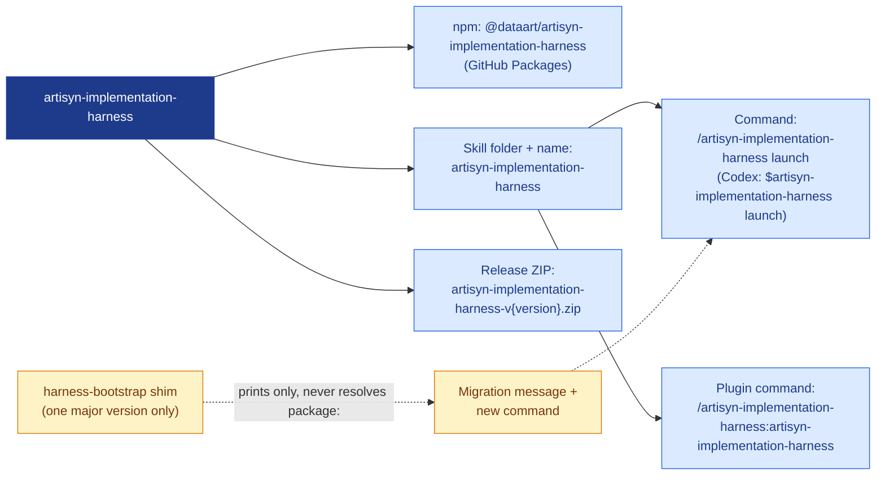

# DESIGN-20261115-CO1T: Harness Distribution and Release Channels — Evaluate: Package Identity

_Produced by the Evaluate phase. This is the judgment artifact for one decision._

Decision 1 of 4 — options from `01 Research - Package Identity.md`.

**Inputs:** Frame EC1–EC12. Research options A–E. Step 1b answer D1-1: the literal full name is used for both skill and command, so C and D are ruled out (shown as ❌ on R1).

## Requirements × Options Matrix

Option B meets every requirement fully or with a one-off cost; only B and E pass R1.
✅ satisfies · ⚠️ partially (see note) · ❌ does not satisfy

| Requirement                                                                                    | A — Brand outer layer                                               | B — Full name everywhere                                                                          | C — Brand package + short skill       | D — Split namespace                 | E — Full name + alias skills          |
| ---------------------------------------------------------------------------------------------- | ------------------------------------------------------------------- | ------------------------------------------------------------------------------------------------- | ------------------------------------- | ----------------------------------- | ------------------------------------- |
| R1: EC1 literal name for package, skill and command (D1-1)                                     | ❌ skill stays `harness-bootstrap`                                  | ✅                                                                                                | ❌ ruled out at Step 1b (short skill) | ❌ ruled out at Step 1b (`harness`) | ✅                                    |
| R2: EC9 old invocation aliased, or a clear migration message                                   | ✅ nothing changes                                                  | ⚠️ needs a shim or message                                                                        | ⚠️ needs a shim                       | ⚠️ needs a shim                     | ✅ legacy alias built in              |
| R3: Agent Skills spec, name = folder (source repo discoverable by skills.sh / `gh skill`, EC4) | ❌ source folder stays invalid                                      | ✅ source renamed                                                                                 | ✅                                    | ✅                                  | ✅                                    |
| R4: One command across channels (marketplace, skills.sh, npm CLI, ZIP)                         | ⚠️ plugin shows `/artisyn-implementation-harness:harness-bootstrap` | ⚠️ plugin form repeats the name: `/artisyn-implementation-harness:artisyn-implementation-harness` | ⚠️                                    | ❌ differs per channel              | ⚠️ as B, plus alias names             |
| R5: Typing ergonomics                                                                          | ✅                                                                  | ⚠️ 30 characters; autocomplete helps                                                              | ✅                                    | ✅                                  | ✅ short alias available              |
| R6: Discovery noise / description tokens                                                       | ✅ one skill                                                        | ✅ one skill                                                                                      | ✅                                    | ✅                                  | ❌ 2–3 skills per provider, permanent |
| R7: Blast radius (≈84 files, E2E fixtures, symlinks)                                           | ✅ none                                                             | ⚠️ full rename, one-off                                                                           | ⚠️                                    | ⚠️                                  | ⚠️ as B, plus alias folders           |
| R8: Legacy maintenance over time                                                               | ✅                                                                  | ✅ shim removed at a stated major                                                                 | ✅                                    | ✅                                  | ❌ aliases permanent unless end-dated |
| R9: EC12 neutrality, state folder unaffected by the name                                       | ✅                                                                  | ✅ if the `.harness/` subfolder is neutral (D3)                                                   | ✅                                    | ✅                                  | ✅                                    |

## Tradeoffs

B carries only one-off costs; E carries recurring ones.

| Option                                              | Operational Excellence       | Security                                                    | Reliability                                   | Performance Efficiency                   | Cost Optimization        | Sustainability        | Integration Complexity    | Vendor Lock-in                |
| --------------------------------------------------- | ---------------------------- | ----------------------------------------------------------- | --------------------------------------------- | ---------------------------------------- | ------------------------ | --------------------- | ------------------------- | ----------------------------- |
| A — Brand outer layer (fails EC1)                   | ⚠️ two names confuse support | ✅                                                          | ✅                                            | ✅                                       | ✅                       | ✅                    | ✅                        | ✅                            |
| B — Full name everywhere                            | ✅ one name to document      | ✅                                                          | ⚠️ one-off migration of `package:` path       | ✅                                       | ⚠️ one-off rename effort | ✅                    | ⚠️ plugin command is long | ✅                            |
| C — Brand package + short skill (ruled out by D1-1) | ✅                           | ✅                                                          | ⚠️                                            | ✅                                       | ⚠️                       | ✅                    | ✅                        | ✅                            |
| D — Split namespace (ruled out by D1-1)             | ❌ per-channel command table | ✅                                                          | ⚠️ `package:` per channel                     | ✅                                       | ⚠️                       | ✅                    | ❌                        | ⚠️ relies on host namespacing |
| E — Full name + alias skills                        | ⚠️ alias folders to maintain | ⚠️ forwarding skill must never resolve `package:` to itself | ⚠️ forwarding reliability per host unverified | ⚠️ extra description tokens each session | ⚠️                       | ⚠️ more loaded skills | ⚠️                        | ✅                            |

## Recommendation

**Recommended option: Option B — Full brand name on every layer, with a time-boxed legacy shim.**

- **Names.** npm `@dataart/artisyn-implementation-harness` (GitHub Packages scope = owner). Skill folder and `name`: `artisyn-implementation-harness`. Command: `/artisyn-implementation-harness launch` (Codex: `$artisyn-implementation-harness launch`). Plugin name: `artisyn-implementation-harness` (no reserved prefix). Release ZIP: `artisyn-implementation-harness-v{version}.zip`.
- **Source folder.** The source folder in this repo is renamed to the skill name. It replaces `.canonical-implementation-harness/` and the three `harness-bootstrap` symlinks. The exact path follows D2 (plugin layout `skills/artisyn-implementation-harness/` or a top-level folder; see OQ-1). The package-root `harness-bootstrap.md` is renamed through a patch `rename` entry. The launch task prefix becomes `[artisyn-implementation-harness <run_id>]`.
- **Legacy.** A thin `harness-bootstrap` deprecation shim skill ships for one major version. It only prints the migration message and the new command. It never resolves `package:`. It is removed at the next major after the rename release; the removal version is recorded in CHANGELOG and D4.
- **Immutable history.** `patch/**` and state keep the old names. A read-time mapping resolves `release:artisyn-harness-bootstrap-v*.zip` snapshot references, like the existing `adoptors/` → `adaptors/` mapping.
- **Why.** Only B and E meet R1 after D1-1. B beats E on R6 and R8: one skill, no permanent aliases. B also beats E on reliability: no skill-to-skill forwarding. B's one EC9 gap (R2) closes with the time-boxed shim. The shim is E's legacy alias without its permanence. The long plugin command (R4) is accepted. It is a host namespacing artifact; the non-plugin channels show the clean `/artisyn-implementation-harness`.
- **Disqualified.** A fails EC1 and keeps the spec-invalid source folder. C and D fail D1-1. E adds permanent noise and unverified forwarding for a benefit the shim already gives.
- **Falsifiable.** If a host rejects or truncates a 30-character skill name, or users report the plugin form as unusable, revisit with E's short alias.

**Open questions to resolve before implementation:**

| #    | Question                                                                                              | Owner                                   | Impact if unresolved                   |
| ---- | ----------------------------------------------------------------------------------------------------- | --------------------------------------- | -------------------------------------- |
| OQ-1 | Exact source folder path in this repo: `skills/artisyn-implementation-harness/` or a top-level folder | Developer, settled with the D2 Solution | Blocks the rename PR                   |
| OQ-2 | Shim removal version (next major after the rename release)                                            | Developer + D4                          | Shim lingers                           |
| OQ-3 | Name collisions for `artisyn-implementation-harness` on skills.sh, awesome-copilot, claude-community  | Developer (check before release)        | Listing conflict                       |
| OQ-4 | Read-time mapping rule for old `release:` snapshot refs after EC11                                    | `@product-architect`                    | `patch apply` cannot resolve old bases |

## Closing WAF Assessment — Option B

| Pillar                 | Rating | Strengths                                          | Gaps                                                                   | Recommendations                                                                       |
| ---------------------- | ------ | -------------------------------------------------- | ---------------------------------------------------------------------- | ------------------------------------------------------------------------------------- |
| Operational Excellence | 🟢     | One name across docs, package and command          | Rename touches ≈84 files + E2E                                         | P2: scripted rename with a grep gate for leftover `harness-bootstrap` outside history |
| Security               | 🟢     | No new trust surface; no reserved-prefix collision | Shim must not act on state                                             | P2: shim has no file access instructions                                              |
| Reliability            | 🟡     | Immutable history untouched                        | Old `release:` refs and `package:` paths must resolve after the rename | P1: read-time mapping for old snapshot refs + migration test in E2E                   |
| Performance Efficiency | 🟢     | One skill loaded                                   | —                                                                      | —                                                                                     |
| Cost Optimization      | 🟢     | One-off effort                                     | —                                                                      | —                                                                                     |
| Sustainability         | 🟢     | No permanent alias load                            | Shim lingers if not removed                                            | P3: CHANGELOG removal notice                                                          |

**P1:** read-time mapping for old `release:artisyn-harness-bootstrap-v*.zip` snapshot refs, covered by an E2E migration test.
