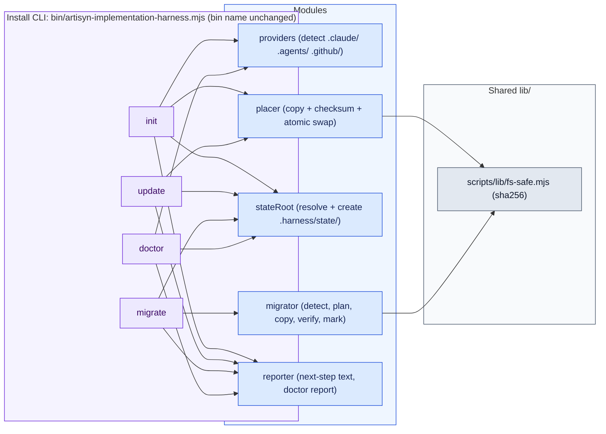
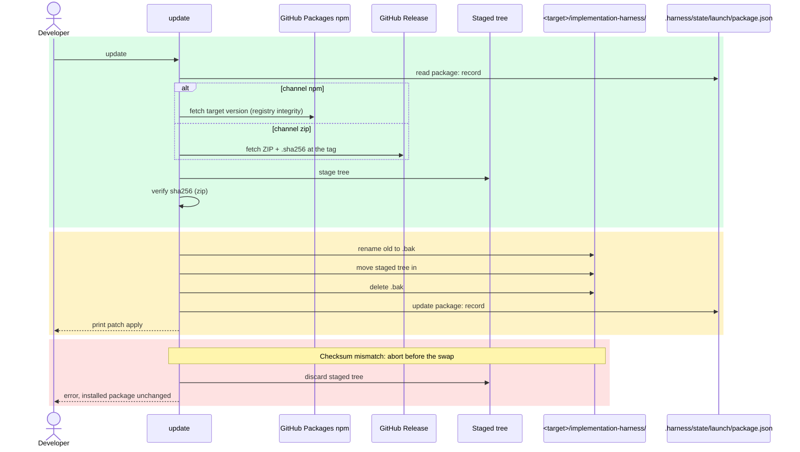
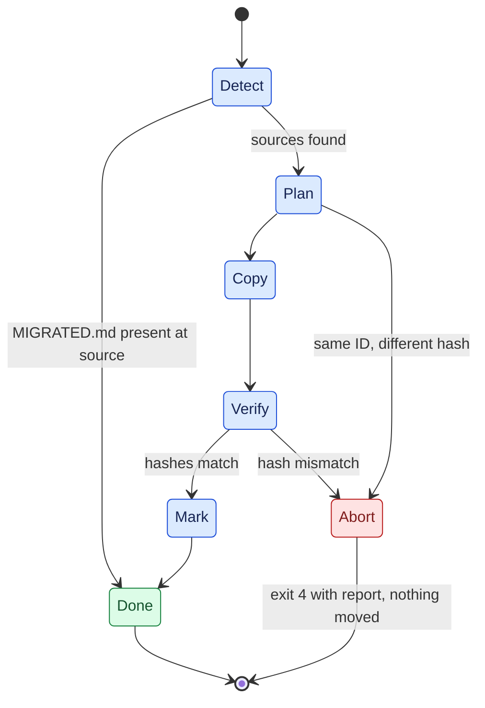

# DESIGN-20261115-CO1T — Design: Install and Update

Detail companion to `Architecture.md` (decisions D-10, D-11, D-12, D-13, D-14).

---

## Component view

The install CLI is one entry file with four commands over five modules; every write lands in a provider skills folder or under `.harness/state/`.



The CLI ships in the npm tarball (`bin`) and in the Release ZIP. It runs on Node >= 22, the same floor as the package scripts. It does not run launch or patch apply.

---

## CLI commands (D-11)

| Command                                                      | Input                                                                                                        | Steps                                                                                                                                                                                                                                                                                                                                                                                                                                                                                                                                                                                                                                                                                                                                                   | Output                         | Failure                                                                  |
| ------------------------------------------------------------ | ------------------------------------------------------------------------------------------------------------ | ------------------------------------------------------------------------------------------------------------------------------------------------------------------------------------------------------------------------------------------------------------------------------------------------------------------------------------------------------------------------------------------------------------------------------------------------------------------------------------------------------------------------------------------------------------------------------------------------------------------------------------------------------------------------------------------------------------------------------------------------------- | ------------------------------ | ------------------------------------------------------------------------ |
| `init [--provider claude\|codex\|copilot]... [--dir <path>]` | cwd (project root via `git rev-parse --show-toplevel`, else cwd)                                             | Detect providers from existing `.claude/`, `.agents/`, `.github/` or flags. Target = first selected provider's skills folder (`.claude/skills/` > `.agents/skills/` > `.github/skills/`). Refuse if the target exists with a different version unless `--force`. Copy the package from the npm tarball (own install dir) into `<target>/implementation-harness/`. Create `.harness/state/` and the ignore entries. Write the `package:` record: `{name, version, channel: "npm"\|"zip"}` into `.harness/state/launch/package.json` (committed) and `{path}` into `.harness/state/launch/package.local.json` (ignored). Print the launch command in the provider's syntax (`/implementation-harness launch`; `$implementation-harness launch` for Codex) | Exit 0 + next-step text        | No provider detected: exit 2 with hint. Copy error: roll back the target |
| `update [--version x.y.z] [--force]`                         | Existing `package:` record                                                                                   | Resolve the target version (the CLI's own version). Fetch by channel: `npm` → the registry tarball under `npm` registry integrity; `zip` → the ZIP + `.sha256` from the GitHub Release at the tag URL, then verify the sha256 of the staged tree. Same version: no-op, exit 0. Downgrade without `--force`: exit 3. Swap atomically (rename old to `.bak`, move new, delete `.bak`). Update the `package:` record. Print `/implementation-harness patch apply`                                                                                                                                                                                                                                                                                          | Exit 0 + `patch apply` command | Checksum mismatch: abort, nothing changed                                |
| `migrate`                                                    | Finds `*/skills/harness-bootstrap/state/`, `.canonical-implementation-harness/state/` and `.harness/launch/` | See Migration; after Mark, replaces the old `harness-bootstrap/` package files with the shim                                                                                                                                                                                                                                                                                                                                                                                                                                                                                                                                                                                                                                                            | Exit 0 + migration report      | Conflicts: exit 4 with report, nothing moved                             |
| `doctor`                                                     | Project                                                                                                      | Print providers, package path/version/channel per provider, state root health, skew between providers, pending migration, a legacy `state/` folder still present next to the shim; re-resolve a missing `package.local.json` path and show the pinned install command for the recorded channel (e.g. `claude plugin install artisyn@dataart`, `npx @dataart/artisyn-implementation-harness init`, `gh skill install DataArt/artisyn-implementation-harness implementation-harness@<tag> …`) and the launch command (`/implementation-harness launch` or `/artisyn:implementation-harness launch`)                                                                                                                                                       | Exit 0/1                       | —                                                                        |

### Update sequence



---

## Host-native paths (D-10)

Marketplace, skills.sh and `gh skill` installs involve no CLI; the first `launch` or `patch apply` does the bookkeeping.

| Step                 | Action                                                                                                                                                                                                                                                                                                                      |
| -------------------- | --------------------------------------------------------------------------------------------------------------------------------------------------------------------------------------------------------------------------------------------------------------------------------------------------------------------------- |
| Resolve project root | Order in State root below                                                                                                                                                                                                                                                                                                   |
| Create state         | `.harness/state/` if absent                                                                                                                                                                                                                                                                                                 |
| Record package       | `package.json` with `channel: "marketplace"\|"skills.sh"\|"gh-skill"`; `package.local.json` with the package path it runs from (plugin cache path allowed). When `package.local.json` is missing, launch searches the provider skills folders and the host plugin cache for the recorded name and version, then rewrites it |
| Migrate              | Run Migration when old state is detected                                                                                                                                                                                                                                                                                    |
| Update               | Host update command, then `patch apply`                                                                                                                                                                                                                                                                                     |

---

## State root (D-12)

One state root for all providers: `.harness/state/`, resolved from the project root and never from the package path or the provider folder.

| Path                                       | Content                                                                                    |
| ------------------------------------------ | ------------------------------------------------------------------------------------------ |
| `.harness/state/launch/answers.json`       | Launch answers                                                                             |
| `.harness/state/launch/package.json`       | `package:` record `{name, version, channel}` (committed)                                   |
| `.harness/state/launch/package.local.json` | `package:` per-machine `{path}` (ignored; re-resolved by launch and `doctor` when missing) |
| `.harness/state/launch/runs/`              | Launch run records                                                                         |
| `.harness/state/launch/reports/`           | Launch reports                                                                             |
| `.harness/state/registry.md`               | Registry                                                                                   |
| `.harness/state/index.json`                | Baselines                                                                                  |
| `.harness/state/objects/`                  | Content-addressed objects                                                                  |
| `.harness/state/operations/`               | Operation records                                                                          |
| `.harness/state/patch/`                    | Project execution bundles, `APPLIED.md`                                                    |

| Alias            | Resolves to             |
| ---------------- | ----------------------- |
| `state/`         | `.harness/state/`       |
| `project-patch/` | `.harness/state/patch/` |
| `package-patch/` | `package:patch/`        |

Resolution order for the project root: `ARTISYN_HARNESS_PROJECT_ROOT` env (CI and tests) → `git rev-parse --show-toplevel` → cwd. Each operation records the package version it used.

---

## Commit rule (D-13)

Launch appends these entries to the consumer `.gitignore`; the write is idempotent and never untracks files.

```
.harness/state/objects/
.harness/state/launch/runs/
.harness/state/launch/reports/
.harness/state/launch/package.local.json
```

Committed: `index.json`, `registry.md`, `launch/answers.json`, `launch/package.json`, `patch/APPLIED.md`.

---

## Migration (D-14)

Migration copies old state into `.harness/state/`, verifies by hash and marks the source; it never deletes the source.



| State  | Rule                                                                                                                                                                                                                                                        |
| ------ | ----------------------------------------------------------------------------------------------------------------------------------------------------------------------------------------------------------------------------------------------------------- |
| Detect | Sources: `*/skills/harness-bootstrap/state/` (any provider folder), `<project>/.canonical-implementation-harness/state/` (3.5.0 root-extract install, also this repo's own case) and legacy `.harness/launch/`. If `MIGRATED.md` exists at the source, skip |
| Plan   | List sources with precedence: package state (`harness-bootstrap/state/` or `.canonical-implementation-harness/state/`) wins; `.harness/launch/` records are imported only when their run IDs are absent                                                     |
| Copy   | Copy to `.harness/state/`; add `provenance.json` `{source path, version, timestamp}` per imported source                                                                                                                                                    |
| Verify | Hash compare of source and copy                                                                                                                                                                                                                             |
| Mark   | Write the `MIGRATED.md` marker at the source; then replace the old `harness-bootstrap/SKILL.md` and package files with the shim (D-03), leaving the marked `state/` in place                                                                                |
| Abort  | Same ID with a different hash, or a hash mismatch: report and stop; nothing is moved                                                                                                                                                                        |

Triggers: CLI `migrate`, or the first `launch` or `patch apply` that detects old state. Re-runs are idempotent.

---

## Package docs changes

Settled text to apply during implementation.

| File                                                          | Change                                                                                                  |
| ------------------------------------------------------------- | ------------------------------------------------------------------------------------------------------- |
| `README` § Local toolkit, § Shared package discovery          | State root `.harness/state/`; package is read-only and removable after launch; consumers do not harvest |
| `references/00-overview.md:34-44`                             | State root; versioning rule section (semver, single source `package.json`, stamping)                    |
| `launch/01a-launch-plan.md:9-28`                              | Aliases per D-12                                                                                        |
| `launch/08-provider-launch.md:11-17,132-133,217-218`          | Aliases per D-12; legacy `.harness/` read-only rule removed                                             |
| `patch/05-patch-apply.md:7-9`                                 | Aliases per D-12; migration section                                                                     |
| `patch/06-patch-state.md` § Path aliases, § Local bookkeeping | Aliases per D-12; legacy `.harness/` read-only rule removed; migration section                          |
| `patch/07-patch-prepare.md:57-60`                             | Remove version bump and `CHANGELOG` edit                                                                |

---

## Verification

| Level                           | Checks                                                                                |
| ------------------------------- | ------------------------------------------------------------------------------------- |
| Unit                            | providers detection, placer checksum, stateRoot resolution order, migrator precedence |
| Integration (E2E deterministic) | `init`, `update`, `migrate`, `doctor` on fixture projects; Windows path cases         |
| Agent-E2E                       | Marketplace path writes only under `.harness/state/` and permanent project files      |
