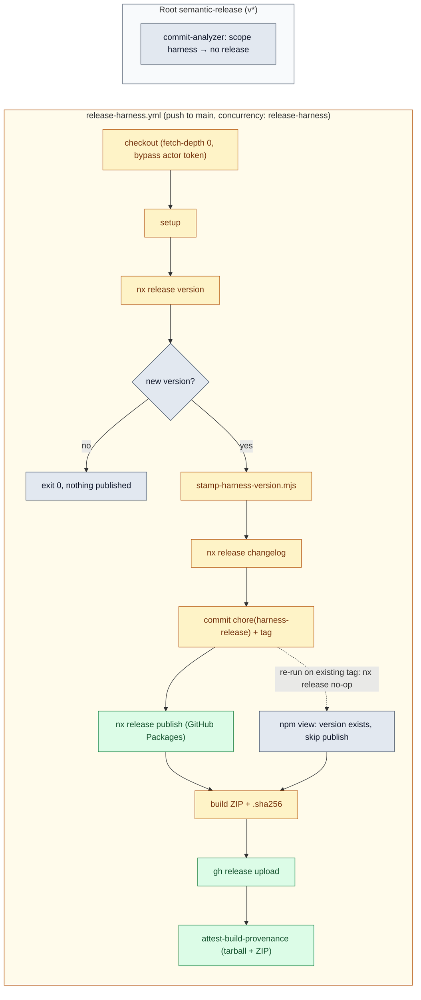

# DESIGN-20261115-CO1T — Design: Release Pipeline

Detail companion to `Architecture.md` (decisions D-15, D-16, D-17).

---

## Release workflow

One workflow on push to `main` versions, stamps, tags, publishes and attests the harness package; the root semantic-release lane runs separately and ignores scope `harness`.



| Item                   | Value                                                                                                                                                                                                       |
| ---------------------- | ----------------------------------------------------------------------------------------------------------------------------------------------------------------------------------------------------------- |
| File                   | `.github/workflows/release-harness.yml`                                                                                                                                                                     |
| Trigger                | `push` to `main`; `concurrency: release-harness`; actor guard `if: github.actor != '<release bot>'` — together with `[skip ci]` on the release commit, the release commit never retriggers the release lane |
| Permissions            | `contents: write`, `packages: write`, `id-token: write`, `attestations: write`                                                                                                                              |
| Gate                   | `yarn nx affected -t test` is a required CI check on the PR; the workflow runs after it                                                                                                                     |
| Checkout               | `fetch-depth: 0`; release App token or `GITHUB_TOKEN` as the bypass actor                                                                                                                                   |
| Version                | `yarn nx release version --projects=artisyn-implementation-harness` (Nx project name; its root is `skills/implementation-harness`)                                                                          |
| Stamp                  | `node scripts/release/stamp-harness-version.mjs`                                                                                                                                                            |
| Changelog              | `yarn nx release changelog`                                                                                                                                                                                 |
| Commit                 | `chore(harness-release): 4.0.0 [skip ci]` + tag `artisyn-implementation-harness-v4.0.0`                                                                                                                     |
| Publish                | `yarn nx release publish` to GitHub Packages                                                                                                                                                                |
| ZIP                    | `zip -r -X` with the D-08 exclusions; `.sha256` next to it; `gh release upload`                                                                                                                             |
| Attest                 | `actions/attest-build-provenance` for tarball and ZIP                                                                                                                                                       |
| No new version         | Workflow exits 0 without publishing                                                                                                                                                                         |
| Re-run on existing tag | `nx release` is a no-op; publish skips the existing version (`npm view` check)                                                                                                                              |

---

## Nx project (D-16)

The harness package is an Nx project released in independent mode; `package.json` is the single version source.

| Item            | Value                                                                                                                                                                                                                                      |
| --------------- | ------------------------------------------------------------------------------------------------------------------------------------------------------------------------------------------------------------------------------------------ |
| Project file    | `skills/implementation-harness/project.json`, Nx project `name` `artisyn-implementation-harness` (differs from the folder name on purpose, so the tag stays `artisyn-implementation-harness-v{version}`); no build target beyond `package` |
| Root workspaces | Add `skills/implementation-harness` to the root `package.json` `workspaces`                                                                                                                                                                |

Package `package.json`:

```json
{
  "name": "@dataart/artisyn-implementation-harness",
  "version": "4.0.0",
  "bin": { "artisyn-implementation-harness": "bin/artisyn-implementation-harness.mjs" },
  "files": ["...allowlist..."],
  "publishConfig": { "registry": "https://npm.pkg.github.com" },
  "repository": "github:DataArt/artisyn-implementation-harness",
  "engines": { "node": ">=22" }
}
```

`nx.json` release block:

```json
"release": { "projects": ["artisyn-implementation-harness"], "projectsRelationship": "independent",
  "releaseTag": { "pattern": "{projectName}-v{version}" },
  "version": { "conventionalCommits": true, "preVersionCommand": "" },
  "changelog": { "projectChangelogs": { "file": "{projectRoot}/CHANGELOG.md", "createRelease": "github" } } }
```

Exact key names verified in `node_modules/nx/schemas/nx-schema.json` (23.3.1).

---

## Stamping (D-15)

`scripts/release/stamp-harness-version.mjs` reads the version from `skills/implementation-harness/package.json` and writes it to every manifest; the same script with `--check` is the CI gate and exits 1 on mismatch.

| Target                                                                                 | Field                                                         |
| -------------------------------------------------------------------------------------- | ------------------------------------------------------------- |
| `skills/implementation-harness/SKILL.md`                                               | `metadata.version` (`name: implementation-harness` unchanged) |
| `skills/harness-bootstrap/SKILL.md` (shim)                                             | `metadata.version`                                            |
| `.claude-plugin/plugin.json` (`name: "artisyn"`)                                       | `version`                                                     |
| `.claude-plugin/marketplace.json` (`name: "dataart"`, plugin entry `name: "artisyn"`)  | `plugins[0].version`, `plugins[0].source.ref`                 |
| `.agents/plugins/marketplace.json` (`name: "dataart"`, plugin entry `name: "artisyn"`) | `plugins[0].version`, `plugins[0].source.ref`                 |

---

## Root semantic-release (D-16)

Commits with scope `harness` never trigger a root `v*` release.

| File                             | Change                                                                                                                  |
| -------------------------------- | ----------------------------------------------------------------------------------------------------------------------- |
| `release.config.js`              | commit-analyzer `releaseRules`: `[{ "scope": "harness", "release": false }]`, plus `harness-release` for the bot commit |
| Commitlint (if present)          | Add `harness` to the allowed scopes                                                                                     |
| `scripts/check-commit-scope.mjs` | lint-staged / commit-msg check: every commit touching `skills/implementation-harness/**` uses scope `harness`           |

---

## Branch protection (D-17)

| Rule          | Value                                                   |
| ------------- | ------------------------------------------------------- |
| Target        | Ruleset on `main`                                       |
| Require       | PR; status checks `ci`, `version-gate`, `rename-gate`   |
| Block         | Force push                                              |
| Bypass actors | Release GitHub App (preferred) or `github-actions[bot]` |
| Bypass scope  | Only the release workflow's commit and tag              |

---

## Retirement (EC11)

| Item                                              | Action                     |
| ------------------------------------------------- | -------------------------- |
| `releases/harness-bootstrap/*.zip`                | Delete                     |
| `scripts/release/release-harness-bootstrap.mjs`   | Delete                     |
| `package.json` script `release:harness-bootstrap` | Delete                     |
| `.github/ISSUE_TEMPLATE/bug_report.yml`           | Update the release example |
| `patch/07-patch-prepare.md`                       | Remove the bump step       |

---

## Rollback

| Channel     | Action                                                                                                            |
| ----------- | ----------------------------------------------------------------------------------------------------------------- |
| npm         | `npm deprecate @dataart/artisyn-implementation-harness@x.y.z "…"`; move dist-tag `latest` to the previous version |
| Marketplace | New release commit that re-pins `ref` to the previous tag (a patch release)                                       |
| Consumers   | Pin by tag                                                                                                        |

---

## Verification

| Check                               | Where                                                                                                                                                                                               |
| ----------------------------------- | --------------------------------------------------------------------------------------------------------------------------------------------------------------------------------------------------- |
| `stamp-harness-version.mjs --check` | CI, every PR                                                                                                                                                                                        |
| `nx release version --dry-run`      | CI                                                                                                                                                                                                  |
| `npm pack --dry-run` allowlist      | CI                                                                                                                                                                                                  |
| `claude plugin validate --strict`   | CI                                                                                                                                                                                                  |
| Rename gate                         | CI                                                                                                                                                                                                  |
| First real release                  | Ticket 6 sets the harness `package.json` to `3.5.0` (the last shipped version); the rename lands as `feat(harness)!: …` (breaking), so the first automatic run from `main` produces exactly `4.0.0` |
