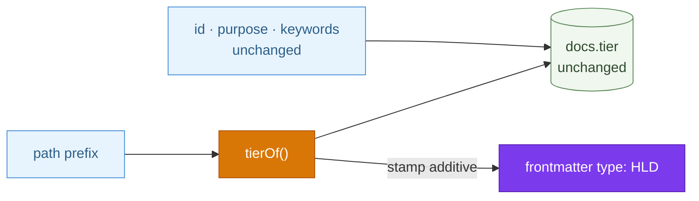
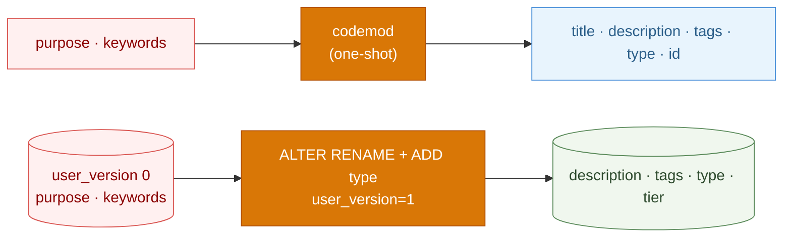
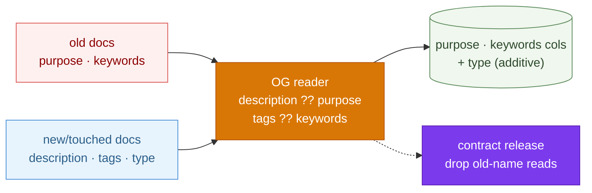
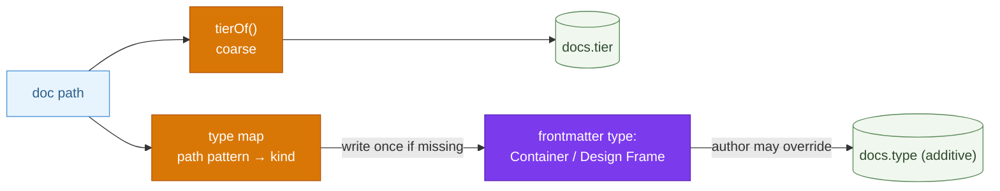
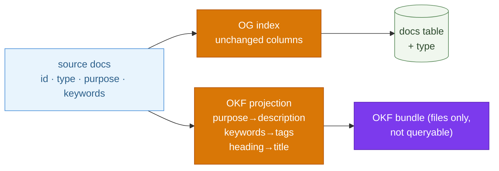
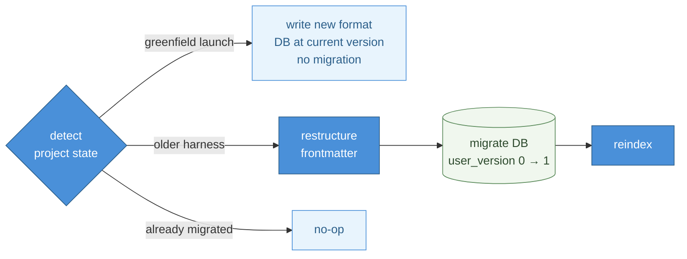

# DESIGN-20261117-7931: OKF-Compatible Knowledge Base — Research: Decision 2, Graph schema and migration

_Produced by the Research phase. Owned by `@product-architect`. Do not edit after Evaluate phase begins._

## Context

At Research sign-off (2026-11-17) the developer split the old 'Frontmatter and graph schema' decision. Decision 1, Target frontmatter format, now owns the key set, `type` vocabulary and ownership (see `01 Research - Target Frontmatter Format.md`). The developer directed OKF key names in source: `type`, `title`, `description` (was `purpose`), `tags` (was `keywords`), plus a time key. This file now covers the SQLite `docs` table that follows the format, its versioning, and how existing databases and docs migrate. The migration ships as a `patch` instruction that restructures frontmatter, migrates the database and reindexes (developer, 2026-11-17).

The rest of this section and the options below are the original research for the combined decision. They are kept as written. See "Option status after the split" for what still applies.

This research covers Decision 1 from `design/00 Frame.md`: the frontmatter and graph schema.

**The decision.** It settles the key set every doc carries:

- Whether source files rename `purpose`→`description` and `keywords`→`tags` (OKF names), or keep OG names and map them.
- Where `type` comes from (derived from the tier, or authored) and its value list.
- What stays OG-only (`id`).
- The matching `docs` table in SQLite. Its columns (`tier`, `purpose`, `keywords` today) may be renamed, added (`type`) or dropped to follow the frontmatter. `search` follows them.
- What changes for `@docs-writer`, Documentation Principles, and the migration of every existing doc.
- How an existing database is migrated, since the schema has no version today.

It covers EC1, EC5 and EC10. It is independent of the bundle layout (Decision 2) and the scope guard (Decision 3). The two meet Decision 1 at OG's columns: the key names decide what `assign` reads.

### Grounding facts (checked in this repo)

1. **Schema is additive-only by governance.** `docs/Harness/07 Operational Graph/02 Storage and Build Model.md` § Compatibility rule: "The schema is additive-only going forward: future revisions may add nullable columns with defaults." Renaming or dropping a `docs` column breaks it and needs a governance amendment.
2. **The browser reads the DB directly.** `03 Visualization Model.md` § Compatibility rule depends on the stable schema. `apps/web-docs/.vitepress/theme/GraphExplorer/graphExplorer.data.ts` runs `SELECT id, tier, path, title FROM docs ORDER BY tier, title` and colors by `tier`. Dropping `tier` breaks the Graph Explorer. Nothing in web-docs reads `purpose` or `keywords`.
3. **The frontmatter parser is line-based.** `readFrontmatter` in `docs/.og/utils.mjs` splits each line at the first colon. It has no multi-line YAML. 36 docs under `docs/` have a bare `keywords:` line followed by a wrapped `[ ... ]` list (e.g. `07 Operational Graph/01 Ops Model.md`, the CO1T Stories). From the code these parse as empty, so `keyword-match` and keyword `search` likely miss them. OKF `tags` is "a YAML list"; a block list (`- a`) fails the same way. _Since verified against the DB: 50 of 184 docs have empty `keywords` (see OQ-8)._
4. **`type` and `description` already appear.** 10 Story docs carry `name`, `description`, `type: reference`, inherited from canonical skill templates (26 files under `skills/implementation-harness/canonical/skills/**/templates|patterns`). Those docs have no `purpose`, so their `purpose` column is NULL today.
5. **Key names are part of the CLI and skill contract.** These all name `purpose`/`keywords`: `list --missing purpose,keywords` (used by `skills/implementation-harness/references/reindex-graph.md` Steps 2–2b), `MISSING_FIELDS`, the `search` haystack, `computeKeywordMatches` (`edges.mjs`), and the Documentation Principles rule.
6. **OG writes only `id` today.** Documentation Principles says the tool never derives or writes `purpose`/`keywords`. `writeAdditiveId` never touches another key. Stamping `type` widens OG's write set.
7. **VitePress reads `title` and `description`** from frontmatter for the page `<title>` and meta description. Adding them in place changes the rendered site head.
8. **The DB file is tracked.** Every consuming project has its own copy. It holds authored edges that cannot be rebuilt from files. _Since verified (see OQ-12)._
9. **Existing DBs have a usable version marker.** `PRAGMA user_version` reads `0` everywhere, so 0 = "v0". SQLite supports `ALTER TABLE ... RENAME COLUMN` (3.25+) and `DROP COLUMN` (3.35+); both keep rows. _Since verified: Node 24.19 `node:sqlite` bundles SQLite 3.53.3 (see OQ-6)._

## Options

### Option 1 — Minimal: keep OG keys, add `type` as a copy of the tier

**Description:** Files keep `id`, `purpose`, `keywords`. OG adds one key, `type`, valued with the path-derived tier name (`HLD`, `LLD`, `EngineeringGuide`, `Product`, `Story`). It is stamped additively, like `id`. The `tier` column already holds the value, so there is no schema change. `search`, `keyword-match` and `list --missing` are unchanged. `title` stays derived from the first heading.

**Industry precedent:** Hugo `type` defaults to the content section. Jekyll `_config.yml` `defaults:` by path scope.

**Diagram:**

**Pros:**

- Smallest change.
- No column change. The Compatibility rule and the Graph Explorer are untouched.
- Meets OKF §11 (only `type` is required).
- Fully deterministic. A trivial `@docs-writer` change.
- Cheap to reverse (EC10).

**Cons:**

- Tier names mean nothing to external consumers ("Product", "EngineeringGuide"). This weakens the Why-now goal.
- No recommended OKF keys (`description`, `tags`, `title`). Consumers derive the title from the filename (e.g. "00. Overview").
- OG now writes two keys. Documentation Principles and `02 Storage and Build Model.md` § Frontmatter format must say so.
- Every Story file gets `type: Story`, so a Frame and a Report look the same.

**Unknowns / risks:**

- Collision with the 10 existing `type: reference` docs. An additive stamp keeps the wrong value; an overwrite breaks "never touch existing keys".
- Frontmatter `type` can drift from the `tier` column if hand-edited.

---

### Option 2 — Spec-native rename in place

**Description:** Files move to OKF names: `title`, `description` (from `purpose`), `tags` (from `keywords`), `type`. `id` stays as an OG-only extra key. `type` uses a descriptive vocabulary (e.g. `Container`, `Component Design`, `Guide`, `Principle`, `Design Frame`, `Implementation Plan`). A codemod seeds it once from path rules; writers own it after. The DB is migrated under `PRAGMA user_version` 0→1: rename `purpose`→`description`, `keywords`→`tags`, add a nullable `type`, keep `tier` (the Graph Explorer needs it). `search`, `keyword-match`, `list --missing description,tags`, `reindex-graph.md`, Documentation Principles and `@docs-writer` move to the new names. A codemod rewrites all ~184 docs once.

**Industry precedent:** Hugo, Jekyll, Docusaurus and VitePress all use `title`/`description`/`tags`. Obsidian uses `tags` as a YAML list. SQLite `PRAGMA user_version` migrations (Android Room pattern) plus `ALTER TABLE RENAME COLUMN`.

**Diagram:**

**Pros:**

- Full OKF recommended key set. External agents need no mapping.
- Same names as mainstream docs tooling.
- VitePress picks up `title` and `description`.
- One vocabulary, no long-term alias.

**Cons:**

- Breaks the additive-only Compatibility rule. A governance amendment is needed.
- `patch apply` must rewrite consumer-authored frontmatter across every consuming project's `docs/`. This is a large, invasive change to content the harness does not own.
- Hardest to reverse (EC10). OKF already broke keys once between v0.1 and v0.2.
- Writers must choose a descriptive `type`. That takes judgment and invites inconsistency.

**Unknowns / risks:**

- The parser problem (fact 3). `tags` as a YAML list needs a real list parser or an inline `[a, b]` rule. Prettier wraps long flow lists, as 36 docs show.
- The migration must be atomic across the file rewrite and the column rename.
- Older OG code reading a migrated DB.

---

### Option 3 — Dual-key transition (expand, then contract)

**Description:** OG reads both names (`description ?? purpose`, `tags ?? keywords`). Writers (`@docs-writer`, `/design publish`, `/dev document`) write only OKF names from now on. A doc moves to the new names when it is next touched. A conformance check reports leftover old keys. DB columns keep their internal names (`purpose`, `keywords`), which decouples file keys from storage. The only schema change is a nullable `type` column, so the additive-only rule holds. A later "contract" release (set date or version) removes the old-name reads.

**Industry precedent:** Expand/contract (parallel change — Martin Fowler, Danilo Sato) for zero-downtime schema renames. Kubernetes API field deprecation windows.

**Diagram:**

**Pros:**

- Keeps the Compatibility rule and the Graph Explorer.
- No mass rewrite of consumer docs at `patch apply`. Projects converge over time.
- Fixes the 10 docs already using `description` (their `purpose` column is NULL now).
- The expand phase rolls back on its own.

**Cons:**

- Two vocabularies coexist for an open-ended time.
- OKF consumers see recommended keys only on migrated docs. This is still conformant, since only `type` is required.
- Column names no longer match file keys. Docs must state the mapping.
- The contract phase can slip forever without a trigger.

**Unknowns / risks:**

- Which key wins if a doc carries both with different values.
- Where `type` comes from is still open. It could combine with Option 1's tier stamp or Option 4's map.

---

### Option 4 — Two-level type, derived then written from a path-pattern map

**Description:** Keep OG key names. Use two levels. `tier` stays the coarse graph grouping: path-derived, DB only, used by the Graph Explorer and the mindmap. `type` is a new descriptive OKF value from a declarative path-pattern map in OG constants. Examples: HLD `Containers/*.md` → `Container`; LLD `*/0N. *.md` → `Component Design`; Engineering Guide → `Guide`; `docs/Harness/**` → `Principle`; Story `design/00 Frame.md` → `Design Frame`; `impl/1-plan.md` → `Implementation Plan`. OG writes `type` once when it is missing (like `id`). The author owns it after and may override it. Unmatched paths get a fallback (e.g. `Reference`). DB: an additive nullable `type` column.

**Industry precedent:** Jekyll `defaults:` by path scope. Hugo section-derived `type`. Backstage catalog coarse `kind` plus free-form `spec.type`. Diátaxis document types as a small fixed doc-kind vocabulary.

**Diagram:**

**Pros:**

- Descriptive types for external consumers, with no writer judgment at creation.
- Separates graph grouping (`tier`) from the consumer-facing kind (`type`).
- Additive-only schema. The Graph Explorer is untouched.
- Splits Story docs into meaningful kinds. This answers "every non-reserved .md needs `type`".

**Cons:**

- A new governed vocabulary and map that every consuming project inherits.
- Projects with other layouts need to extend it. The extension mechanism is undefined.
- OG writes a second key (Principles update).
- Write-once means a moved doc keeps a stale `type`.
- Still no `description` or `tags` for OKF consumers.

**Unknowns / risks:**

- Whether the map lives in canonical OG code (shared) or project config. If shared, consumer-specific folders fall to the fallback.
- Overwrite policy for the existing `type: reference` docs.

---

### Option 5 — Keep the source, map at the OKF boundary

**Description:** Source files keep OG names and gain only `type` (sourced as in Option 1 or 4). Nothing is renamed in source or the DB. A deterministic projection maps `purpose`→`description`, `keywords`→`tags`, first heading→`title`; `id` passes through. It is emitted as a generated bundle or an OG export step — files only, never a second queryable store (EC6). It is complete only if Decision 2 picks an export or hybrid layout. With an in-place bundle it collapses into Option 1.

**Industry precedent:** Static-site generators separate authoring frontmatter from emitted metadata. Backstage catalog processors. Adapter / anti-corruption layer (Evans, DDD).

**Diagram:**

**Pros:**

- No change to source keys, DB columns, CLI flags, `reindex-graph.md` or writer habits.
- No consumer frontmatter rewrite.
- External consumers still get the full recommended set plus a real `title`.
- Most reversible: delete the projection.
- The OKF version pin lives in one place.

**Cons:**

- Two shapes of the same metadata. Writers never see OKF names.
- Couples Decision 1 to Decision 2. Not viable alone.
- The projection must track OKF changes (OKF already broke once).
- The in-repo `docs/` tree is not OKF-native for recommended keys.

**Unknowns / risks:**

- Whether a generated bundle satisfies EC1's wording ("the knowledge base under `docs/` conforms").
- Where the output lives and whether it is committed.

---

## Option status after the split

| Option                                           | Status           | Why                                                                                                                                                                                                                                                                                                                  |
| ------------------------------------------------ | ---------------- | -------------------------------------------------------------------------------------------------------------------------------------------------------------------------------------------------------------------------------------------------------------------------------------------------------------------- |
| 1 Keep OG keys + type copy                       | Disqualified     | Source keys are now OKF names; the type vocabulary is settled in Decision 1, not copied from the tier.                                                                                                                                                                                                               |
| 2 Rename in place with versioned DB migration    | Viable, narrowed | File keys are fixed by Decision 1. Remaining: column rename/add under `PRAGMA user_version` 0→1, the Compatibility rule amendment, atomic file + DB migration through the patch instruction.                                                                                                                         |
| 3 Dual-key transition with internal column names | Re-scoped        | Dual reading of file keys conflicts with "source conforms in place" plus the allowed rewrite. Two parts survive: internal column names (`purpose`/`keywords` columns fed by `description`/`tags`), and a short read-compat window so a consuming project stays safe between the OG upgrade and the migration (EC10). |
| 4 Two-level type from path map                   | Re-scoped        | Type vocabulary, path map and ownership moved to Decision 1. What stays here: keep `tier` for the Graph Explorer plus an additive `type` column.                                                                                                                                                                     |
| 5 Keep source + map at boundary                  | Disqualified     | The developer requires OKF names in source, in place.                                                                                                                                                                                                                                                                |

New item for this decision: whether the DB stores the time key (`timestamp` or `generated.at`) alongside or instead of `updated_at`. Moot if Decision 1 picks no time key.

## Migration cases (developer, 2026-11-17)

The migration must recognise three project states and act on each:

1. **Greenfield launch** — nothing to migrate. Launch writes the new format and a database at the current schema version directly.
2. **Project on an older harness** — migrate: restructure frontmatter, migrate the database (`PRAGMA user_version` 0 → 1), then reindex.
3. **Already migrated (future releases)** — no-op. Running the migration again changes nothing.

State detection needs a reliable signal. Candidates: `PRAGMA user_version` on the database, the presence of OG-era keys (`purpose`, `keywords`) in frontmatter, and the harness version recorded in harness state. Evaluate picks the signal and how the three cases map to it.

## Cross-option notes

- `id` stays an OG-only extra key in all options (OKF allows it). OKF identity stays path-based. The additive, never-reassigned `id` rule is unchanged.
- `title`: Options 2 and 5 surface it. Options 1, 3 and 4 leave consumers to derive it from the filename. A frontmatter `title` in place also changes the VitePress `<title>`.
- `tier` column: no option drops it without changing the Graph Explorer query and `03 Visualization Model.md`. Dropping is possible only as an extra step in Option 2.
- The parser (fact 3) affects every option that keeps `keywords` or adopts `tags`. It is already a live defect (see OQ-8).
- Governance docs touched by all options: `02 Storage and Build Model.md` (§ Frontmatter format; § Compatibility rule for Option 2), Documentation Principles § Operational graph frontmatter, `03 Lifecycles/05 Documents Flow.md`, `@docs-writer`, `reindex-graph.md`.

## Open Questions

V = needs a value judgment from the developer. E = engineering fact or detail, answerable by checking or by Evaluate. Each status says whether the item is resolved, verified, open, deferred to Evaluate, or moved to Decision 1.

| #     | Question                                                                                                                                                                                      | V/E | Proposed resolution / status                                                                                                                                                                                                                                    |
| ----- | --------------------------------------------------------------------------------------------------------------------------------------------------------------------------------------------- | --- | --------------------------------------------------------------------------------------------------------------------------------------------------------------------------------------------------------------------------------------------------------------- |
| OQ-1  | May the additive-only Compatibility rule be amended to allow renaming or dropping columns? If not, Option 2's column rename is out (it becomes Option 3's decoupling).                        | V   | Resolved (developer, 2026-11-17): yes — the developer stated the DB structure is subject to change; the additive-only Compatibility rule is amended by this design.                                                                                             |
| OQ-2  | May `patch apply` rewrite consumer-authored frontmatter across a consuming project's whole `docs/`? If not, Option 2's one-shot codemod is not viable for consumers.                          | V   | Resolved (developer, 2026-11-17): yes — through an explicit migration instruction shipped in the patch (restructure frontmatter, migrate DB, reindex), never a silent rewrite.                                                                                  |
| OQ-3  | May OG write a frontmatter key other than `id` (stamping `type`)? If not, Options 1 and 4 fall back to writer-authored `type`.                                                                | V   | Resolved (developer, 2026-11-17): yes — OG may write keys other than `id`, e.g. stamp `type`.                                                                                                                                                                   |
| OQ-4  | Does EC1 require the source tree to carry OKF recommended keys, or is `type` enough in source? If recommended keys are required in source, Options 1, 4 and 5 fail EC1.                       | V   | Resolved (developer, 2026-11-17): source conforms in place, with OKF key names (Decision 1).                                                                                                                                                                    |
| OQ-5  | Which layout does Decision 2 pick (in-place, export, hybrid)? Option 5 is viable only with export or hybrid.                                                                                  | V   | Resolved: Option 5 disqualified (see Option status after the split), so the coupling to the bundle layout no longer decides viability here.                                                                                                                     |
| OQ-6  | Does Node 24 `node:sqlite` support `RENAME COLUMN` (3.25+) and `DROP COLUMN` (3.35+)? Sets migration cost only.                                                                               | E   | Verified. Node 24.19 `node:sqlite` bundles SQLite 3.53.3, so `RENAME COLUMN` and `DROP COLUMN` work in place. Current DBs report `PRAGMA user_version = 0`.                                                                                                     |
| OQ-7  | What happens to the 10 Story docs and 26 canonical templates carrying `type: reference`/`description`/`name`? Migration rules and template edits; solvable in each option.                    | E   | Deferred to Evaluate. Moved to Decision 1 (Target frontmatter format).                                                                                                                                                                                          |
| OQ-8  | Replace the line-based `readFrontmatter` with real YAML list parsing, or enforce inline lists? Sets cost and fixes a live gap.                                                                | E   | Verified, raised in importance. The graph has 50 of 184 docs with empty `keywords` today. This is a live defect in `readFrontmatter` regardless of option.                                                                                                      |
| OQ-9  | `type` vocabulary: tier names, descriptive, or two-level? Governed in canonical, or extendable per project? Picks between Options 1 and 4 and their sub-variants.                             | E   | Deferred to Evaluate. Moved to Decision 1 (Target frontmatter format).                                                                                                                                                                                          |
| OQ-10 | Move `title` into frontmatter, given VitePress then uses it for `<title>`? Affects consumer quality and the site head; additive in every option.                                              | E   | Deferred to Evaluate. Moved to Decision 1 (Target frontmatter format).                                                                                                                                                                                          |
| OQ-11 | For Option 3, what triggers the contract phase? Without a trigger the dual vocabulary is permanent.                                                                                           | E   | Deferred to Evaluate.                                                                                                                                                                                                                                           |
| OQ-12 | Is the SQLite file tracked in git here and in consuming projects? Decides whether a migrated DB ships via `patch apply` or migrates in place on open.                                         | E   | Verified. `docs/.og/docs-operational-graph.sqlite` is tracked in git in this repo. `skills/implementation-harness/canonical/docs/.og/docs-operational-graph.sqlite` is tracked in the canonical package. A migrated DB must preserve authored edges either way. |
| OQ-13 | How does the patch migration instruction run, given `patch/05-patch-apply.md` §2 forbids running newly imported recipes mid-apply (post-apply step, new payload kind, or a separate command)? | V   | Open — to resolve before or at Evaluate Step 1b. Shared with Decision 3's OQ16. The developer named the three cases above; the runner mechanism is still open for Evaluate Step 1b.                                                                             |
| OQ-14 | Which signal detects the project state (DB `user_version`, OG-era frontmatter keys, harness version in state)?                                                                                | E   | Deferred to Evaluate.                                                                                                                                                                                                                                           |
