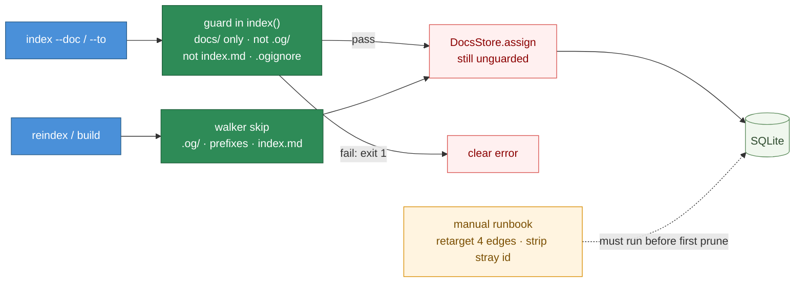
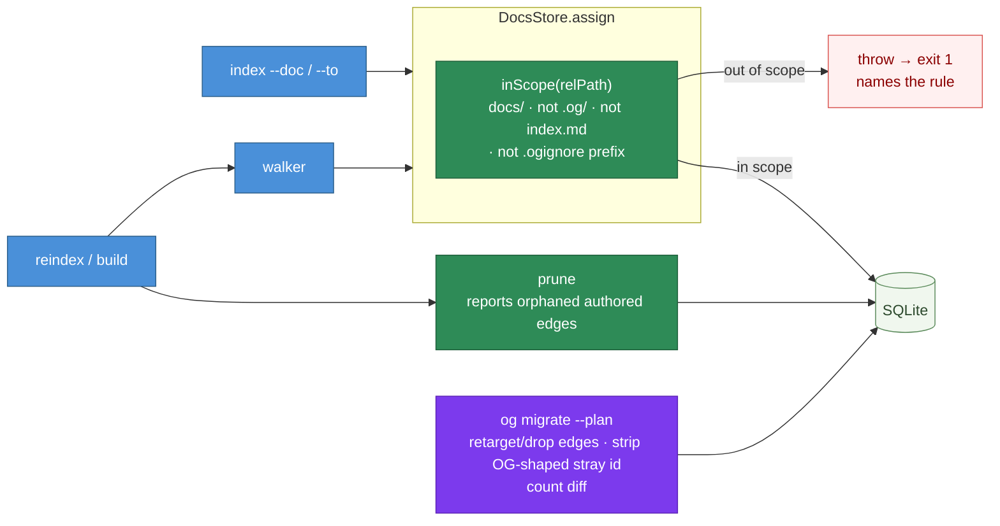
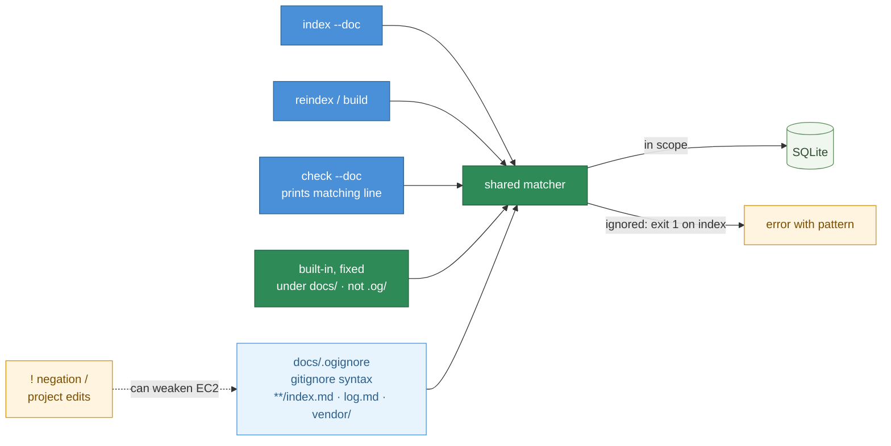
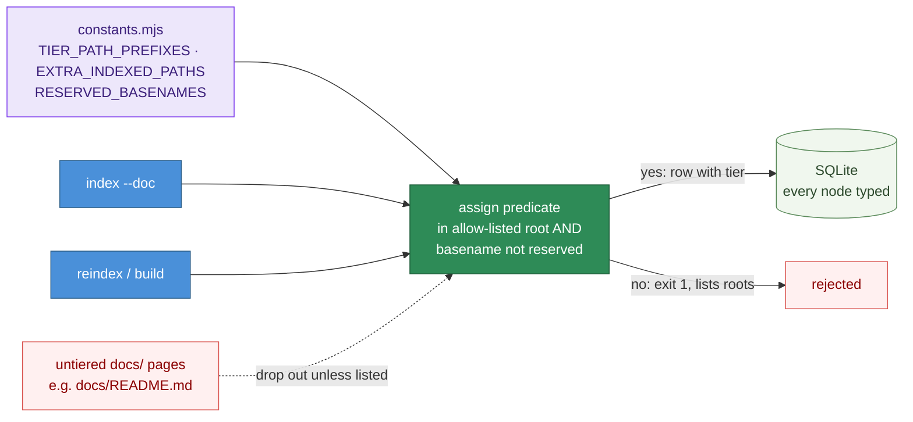

# DESIGN-20261117-7931: OKF-Compatible Knowledge Base — Research: Decision 4, OG scope guard

_Produced by the 🔍 Research phase. Owned by `@product-architect`. Do not edit after Evaluate phase begins._

## Context

Decision 4 fixes what OG may write to and index. It decides:

- where the guard sits (`assign`, `index --doc`, `reindex`);
- the rule set: only under `docs/`, never `index.md`, `.ogignore` honored on every write path;
- what happens to the `AppReadme` tier and the `impl-to-readme` edge;
- how the 4 graduation edges into index pages and the stray `apps/web-explorer/README.md` id are migrated.

It covers EC2, EC3, EC6, EC7 and EC9 from `design/00 Frame.md`. It fixes a real leak that exists with or without OKF, so it could ship on its own.

The developer confirmed Stories are inside an OKF bundle and proposed five tier bundles (HLD, LLD, Stories, Engineering Guide, Product) — see Decision 3. That makes retiring `AppReadme` (no tier root) consistent with every bundle option.

ECs that bound the options:

| EC              | Rule                                                                                                                                                                                                                             |
| --------------- | -------------------------------------------------------------------------------------------------------------------------------------------------------------------------------------------------------------------------------- |
| EC2             | OG never writes frontmatter into an `index.md` and never indexes one into the graph.                                                                                                                                             |
| EC3             | OG never writes into or indexes any file outside `docs/`.                                                                                                                                                                        |
| EC6             | OG stays the single query layer.                                                                                                                                                                                                 |
| EC7 (proposed)  | No silent provenance loss. The 4 authored graduation edges into index pages are retargeted or explicitly dropped. Node and edge counts are diffed before and after. The stray `id:` in `apps/web-explorer/README.md` is removed. |
| EC9 (proposed)  | `index --doc` on a guarded path exits non-zero with a clear message. `index --doc` honors `.ogignore`. Both are covered in `cli.test.mjs`.                                                                                       |
| EC10 (proposed) | `patch apply` is idempotent and safe on consuming projects.                                                                                                                                                                      |

### What the code does today

- `DocsStore.assign` (`docs/.og/docs.mjs`) has no guard. It writes `id:` into any path. `index()` (`cli.mjs`) passes `--doc` straight in and never calls `readIgnoreList`.
- Only `reindex` filters, and only by prefix. `listMarkdownFiles` skips `docs/.og/` and `.ogignore` prefixes. Basenames like `index.md` cannot be expressed.
- Pruning silently deletes authored edges. `pruneExcept` → `edges.removeForDocs` removes every edge touching a pruned row, authored (`derived=0`) included. The first `reindex` after an `index.md` exclusion lands deletes the 4 graduation edges and ~10 `references` edges with no report. That breaks EC7.
- The migration window is small and partly automatic. `unedge` needs both endpoints still indexed, so cleanup must run before the guarded build prunes. `reindex-graph.md` Step 0 copies new modules and Step 1 runs `build` right away. The docs-site build hook also calls `build`. `patch/05-patch-apply.md` says "Do not automatically run a newly imported recipe in the middle of this operation." In a consuming project nothing runs a migration before the first prune unless the design makes it.
- The `impl-to-readme` call is the live leak path. `.claude/skills/dev/references/06-document.md` authors `index --doc … --edge impl-to-readme --to <app root>/README.md`. A strict docs/-only guard makes that call fail in every `/dev document` touching an app README unless the step changes.
- Both existing `impl-to-readme` edges target `docs/README.md` (inside `docs/`, not `index.md`, tier = null).
- No DB-level constraint on edge types. `schema.mjs` has no CHECK on `edge_type`. Retiring a type leaves old rows until removed.
- Harness docs are out of date. These still describe app READMEs as graph nodes:
  - `07 Operational Graph/01 Ops Model.md` (README node, `AppReadme` node, "Ten edge types", "six graduation");
  - `02 Storage and Build Model.md` (tier list);
  - `03 Visualization Model.md` (AppReadme color);
  - `03 Lifecycles/05 Documents Flow.md` (App README row).

## Options

### Option A — Minimal guard at the `index` command, manual migration

**Description:** Two checks in `index()` before `assign`: the resolved path is under `<dir>/docs/` and not `docs/.og/`, and it does not match `readIgnoreList`. Hardcode a basename skip for `index.md` in both `listMarkdownFiles` and `index()`. `--to` gets the same check (clear message instead of "not indexed"). Loud failure via the existing `need()` throw. Delete `APP_README_PATTERN` and the `AppReadme` tier (dead code). Keep `impl-to-readme` (valid for `docs/` README pages). `/dev document` stops calling `index` for app READMEs (the App README row stays in the report table only). Migration: a written runbook the developer follows before upgrading. Retarget the 4 graduation edges with `index --edge`/`unedge`, strip stray `id:` by hand, then `reindex` drops `index.md` rows. Index-page `id:` removal is left to Decision 3.

**Industry precedent:** `git add` refuses an ignored path unless forced (check at command entry, loud). Prettier and ESLint CLIs honor their ignore file for explicitly passed paths (ESLint: "File ignored because of a matching ignore pattern").

**Diagram:**

**Pros:**

- Smallest change (2 functions, 1 constant).
- Fixes the observed leak directly.
- Edge types and counts unchanged; small doc ripple.
- Easy to test in `cli.test.mjs` (EC9).

**Cons:**

- `assign` stays unguarded. Any future caller importing `DocsStore` (build hook, lifecycle skills import it programmatically) can leak again.
- The rule lives in two places and can drift.
- Migration depends on a human running the runbook first. In consuming projects the first `reindex-graph` or docs build prunes `index.md` rows and silently drops authored edges, so EC7 holds only if the runbook runs first.
- Stray IDs in consuming projects stay until found.

**Unknowns / risks:**

- Whether EC3 must hold for programmatic callers or only the CLI.
- How to make the runbook run before `reindex-graph` Step 1 in consuming projects.

---

### Option B — One scope predicate at the single write path, built-in rules, guarded prune, cleanup command

**Description:** One function `inScope(relPath, ignore)` in `utils.mjs`, called by both `DocsStore.assign` and `listMarkdownFiles`. Built-in, non-configurable rules: under `docs/`; not under `docs/.og/`; basename not `index.md`; not matching an `.ogignore` prefix (adding `log.md` is an open question). `assign` reads `.ogignore` itself or receives it, so `index --doc` honors it. Loud: `assign` throws, and `index` exits non-zero naming the rule. The walker filters silently with the same predicate. Prune safety net: `pruneExcept` no longer silently cascades authored (`derived=0`) edges. They are listed in `reindex`'s JSON output as `orphanedAuthored`, so EC7's diff sees them. Retire `AppReadme` (pattern + tier). Retire `impl-to-readme` from `EDGE_TYPES`. Re-type the 2 edges to `docs/README.md` as `references`. `/dev document` records app README updates in the report only. Cleanup command (e.g. `og migrate --plan <file>`): applies a retarget map (old target → new target or "drop") for authored edges into rows about to leave scope. It strips `id:` from out-of-scope files only if the value has OG's shape (`^[0-9a-f]{8}(-\d+)?$`) and no row owns it. It prints node/edge counts before and after. Index-page `id:` removal also uses it; Decision 3 owns the rest of their frontmatter.

**Industry precedent:** OWASP Path Traversal guidance: resolve the canonical path, check it starts with the permitted base, one check at the sink. Migration tools (Rails `db:migrate`, Flyway) for explicit, versioned, counted data migration instead of silent rebuild loss.

**Diagram:**

**Pros:**

- One choke point covering every caller, present and future. Matches the existing "assign is the one write path" contract.
- Walker and command cannot drift.
- The prune safety net keeps EC7 even if a consuming project rebuilds before migrating.
- Cleanup is repeatable and idempotent (EC10).
- Removes the `AppReadme` contradiction at the root.

**Cons:**

- Larger change: predicate, prune behaviour, new subcommand, tests for each.
- Retiring `impl-to-readme` ripples through Harness docs ("Ten edge types" → nine, "six graduation" → five): `01 Ops Model.md`, `02 Storage and Build Model.md`, `03 Visualization Model.md`, `05 Documents Flow.md`, `06-document.md`, Graph Explorer `edgeGroup()`.
- Hardcoded rules give no escape hatch for unusual layouts.
- The retarget map needs a human to know the 4 real destinations.

**Unknowns / risks:**

- The `id:` shape check could collide with other tools' `id:` frontmatter (Docusaurus, Hugo).
- Whether reporting orphaned edges (vs failing) is enough for EC7.
- How the cleanup command gets run in consuming projects, since `patch apply` does not run new recipes mid-operation.

---

### Option C — gitignore-style `.ogignore` (industry-standard pattern file)

**Description:** Extend `.ogignore` from prefixes to gitignore-style patterns: globs `*`/`**`, basename patterns without a slash so `index.md` matches at any depth, directory patterns with trailing slash, `#` comments, optionally `!` negation. One matcher in `utils.mjs` used by the walker and `assign`. Two rules stay built in and non-overridable: under `docs/`, and `docs/.og/` excluded. Everything else, including `**/index.md`, ships as default lines in a canonical `docs/.ogignore`. A new `check` subcommand reports whether a path is in scope and which line matched (like `git check-ignore -v`). `index --doc` on a matched path exits non-zero printing the line. Drop `AppReadme`. Keep `impl-to-readme` narrowed to README pages under `docs/` (its 2 edges stay valid). Migration: retarget the 4 graduation edges before the default patterns land; strip stray IDs by hand or with a small script; `index.md` rows prune on next build.

**Industry precedent:** `.gitignore` PATTERN FORMAT; `git check-ignore -v`; `.prettierignore` and `.eslintignore` (gitignore syntax). ESLint flat config `ignores` keeps some non-overridable defaults (`**/node_modules/`, `.git/`): a built-in core plus a configurable layer.

**Diagram:**

**Pros:**

- Familiar semantics; one file explains the whole scope.
- Consuming projects tune scope without a code change (matches existing guidance to ask about externally owned paths).
- `check` makes the guard explainable and testable.
- Future reserved names (`log.md`) are one line.

**Cons:**

- Biggest parsing change. OG is zero-dependency, so the matcher is hand-written or uses Node's `path.matchesGlob`. Gitignore edge cases (anchoring, negation order, directory-only rules) are a known bug source.
- Conflicts with EC2. If `**/index.md` is a default line, a project can delete or negate it, so "never" becomes a project choice. Keeping EC2 needs `index.md` hardcoded anyway, which collapses toward Option B.
- File ownership. `docs/.ogignore` is project-owned today, so shipping canonical default lines means `patch apply` must merge into a project file (a known conflict surface; see `05-patch-apply.md` on retained customizations).
- Does nothing on its own about the silent prune of authored edges.

**Unknowns / risks:**

- Whether `path.matchesGlob` is stable enough on Node 24 for a zero-dependency tool.
- Whether negation is allowed.
- How defaults reach a project that already has its own `.ogignore`.

---

### Option D — Allow-list by tier root, as a config list in constants

**Description:** Inverted rule: a file is in scope only if it matches an allow-listed root. Lists live in `constants.mjs`. The allow-list is `TIER_PATH_PREFIXES` plus a short `EXTRA_INDEXED_PATHS` (e.g. `docs/README.md`) and `RESERVED_BASENAMES` (`index.md`, possibly `log.md`). One predicate in `assign`, used by the walker too. Every indexed node has a tier. This links to Decision 1: if OKF `type` is derived from tier, every indexed doc carries a non-empty `type` by construction (EC1). Loud on `index`; the error lists the allowed roots. `AppReadme` removed. `impl-to-readme` retired or kept only for the extra paths. Migration: untiered docs under `docs/` (e.g. `docs/README.md` if not listed) leave the graph with their edges. The 4 graduation edges and stray IDs are handled as in B.

**Industry precedent:** OWASP Input Validation Cheat Sheet (allow-list over deny-list); `package.json` `files` / npm publish allow-list; TypeScript `tsconfig` `include`.

**Diagram:**

**Pros:**

- The allow-list is the safer default: new folders are out until opted in.
- The same list drives tier and scope, so there are no untyped nodes. This makes Decision 1's "type from tier" trivially conformant.
- Data in one file; deterministic and testable.

**Cons:**

- Drops every untiered doc under `docs/`. Here `docs/README.md` holds both `impl-to-readme` edges; there may be others.
- Consuming projects with docs outside the five tier roots lose them after upgrade. Widening scope means editing canonical `constants.mjs`, which patches overwrite.
- Turns a leak fix into a scope reduction: a bigger behaviour change than EC3 asks.
- Ties Decision 4 to one outcome of Decision 1.

**Unknowns / risks:**

- How many untiered docs exist here and in consuming projects.
- Whether consuming projects rename or relocate tier roots. `01 Ops Model.md` says each project "instantiates its own Product tier under its own name", but the constant hardcodes `docs/Harness`.

---

## Cross-cutting notes for Evaluate

- **Linked to Decision 3.** Every option takes `index.md` out of the graph, so their `id:` frontmatter must go too. Who strips it: an OG command (B, D), a manual step (A), or Decision 3's `index.md` rework. `docs/index.md` keeps its VitePress `layout`/`hero` regardless.
- **Migration order is the same for all options.** Retarget/drop authored edges while both endpoints are indexed → land the guard and rebuild → strip stray IDs. Only B and D add a code-level safety net for consuming projects that rebuild first.
- **Governance altitude for Publish.** Harness docs should state the scope contract (only `docs/`, never reserved OKF filenames, never `.og/`, `.ogignore` honored on every write, loud failure), not name the predicate function. Files needing edits in all options: `07 Operational Graph/01 Ops Model.md`, `02 Storage and Build Model.md`, `03 Visualization Model.md`, `03 Lifecycles/05 Documents Flow.md`, `skills/implementation-harness/references/reindex-graph.md` Step 1.

## Open Questions

V = shapes which options are viable. E = affects effort or detail only.

| #   | Question                                                                                                                                                                                 | V/E | Proposed resolution / status                                                                                                                                                                                                                                                                                                                                                                                                                 |
| --- | ---------------------------------------------------------------------------------------------------------------------------------------------------------------------------------------- | --- | -------------------------------------------------------------------------------------------------------------------------------------------------------------------------------------------------------------------------------------------------------------------------------------------------------------------------------------------------------------------------------------------------------------------------------------------- |
| 1   | Must EC3 hold for every caller of the OG module (build hook, programmatic imports), or only the `index` CLI? If every caller, A fails EC3.                                               | V   | Proposed resolved: every caller. EC3 says OG "never" writes outside `docs/`, and `DocsStore` is imported programmatically. Option A fails EC3 as written unless it also guards `assign`. Proposed — confirm at Research sign-off.                                                                                                                                                                                                            |
| 2   | Does EC2's "never" rule out any project-level override (`!` negation, deleting the `index.md` line)? If yes, C's configurable rule is out unless hardcoded, turning C into B plus globs. | V   | Proposed resolved: yes, no project-level override for `index.md`. EC2 says "never". Option C survives only with `index.md` hardcoded as a non-overridable built-in rule. Proposed — confirm at Research sign-off.                                                                                                                                                                                                                            |
| 3   | Must untiered docs under `docs/` (e.g. `docs/README.md`, holding both `impl-to-readme` edges) stay in the graph? If yes, D needs an explicit extra-path list or fails.                   | V   | Proposed resolved: yes, untiered docs under `docs/` stay in the graph. EC3 asks to block files outside `docs/`, not to shrink scope inside it. Option D survives only with an explicit extra-path list. Proposed — confirm at Research sign-off.                                                                                                                                                                                             |
| 4   | Can a migration step run in consuming projects before the first guarded `build` prunes rows? If not, options without a prune safety net (A, C) cannot meet EC7 there.                    | V   | Verified: no. `patch apply` does not run newly imported recipes mid-operation, and `reindex-graph` Step 1 builds right after Step 0. Options without a prune safety net (A, C) cannot meet EC7 in consuming projects unless they add one. The developer decided migration ships as a patch instruction that restructures frontmatter, migrates the DB and reindexes. How it runs given `05-patch-apply.md` §2 is open in Decision 2 (OQ-13). |
| 5   | Should `reindex`/`build` ever exit non-zero on scope violations? The docs-site build hook runs `build` in CI; a loud `reindex` would block site deploys mid-migration.                   | V   | Resolved (developer, 2026-11-17): agreed — `reindex`/`build` report scope violations and orphaned authored edges in their JSON output and exit 0; only `index` exits non-zero.                                                                                                                                                                                                                                                               |
| 6   | Is Node 24's `path.matchesGlob` stable enough, or a hand-written matcher acceptable under the zero-dependency rule? If neither, C loses glob support.                                    | V   | Verified: Node 24.19 has `path.matchesGlob`, and it matches `**/index.md`. Option C keeps glob support without a dependency.                                                                                                                                                                                                                                                                                                                 |
| 7   | Real destination docs for the 4 graduation edges — needs reading the source Stories. Migration effort only.                                                                              | E   | Deferred to Evaluate.                                                                                                                                                                                                                                                                                                                                                                                                                        |
| 8   | Retarget the ~10 `references` edges one by one or drop in bulk? Effort and EC7 reporting detail.                                                                                         | E   | Deferred to Evaluate.                                                                                                                                                                                                                                                                                                                                                                                                                        |
| 9   | Retire `impl-to-readme` or keep it for `docs/` README pages? Decides the doc ripple.                                                                                                     | E   | Deferred to Evaluate.                                                                                                                                                                                                                                                                                                                                                                                                                        |
| 10  | Safe to auto-remove stray `id:` by OG's ID shape, given Docusaurus/Hugo also use `id:`? Or confirm-each manual? Cleanup design and test cost.                                            | E   | Deferred to Evaluate.                                                                                                                                                                                                                                                                                                                                                                                                                        |
| 11  | `log.md` in reserved basenames now, or wait for Decision 3? One-line difference.                                                                                                         | E   | Deferred to Evaluate.                                                                                                                                                                                                                                                                                                                                                                                                                        |
| 12  | Case-insensitive basename check (`Index.md`) on macOS/Windows? Small predicate/test detail.                                                                                              | E   | Deferred to Evaluate.                                                                                                                                                                                                                                                                                                                                                                                                                        |
