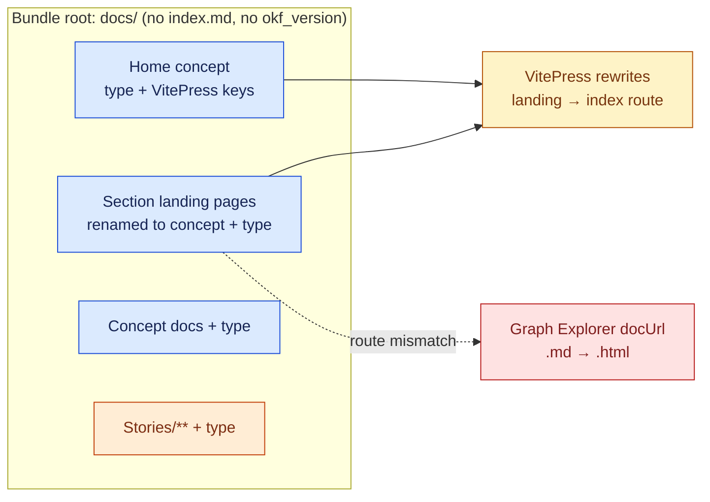
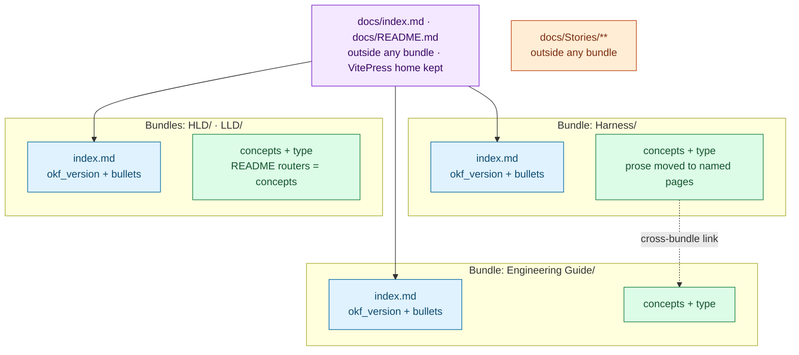
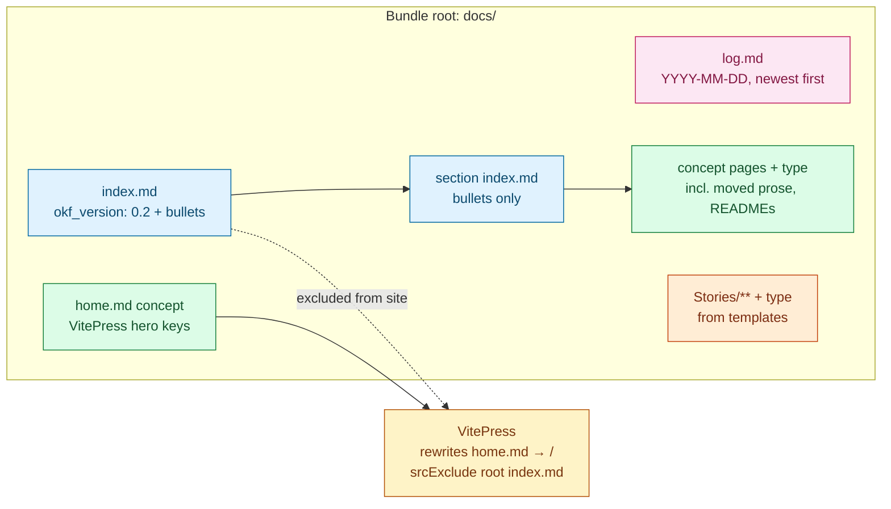
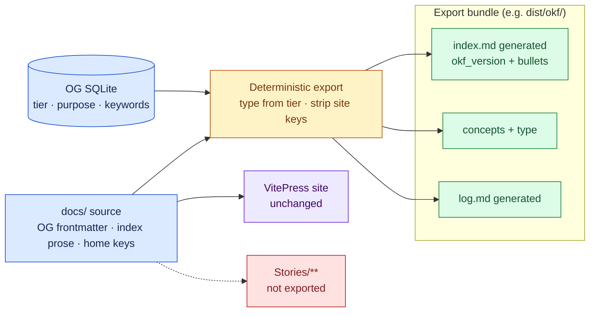
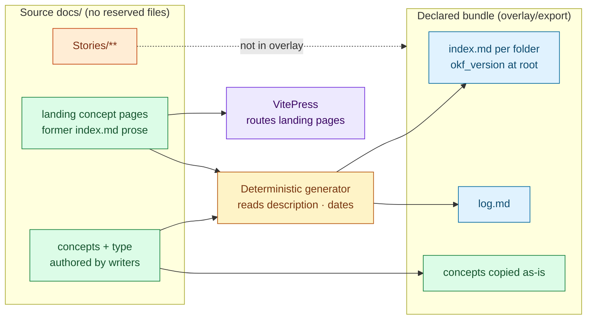
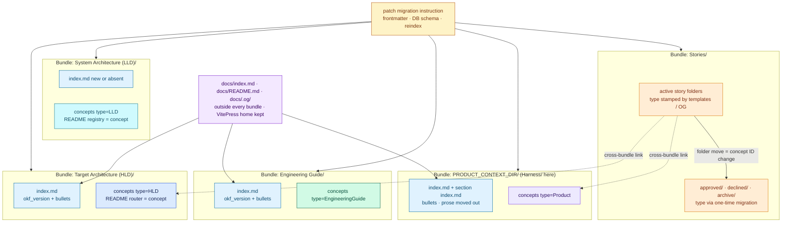

# DESIGN-20261117-7931: OKF-Compatible Knowledge Base — Research: Decision 3, OKF bundle layout

_Produced by the 🔍 Research phase. Owned by `@product-architect`. Do not edit after Evaluate phase begins._

## Context

Decision 3 from `design/00 Frame.md`: **OKF bundle layout**. It settles where the bundle root and `okf_version` sit. It settles how `index.md` meets the reserved-file rule, given VitePress needs `docs/index.md` home frontmatter and some index pages carry real content. It settles whether to add `log.md`. It settles whether conformance lives in the source tree or a generated export. It covers EC1, EC8 and EC10.

Decision 1 (Target frontmatter format) and Decision 2 (Graph schema and migration) replaced the earlier combined frontmatter-and-schema decision. Decision 4 is the OG scope guard.

The decision is about files and folders, not key names (Decision 1), the graph schema (Decision 2) or OG guard code (Decision 4). It meets Decision 4 at `index.md`: Decision 4 decides whether index pages leave the graph, Decision 3 decides what their frontmatter becomes.

### Facts the options rest on

- **OKF (verified).** A bundle is a folder tree. It may sit inside a bigger repo. It has no root marker. `okf_version` is optional and only in the root `index.md`. OKF has no exclusion mechanism: every `.md` under the bundle root except `index.md`/`log.md` is a concept and needs `type`. `README.md` counts. `index.md` and `log.md` are optional. The `index.md` body is `# Section` headings with `* [Title](url) - description` bullets. Extra frontmatter keys are allowed, so VitePress keys are legal on a concept, not on `index.md`. Nested bundles are unspecified. v0.2 already broke v0.1.
- **The 11 index pages.** None is pure OKF navigation. All use tables or prose, not bullets. `05 Principles`, `09 Distribution` and `02 Quick Start` hold real content. `Harness/index.md`, `00 The Story`, `01 Explore`, `Engineering Guide` and the HLD index have intro prose. `docs/index.md` is pure VitePress `layout: home`/`hero`/`features` frontmatter with no body.
- **README files.** `docs/README.md`, `Target Architecture (HLD)/README.md` (version router) and `System Architecture (LLD)/README.md` (LLD has no `index.md`) all have OG frontmatter. Under OKF they are concepts.
- **VitePress** (`apps/web-docs/.vitepress/config.ts`, ^1.6.0). `srcDir: '../../docs'`, `srcExclude: ['Stories/**']`, no `rewrites`. `scanSection` already leaves `index.md` and `README.md` out of the sidebar. The top nav links to folder routes (`/Harness/05%20Principles/`) that depend on an `index.md`. In-repo precedent: `03 Lifecycles` and `04 Adoption` have no `index.md`; the nav points at `00 Overview` / `00 Adoption Path`. `GraphExplorer/docUrl.ts` maps file path to route by `.md` → `.html` and is unaware of rewrites.
- **Stories.** `docs/Stories/` is excluded from the site but is the OG `Story` tier. About 94 Story files carry `id:`. In-flight drafts carry no frontmatter at all (this design's `00 Frame.md`, `Report.md`). Story folders hold non-md files (`stat.json`).
- **Canonical package.** `canonical/docs/` ships only `.og/*` and Engineering Guide articles: no `index.md`, no site generator. Launch creates `docs/README.md` (a "thin index"), the HLD `README.md` router and LLD files per project. A consuming project's site generator is unknown and must not be assumed. VitePress handling is this repo's concern. The canonical rule must work without any site generator.

Added for Option 6:

- **Stories layout.** Design stories are active at `docs/Stories/design/[T] name/` or `docs/Stories/product-design/[T] name/`. When done they move to `…/approved/[T] name/` or `…/declined/[T] name/`. Dev stories are active at `docs/Stories/[T] name/impl/` and archived to `docs/Stories/archive/`, which also holds one legacy design folder (Q5MU). No `declined/` folder exists yet. There is no `docs/Stories/index.md`. `stat.json` sits in 12 story subfolders. Source: canonical `Engineering Guide/Lifecycles/02 Design Lifecycle.md` line 19; `docs/Harness/03 Lifecycles/05 Documents Flow.md` line 75.
- **Story files are frozen after completion.** Documents Flow marks archive "Archived — no further edits", and `1-plan.md` and `solution/` "Immutable after approval". OG already stamps `id:` into archived Story files, so frontmatter-only stamping of frozen files has precedent.
- **Product tier name.** Canonical docs name the Product folder `docs/{{PRODUCT_CONTEXT_DIR}}/` (per project). Canonical OG `constants.mjs` hard-codes `['docs/Harness', 'Product']`, and OG code is byte-identical across projects. A consuming project with another Product folder name gets no Product tier today.
- **Patch apply cannot run a migration mid-apply.** `references/patch/05-patch-apply.md` §2: "Do not automatically run a newly imported recipe in the middle of this operation." It deploys rendered files with a three-way merge and has no one-time data-migration step.
- **Tier roots.** The five roots match `TIER_PATH_PREFIXES` exactly. `AppReadme` is in `TIER_COLORS` but has no path prefix.

## Options

### Option 1 — Rename-away (minimal, in place, no `index.md` at all)

**Description:** Bundle root is `docs/`. OKF makes `index.md` optional, so the source keeps none. Every current `index.md` becomes a concept page (e.g. `README.md` or a named overview). It keeps its prose and OG `id` and gains `type`. Home keeps its VitePress keys as extra keys on a concept. VitePress `rewrites` map each landing concept back to the `index` route so URLs stay. Folders that already have a `README.md` (`docs/`, HLD) need a merge. No `okf_version`, since it can only live in a root `index.md`; the version pin lives in harness docs or the conformance check. No `log.md`. Stories stay inside the bundle and need `type`.

**Industry precedent:** MkDocs uses `README.md` as a folder index when no `index.md` exists. GitHub renders `README.md` as the folder landing. VitePress Route Rewrites.

**Diagram:**

**Pros:**

- EC2 trivially holds: there is no `index.md` to stamp or index.
- The 4 graduation edges keep their targets (pages stay concepts with their `id`), which shrinks EC7.
- No prose split.
- The canonical rule is generator-neutral: "no reserved filenames in authored docs".

**Cons:**

- EC1's "`index.md` follows the reserved-file rule" holds only vacuously. Agents get no OKF navigation file.
- No `okf_version`, so the pin is invisible in the bundle (EC10).
- Renames break inbound links (e.g. `Harness/index.md` → `./09 Distribution/index.md`). Two folders need a README merge.
- Stories inside `docs/` need `type`, including in-flight drafts.

**Unknowns / risks:**

- Whether VitePress 1.6 rewrites support a parameterized `README.md` → `index.md` mapping across all folders. VitePress says relative links should follow rewritten paths, which may clash with OKF's file-tree-relative links.
- `docUrl.ts` would emit `README.html` routes that no longer exist.

---

### Option 2 — Area bundles (in place, one bundle per top-level area)

**Description:** Each permanent area is its own sibling bundle: `Harness/`, `Engineering Guide/`, `Target Architecture (HLD)/`, `System Architecture (LLD)/`. Each area's `index.md` becomes OKF navigation (bullets, no frontmatter) with its own `okf_version`. Section `index.md` files inside an area become OKF bullets too. Prose from content-bearing pages moves into named concept pages, following `03 Lifecycles/00 Overview.md`. `docs/index.md`, `docs/README.md` and `docs/Stories/` sit outside every bundle, unchanged. The VitePress home is untouched. Optional `log.md` at each area root. Narrowest variant: a Product-only bundle (`docs/Harness/` alone).

**Industry precedent:** Antora components. Backstage TechDocs (docs root per component in a monorepo). Docusaurus multi-instance docs plugin.

**Diagram:**

**Pros:**

- EC8 safe: home unchanged, a frontmatter-less section `index.md` still renders, and the sidebar already skips them.
- Stories are excluded by layout, not by a rule OKF lacks.
- Bundles match existing tier boundaries (`TIER_PATH_PREFIXES`) and Documents Flow destinations.
- Easy canonical rule: "each permanent docs area is a bundle".

**Cons:**

- Four `okf_version` markers to keep in step. Product-only is narrower but may miss EC1's "knowledge base under `docs/`".
- Cross-area links (Engineering Guide ↔ Harness) become out-of-bundle.
- OKF recommends `/`-prefixed bundle-absolute links, but VitePress resolves `/` against `docs/`. Only relative links work on both.
- LLD has no `index.md`, and HLD has both a `README.md` router and an `index.md`. Both need reshaping.
- The prose split means new concept pages, nav updates and retargeting the 4 graduation edges (EC7).

**Unknowns / risks:**

- No root marker: an external consumer pointed at `docs/` treats the whole tree as one bundle, and Stories fail conformance.
- The Product tier name differs per consuming project, so the canonical rule must name areas by role.

---

### Option 3 — Single `docs/` bundle, spec-native, in place

**Description:** `docs/` is one bundle. `docs/index.md` becomes the root OKF index (`okf_version: "0.2"` only, then bullets). `docs/README.md` folds in or stays a concept. Every section `index.md` becomes OKF bullets; prose moves to named concept pages. The VitePress home moves to a concept file (e.g. `home.md`) mapped to `/` with `rewrites`, and the root `index.md` is `srcExclude`d from the site. Stories are inside, so every Story `.md` carries `type` from creation (lifecycle templates). One root `log.md`, hand-written or generated. Sub-choice: `index.md` hand-written, or generated from frontmatter `description` and committed with a staleness check.

**Industry precedent:** The OKF spec itself (optional root `index.md` with `okf_version`). Hugo `_index.md` for section lists. Docusaurus `_category_.json` `generated-index`. Keep a Changelog for `log.md`.

**Diagram:**

**Pros:**

- Plain reading of EC1: the whole tree conforms.
- One `okf_version` pin.
- Bundle-absolute `/` links match VitePress's `/`.
- External consumers pointed at `docs/` see a valid bundle, with no hidden boundary.
- One canonical rule for any project that keeps docs under `docs/`.

**Cons:**

- Biggest blast radius: all 11 index pages rewritten, new concept pages, nav updates, EC7 retargeting.
- Every Story file (about 94 indexed, plus drafts) needs `type`. `/dev` and `/design` templates change. Tight coupling to Decision 1.
- The home relocation is a repo-specific VitePress workaround.
- Hardest to reverse (EC10).

**Unknowns / risks:**

- Whether a VitePress rewrite target (`index.md`) can coincide with an `srcExclude`d source of the same path.
- How far `docUrl.ts` drifts from routes once rewrites exist.
- Non-doc Story working files would all need `type` or fail conformance.

---

### Option 4 — Generated export bundle (source unchanged)

**Description:** Source `docs/` keeps its shape. A deterministic export writes a separate conformant bundle (e.g. `dist/okf/`, git-ignored or CI-built). It copies the permanent areas, derives `type` from tier, maps OG keys to OKF names, strips VitePress keys, generates every `index.md` from `description`, writes the root `okf_version` and can generate `log.md`. Stories are not exported. Content-bearing index pages are exported as concepts under another name.

**Industry precedent:** llms.txt (a generated agent-facing markdown index, close to OKF's index format; VitePress plugins generate it at build). Backstage TechDocs.

**Diagram:**

**Pros:**

- Zero risk to EC8.
- Cheapest to reverse (delete the exporter). The pin sits in one place.
- Stories, home frontmatter and prose-in-index conflicts are solved by filtering.
- Generated `index.md` meets the OKF SHOULD by construction.

**Cons:**

- Likely fails EC1 and EC5 as framed: conformance exists only in the artifact.
- Two shapes of the same knowledge. In-repo agents still read non-conformant source.
- A new artifact to build, check and ship, near the out-of-scope "publish to external catalog" line.
- Export concept IDs are export paths, not source paths.

**Unknowns / risks:**

- Where the exporter lives (OG subcommand or separate), and whether it strains EC6 (it writes files, not a graph).
- Whether it ships in the site build, the package, or neither.

---

### Option 5 — Hybrid: concepts conform in source, reserved files generated

**Description:** Concept docs conform in source: writers author `type` and the Decision 1 keys (EC5). Source holds no reserved files. Each current `index.md` becomes a named concept landing page (as in Option 1), with VitePress routes following it. All OKF reserved files (`index.md` per folder, root `okf_version`, `log.md`) are generated deterministically into an overlay/export that is the declared bundle. The overlay leaves out Stories and site-only files. Concept files come across byte-identical ("source plus generated navigation").

**Industry precedent:** Docusaurus authored docs plus `generated-index` category pages. MkDocs `literate-nav`/`awesome-pages`. conventional-changelog / Nx Release generated changelogs.

**Diagram:**

**Pros:**

- Source concepts are conformant in place (EC1 concept rule, EC5). In-repo agents see `type`.
- Reserved-file conflicts with VitePress go away.
- Generated indexes stay in sync with `description`.
- `log.md` can come from data that OG or git holds.
- Reversible: drop the generator; source `type` is harmless.

**Cons:**

- Two moving parts: source rules plus a generator.
- EC1's "`index.md` follows the rule" holds only in the overlay.
- Still needs the landing-page rename, link updates, VitePress routing and the `docUrl.ts` fix from Option 1.
- Stories in source still lack `type` if left out of the overlay. Source `docs/` as a whole is not a bundle.

**Unknowns / risks:**

- Whether the overlay is committed, git-ignored or CI-built. Each needs a different staleness check.
- The `log.md` source (git, graduation events, Report Efforts) may not exist deterministically.

---

### Option 6 — Five tier bundles (developer-proposed)

**Description:** Each OG tier root is its own sibling OKF bundle: `Target Architecture (HLD)/`, `System Architecture (LLD)/`, `Engineering Guide/`, `Stories/`, and the Product folder (`Harness/` here, `{{PRODUCT_CONTEXT_DIR}}` in canonical text). Canonical rule: "every OG tier root is a bundle". Source conforms in place. Stories are a full bundle, so every Story `.md` carries `type`. OG may stamp `type` along with `id`. `reindex`/`build` report conformance gaps and exit 0. A `patch` delivers the change with a migration instruction that (1) restructures frontmatter in every existing doc, (2) migrates the OG SQLite schema, (3) reindexes.

**Bundle roots, `index.md`, `okf_version`.** Each bundle root may hold an `index.md` with only `okf_version: "0.2"` as frontmatter and a `# Section` + bullets body. Section `index.md` files inside a bundle become bullets only. Their prose moves to named concept pages, as in Option 2. This affects `05 Principles`, `09 Distribution`, `02 Quick Start`, and intro prose in `Harness/index.md`, `00 The Story`, `01 Explore`, `Engineering Guide/index.md` and the HLD index. README routers stay concepts with `type` (HLD `README.md` version router, LLD `README.md` registry). HLD keeps both files: `index.md` becomes OKF root nav, `README.md` stays a concept. LLD has no `index.md`: it gains one (mainly for `okf_version`), or has none and no visible pin. Stories has no `index.md`: it gains one (hand-written or generated) or none.

**Outside every bundle.** `docs/index.md` (VitePress home, keeps `layout`/`hero`/`features` unchanged). `docs/README.md` (launch's "thin index", needs no `type`). `docs/.og/` (no `.md` concepts). `apps/*/README.md` (no tier prefix). `docs/` as a whole is not a bundle. EC8 holds for the home as in Option 2.

**Stories as a bundle.** Root is `docs/Stories/`. Active folders and `approved/`, `declined/`, `archive/` all sit inside one bundle. Story templates stamp `type` at creation (`00 Frame.md`, `01 Research …`, `Report.md`, `0-intent.md`, `1-plan.md`, `2-report.md`). In-flight drafts without frontmatter fail conformance until OG stamps them on `index --doc`. `reindex`/`build` report them and exit 0. Archived and approved files are frozen, so they get `type` only through the one-time migration (following the `id` precedent). Non-md files (`stat.json`) are outside OKF's scope. The OKF concept ID is the path inside the bundle, so a Story's concept ID changes when its folder moves to `approved/`/`declined/`/`archive/`. OG's `id` stays stable. `docs/Stories/` is already `srcExclude`d from VitePress, so there is no site impact.

**Product tier name.** Canonical text names the root by role ("the Product context folder, `docs/{{PRODUCT_CONTEXT_DIR}}/`"), not `Harness`. To keep the 1:1 tier mapping in consuming projects, OG must get the Product prefix from project config, not the hard-coded `'docs/Harness'`. Otherwise canonical `constants.mjs` stops being byte-identical (OQ15).

**Cross-bundle links.** Story → HLD, Story → Product and Engineering Guide ↔ Product all leave their bundle. OKF allows them: consumers tolerate broken links, and links are untyped. `/`-prefixed bundle-absolute links never match VitePress `/` = `docs/` here. Only file-relative links work for both. Typed lineage stays in OG edges.

**1:1 mapping to OG tiers.** Each bundle root is exactly one `TIER_PATH_PREFIXES` entry and vice versa, so bundle membership and tier are the same fact. `type` can be tier-derived per bundle (`HLD`, `LLD`, `EngineeringGuide`, `Product`, `Story`) and OG-stamped. Or it can be finer and authored inside a bundle (e.g. Story `Frame`, `Research`, `Plan`). That is the frontmatter-format decision's call. The mapping is clean only if `AppReadme` is retired (scope-guard decision).

**Differs from Option 2 (Area bundles).** Option 2 leaves `docs/Stories/` outside every bundle with no `type`. Option 6 makes Stories the fifth bundle, so every Story file, template and draft carries `type`. Option 6 defines the bundle set as "OG tier roots" rather than "permanent areas", so bundle and tier come from one source. Option 6 explicitly includes OG stamping `type` and a patch-shipped migration of frontmatter, DB and reindex.

**Industry precedent:** Antora components (own docs root and version descriptor per component; explicit cross-component links). Backstage TechDocs (one docs root per catalog entity in a monorepo). Nx project roots (one root per project with project-level type/tags and a workspace graph across them). Hugo content sections (`type` defaults to the top-level section, a precedent for tier-derived `type`). Jekyll front matter `defaults` scoped by path.

**Diagram:**

**Pros:**

- Bundle = tier is one source of truth. `type` can be derived and OG-stamped with no authoring burden.
- Covers all indexed knowledge, Stories included. A consumer pointed at `docs/Stories/` sees a valid bundle, unlike Option 2.
- VitePress home and `docs/README.md` are untouched (EC8).
- Generator-neutral canonical rule that names roots by role.
- Matches Documents Flow destinations and tier boundaries.

**Cons:**

- Up to five `okf_version` pins to keep in step (EC10).
- Every Story template changes. About 94 existing Story files (many frozen) get frontmatter edits. In-flight drafts need stamping.
- Story concept IDs change on every archive or approval move.
- Cross-bundle links are the norm for Stories.
- Same prose split, nav updates and EC7 retargeting as Option 2 for the Product, Engineering Guide and HLD indexes.
- Needs a canonical Product-prefix change in OG, or the 1:1 mapping breaks in consuming projects.
- Needs a migration step that patch apply does not have today.

**Unknowns / risks:**

- No OKF root marker, so a consumer pointed at `docs/` still sees one invalid bundle (home and README lack `type`).
- How OG gets the per-project Product prefix while staying byte-identical.
- How a patch migration instruction runs, given `05-patch-apply.md` forbids running imported recipes mid-apply.
- Whether archive immutability allows a one-time `type` stamp.
- Greenfield projects may lack an LLD or Product root. The rule must allow absent bundles.

---

## Open Questions

V = must be answered to validate the option set. E = deferred to Evaluate. Every status is proposed by the orchestrator and must be confirmed at Research sign-off unless it says verified or resolved by the developer.

| #    | Question                                                                                                                                                                                                | V/E | Proposed resolution / status                                                                                                                                                                                                                                                                                                                              |
| ---- | ------------------------------------------------------------------------------------------------------------------------------------------------------------------------------------------------------- | --- | --------------------------------------------------------------------------------------------------------------------------------------------------------------------------------------------------------------------------------------------------------------------------------------------------------------------------------------------------------- |
| OQ1  | Does EC1's "knowledge base under `docs/`" mean all of `docs/`, the permanent areas only, or Product only?                                                                                               | V   | Resolved (developer, 2026-11-17): the knowledge base is the five OG tier roots, Stories included. This supersedes the earlier "permanent areas, not Stories" proposal. `docs/index.md`, `docs/README.md` and `docs/.og/` stay outside. The Product-only variant of Option 2 is out.                                                                       |
| OQ2  | Must the source tree conform, or is a generated bundle enough for EC1/EC5?                                                                                                                              | V   | Resolved (developer, 2026-11-17): the source tree conforms in place (EC1, EC5). Option 4 (export only) is disqualified as a standalone answer. Option 5 survives only if its source half meets EC1.                                                                                                                                                       |
| OQ3  | Must `docs/Stories/` stay outside the bundle? With a `docs/` root every Story `.md`, drafts included, needs `type`.                                                                                     | V   | Resolved (developer, 2026-11-17): Stories are inside a bundle, and every Story `.md` carries `type`. Option 6 shows the root need not be `docs/` for this. Draft handling moves to OQ17/OQ18. OG stamping with report-only checks (exit 0) covers drafts without frontmatter.                                                                             |
| OQ4  | Do VitePress 1.6 `rewrites` support a parameterized landing → `index` mapping, a target matching an `srcExclude`d source, and file-relative links under rewrites?                                       | V   | Partly verified. This repo runs VitePress 1.6.4, and parameterized `rewrites` are a documented VitePress 1.x feature. Unverified: rewrite-target vs `srcExclude` collision, and file-relative links under rewrites. Options 1, 3 and 5 are conditional on a small spike, scheduled in Evaluate. Spike scheduling proposed — confirm at Research sign-off. |
| OQ5  | Is "no `index.md` at all" acceptable for EC1's reserved-file clause, and can the EC10 pin live outside the bundle?                                                                                      | V   | Proposed resolved: yes, per spec §11. `index.md` is optional, and a missing one must not cause rejection. Vacuous conformance is acceptable. The version pin can live outside the bundle, but then consumers cannot see it; scored in Evaluate under EC10. Proposed — confirm at Research sign-off.                                                       |
| OQ6  | Does the spec allow prose/tables in `index.md` besides `# Section` + bullets?                                                                                                                           | E   | Deferred to Evaluate. Sets how much prose moves in Options 2 and 3. The verified spec summary defines the index body as `# Section` headings with bullets and says nothing that permits other content. Treat prose and tables as non-conformant.                                                                                                          |
| OQ7  | Hand-written or generated `index.md`; if generated, from frontmatter `description` or OG columns?                                                                                                       | E   | Deferred to Evaluate. Upkeep cost and coupling to Decision 1.                                                                                                                                                                                                                                                                                             |
| OQ8  | Is `log.md` wanted; from what source? Does OG store event dates?                                                                                                                                        | E   | Deferred to Evaluate. Optional; the source drives generator cost.                                                                                                                                                                                                                                                                                         |
| OQ9  | How does a consumer find bundle roots with no marker? Require `okf_version` on every root?                                                                                                              | E   | Deferred to Evaluate. Decides whether area bundles are observable. More pressing now: under Options 2 and 6 the root set is fixed and named. Discovery could follow that list or require `okf_version` on every root (OQ19 and OQ21 feed it).                                                                                                             |
| OQ10 | Link style: OKF `/` bundle-absolute vs VitePress `/` = `docs/`.                                                                                                                                         | E   | Deferred to Evaluate. They agree only when the root is `docs/`. Under Option 6, `/` bundle-absolute links never match VitePress `/` = `docs/`; only relative links work for both. The Stories bundle has no site, so the clash is only in the other four.                                                                                                 |
| OQ11 | What does the canonical rule say for projects without VitePress or any site? Does launch's `docs/README.md` become a concept or the root `index.md`?                                                    | E   | Deferred to Evaluate. The canonical rule must stay generator-neutral. Partly changed: under Option 6, launch's `docs/README.md` sits outside every bundle and stays a plain file with no `type`. The generator-neutral wording is still for Evaluate.                                                                                                     |
| OQ12 | Where does an export/overlay live, and does it cross the out-of-scope publishing line?                                                                                                                  | E   | Deferred to Evaluate. Cost and boundary for Options 4 and 5.                                                                                                                                                                                                                                                                                              |
| OQ13 | How much `docUrl.ts` fixing do renamed or rewritten landing pages need?                                                                                                                                 | E   | Deferred to Evaluate. Site-only cost under EC8.                                                                                                                                                                                                                                                                                                           |
| OQ14 | When index prose moves to a new concept page, does its OG `id` move too, so the 4 graduation edges survive?                                                                                             | E   | Deferred to Evaluate. EC7 migration cost; joint with Decision 4 (OG scope guard).                                                                                                                                                                                                                                                                         |
| OQ15 | How does canonical OG learn the per-project Product tier prefix (config/answers vs rendered constant), given `constants.mjs` hard-codes `docs/Harness` and must stay byte-identical?                    | V   | Resolved (developer, 2026-11-17): the Product folder name is set per project at harness launch. Canonical OG reads it from launch configuration instead of hard-coding `docs/Harness`. This is recorded as a fix in the Frame's scope. Option 6 is no longer conditional on it.                                                                           |
| OQ16 | How does a patch "migration instruction" run (post-apply step, new payload kind, or a separate `reindex-graph`-style command), given `05-patch-apply.md` §2 forbids running imported recipes mid-apply? | V   | Open — to resolve before or at Evaluate Step 1b. EC4 delivery depends on it, for this option and any option that migrates the DB. The developer named three migration cases (greenfield, older harness, already migrated); see Decision 2. The runner mechanism stays open for Evaluate Step 1b.                                                          |
| OQ17 | Is `type` one value per bundle (tier-derived, OG-stamped) or finer inside a bundle (e.g. Story `Frame`/`Plan`/`Report`)?                                                                                | E   | Deferred to Evaluate. Joint with the frontmatter-format decision; both are legal OKF.                                                                                                                                                                                                                                                                     |
| OQ18 | Does the one-time migration get an explicit exception to archive/approved immutability for frontmatter-only edits?                                                                                      | E   | Deferred to Evaluate. The `id` precedent exists, but Documents Flow does not state the exception.                                                                                                                                                                                                                                                         |
| OQ19 | Does the Stories bundle get a root `index.md` (hand-written, generated, none)?                                                                                                                          | E   | Deferred to Evaluate. Upkeep cost; pin visibility for Stories.                                                                                                                                                                                                                                                                                            |
| OQ20 | Is Story concept-ID churn on active → `approved/`/`declined/`/`archive/` moves acceptable?                                                                                                              | E   | Deferred to Evaluate. OKF identity is path-based; OG `id` stays stable.                                                                                                                                                                                                                                                                                   |
| OQ21 | Does LLD gain a root `index.md` just to carry `okf_version`?                                                                                                                                            | E   | Deferred to Evaluate. LLD has only a README registry today.                                                                                                                                                                                                                                                                                               |
| OQ22 | Is a missing tier root (greenfield, no LLD or Product folder) simply an absent bundle?                                                                                                                  | E   | Deferred to Evaluate. The canonical rule must not require empty bundles.                                                                                                                                                                                                                                                                                  |
