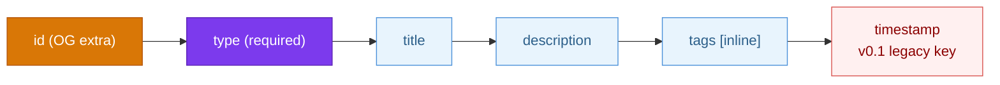
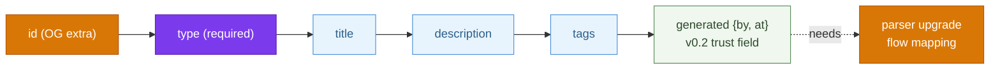
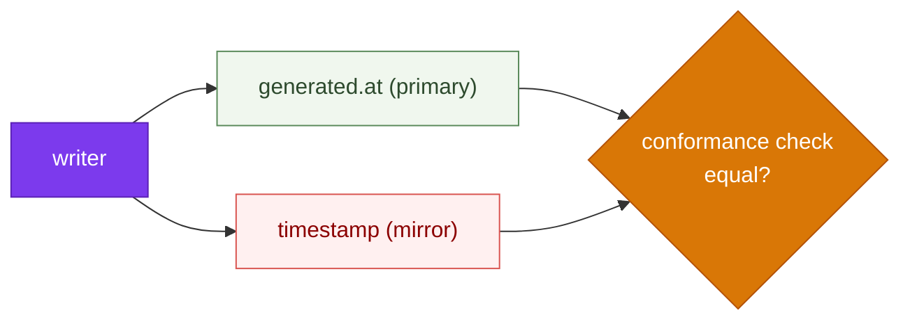
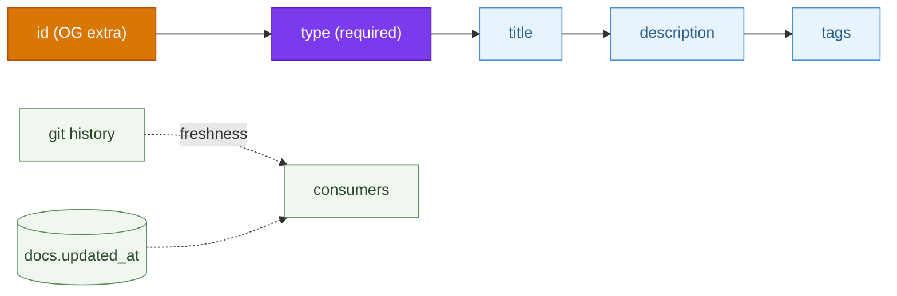
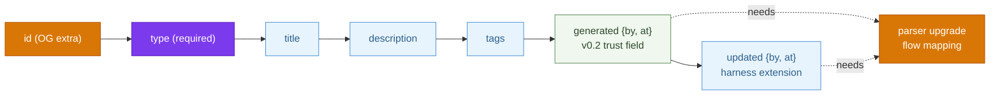

# DESIGN-20261117-7931: OKF-Compatible Knowledge Base — Research: Decision 1, Target frontmatter format

_Produced by the Research phase. Owned by `@product-architect`. Do not edit after Evaluate phase begins._

## Context

This research covers the new Decision 1 from `design/00 Frame.md`: the target frontmatter format. It settles which keys every doc carries in source, what each key means, and who writes it. It does not recommend an option.

The graph schema and migration questions now sit in `01 Research - Graph Schema and Migration.md`. This format decision narrows them (see the impact table at the end).

### Developer direction (2026-11-17)

Stay close to canonical OKF:

```
type: <Type name>                  # REQUIRED
title: <Optional display name>
description: <One-line summary, optional>  (ex purpose)
tags: [<tag>, <tag>, …] (ex keywords)
timestamp: <ISO 8601 datetime>
```

Developer direction at Research sign-off (2026-11-17): Option B plus an `updated: {by, at}` key. `generated` records creation; `updated` records the last meaningful update. `updated` is not an OKF key; OKF allows extra keys, so v0.2 consumers ignore it. Evaluate confirms the rest of the format against this direction.

### Developer answers already given

- OG may write frontmatter keys other than `id`.
- `patch apply` may rewrite consumer frontmatter through an explicit migration instruction: restructure frontmatter, migrate the DB, reindex.
- Stories are inside the OKF bundle(s).
- The source tree conforms in place.

### Grounding facts

Facts 1–9 of the earlier combined research still hold. They now live in `01 Research - Graph Schema and Migration.md`. New facts checked in this repo:

- **F1.** OG already reads `title`: `docs/.og/docs.mjs:116` sets `title = data.title ?? firstHeading(body)`. `02 Storage and Build Model.md` § Frontmatter format already lists `title` as optional. No real doc sets `title:` today (2 matches are examples in code fences).
- **F2.** `writeAdditiveId` puts `id` on the first line (`utils.mjs:70-71`). Another key order needs a code change.
- **F3.** OG imports Node built-ins only (`node:fs`, `node:path`, `node:sqlite`, `node:crypto`, `node:util`, `node:url`). Node has no YAML parser. A real parser means a new dependency in canonical OG or a hand-written YAML subset. No governance statement found that requires zero dependencies.
- **F4.** The line parser has two failure modes. A wrapped `[ ... ]` list reads as empty (36 files have a bare `keywords:` line). Nested block keys are lifted to the top level (in `docs/index.md`, `hero:` → `name:`/`text:` show up as top-level `name`/`text`). So a block mapping `generated:\n  by: …\n  at: …` adds stray top-level `by`/`at`. A flow mapping `{by: …, at: …}` is read as one raw string.
- **F5.** Prettier causes the wrapping: `.prettierrc.json` sets `printWidth: 100`. Flow lists longer than that get wrapped. Block lists (`- a`) are never rewrapped.
- **F6.** The DB already holds a time value: `docs.updated_at` = `new Date().toISOString()` on every `assign` (`docs.mjs:136,156`). It is index time in the DB, not edit time in files.
- **F7.** VitePress (`apps/web-docs/.vitepress/config.ts`) sets only site `title`/`description`, no `titleTemplate`/`lastUpdated`. Default: page `<title>` = frontmatter `title`, else first H1. The doc layout does not render frontmatter `title` as a visible H1. A `title` equal to the H1 changes nothing on screen. A different `title` changes only `<title>`. A per-doc `description` replaces the site-wide meta description.
- **F8.** Filename-derived titles collide: every LLD container has `00. Overview.md`. OKF falls back to a filename title, so docs without `title` get duplicate titles like "00. Overview".
- **F9.** Template frontmatter describes the template, not the doc. The 10 Story docs copied it verbatim (e.g. `[DEV-20261108-K7XQ]/impl/2-report.md` has `name: Dev Report Template`, a template description, `type: reference`). Their `description` is wrong for OKF, not just misnamed. Copying is inconsistent (this design's `00 Frame.md` has none). The template files (19 found under `canonical/skills/**` with `name:`/`type:`) live in `skills/`. That is harness config, out of OKF scope per the Frame, yet they feed Story docs.
- **F10.** OKF v0.2 groups `generated` with the trust fields. The Frame's Out of scope names `status`, `verified`, `stale_after`, not `generated`. Adopting it means stating that boundary explicitly.
- **F11.** Tier values today (`constants.mjs:56-62`): `HLD`, `LLD`, `EngineeringGuide`, `Product`, `Story`.

### Sub-points shared by all options

| Sub-point                                             | Variants                                                                                                                                                                                                                                                                                                                                                                                                                           |
| ----------------------------------------------------- | ---------------------------------------------------------------------------------------------------------------------------------------------------------------------------------------------------------------------------------------------------------------------------------------------------------------------------------------------------------------------------------------------------------------------------------- |
| S1 Time meaning and writer                            | (i) created-at, written once, never churns, weak freshness. (ii) last meaningful update, writer-owned, same rule as `purpose`/`keywords` today ("update when it no longer fits"); churns only with real edits. (iii) OG stamps the clock on every index: every reindex changes every file, non-deterministic. (iv) OG stamps the git commit date: stamping changes the file, the next commit changes the date — a loop.            |
| S2 `id` position                                      | (a) `id` first — matches today, no code (F2). (b) `type` first, `id` last — needs a `writeAdditiveId` change. OKF defines no key order.                                                                                                                                                                                                                                                                                            |
| S3 `title` source                                     | (a) Authored, must equal the H1 — duplicated, can drift, `<title>` unchanged. (b) Left out — OG falls back to H1 (F1), but OKF consumers get filename titles (F8). (c) Migration stamps it once from the H1, then the writer owns it.                                                                                                                                                                                              |
| S4 `type` vocabulary and source                       | Vocabulary: (a) tier names (F11); (b) descriptive per-kind values (`Container`, `Component Design`, `Guide`, `Principle`, `Design Frame`, `Implementation Plan`). Source: (1) OG derives it on every index and overwrites — always consistent, OG-owned; (2) OG stamps once when missing, then author-owned — a moved doc keeps a stale value; (3) for Story docs the template carries it (frame template → `type: Design Frame`). |
| S5 `tags` syntax                                      | (a) Inline flow list only `[a, b]` — `parseKeywords` reads it; needs a length cap or Prettier exemption (F5). (b) Block list (`- a`) — Prettier-stable, needs a parser upgrade (F3, F4). (c) Both via a YAML-subset parser.                                                                                                                                                                                                        |
| S6 Legacy `name:` / `type: reference` / `description` | Story docs: drop `name`, replace `type`, remove the template `description` (F9); a deterministic migration can only drop it, a writer fills it later. Templates: (a) template frontmatter becomes the target doc's skeleton; (b) templates keep their own meta and the skill strips it when copying.                                                                                                                               |
| S7 Extras                                             | `id` (OG). VitePress `layout`/`hero`/`features` on `docs/index.md` allowed by OKF extra keys; whether that file is a concept or a reserved `index.md` is the bundle-layout decision's call.                                                                                                                                                                                                                                        |

## Options

### Option A — The developer's list verbatim, plus `id`

**Description:** Keys `type` (required), `title`, `description`, `tags`, `timestamp`, and `id` as an OG extra key. `timestamp` is ISO 8601. OKF v0.2 treats it as a legacy key consumers MAY fall back to. Natural pairing: S1(ii), S2(a), S3(c), S4(b)+(2)/(3), S5(a).

```yaml
---
id: f84dc7bb
type: Container
title: Discuss Container
description: Design intent for the Discuss container — giscus comments widget with no infra of its own
tags: [discuss, giscus, github-discussions, hld]
timestamp: 2026-11-17T10:00:00Z
---
```

**Industry precedent:** OKF v0.1 `timestamp`; Hugo `date`/`lastmod`; Docusaurus `last_update`; schema.org `dateModified`.

**Diagram:**



**Pros:**

- Exactly the developer's direction.
- Flat keys only.
- Today's line parser reads every key except wrapped lists.
- `timestamp` is a single scalar, simple to write and check.

**Cons:**

- Writes a key v0.2 superseded while the bundle pins `okf_version: "0.2"` — inconsistent.
- Consumers read it only as a fallback ("MAY").
- No actor, so a consumer cannot tell a human edit from an agent edit.

**Unknowns / risks:**

- OKF may remove the legacy fallback later (it broke once between v0.1 and v0.2).
- If S1(iii) is chosen, every reindex churns diffs.

---

### Option B — v0.2-native: `generated: {by, at}` replaces `timestamp`

**Description:** Same as A, but the time key is `generated` with `by` (an actor per OKF: `<producer>/<version>`, `human:<id>`, `process:<id>`) and `at` (ISO 8601), written as a one-line flow mapping. Natural pairing: S1(ii) with `by` = the writing actor (e.g. `artisyn-harness/4.1.0` for `@docs-writer`), S2(a), S3(c), S4(b), S5(c).

```yaml
---
id: f84dc7bb
type: Container
title: Discuss Container
description: Design intent for the Discuss container — giscus comments widget with no infra of its own
tags: [discuss, giscus, github-discussions, hld]
generated: { by: artisyn-harness/4.1.0, at: 2026-11-17T10:00:00Z }
---
```

**Industry precedent:** OKF v0.2 §13; W3C PROV-O `wasGeneratedBy`/`generatedAtTime`; SLSA provenance `builder.id`; CycloneDX `metadata.tools` + `metadata.timestamp`.

**Diagram:**



**Pros:**

- Matches the pinned v0.2 exactly, no legacy key.
- Records who produced the doc (agent or human).
- Clear meaning: "produced by X at T".

**Cons:**

- Brings a trust-group field into scope. The Frame boundary must be amended (F10).
- Needs a parser upgrade for flow mappings. A block mapping breaks the current parser (F4). Both paths hit F3.
- The meaning of `at` for a doc edited many times is unclear (first generation or latest?).

**Unknowns / risks:**

- `human:<id>` goes onto a public site (NFR: no access gate) and may expose names or emails.
- Prettier may expand a long flow mapping into a block mapping (F5 → F4 failure).
- The actor version churns on every harness release if `by` carries a version.

---

### Option C — Both: `generated` primary, `timestamp` as a mirror

**Description:** Writers emit `generated: {by, at}` and `timestamp`, with `timestamp == generated.at`. v0.2 consumers read `generated`. Older or simpler consumers read `timestamp`. A deterministic conformance check fails when they differ. Natural pairing: as B.

```yaml
---
id: f84dc7bb
type: Container
title: Discuss Container
description: Design intent for the Discuss container — giscus comments widget with no infra of its own
tags: [discuss, giscus, github-discussions, hld]
generated: { by: artisyn-harness/4.1.0, at: 2026-11-17T10:00:00Z }
timestamp: 2026-11-17T10:00:00Z
---
```

**Industry precedent:** Expand/contract (parallel change, Fowler and Sato); Kubernetes deprecated-field windows; HTTP `Expires` alongside `Cache-Control`.

**Diagram:**



**Pros:**

- Works for v0.1-style and v0.2 consumers.
- OG can keep reading the flat `timestamp` with today's parser while it lacks a mapping parser.
- Dropping `timestamp` later is cheap (EC10).

**Cons:**

- Two values for one fact. Drift is possible unless the check enforces equality.
- Inherits B's cons (trust scope, parser, actor privacy).
- More frontmatter for every writer.

**Unknowns / risks:**

- Nothing triggers dropping the mirror, so it can become permanent.
- When values differ, a consumer may pick either.

---

### Option D — No time key in source (time from git and the DB)

**Description:** Keys `type` (required), `title`, `description`, `tags`, and `id`. No `timestamp` or `generated`. Freshness comes from git history and the DB's `updated_at` (F6). `generated` is left to the trust-field follow-up named in the Frame. Natural pairing: S2(a), S3(c), S4(b), S5(a) or (c).

```yaml
---
id: f84dc7bb
type: Container
title: Discuss Container
description: Design intent for the Discuss container — giscus comments widget with no infra of its own
tags: [discuss, giscus, github-discussions, hld]
---
```

**Industry precedent:** Hugo `enableGitInfo`; VitePress `lastUpdated`; Docusaurus `showLastUpdateTime` (all from git).

**Diagram:**



**Pros:**

- Every OKF key used is a current v0.2 key. Nothing deprecated, no trust field, Frame scope unchanged.
- No time churn in diffs, no writer burden, no privacy question.
- Smallest parser change (flat keys only).

**Cons:**

- Drops a key the developer listed.
- OKF consumers reading only the bundle (no git) see no freshness.
- DB `updated_at` is index time, a weak proxy.

**Unknowns / risks:**

- Whether consumers outside this repo ever get git history.
- The trust-field follow-up might never happen.

---

### Option B+ — v0.2-native with `updated` (developer direction)

**Description:** Same as B, plus `updated: { by: <actor>, at: <ISO 8601> }`. The writer writes `updated` on each meaningful update. `generated` is written once, at creation. `updated` is a harness extension; OKF allows extra keys.

```yaml
---
id: f84dc7bb
type: Container
title: Discuss Container
description: Design intent for the Discuss container — giscus comments widget with no infra of its own
tags: [discuss, giscus, github-discussions, hld]
generated: { by: artisyn-harness/4.1, at: 2026-11-02T09:00:00Z }
updated: { by: artisyn-harness/4.1, at: 2026-11-17T10:00:00Z }
---
```

**Industry precedent:** Hugo `date` + `lastmod`; schema.org `dateCreated` + `dateModified`; Docusaurus `last_update`.

**Diagram:**



**Pros:**

- v0.2-native creation provenance.
- A separate freshness signal without overloading `generated.at`.
- No legacy `timestamp`.

**Cons:**

- `updated` is a harness extension that OKF consumers do not interpret.
- Two mapping keys raise the parser stakes (flow mappings, F3/F4).
- Two values for writers to keep.

**Unknowns / risks:**

- Prettier may expand long flow mappings (F5).

---

## Cross-option notes

- In every option `type` is the only key OKF requires. The others are recommended or extra.
- Documentation Principles makes `purpose`/`keywords` mandatory for writers, while `02 Storage and Build Model.md` calls them optional. The format decision settles which wins for `description`/`tags`.
- `purpose` maps cleanly to `description` (one line, what the doc is for = OKF's "one sentence").
- A fallback type for unmatched paths (e.g. `Reference`) is needed wherever OG derives `type`.

## Impact on the narrowed "Graph schema and migration" decision

| Old option                                       | Verdict                | Why                                                                                                                                                                                                                                                                                                                     |
| ------------------------------------------------ | ---------------------- | ----------------------------------------------------------------------------------------------------------------------------------------------------------------------------------------------------------------------------------------------------------------------------------------------------------------------- |
| 1 Keep OG keys + type copy                       | Disqualified           | Source keys are now OKF names; the type vocabulary is settled in the format decision, not copied from the tier.                                                                                                                                                                                                         |
| 2 Rename in place with versioned DB migration    | Still viable, narrowed | File keys are fixed by the format decision. Remaining: column rename/add under `user_version` 0→1, the Compatibility rule amendment, atomic file + DB migration through `patch apply`.                                                                                                                                  |
| 3 Dual-key transition with internal column names | Re-scoped              | Dual reading of file keys conflicts with "source conforms in place" plus the allowed rewrite. Two parts survive: internal column names (`purpose`/`keywords` columns fed by `description`/`tags`), and a short read-compat window so a consumer stays safe between the OG upgrade and the migration (EC10 idempotency). |
| 4 Two-level type from path map                   | Re-scoped              | Type vocabulary, path map and ownership move to the format decision. Schema keeps `tier` for the Graph Explorer plus an additive `type` column.                                                                                                                                                                         |
| 5 Keep source + map at boundary                  | Disqualified           | The developer requires OKF names in source, in place.                                                                                                                                                                                                                                                                   |

New item for the schema decision: whether the DB stores the time key (`timestamp`/`generated.at`) alongside or instead of `updated_at`. It is moot under Option D.

## Open Questions

V = needs a developer value call. E = can be settled with evidence in Evaluate.

| #     | Question                                                                                                    | V/E          | Proposed resolution / status                                                                                                                                                                                                                                                                                                                                                                                                     |
| ----- | ----------------------------------------------------------------------------------------------------------- | ------------ | -------------------------------------------------------------------------------------------------------------------------------------------------------------------------------------------------------------------------------------------------------------------------------------------------------------------------------------------------------------------------------------------------------------------------------- |
| FQ-1  | Bring `generated` (an OKF trust field) into scope by amending the Frame boundary?                           | V            | Resolved (developer, 2026-11-17): yes — `generated` is in scope; the Frame boundary is amended.                                                                                                                                                                                                                                                                                                                                  |
| FQ-2  | Is a v0.1 legacy key (`timestamp`) acceptable next to a `0.2` pin?                                          | V            | Resolved (developer, 2026-11-17): no `timestamp`; v0.2-native keys only, plus the `updated` extension.                                                                                                                                                                                                                                                                                                                           |
| FQ-3  | What does the time value mean: created, last meaningful update, or nothing in source?                       | V            | Resolved (developer, 2026-11-17): `generated.at` = creation; `updated.at` = last meaningful update.                                                                                                                                                                                                                                                                                                                              |
| FQ-4  | Who writes the time value: the writer, OG from the clock, or OG from git?                                   | V            | Proposed — the writer (`@docs-writer` / lifecycle publish/document steps) writes it. OG never stamps time (S1 iii churns every reindex, S1 iv loops). The one-time migration seeds it from each file's last git commit date. Applies to `updated`; `generated` is written once at creation (by the template/writer, or by the migration from the file's first git commit date). Status: proposed — confirm at Research sign-off. |
| FQ-5  | Which actor values for `generated.by`, given the site is public?                                            | V            | Proposed — if `generated` is chosen, `by` uses process/producer actors only (`artisyn-harness/<major.minor>` or `process:<lifecycle>`), never `human:<id>`, because the site is public. Status: proposed — confirm at Research sign-off.                                                                                                                                                                                         |
| FQ-6  | `type` vocabulary: tier names or descriptive per-kind values?                                               | V            | Proposed — descriptive per-kind values (S4 b), with a tier-level fallback per bundle. Evaluate fixes the exact list. Status: proposed — confirm at Research sign-off.                                                                                                                                                                                                                                                            |
| FQ-7  | `type` ownership: OG always derives, OG stamps once then author owns, or template carries it for Stories?   | V            | Proposed — OG may stamp `type` (developer answer, 2026-11-17). Templates carry it for Story docs. OG stamps once when missing, from a canonical path map; then the author owns it. Evaluate confirms. Status: proposed — confirm at Research sign-off.                                                                                                                                                                           |
| FQ-8  | Type path map in canonical OG or project config; how do consumers extend it?                                | E            | Deferred to Evaluate.                                                                                                                                                                                                                                                                                                                                                                                                            |
| FQ-9  | `title`: authored, left out, or stamped once from the H1?                                                   | E            | Deferred to Evaluate.                                                                                                                                                                                                                                                                                                                                                                                                            |
| FQ-10 | `tags` syntax: inline only with a cap, block list, or both via a YAML-subset parser, given no dependencies? | E            | Deferred to Evaluate. Also fixes the live empty-`keywords` defect.                                                                                                                                                                                                                                                                                                                                                               |
| FQ-11 | Does Prettier format frontmatter under `docs/`, given `.prettierignore` exists?                             | E → verified | Yes. `.prettierignore` does not exclude `docs/`, so Prettier (printWidth 100) formats frontmatter there. Inline-only lists need a cap or a block-list-capable parser.                                                                                                                                                                                                                                                            |
| FQ-12 | Templates: frontmatter becomes the target doc's skeleton, or the skill strips it on copy?                   | E            | Deferred to Evaluate.                                                                                                                                                                                                                                                                                                                                                                                                            |
| FQ-13 | The 10 Story docs' template `description`: drop or re-author?                                               | E            | Deferred to Evaluate.                                                                                                                                                                                                                                                                                                                                                                                                            |
| FQ-14 | Key order: `id` first or `type` first?                                                                      | E            | Deferred to Evaluate.                                                                                                                                                                                                                                                                                                                                                                                                            |
| FQ-15 | Should the harness require `description`/`tags` (stricter than OKF) for graph search?                       | V            | Proposed — yes. The harness requires `description` and `tags` for every concept doc (stricter than OKF), keeping today's Principles rule. `02 Storage and Build Model.md` is aligned to it. Status: proposed — confirm at Research sign-off.                                                                                                                                                                                     |
| FQ-16 | VitePress `layout`/`hero` on `docs/index.md` as allowed extras?                                             | E            | Deferred to Evaluate. Depends on the bundle-layout ruling on `index.md`.                                                                                                                                                                                                                                                                                                                                                         |
| FQ-17 | Does OG store `generated.at`/`updated.at` in the DB (alongside or instead of `updated_at`)?                 | E            | Deferred to Evaluate (Decision 2).                                                                                                                                                                                                                                                                                                                                                                                               |
