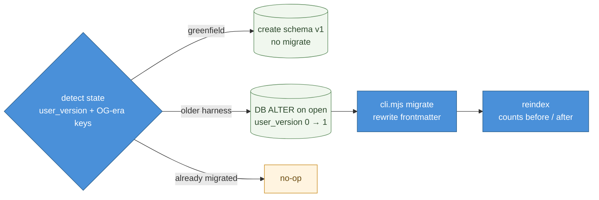
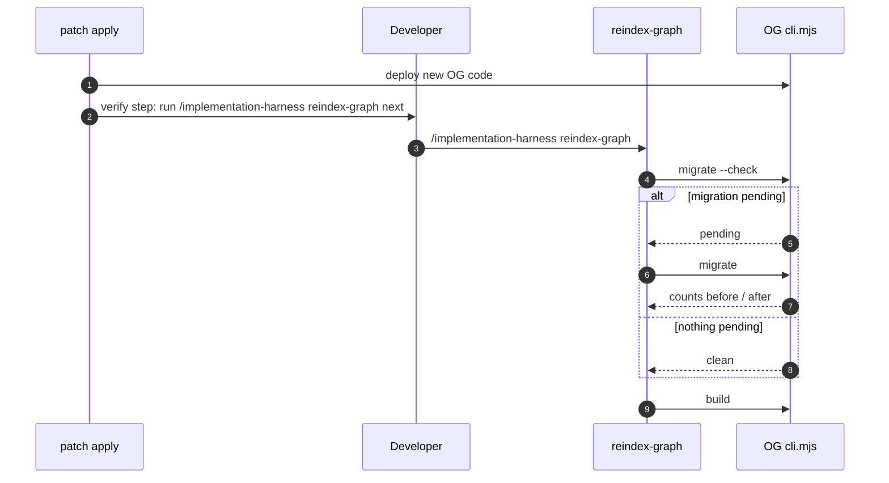

# DESIGN-20261117-7931: OKF-Compatible Knowledge Base — Evaluate: Decision 2, Graph schema and migration

_Produced by the 🏗 Evaluate phase. Options come from `01 Research - Graph Schema and Migration.md`. The WAF summary below is repeated in `design/Report.md`._

**Recommendation:** Option 2 (rename in place under `PRAGMA user_version`), with Option 4r's column set and Option 3r's read-compat window.

**Step 1b outcome (all decisions):** Assumption #18 proposed. The DB migrates inside OG on open via `PRAGMA user_version`. A deterministic `cli.mjs migrate` rewrites frontmatter and detects pending work by OG-era keys. `reindex-graph` runs it before `build`. OG reads both key names until a project is migrated. Greenfield starts at v1. An already migrated project is a no-op. Launch writes the Product folder from Q10c to an OG config file. Assumption #19 (Decision 3) is recorded in its own Evaluate file.

## Options after the split

| Option                                 | Status           | Scope in this evaluation                                |
| -------------------------------------- | ---------------- | ------------------------------------------------------- |
| 1 Keep OG keys                         | Disqualified     | Contradicts Decision 1 key names                        |
| 2 Rename in place + `user_version`     | Viable, narrowed | Column rename/add, Compatibility rule amendment         |
| 3r Internal column names + read-compat | Re-scoped        | Internal column names; short read-compat window         |
| 4r `tier` + additive `type`            | Re-scoped        | Keep `tier` for the Graph Explorer; add a `type` column |
| 5 Map at boundary                      | Disqualified     | Developer requires OKF names in source                  |

## Requirements × Options Matrix

✅ satisfies · ⚠️ partially (see note) · ❌ does not satisfy

| Criterion                                           | 1 keep OG keys | 2 rename in place + user_version | 3r internal column names + read-compat | 4r tier + additive type      | 5 map at boundary |
| --------------------------------------------------- | -------------- | -------------------------------- | -------------------------------------- | ---------------------------- | ----------------- |
| Follows Decision 1 key names in source              | ❌             | ✅                               | ✅                                     | ✅                           | ❌                |
| Columns match file keys (no mapping to explain)     | n/a            | ✅                               | ❌                                     | ✅ additive                  | n/a               |
| EC6 single query layer; Graph Explorer keeps `tier` | ✅             | ✅ keeps `tier`                  | ✅                                     | ✅                           | ✅                |
| EC7 authored edges survive migration                | ✅             | ✅ ALTER keeps rows              | ✅                                     | ✅                           | ✅                |
| EC10 three migration cases, idempotent              | ⚠️             | ✅ with `user_version`           | ⚠️                                     | ⚠️ alone it migrates nothing | n/a               |
| Safe for a CI build mid-migration                   | ✅             | ⚠️ needs read-compat             | ✅                                     | ✅                           | ✅                |
| Compatibility rule                                  | kept           | amended (developer OK)           | kept                                   | kept                         | kept              |

## Tradeoffs

| Dimension              | 1                         | 2                              | 3r                         | 4r  | 5                         |
| ---------------------- | ------------------------- | ------------------------------ | -------------------------- | --- | ------------------------- |
| Operational Excellence | ✅                        | ✅ versioned                   | ⚠️ permanent name mismatch | ✅  | ⚠️ two shapes             |
| Security               | ✅                        | ✅                             | ✅                         | ✅  | ✅                        |
| Reliability            | ✅                        | ⚠️ atomic file + DB order      | ✅                         | ✅  | ✅                        |
| Performance Efficiency | ✅                        | ✅                             | ✅                         | ✅  | ✅                        |
| Cost Optimization      | ✅                        | ✅                             | ✅                         | ✅  | ⚠️                        |
| Sustainability         | ✅                        | ✅                             | ✅                         | ✅  | ✅                        |
| Integration Complexity | ❌ contradicts Decision 1 | ⚠️ CLI flags and skills rename | ✅                         | ✅  | ❌ contradicts Decision 1 |
| Vendor Lock-in         | ✅                        | ✅                             | ✅                         | ✅  | ✅                        |

## Recommendation

**Recommended option: Option 2 — Rename in place under `PRAGMA user_version`, with 4r's column set and 3r's read-compat window**

### Migration cases

OG detects the project state and takes exactly one path.

| Case             | Signal                                                               | Action                                                               |
| ---------------- | -------------------------------------------------------------------- | -------------------------------------------------------------------- |
| Greenfield       | No DB, no OG-era keys                                                | OG creates schema v1 directly. `migrate` has nothing to do.          |
| Older harness    | `user_version = 0`; `purpose:`/`keywords:` present or `type` missing | OG runs ALTER on open. `migrate` rewrites frontmatter. Then reindex. |
| Already migrated | `user_version = 1`; no OG-era keys; `type` present                   | No-op. Running again changes nothing.                                |

### Schema v1

`PRAGMA user_version = 1`. The `docs` table has these columns.

| Column        | Source                    | v0 → v1 change                          |
| ------------- | ------------------------- | --------------------------------------- |
| `id`          | frontmatter `id`          | unchanged                               |
| `tier`        | path prefix               | unchanged; the Graph Explorer reads it  |
| `type`        | frontmatter `type`        | `ADD COLUMN`                            |
| `path`        | file path                 | unchanged                               |
| `title`       | frontmatter `title`       | unchanged                               |
| `description` | frontmatter `description` | `RENAME COLUMN purpose → description`   |
| `tags`        | frontmatter `tags`        | `RENAME COLUMN keywords → tags`         |
| `created_at`  | `generated.at`            | `ADD COLUMN`                            |
| `modified_at` | `updated.at`              | `ADD COLUMN`                            |
| `indexed_at`  | OG reindex time           | `RENAME COLUMN updated_at → indexed_at` |

- OG runs the v0 → v1 migration on open, in one transaction.
- The `edges` table is untouched.
- Node 24 `node:sqlite` bundles SQLite 3.53. It supports every statement above.

### `migrate` command

`cli.mjs migrate --dir <root> [--check|--dry-run]` is deterministic and idempotent.

| Step    | What it does                                                             |
| ------- | ------------------------------------------------------------------------ |
| Detect  | Finds OG-era keys (`purpose:`, `keywords:`) or a missing `type` in scope |
| Rewrite | Moves keys to the Decision 1 format                                      |
| Stamp   | Writes `type`, `title`, `generated`, `updated`                           |
| Move    | Applies Decision 3's index-page `id` moves                               |
| Clean   | Applies Decision 4's stray-`id` cleanup                                  |
| Verify  | Reindexes and prints node and edge counts before and after               |

### Trigger

`reindex-graph` is the one trigger point. `patch apply` cannot run new recipes mid-apply, so it hands off to the developer.

Launch runs `reindex-graph` as part of its own flow.

### Read-compat window

- `build` and `reindex` read `description ?? purpose` and `tags ?? keywords` until a project is migrated.
- A CI docs build between the OG upgrade and the migration loses no data.
- The window is removed in the next major harness release.

### CLI and skill contract

| Surface                  | Change                                           |
| ------------------------ | ------------------------------------------------ |
| `cli.mjs list`           | `--missing description,tags`                     |
| `reindex-graph.md`       | Steps 2–2b use the new names                     |
| Documentation Principles | Operational graph frontmatter uses the new names |
| `@docs-writer`           | Uses the new names                               |

### `og.config.json`

- Launch writes the Q10c answer to `docs/.og/og.config.json`, e.g. `{"productDir": "docs/<name>"}`.
- OG reads it to build `TIER_PATH_PREFIXES`. The OG code stays byte-identical across projects.
- No config means no Product tier. This fits a greenfield project without a product context.

### Compatibility rule amendment

The rule in `02 Storage and Build Model.md` becomes: "Schema changes are versioned with `PRAGMA user_version` and migrated in place by OG on open. Authored edges are always preserved."

### Seed DB

The canonical seed `docs-operational-graph.sqlite` in the package is regenerated at v1.

### Why, and disqualifiers

| Option | Verdict          | Reason                                                                                                               |
| ------ | ---------------- | -------------------------------------------------------------------------------------------------------------------- |
| 2      | Chosen base      | Only option where file keys, columns and CLI names match. `user_version` gives clean three-case detection.           |
| 4r     | Folded in        | Additive `type` next to `tier` keeps the Graph Explorer working.                                                     |
| 3r     | Partly folded in | Internal column names rejected: a permanent mismatch. Its read-compat window closes Option 2's only reliability gap. |
| 1      | Disqualified     | Contradicts Decision 1 key names.                                                                                    |
| 5      | Disqualified     | Contradicts Decision 1; source must carry OKF names in place.                                                        |

**Falsifiability:** if a consumer pins old OG code against a v1 DB, the read path fails. OG ships as one unit per patch, so this does not occur through the supported path.

**Open questions to resolve before implementation:**

| #    | Question                                               | Owner                  | Impact if unresolved                              |
| ---- | ------------------------------------------------------ | ---------------------- | ------------------------------------------------- |
| OQ-1 | Must `migrate` refuse a dirty git worktree?            | dev                    | Rollback path unclear; blocks the P2 precondition |
| OQ-2 | Exact `og.config.json` shape and the launch write step | dev (launch reference) | Product tier not set in consuming projects        |
| OQ-3 | Confirm the Graph Explorer query stays unchanged       | dev                    | Graph Explorer regression                         |

## WAF (Option 2 + 4r + 3r window)

| Pillar                 | Rating | Headline                                                                                        |
| ---------------------- | ------ | ----------------------------------------------------------------------------------------------- |
| Operational Excellence | 🟢     | Self-detecting, idempotent migration; one trigger point (`reindex-graph`); counts diff printed. |
| Security               | 🟢     | Local files and SQLite only; no new access paths.                                               |
| Reliability            | 🟡     | Rewriting every doc's frontmatter in one pass is a large change.                                |
| Performance Efficiency | 🟢     | In-place ALTER; reindex cost unchanged.                                                         |
| Cost Optimization      | 🟢     | No new tooling.                                                                                 |
| Sustainability         | 🟢     | No duplicated stores.                                                                           |

| Priority | Action                                                                          |
| -------- | ------------------------------------------------------------------------------- |
| P1       | None                                                                            |
| P2       | `--dry-run` summary and a clean-worktree precondition, so `git` is the rollback |
| P3       | Drop the read-compat window at the next major release                           |

## Cross-decision consistency

| Link                                                                                                                                              | Status |
| ------------------------------------------------------------------------------------------------------------------------------------------------- | ------ |
| Decision 3 keeps `index.md` in source as navigation; Decision 4 keeps it out of the graph, and OG never writes it                                 | ✅     |
| Decision 1's `type` fallback = Decision 3's bundle tier = OG tier                                                                                 | ✅     |
| Decision 2's `migrate` carries Decision 1's rewrite, Decision 3's index-page `id` move and Decision 4's stray-`id` cleanup in one idempotent pass | ✅     |
| Decision 2's `og.config.json` supplies Decision 3's Product bundle root and the Product tier for Decisions 1 and 4                                | ✅     |

One fix sits outside the four decisions and is already in Frame scope: the Product folder is set at launch.
